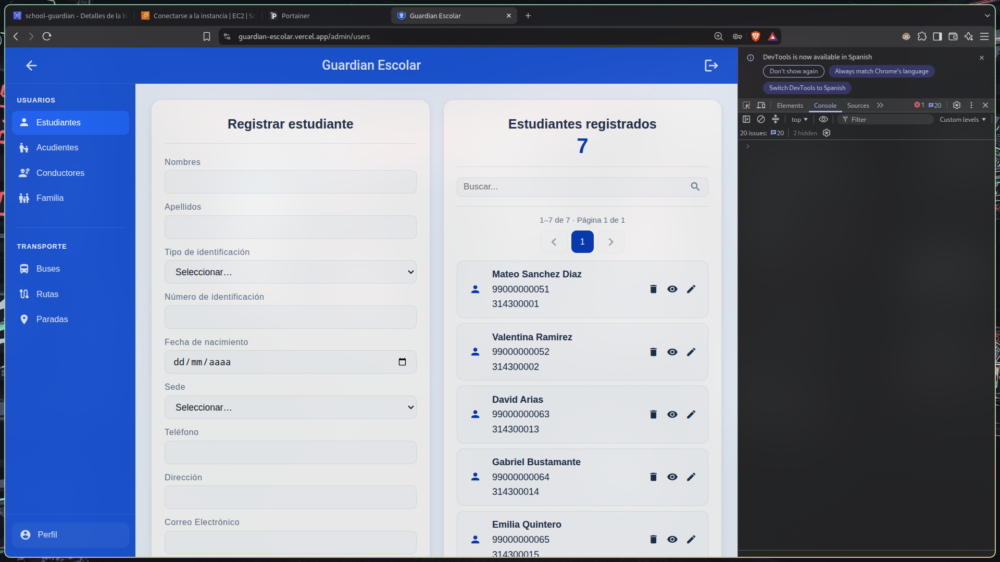
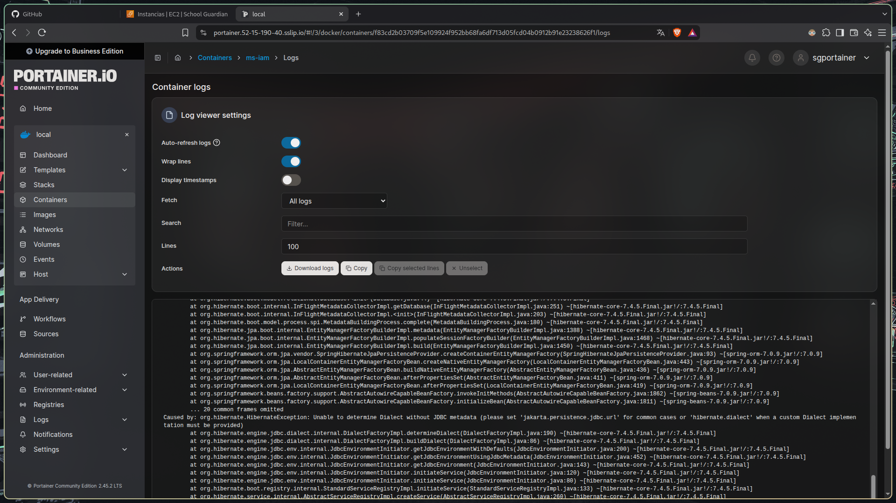
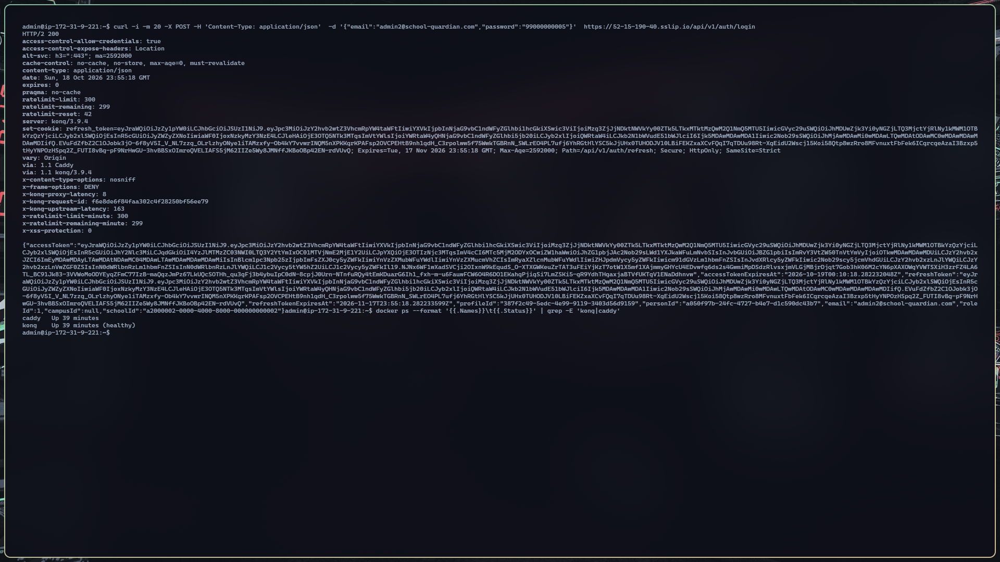
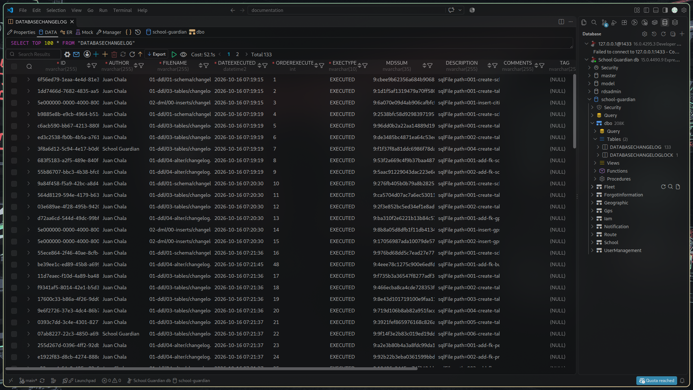

**Procedimiento de Implementación del Software**

Guardian Escolar

Software para la creación de la aplicación "Guardian Escolar"

Johan Smith Santamaria Fernández  
Sharik Dayanna Rojas Ibarra  
Juan Pablo Chala Ramírez

SENA — Servicio Nacional de Aprendizaje  
Ficha de programación 3145556  
Centro de formación de Neiva (Huila)

Neiva, 6 de octubre de 2026

# Procedimiento de implementación de Guardian Escolar

**Documento operativo**

| Dato de control | Información |
|---|---|
| Software | Guardian Escolar |
| Versión | Repositorios locales disponibles al 13 de octubre de 2026; no se identificó un tag único de release |
| Fecha | 13 de octubre de 2026 (actualizado el 4 de noviembre de 2026 con la verificación del entorno desplegado) |
| Responsables | Johan Smith Santamaria Fernández, Sharik Dayanna Rojas Ibarra y Juan Pablo Chala Ramírez |
| Objetivo | Preparar, ejecutar y verificar el entorno de desarrollo local |

> **Advertencia.** Este documento cubre el entorno de desarrollo y el ambiente desplegado en AWS EC2. Los secretos se configuran en archivos `.env` locales ignorados por Git; nunca se deben copiar a este documento, a capturas, al historial de Git ni a mensajes de error. La arquitectura, los requisitos y el estado funcional se detallan en el [Diseño de software de Guardian Escolar](../04-software-design/software-design.md); aquí se documentan los pasos de ejecución para no duplicar esa descripción.

> **Convención de rutas.** Las rutas de código se expresan relativas a la raíz del proyecto (`school-guardian/`), que contiene `backend/`, `database/` y `docs/`.


## Información general

El repositorio de trabajo está organizado en carpetas separadas para frontend, gateway, microservicios, base de datos e infraestructura. Cada `docker-compose.yml` debe ejecutarse desde la carpeta que lo contiene, porque usa rutas relativas para el contexto de build, `Dockerfile`, volúmenes y `.env`.

No se encontró un commit/tag común que identifique una versión instalable de todos los componentes. Para una entrega formal, anotar el hash o tag de cada repositorio usado y evitar mezclar ramas incompatibles.

## Requisitos previos

### Software

- Windows 10/11 con Docker Desktop y motor Linux funcionando; WSL2 se documenta como entorno de desarrollo.
- Docker Engine y Docker Compose V2 (`docker compose`).
- Git y acceso a los repositorios.
- .NET SDK 10 para compilar/probar servicios ASP.NET Core.
- JDK 21 para el servicio IAM Java.
- Node.js 20 y npm 10 para frontend web y móvil; la imagen del frontend web usa Node 20.
- Dispositivo Android o emulador compatible con Expo para verificar la aplicación móvil. Para geolocalización, conceder permisos explícitos y usar datos de prueba.
- Conectividad a Internet para obtener imágenes y paquetes durante la primera instalación y para acceder a SMTP/Twilio cuando se validen esas integraciones.

Las versiones de Angular 21, Expo 57, React Native 0.86, SQL Server 2022, Kafka 4.1.0, Kong 3.9 y Liquibase 4.29 corresponden a versiones/configuraciones observadas en manifiestos o Compose. Antes de actualizar una dependencia, revisar compatibilidad en el repositorio del componente.

### Hardware

No hay evidencia de una especificación mínima certificada ni de una prueba de carga que permita fijarla. Se recomienda disponer de memoria y almacenamiento suficientes para Docker Desktop, SQL Server, Kafka, el gateway y los proyectos Java/.NET, además de reservar disco para el volumen persistente de la base de datos. Registrar la configuración usada durante las pruebas del equipo.

## Obtención del código fuente

La carpeta de trabajo actual contiene los proyectos en directorios independientes. Clonar cada repositorio en una estructura equivalente y mantener rutas y nombres de carpetas coherentes con los ejemplos siguientes. No se debe asumir que `GuardianEscolar` es la raíz Git de todos los servicios.

```text
Proyecto\
├── database\
├── kafka\
├── sg-ms-api-gateway\
├── sg-ms-iam\
├── sg-ms-user-management\
├── sg-ms-school-management\
├── sg-ms-fleet\
├── sg-ms-route\
├── sg-ms-notification\
├── sg-ms-forgot-information\
└── GuardianEscolar\
    └── dvlp-front\
        ├── dvlp-web\
        └── dvlp-movil\guardian-escolar
```

En cada repositorio, usar la rama/tag acordada por el equipo. Antes de desplegar, comparar la revisión del gateway con los paths de cada servicio y comprobar que comparten los contratos API esperados.

Las rutas absolutas de los comandos de este procedimiento corresponden a la estación donde se preparó el documento. En otra máquina, se deben reemplazar por la ubicación local de `Proyecto`.

## Configuración del entorno

### Archivos `.env`

1. En cada componente que provea `.env.example`, copiarlo al archivo `.env` de esa misma carpeta. Hay plantillas en IAM (`backend/ms-iam/.env.example`), usuarios (`backend/ms-user-management/.env.example`), colegios (`backend/ms-school-management/.env.example`), flota (`backend/ms-fleet/.env.example`), rutas (`backend/ms-route/.env.example`), notificaciones (`backend/ms-notification/.env.example`), recuperación (`backend/sg-ms-forgot-information/.env.example`) y `dvlp-front/dvlp-movil/guardian-escolar/.env.example` (repositorio del cliente móvil). En este checkout no hay `.env.example` para la base de datos: prepara el archivo local según las variables descritas en el paso 4.
   Desde el directorio del componente, crear el archivo sin sobrescribir una configuración existente:

   ```powershell
   if (-not (Test-Path .env)) { Copy-Item .env.example .env }
   ```
2. Completar localmente los valores requeridos con datos de desarrollo. No colocar secretos reales en un `.env.example`.
3. Comprobar los nombres de variables contra el Compose y el README del componente. Compose interpolará `.env` desde el directorio del proyecto de Compose.
4. Para la base de datos, configurar `MSSQL_DATABASE`, `MSSQL_USER` y `MSSQL_SA_PASSWORD`, además de `SCHOOL_GUARDIAN_DB_DIR` solo si los changelogs no están en la ruta predeterminada. El usuario definido en `MSSQL_USER` debe ser un principal SQL Server existente con permisos de migración. El Compose crea la base con `sa`, pero Liquibase intenta autenticarse con `MSSQL_USER`; no se debe asumir que un usuario llamado `user` existe automáticamente.
5. Para IAM, usuarios, escuelas, flota, rutas y notificaciones, configurar la conexión compartida SQL Server y los valores de mensajería/autenticación requeridos por sus `.env.example`.
6. Para recuperación, completar cadena `ConnectionStrings__DefaultConnection`, `INTERNAL_API_KEY`, `OTP_HASH_PEPPER`, variables SMTP y, solo si se probará cambio de teléfono, credenciales Twilio.
7. Para frontend web, revisar `API_URL` y `API_FORGOT_INFORMATION_URL`.
8. Para Expo, revisar `EXPO_PUBLIC_API_URL` y `EXPO_PUBLIC_FORGOT_INFORMATION_API_URL`. Son URLs que quedan accesibles en el bundle cliente; no se deben usar para secretos.

No publicar valores de conexión, contraseñas, JWT secrets, API keys, OTP pepper, contraseñas SMTP ni credenciales Twilio. Para un dispositivo físico, `localhost` apunta al propio teléfono: la API debe apuntar a una dirección accesible desde el móvil, como la IP privada del computador en la misma red o un túnel HTTPS activo. La IP privada puede cambiar al reconectar la red.

## Preparación de la base de datos

La configuración inspeccionada usa **Microsoft SQL Server 2022**, no PostgreSQL. Los esquemas y migraciones están bajo `database/docker-compose.yaml`; Liquibase aplica los changelogs por dominio.

1. Verificar que el archivo `.env` exista en `database` y contenga los valores requeridos, sin imprimirlos en terminales compartidos.
2. Asegurarse de que existe la red Docker externa. Si aún no está creada:

   ```powershell
   docker network inspect sg-services-network
   # Si el comando confirma que no existe:
   docker network create sg-services-network
   ```

3. Iniciar SQL Server y los servicios de inicialización/migración desde la carpeta `database`:

   ```powershell
   Set-Location C:\Users\Admin\Desktop\Proyecto\database
   docker compose up -d
   ```

4. Comprobar primero el estado del contenedor SQL Server y luego los logs de `liquibase-*`. No iniciar las APIs si alguna migración necesaria terminó con error.

   ```powershell
   docker ps -a
   docker logs --tail 100 school-guardian-db-dev
   docker logs --tail 100 liquibase-iam
   ```

5. Mantener el volumen `school-guardian-sqlserver-data` si se requiere conservar la base local. No eliminar volúmenes como método rutinario de solución de problemas; esa acción puede borrar datos.

El Compose de base de datos define dependencias entre migraciones. Si un changeset falla, revisar primero el error específico y la tabla de historial de Liquibase. No editar un changeset ya aplicado en un entorno compartido sin una migración correctiva revisada.

## Instalación y configuración del backend

### Gateway y servicios

Los servicios se comunican por nombre de contenedor sobre `sg-services-network`; para tráfico interno usan normalmente el puerto 8080. La entrada HTTP del gateway se publica en el puerto 8000. Para cada servicio, abrir PowerShell y ejecutar desde el directorio correspondiente:

```powershell
Set-Location C:\Users\Admin\Desktop\Proyecto\sg-ms-iam
docker compose up -d --build
```

Repetir desde `sg-ms-user-management`, `sg-ms-school-management`, `sg-ms-fleet`, `sg-ms-route` y `sg-ms-notification`, siempre después de confirmar que SQL Server y sus migraciones están listos. Iniciar `sg-ms-forgot-information` después de IAM, ya que utiliza sus endpoints internos.

```powershell
Set-Location C:\Users\Admin\Desktop\Proyecto\sg-ms-forgot-information
docker compose up -d --build
```

Kafka se inicia desde su propio repositorio si el flujo del componente requiere eventos:

```powershell
Set-Location C:\Users\Admin\Desktop\Proyecto\kafka
docker compose up -d
```

El gateway se inicia desde `sg-ms-api-gateway` después de que los upstreams necesarios tengan nombre DNS en la red:

```powershell
Set-Location C:\Users\Admin\Desktop\Proyecto\sg-ms-api-gateway
docker compose up -d
```

Si un servicio no tiene `.env.example` o el Compose no incluye una publicación fija de puerto host, no inventar valores: consultar el README y el Compose de ese servicio. Varios Compose publican `8080` como puerto interno dinámico/no fijado al host; las APIs se consumen por Kong o por el DNS interno, no por un puerto aleatorio.

### Recuperación de contraseña

IAM y recuperación deben apuntar a la misma base SQL de desarrollo. El valor local de `INTERNAL_API_KEY` debe ser idéntico en ambos servicios; IAM expone sus rutas `/api/profiles/**` solo como endpoints internos. Para probar envío de correo se necesita un servidor SMTP y una cuenta autorizada. El cambio de teléfono requiere Twilio Verify configurado. Sin esas dependencias, limitar la verificación a pruebas que no envíen mensajes ni modifiquen datos reales.

### Perfiles y observabilidad de inicio

Usar estos comandos sin mostrar variables de entorno:

```powershell
docker compose ps
docker logs --tail 100 ms-iam
docker logs --tail 100 ms-user-management
docker logs --tail 100 ms-school-management
docker logs --tail 100 ms-fleet
docker logs --tail 100 ms-route
docker logs --tail 100 ms-notification
docker logs --tail 100 ms-forgot-information
docker logs --tail 100 kong
```

Nombres concretos de contenedores pueden cambiar según la versión del Compose. Si `docker logs` indica que un contenedor no existe, confirmar el nombre con `docker ps -a`.

## Instalación del frontend web

El frontend se encuentra en `GuardianEscolar/dvlp-front/dvlp-web`. Su `package.json` declara npm, Angular 21 y scripts `start`, `build` y `test`.

```powershell
Set-Location C:\Users\Admin\Desktop\Proyecto\GuardianEscolar\dvlp-front\dvlp-web
npm ci
npm start
```

Configurar `API_URL` para la URL base del gateway y `API_FORGOT_INFORMATION_URL` para el servicio de recuperación si se expone directamente. Para compilar y ejecutar pruebas:

```powershell
npm run build
npm test -- --watch=false
```

El Compose de `GuardianEscolar` publica la web de desarrollo en el puerto 4200. El Dockerfile de producción compila la aplicación Angular estática y la sirve con Nginx; para una imagen coherente con un ambiente concreto, configurar la API antes de construirla y comprobar qué valores quedan incluidos en el bundle.

## Instalación de la aplicación móvil

El proyecto móvil está en el repositorio del cliente, bajo la ruta `dvlp-front/dvlp-movil/guardian-escolar`.

```powershell
Set-Location C:\Users\Admin\Desktop\Proyecto\GuardianEscolar\dvlp-front\dvlp-movil\guardian-escolar
npm ci
npm start
```

Expo carga `EXPO_PUBLIC_*` al preparar el bundle; después de modificar las URLs se debe recargar la app. En desarrollo dentro de la misma Wi-Fi, establecer ambas URLs con el host/IP que el teléfono pueda alcanzar y comprobar que el firewall de Windows permite los puertos necesarios. No usar `localhost` en un dispositivo físico.

El proyecto ofrece scripts `start:lan`, `android`, `ios` y `web`. En Windows, iOS requiere herramientas de Apple no disponibles de forma nativa. El script `scripts/sync-api-tunnels.mjs` del proyecto móvil puede sincronizar y probar URLs Cloudflare cuando el `.env` ya tiene URLs de túnel; los Quick Tunnels generan URLs temporales y no constituyen un endpoint estable.

## Orden de inicio y puertos

### Orden recomendado

1. Docker Desktop y red `sg-services-network`.
2. SQL Server y migraciones Liquibase.
3. Kafka, cuando los servicios que se van a validar lo requieran.
4. IAM y servicios backend requeridos por la prueba.
5. Servicio de recuperación, después de IAM, si se probará ese flujo.
6. Kong API Gateway.
7. Frontend web, aplicación Expo y, por último, pruebas en dispositivo.

La disponibilidad del contenedor no garantiza la disponibilidad de sus dependencias; confirmar logs y endpoints antes de cada paso de integración.

### Puertos conocidos

| Puerto host | Componente | Uso/notas |
|---|---|---|
| 4200 | Frontend web de desarrollo | Publicado por Compose de `GuardianEscolar`. |
| 8000 | Kong proxy HTTP | URL base del gateway en desarrollo. |
| 8001, 8002 | API Admin/UI de Kong | Puertos de administración publicados por Compose; mantener solo en desarrollo y no exponer a redes no confiables. |
| 8080 | APIs backend dentro de la red Docker | Varios Compose no fijan un puerto host para cada API. |
| 8091 | Servicio de recuperación | Publicación `8091:8080` en su Compose. |
| 9092 | Kafka | Publicado por el Compose del broker; su listener está configurado para la red Docker. |
| 1433 | SQL Server | Publicado localmente para administración/pruebas; protegerlo con firewall y credenciales de desarrollo. |
| 9081 | Metro/Expo según Compose | Puerto configurado en el Compose de desarrollo móvil; revisar modo de inicio utilizado. |

## Verificación de la implementación

### Comprobaciones de infraestructura

```powershell
docker network inspect sg-services-network
docker ps -a
Invoke-RestMethod http://localhost:8091/health
```

El endpoint `/health` está definido en `backend/sg-ms-forgot-information/README.md`. Para otros servicios, consultar su README/OpenAPI y no suponer que todos exponen la misma ruta de salud.

### Comprobación de API y aplicación

1. Abrir la URL del frontend web y confirmar que se carga.
2. Revisar que `API_URL` en web y `EXPO_PUBLIC_API_URL` en móvil señalen a Kong accesible desde el navegador o teléfono.
3. Enviar una solicitud de inicio de sesión únicamente con una cuenta de prueba autorizada. El endpoint del IAM se configura bajo `/api/v1/auth`; no registrar contraseñas ni tokens.
4. Validar comportamiento de permisos con cuentas de roles distintos y recursos de prueba. Verificar respuestas tanto desde la API como desde la interfaz.
5. Probar CRUD solo sobre registros de desarrollo y comprobar su persistencia en el esquema correspondiente.
6. Para recuperación, seguir las pruebas seguras de `backend/sg-ms-forgot-information/TESTING.md`; los pasos que cambian una contraseña real requieren autorización expresa.
7. Para cada prueba anotar fecha, commit/tag, comandos, servicio, resultado y evidencia saneada.

La presencia de una pantalla no sustituye una prueba de permisos de backend. La visualización GPS solo puede marcarse aprobada si existe proveedor o simulador autorizado, ingestión, persistencia/consulta y actualización visible comprobadas de extremo a extremo.

## Ambiente desplegado y evidencia

Además del entorno local descrito arriba, el proyecto se desplegó en infraestructura propia. La arquitectura del despliegue se detalla en el [Manual de despliegue](../08-manuals/deployment-manual.md); esta sección resume el ambiente y la verificación realizada el **4 de noviembre de 2026**.

### Ambientes

| Ambiente | Ubicación | Componentes | Propósito |
|---|---|---|---|
| Local | Estación de trabajo del equipo | Docker Desktop, SQL Server 2022, Liquibase, Kafka, Kong, APIs y clientes | Desarrollo y pruebas funcionales |
| Desplegado | AWS EC2 `i-0911016bb4a900105`, región `us-east-2` (Ohio, zona `us-east-2a`), Debian 13 | Caddy (TLS), Kong DB-less, Kafka, siete microservicios y Portainer CE, todos en Docker | Pruebas de integración y demostración con acceso público |
| Base de datos desplegada | RDS SQL Server (solo accesible desde la instancia EC2) | Esquemas aplicados con Liquibase | Persistencia compartida |
| Cliente web | Vercel | Build de Angular con rewrites SPA | Interfaz web pública |
| Cliente móvil | Expo / React Native | Build de desarrollo distribuido por Expo | Verificación en dispositivo |

### URLs y verificación

| Componente | URL | Comprobación realizada | Resultado |
|---|---|---|---|
| Cliente web | `https://guardian-escolar.vercel.app` | `curl -sI` a la raíz | `HTTP/2 200`, servidor `Vercel`, `strict-transport-security` activo |
| API Gateway | `https://school-guardian.duckdns.org` | `POST /api/v1/auth/login` con un cuerpo inválido | `400 Bad Request` con error de validación del servicio: la ruta existe y el gateway enruta correctamente |
| Endpoints protegidos | `https://school-guardian.duckdns.org` | `GET /api/v1/auth/profile`, `/user/api/students`, `/route/api/routes` sin token | `401 Unauthorized` en los tres: los recursos exigen autenticación |

Comandos utilizados para la verificación (sin credenciales, sin datos personales):

```bash
curl -sI https://guardian-escolar.vercel.app

curl -s -X POST -H 'Content-Type: application/json' \
  -d '{"email":"x","password":"y"}' \
  https://school-guardian.duckdns.org/api/v1/auth/login

for p in /api/v1/auth/profile /user/api/students /route/api/routes; do
  echo "$p -> $(curl -s -o /dev/null -w '%{http_code}' https://school-guardian.duckdns.org$p)"
done
```

Las pruebas con cuentas reales se ejecutaron con usuarios autorizados y no se registran aquí contraseñas, tokens ni identificadores de sesión.

### Evidencia visual



*Figura 1. Portainer CE en el servidor EC2 con los contenedores del proyecto en estado `running`.*



*Figura 2. Detalle del contenedor del servicio IAM gestionado desde Portainer.*



*Figura 3. Respuesta de una solicitud a la API a través del gateway.*



*Figura 4. Registro de migraciones aplicadas por Liquibase en la base de datos desplegada.*

> **Alcance del ambiente.** El despliegue corresponde a un entorno de pruebas y uso intermitente sobre una instancia EC2, no a una operación productiva con acuerdo de nivel de servicio. La configuración de respaldos, monitoreo y rotación de secretos debe completarse antes de un uso real.

## Solución de problemas frecuentes

| Síntoma | Diagnóstico inicial | Acción segura |
|---|---|---|
| El móvil dice que no tiene conexión | URL vacía/antigua, `localhost` en dispositivo físico, Quick Tunnel expirado o teléfono fuera de la LAN. | Corregir `EXPO_PUBLIC_API_URL`, probar conectividad a la IP/puerto del host y recargar Expo. Si usa túnel, actualizar la URL con el script de sincronización y verificar el gateway. |
| Login HTTP 502 desde Kong | Kong funciona, pero un upstream no está disponible o no puede conectarse a SQL Server. | Comprobar estado/logs de IAM, SQL y migraciones; verificar que los contenedores compartan `sg-services-network` y que el nombre upstream/puerto coincida. |
| API de recuperación no responde | SQL Server o IAM todavía no inició, `.env` requerido no está completo o hubo error al crear el esquema OTP. | Revisar `docker compose ps`, logs, cadena de conexión y endpoint `/health`; evitar publicar `.env`. |
| IAM no inicia | Error de datasource, clave JWT ausente o migración Liquibase fallida. | Confirmar SQL saludable y variable de conexión. Consultar el changeset fallido. No borrar datos ni editar el historial de Liquibase sin un plan de recuperación. |
| `FK_Profile_Person` duplicada en migración | Estado de base e historial de Liquibase no coinciden o un changeset se aplicó manualmente/parcialmente. | Detener reintentos destructivos; comparar el objeto SQL con `DATABASECHANGELOG` y aplicar una corrección versionada revisada por el responsable de datos. |
| Un contenedor se apaga | El proceso principal terminó; Compose no necesariamente reinicia todos los servicios. | Inspeccionar el contenedor y sus logs, distinguir `OOMKilled`, fallo de configuración y dependencia no disponible; corregir causa antes de agregar una política de restart. |
| Puerto ocupado | Otro proceso o contenedor usa el puerto host solicitado. | `docker ps` y `Get-NetTCPConnection -LocalPort <puerto>`; detener únicamente el proceso/servicio identificado o cambiar de forma coordinada la publicación y URL del cliente. |
| Migraciones no comienzan | Red Docker externa inexistente, SQL aún no saludable o dependencia de un changeset previo fallida. | Inspeccionar la red, healthcheck y logs de Liquibase; ejecutar desde la carpeta correcta y respetar dependencias. |
| No llegan correos o SMS | SMTP/Twilio no configurado, credenciales incorrectas, proveedor rechaza entrega o cuenta de prueba no habilitada. | Revisar configuración local y logs saneados; confirmar permisos/proveedor. No repetir envíos a usuarios sin autorización. |

## Actualización, mantenimiento y cierre

### Actualizar

1. Acordar rama y conjunto compatible de versiones.
2. Respaldar SQL Server antes de cambios de esquema; documentar ubicación y verificación del respaldo sin incluir credenciales.
3. Revisar y aplicar changelogs Liquibase aprobados.
4. Construir y actualizar servicios afectados con `docker compose up -d --build` desde la carpeta del servicio.
5. Revisar logs y smoke tests, y actualizar la documentación/matriz si la funcionalidad cambió.

### Revisar registros

Usar `docker logs --tail 100 <contenedor>` y filtrar cualquier dato personal antes de compartir. No adjuntar `.env`, tokens, OTP, contraseñas ni valores completos de conexión.

### Detener el entorno

Ejecutar `docker compose down` desde cada proyecto cuyo conjunto de contenedores se quiera detener. Para conservar SQL Server, usar Compose desde la carpeta correspondiente y no añadir `--volumes`. No usar `docker compose down -v` como acción rutinaria: eliminaría volúmenes persistentes.

### Recuperación

Ante un fallo, conservar logs y estado de contenedores, validar healthchecks y dependencias, y restaurar desde un respaldo comprobado si se afectaron datos. No reconstruir o recrear una base de desarrollo compartida sin confirmar primero que no contenga datos que el equipo necesita.

## Anexos

### Variables por componente

La lista exacta de nombres y obligatoriedad es la de cada [plantilla de entorno](#archivos-env) y Compose. Las categorías principales son:

- SQL Server/Liquibase: usuario, base, contraseña local y ruta de changelogs.
- IAM y microservicios: conexión SQL, secreto de autenticación y parámetros de Kafka/gRPC según servicio.
- Recuperación: connection string, clave interna compartida, OTP pepper, SMTP y credenciales Twilio opcionales.
- Web: URL del gateway y URL de recuperación.
- Móvil: URL del gateway y URL de recuperación, sin secretos.

### Repositorios y documentación técnica

Los servicios están separados en `sg-ms-*`, la base en `database`, el gateway en `sg-ms-api-gateway`, el broker en `kafka` y los clientes en `GuardianEscolar/dvlp-front`. Para el catálogo de capacidades, roles, arquitectura y datos, consultar [Diseño de software de Guardian Escolar](../04-software-design/software-design.md); para antecedentes y referencias, consultar [Artículo colaborativo](../09-project-article/project-article.md).
