**Guardian Escolar**

*Sistema de monitoreo y seguridad de transporte escolar*

**MANUAL DE USUARIO**

*Aplicativo móvil y panel web*

| **Proyecto**              | Guardian Escolar                                              |
|---------------------------|---------------------------------------------------------------|
| **Tipo de documento**     | Manual de usuario (móvil y web)                               |
| **Integrantes**           | Johan Smith Santamaria Fernández, Sharik Dayanna Rojas Ibarra, Juan Pablo Chala Ramírez |
| **Ficha**                 | 3145556                                                       |
| **Programa de formación** | Tecnólogo en Análisis y Desarrollo de Software (ADSO)         |
| **Instructor(a)**         |   Karol Daniela Correa                                                       |
| **Centro de formación**   | La Industria, La Empresa y Los Servicios                      |
| **Fecha**                 | 30/07/2026                                                    |
                                                     

# Introducción

Guardian Escolar es un sistema de seguridad y transporte escolar compuesto por dos aplicativos: una aplicación móvil, dirigida a padres/acudientes, estudiantes y conductores, y un panel web de administración, dirigido al personal administrativo de las instituciones educativas (administradores y superadministradores).

Este manual explica, paso a paso y para cada funcionalidad, cómo utilizar ambos aplicativos, de manera que cualquier usuario final pueda operarlos sin necesidad de conocimientos técnicos, de programación o de configuración del sistema.

# Objetivo

Explicar de forma clara, ordenada y completa cómo el usuario final debe ingresar, navegar y utilizar cada una de las funcionalidades disponibles en la aplicación móvil Guardian Escolar y en el panel web de administración, describiendo para cada módulo su descripción, el rol que puede usarlo, la ruta de acceso, los pasos de uso, una referencia visual, el resultado esperado y las observaciones o restricciones aplicables.

# Alcance

Este manual cubre el uso funcional de:

- La aplicación móvil, para los roles Padre/Acudiente, Estudiante y Conductor.

- El panel web de administración, para los roles Administrador (por institución) y Superadministrador (a nivel de plataforma).

No hace parte del alcance de este documento la arquitectura, la base de datos ni el código fuente del sistema, los cuales se documentan en el Manual técnico, ni el procedimiento detallado de instalación y despliegue, documentado en el Manual de instalación.

# Parte I — Aplicativo móvil

Aplicación dirigida a padres/acudientes, estudiantes y conductores, para el seguimiento en tiempo real del transporte escolar.

## 1. Presentación del aplicativo móvil

La aplicación móvil permite monitorear en tiempo real la ubicación del bus escolar, recibir alertas ante novedades del recorrido, consultar la información de la ruta y las paradas, gestionar el perfil del usuario y registrar el abordaje/descenso de los estudiantes mediante código QR.

## 2. Requisitos para usar el aplicativo móvil

- Dispositivo móvil (celular o tableta) con conexión a internet activa.

- Aplicación Guardian Escolar instalada.

- Usuario y contraseña activos, registrados previamente por la institución educativa.

- Permisos de ubicación y notificaciones habilitados en el dispositivo.

## 3. Ingreso al aplicativo móvil

### 3.1 Inicio de sesión

| | |
|---|---|
| **Descripción:** | Permite que el usuario ingrese a la aplicación con sus credenciales registradas. |
| **Rol que puede usarlo:** | Padre/Acudiente, Estudiante, Conductor. |
| **Ruta:** | Pantalla "Iniciar sesión" de la aplicación. |

**Pasos para utilizarlo:**

- Escribir el correo en el campo "Correo Electrónico".

- Escribir la contraseña en el campo "Contraseña".

- Pulsar el botón "Ingresar".

**Captura de pantalla:**

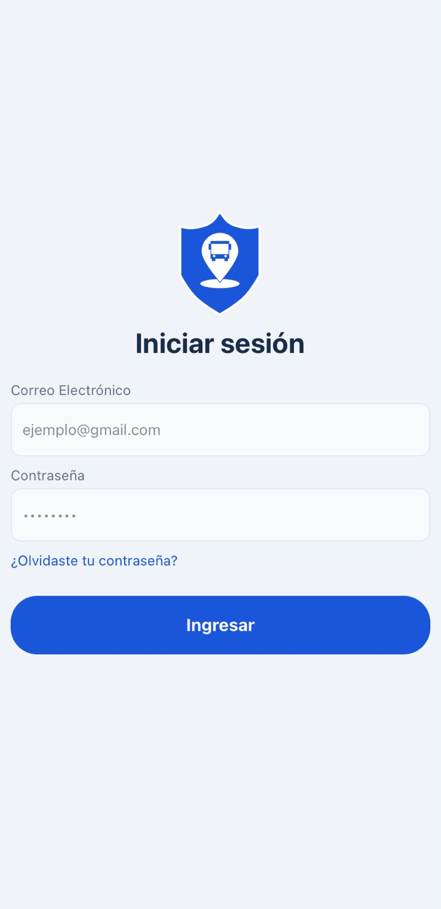

**Resultado esperado:** El sistema valida las credenciales y muestra la pantalla principal de rastreo GPS correspondiente al rol del usuario.

**Observaciones o restricciones:** Si el usuario olvidó su contraseña, debe pulsar "¿Olvidaste tu contraseña?" para iniciar la recuperación.

### 3.2 Recuperar contraseña

| | |
|---|---|
| **Descripción:** | Permite restablecer la contraseña de acceso cuando el usuario no la recuerda, mediante un código de verificación enviado al correo. |
| **Rol que puede usarlo:** | Padre/Acudiente, Estudiante, Conductor. |
| **Ruta:** | Enlace "¿Olvidaste tu contraseña?" en la pantalla "Iniciar sesión". |

**Pasos para utilizarlo:**

- Paso 1 ("Restablecer contraseña"): escribir el correo electrónico registrado y pulsar "Enviar código". El sistema envía un código de verificación a ese correo.

- Paso 2 ("Código de verificación"): escribir en las seis casillas el código recibido en el correo y pulsar "Verificar código". Si no llega, pulsar "Reenviar" en el texto "¿No recibiste el código? Reenviar".

- Paso 3 ("Restablecer contraseña"): escribir la "Nueva contraseña", repetirla en "Confirmación" y pulsar "Restablecer".

**Captura de pantalla:**

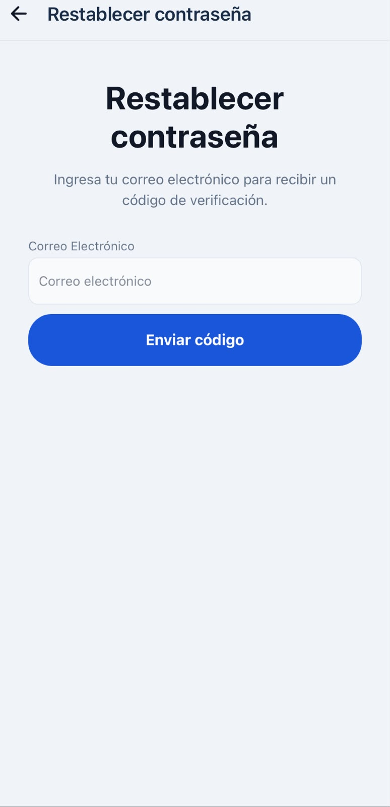

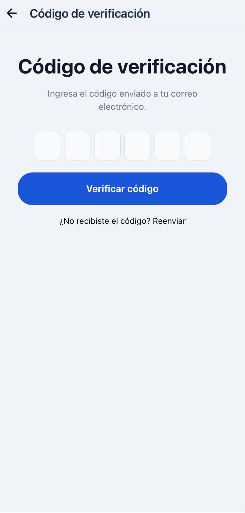

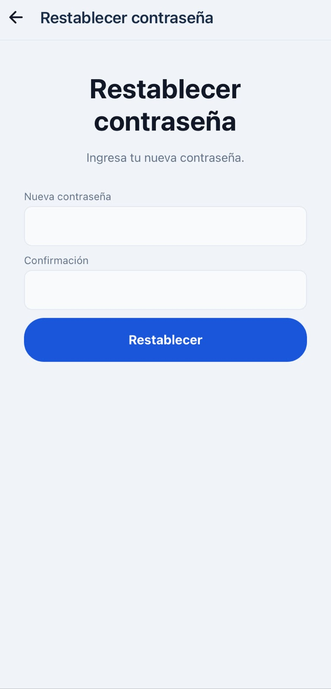

**Resultado esperado:** El sistema muestra el mensaje "Contraseña actualizada" y permite iniciar sesión con la nueva contraseña.

**Observaciones o restricciones:** En cualquier paso se puede pulsar la flecha de la esquina superior izquierda para volver a la pantalla anterior.

## 4. Menú principal del aplicativo móvil

La aplicación se navega con una barra inferior de tres pestañas (Ruta, Ubicación y Perfil) y un ícono de campana en la parte superior derecha del mapa, desde el cual se consultan las alertas.

| **Sección** | **Cómo se accede** | **Disponible para** | **Descripción breve** |
|---|---|---|---|
| Ubicación / Rastreo GPS | Pestaña "Ubicación" | Padre, Estudiante, Conductor | Mapa con la ubicación en vivo del bus, su estado, velocidad y última actualización. |
| Ruta (Mi ruta) | Pestaña "Ruta" | Padre, Estudiante, Conductor | Detalle de la ruta asignada: bus, conductor, horario, destino y paradas. |
| Rutas cercanas | Desde "Ruta" | Estudiante | Listado de otras rutas disponibles cerca de la ubicación actual. |
| Alertas | Ícono de campana | Padre, Estudiante, Conductor | Notificaciones sobre novedades de la ruta o del bus, con filtros. |
| Código QR | Desde la pantalla principal | Estudiante, Conductor | Generación (estudiante) o escaneo (conductor) del código de abordaje/descenso. |
| Perfil (Mi perfil) | Pestaña "Perfil" | Padre, Estudiante, Conductor | Mis datos, Mi familia, Seguridad, Apariencia, Idioma, Políticas de privacidad y Sobre nosotros. |

## 5. Módulos del aplicativo móvil

### 5.1 Rastreo en tiempo real (GPS)

| | |
|---|---|
| **Descripción:** | Muestra en un mapa la ubicación en vivo del bus escolar junto con su estado, velocidad y hora de la última actualización. |
| **Rol que puede usarlo:** | Padre/Acudiente (vista padres), Estudiante (vista estudiantes), Conductor (vista conductores). |
| **Ruta:** | Pantalla "Ubicación del vehículo" (pestaña "Ubicación"), inmediatamente después de iniciar sesión. |

**Pasos para utilizarlo:**

- Iniciar sesión en la aplicación.

- Observar en el mapa el ícono del bus, que indica la ubicación actual del vehículo.

- Consultar en la tarjeta "Ubicación del vehículo": Estado (por ejemplo, ACTIVE), Velocidad (en km/h) y Última actualización (hora del último dato recibido).

- Pulsar el botón de la mira (parte inferior derecha del mapa) para centrar el mapa en la ubicación.

- Pulsar el ícono de campana (parte superior derecha) para consultar las alertas.

**Captura de pantalla:**

- **Pantalla / Vista Estudiante**

> 🖼️ **[AQUÍ VA LA IMAGEN 5 — Vista estudiantes (mockup anterior, reemplazar por captura real)]**

- **Pantalla / Vista Conductor**

> 🖼️ **[AQUÍ VA LA IMAGEN 6 — Vista conductores (mockup anterior, reemplazar por captura real)]**

- **Pantalla / Vista Padres**

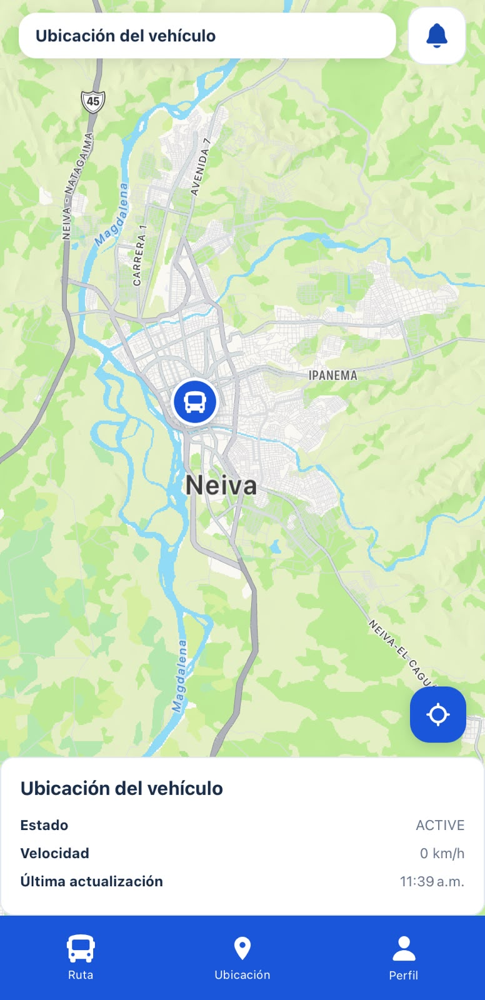

**Resultado esperado:** El usuario visualiza en tiempo real la posición del bus, su estado y su velocidad.

**Observaciones o restricciones:** La vista y algunos datos pueden variar según el rol del usuario (padre, estudiante o conductor). Requiere conexión a internet y permisos de ubicación activos.

### 5.2 Mi ruta

| **Descripción:**          | Presenta el detalle completo de la ruta asignada al usuario. |
|---------------------------|--------------------------------------------------------------|
| **Rol que puede usarlo:** | Padre/Acudiente, Estudiante, Conductor.                      |
| **Ruta:** | Pestaña "Ruta" de la barra inferior. |

**Pasos para utilizarlo:**

- Pulsar la pestaña "Ruta" de la barra inferior.

- Consultar el nombre de la ruta, la placa del bus, el conductor asignado, el destino final, la dirección, las paradas y el horario.

- Pulsar "Rutas cercanas" si se desea consultar otras rutas disponibles.

**Captura de pantalla:**

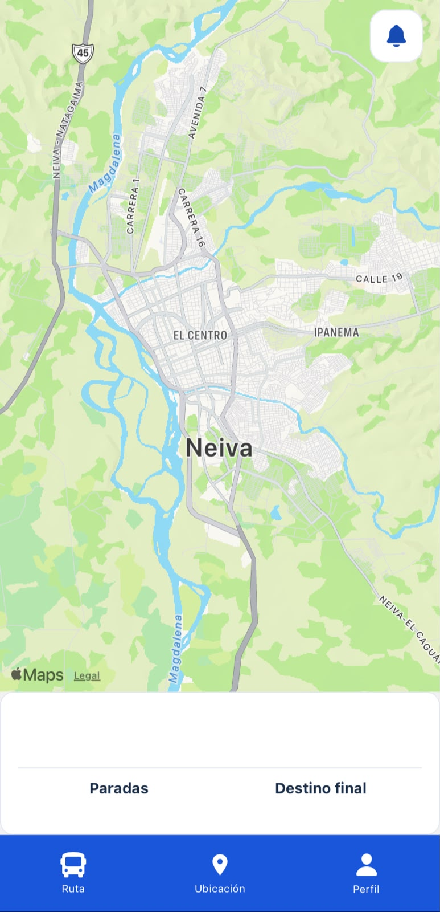

**Resultado esperado:** El usuario conoce todos los detalles operativos de su ruta asignada.

**Observaciones o restricciones:** La información depende de la ruta configurada por el administrador de la institución.

### 5.3 Alertas y filtros de alertas

| **Descripción:**          | Lista las notificaciones generadas durante el recorrido (bus fuera de ruta, frenó brusco, ruta demorada, bus indispuesto), con hora, conductor y placa del bus, y permite filtrarlas por tipo. |
|---------------------------|------------------------------------------------------------------------------------------------------------------------------------------------------------------------------------------------|
| **Rol que puede usarlo:** | Padre/Acudiente, Estudiante, Conductor.                                                                                                                                                        |
| **Ruta:** | Ícono de campana, en la parte superior derecha de la pantalla principal. |

**Pasos para utilizarlo:**

- Pulsar el ícono de campana, en la parte superior derecha.

- Revisar el listado de notificaciones, ordenadas por hora.

- Pulsar "Filtrar alertas" para mostrar únicamente el tipo de novedad deseado.

**Captura de pantalla:**

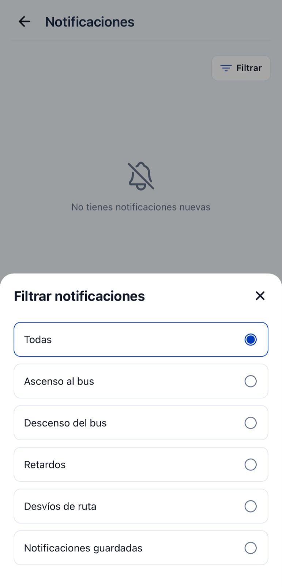

**Resultado esperado:** El usuario se mantiene informado de cualquier novedad relevante durante el trayecto del bus.

**Observaciones o restricciones:** Las alertas dependen de eventos generados automáticamente por el sistema durante el recorrido.

### 5.6 Código QR de abordaje y descenso

<!-- VERIFICAR: no hay captura real de este módulo en la app actual; el texto viene del diseño anterior (Figma). Confirmar que sigue igual. -->

| **Descripción:**          | Genera (estudiante) o escanea (conductor) el código QR que registra el abordaje o descenso del bus. |
|---------------------------|-----------------------------------------------------------------------------------------------------|
| **Rol que puede usarlo:** | Estudiante (generar QR), Conductor (escanear QR).                                                   |
| **Ruta:**                 | Ventanas emergentes "Activar QR", "QR escaneable" y "Empezar escaneo".                              |

**Pasos para utilizarlo:**

- Estudiante: pulsar "Activar QR" y elegir "Subida" o "Bajada"; el sistema genera un código QR de uso único; presentarlo frente al lector del bus.

- Conductor: pulsar "Escanear QRs" y luego "Activar" para iniciar el lector; escanear el código de cada estudiante al subir o bajar.

**Captura de pantalla:**

> 🖼️ **[AQUÍ VA LA IMAGEN — captura pendiente]**  
> *Pantalla Figma: "Qr escaneable / Activar QR / Empezar escaneo" (node-id 33:7788 · 33:7870 · 33:7886)*

**Resultado esperado:** Queda registrado el abordaje o descenso del estudiante en el sistema.

**Observaciones o restricciones:** Cada código QR es de uso único; tras utilizarse, el sistema genera uno nuevo para el siguiente movimiento.

### 5.7 Mi perfil

| | |
|---|---|
| **Descripción:** | Punto de acceso a la información personal, familiar, de seguridad, apariencia, idioma, privacidad e información institucional del usuario. |
| **Rol que puede usarlo:** | Padre/Acudiente, Estudiante, Conductor. |
| **Ruta:** | Pestaña "Perfil" de la barra inferior. |

**Pasos para utilizarlo:**

- Pulsar la pestaña "Perfil".

- Seleccionar la opción deseada: Mis datos, Mi familia, Seguridad, Apariencia, Idioma, Políticas de privacidad o Sobre nosotros.

**Captura de pantalla:**

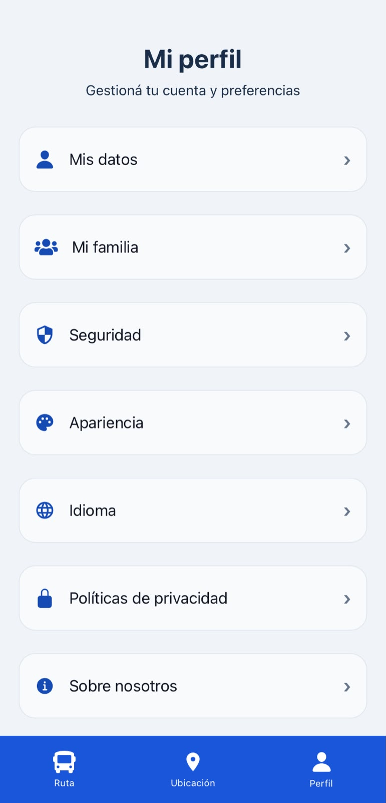

**Resultado esperado:** El usuario accede al conjunto de opciones de configuración de su cuenta.

**Observaciones o restricciones:** Ninguna.

### 5.8 Mis datos (incluye actualizar teléfono y correo)

| | |
|---|---|
| **Descripción:** | Permite consultar el nombre, teléfono, correo electrónico, contraseña, dirección, ciudad y escuela del usuario, y actualizar el teléfono y el correo electrónico. |
| **Rol que puede usarlo:** | Padre/Acudiente, Estudiante, Conductor. |
| **Ruta:** | Mi perfil \> Mis datos. |

**Pasos para utilizarlo:**

- Ingresar a "Mis datos" y revisar la información registrada.

- Para actualizar el teléfono: pulsar el ícono de edición junto a "Teléfono". En la pantalla "Actualizar número telefónico", escribir el correo electrónico para verificar la identidad y pulsar "Enviar código"; escribir el código de seis dígitos y pulsar "Verificar código" (si no llega, pulsar "Reenviar"); escribir el nuevo número telefónico y pulsar "Actualizar"; si la aplicación solicita un código de confirmación adicional, ingresarlo y pulsar "Verificar código".

- Para actualizar el correo: pulsar el ícono de edición junto a "Correo Electrónico". En la pantalla "Actualizar correo electrónico", escribir el correo actual para verificar la identidad y pulsar "Enviar código"; escribir el código de seis dígitos recibido en el correo y pulsar "Verificar código"; escribir el nuevo correo y pulsar "Actualizar"; si la aplicación solicita un código de confirmación adicional, ingresarlo para finalizar.

**Captura de pantalla:**

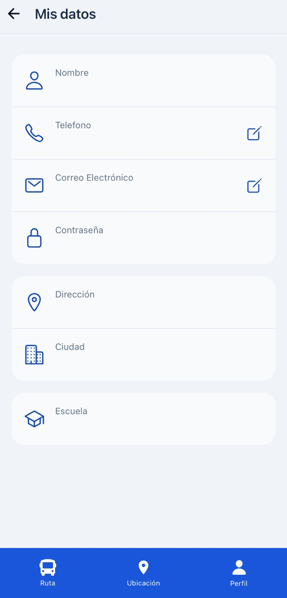

**Actualizar número telefonico**
--
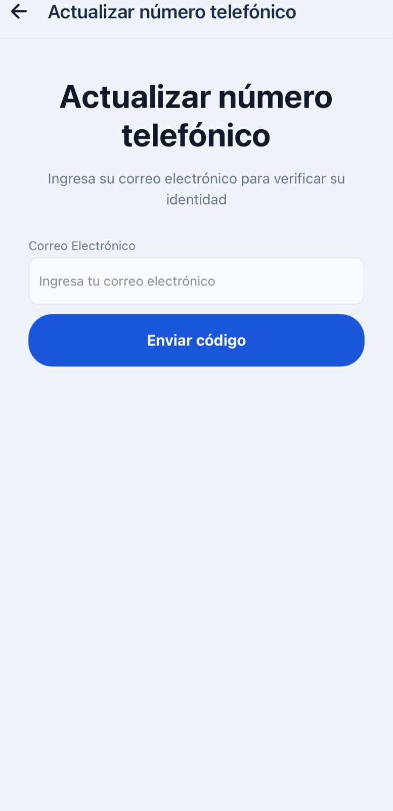

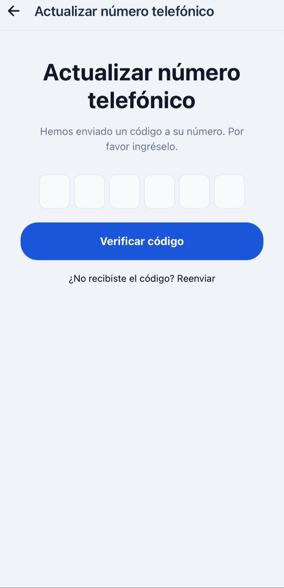

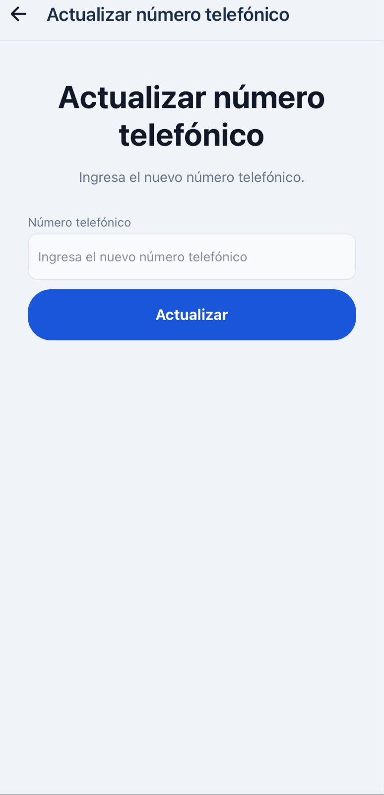

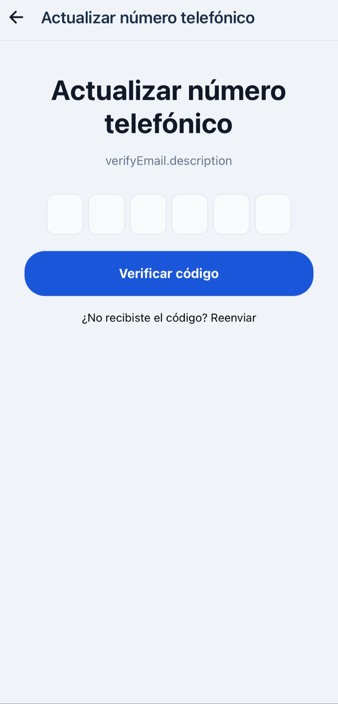

**Actualizar correo electrónico**
--
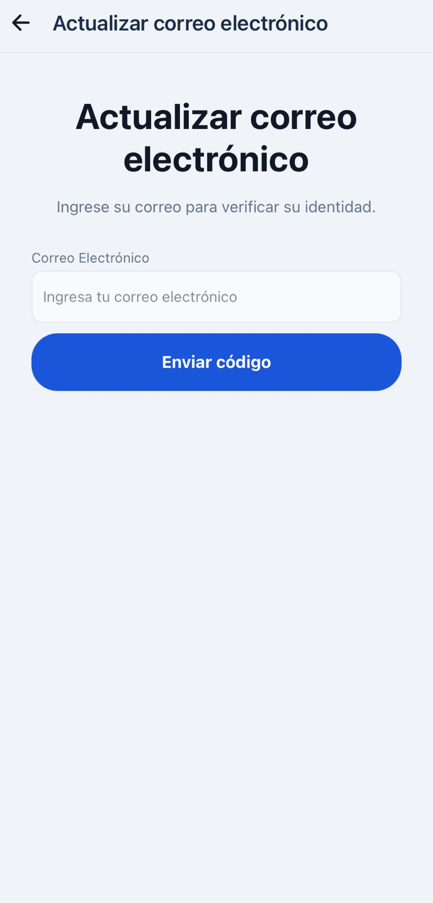

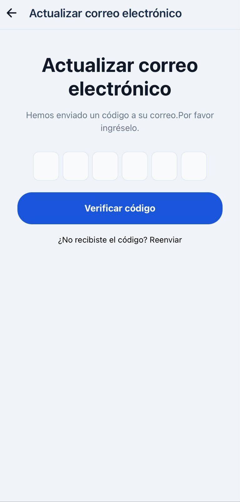

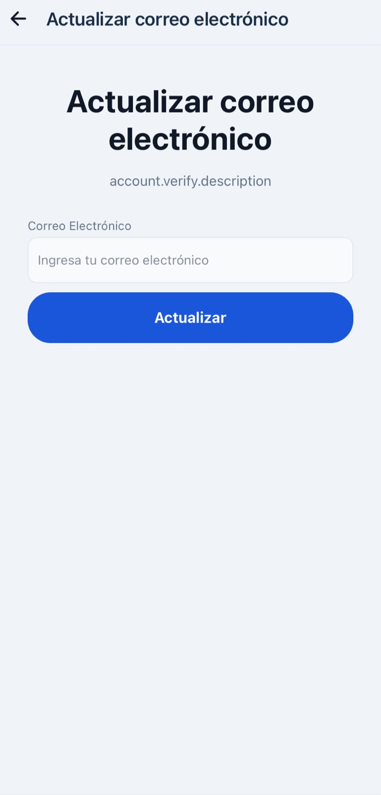

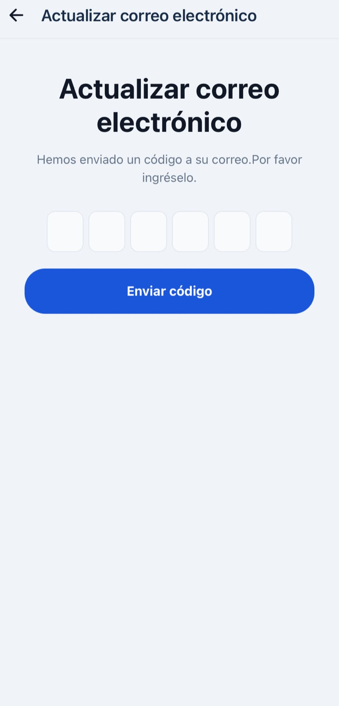

**Resultado esperado:** El sistema muestra el mensaje "Número actualizado" o "Correo actualizado" y refleja los nuevos datos.

**Observaciones o restricciones:** Solo el teléfono y el correo electrónico se pueden editar desde esta pantalla (tienen ícono de edición); la contraseña se cambia desde "Seguridad". El cambio de teléfono o correo requiere validar el código enviado antes de completarse.

### 5.9 Mi familia

| | |
|---|---|
| **Descripción:** | Muestra el nombre de la familia, el titular (acudiente principal) y los otros miembros registrados. |
| **Rol que puede usarlo:** | Padre/Acudiente. |
| **Ruta:** | Mi perfil \> Mi familia. |

**Pasos para utilizarlo:**

- Ingresar a "Mi familia".

- Consultar el nombre de la familia y las secciones "Titular" y "Otros miembros".

**Captura de pantalla:**

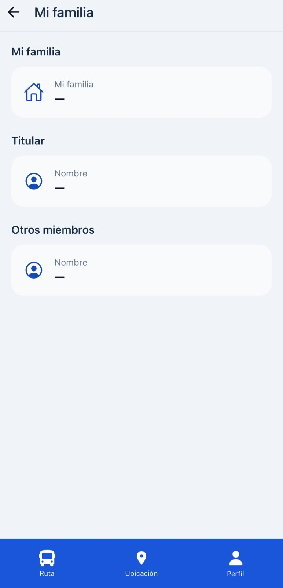

**Resultado esperado:** El usuario visualiza el núcleo familiar asociado a su cuenta.

**Observaciones o restricciones:** La edición de miembros de familia se realiza desde el panel web por el administrador.

### 5.10 Seguridad (incluye cambiar contraseña)

| | |
|---|---|
| **Descripción:** | Permite activar o desactivar las notificaciones y cambiar la contraseña de la cuenta. |
| **Rol que puede usarlo:** | Padre/Acudiente, Estudiante, Conductor. |
| **Ruta:** | Mi perfil \> Seguridad. |

**Pasos para utilizarlo:**

- Ingresar a "Seguridad".

- Para recibir o dejar de recibir notificaciones: usar el interruptor "Activar notificaciones".

- Para cambiar la contraseña: pulsar "Cambiar la contraseña" (ícono de edición) y seguir el proceso de verificación mediante un código de confirmación enviado al correo.

**Captura de pantalla:**

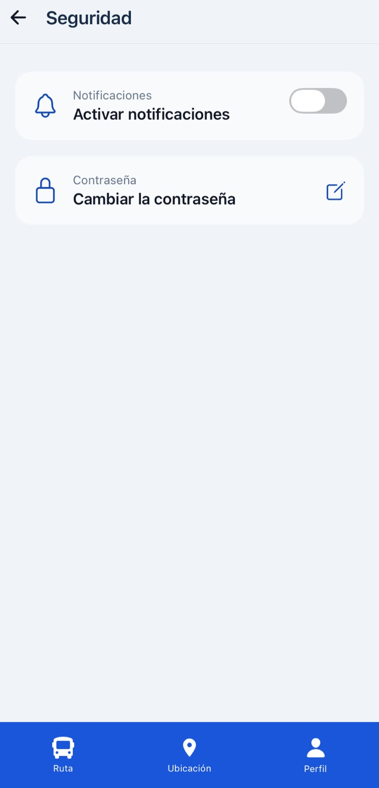

**Resultado esperado:** La cuenta queda configurada según las opciones elegidas por el usuario.

**Observaciones o restricciones:** El cambio de contraseña exige verificación previa por correo.

### 5.11 Configuración: apariencia e idioma

| | |
|---|---|
| **Descripción:** | Permite cambiar la apariencia de la aplicación (modo claro u oscuro y color: azul, verde, amarillo o rojo) y el idioma (español, English, Français o Português). |
| **Rol que puede usarlo:** | Padre/Acudiente, Estudiante, Conductor. |
| **Ruta:** | Mi perfil \> Apariencia / Idioma. |

**Pasos para utilizarlo:**

- Ingresar a "Apariencia" y seleccionar el modo ("Claro" u "Oscuro") y el color deseado ("Azul", "Verde", "Amarillo" o "Rojo").

- Ingresar a "Idioma" y seleccionar el idioma deseado.

**Captura de pantalla:**

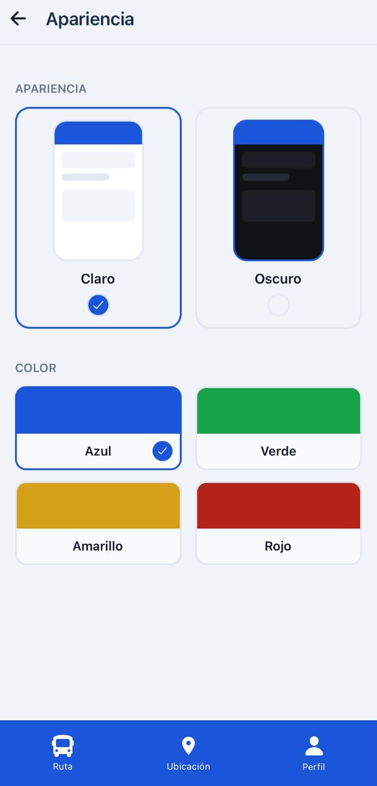

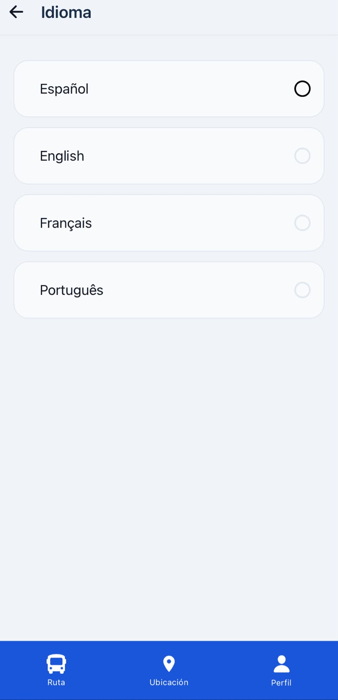

**Resultado esperado:** La interfaz se actualiza con la apariencia o el idioma seleccionado.

**Observaciones o restricciones:** Ninguna.

### 5.12 Sobre nosotros y políticas de privacidad

| **Descripción:**          | Presenta información institucional del proyecto (misión, visión y opción de calificar la app) y las políticas de manejo de permisos y privacidad de los datos. |
|---------------------------|----------------------------------------------------------------------------------------------------------------------------------------------------------------|
| **Rol que puede usarlo:** | Padre/Acudiente, Estudiante, Conductor.                                                                                                                        |
| **Ruta:**                 | Mi perfil \> Políticas de privacidad / Sobre nosotros.                                                                                                         |

**Pasos para utilizarlo:**

- Ingresar a "Sobre nosotros" para conocer la misión, visión y calificar la app.

- Ingresar a "Políticas de privacidad" para consultar el uso de permisos y datos.

**Captura de pantalla:**

**Sobre nosotros:**
--

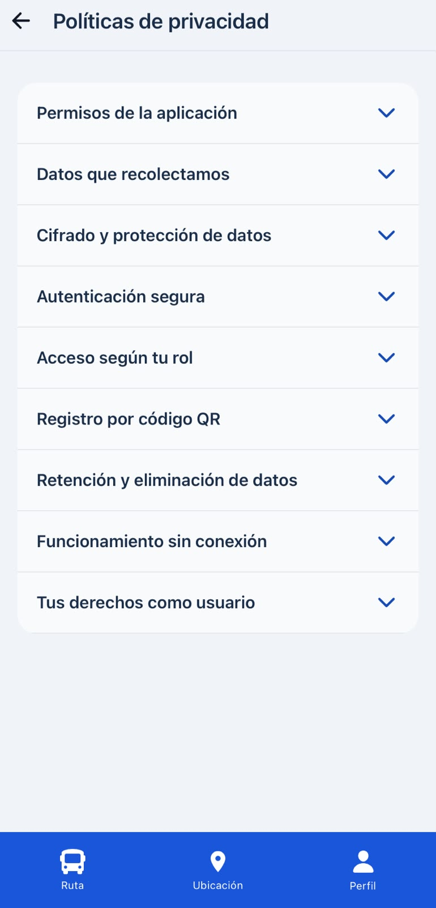

**Quienes somos**
--

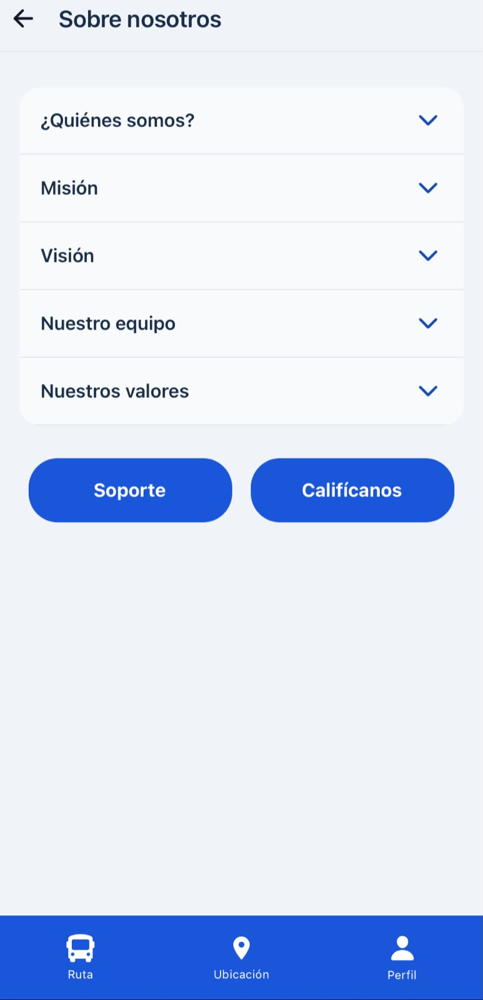

**Resultado esperado:** El usuario conoce el propósito del proyecto y cómo se protegen sus datos.

**Observaciones o restricciones:** Ninguna.

### 5.13 Soporte

| | |
|---|---|
| **Descripción:** | Permite reportar un inconveniente directamente al equipo de soporte. |
| **Rol que puede usarlo:** | Padre/Acudiente, Estudiante, Conductor. |
| **Ruta:** | Mi perfil \> Sobre nosotros \> Soporte. |

**Pasos para utilizarlo:**

- Ingresar a "Soporte".

- Escribir el inconveniente en el cuadro de texto "Escribe aquí tu mensaje...", debajo de "Cuéntanos tu inconveniente".

- Pulsar "Enviar".

**Captura de pantalla:**

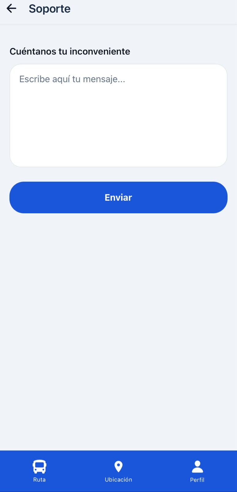

**Resultado esperado:** El reporte queda enviado al equipo de soporte para su atención.

**Observaciones o restricciones:** No se debe incluir información sensible o contraseñas en el mensaje de soporte.

### 5.1 Califícanos

| | |
|---|---|
| **Descripción:** | Permite calificar directamente a la aplicación. |
| **Rol que puede usarlo:** | Padre/Acudiente, Estudiante, Conductor. |
| **Ruta:** | Mi perfil \> Sobre nosotros \> Califícanos. |

**Pasos para utilizarlo:**

- Ingresar a "Califícanos".

- Escribir el mensaje califando la aplicación.

- Dar una puntuación 

- Pulsar "Enviar".

**Captura de pantalla:**

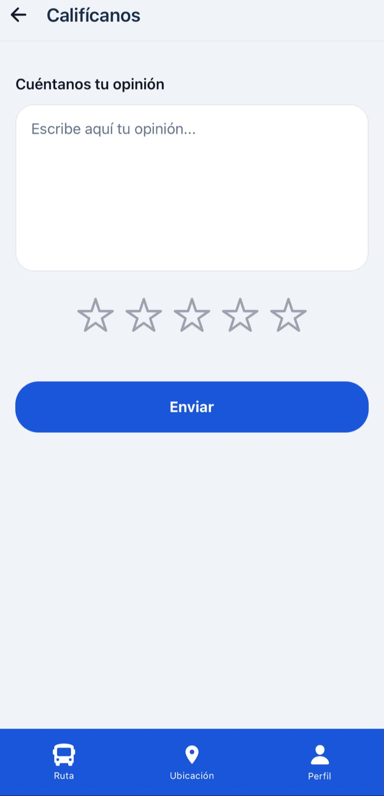

**Resultado esperado:** El reporte queda enviado al equipo de soporte para su atención.

**Observaciones o restricciones:** No se debe incluir información sensible o contraseñas en el mensaje de soporte.
                          |

## 7. Cierre de sesión (móvil)

Para salir de forma segura, el usuario debe ingresar a "Mi perfil" y seleccionar la opción de cerrar sesión. El sistema finaliza la sesión activa y regresa a la pantalla de Inicio de sesión. Se recomienda cerrar sesión siempre que se use un dispositivo compartido.

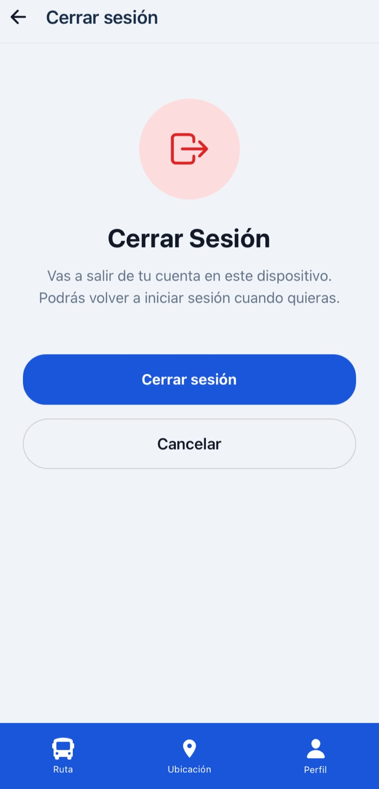

# Parte II — Aplicativo web (panel de administración)

Panel dirigido al personal administrativo de las instituciones educativas, para la gestión de estudiantes, acudientes, conductores, familias, buses, paradas y rutas.

## 1. Presentación del aplicativo web

El sitio público (landing page) presenta el sistema Guardian Escolar, sus funcionalidades (GPS en tiempo real, panel de administración, alertas instantáneas, app para familias, control de asistencia y datos seguros) y permite descargar la app o contactar al equipo comercial. Desde allí también se accede al inicio de sesión del panel de administración.

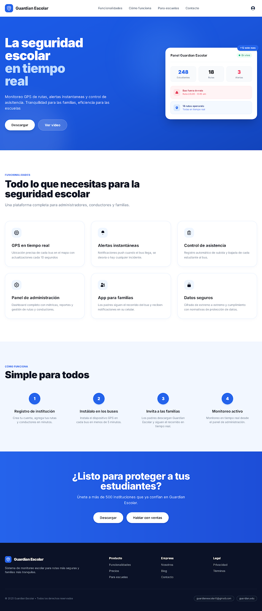

## 2. Requisitos para usar el panel web

- Computador con navegador web actualizado (Chrome, Edge o Firefox) y conexión a internet.

- Usuario y contraseña de administrador o superadministrador, asignados previamente.

- Resolución de pantalla recomendada de 1366×768 o superior.

## 3. Ingreso al panel web

### 3.1 Inicio de sesión (web)

| **Descripción:**          | Permite que el administrador o superadministrador ingrese al panel con sus credenciales. |
|---------------------------|------------------------------------------------------------------------------------------|
| **Rol que puede usarlo:** | Administrador, Superadministrador.                                                       |
| **Ruta:**                 | Pantalla "Login", accesible desde la landing page o directamente por la URL del sistema. |

**Pasos para utilizarlo:**

- Escribir el correo electrónico en el campo "Correo electrónico".

- Escribir la contraseña en el campo "Contraseña".

- Pulsar el botón "Iniciar sesión".

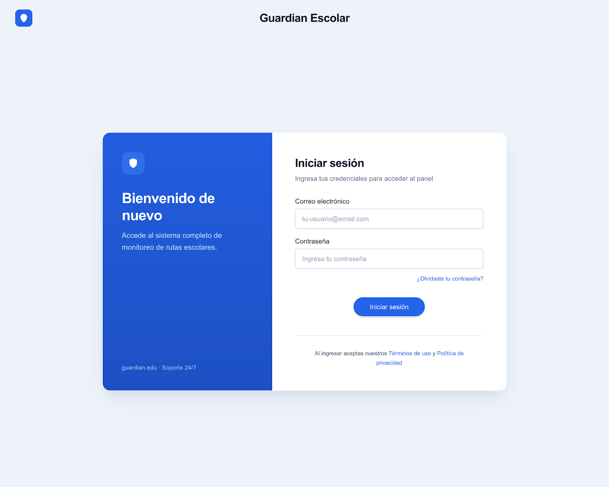

**Resultado esperado:** El sistema valida las credenciales y muestra el panel de administración correspondiente al rol (Dashboard admin o Dashboard superadmin).

**Observaciones o restricciones:** Al ingresar, el usuario acepta los Términos de uso y la Política de privacidad. Si olvidó la contraseña, debe usar el enlace "¿Olvidaste tu contraseña?".

### 3.2 Recuperar contraseña (web)

| **Descripción:**          | Permite restablecer la contraseña de acceso al panel mediante verificación por correo, en tres pasos. |
|---------------------------|-------------------------------------------------------------------------------------------------------|
| **Rol que puede usarlo:** | Administrador, Superadministrador.                                                                    |
| **Ruta:**                 | Enlace "¿Olvidaste tu contraseña?" en la pantalla de Login.                                           |

**Pasos para utilizarlo:**

- Paso 1 de 3: ingresar el correo con el que se registró y pulsar "Enviar código". El sistema informa que se recibirá un código de 6 dígitos.

- Paso 2 de 3: ingresar el código de 6 dígitos recibido en el correo y pulsar "Validar".

- Paso 3 de 3: crear una nueva contraseña seguindo las recomendaciones de seguridad (mínimo 8 caracteres, números y letras, mayúsculas y minúsculas, caracteres especiales) y confirmarla; pulsar "Guardar nueva contraseña".

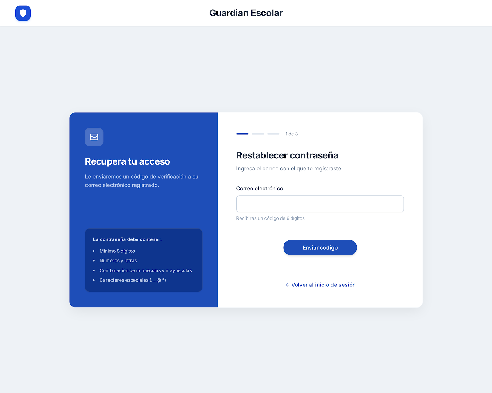
--
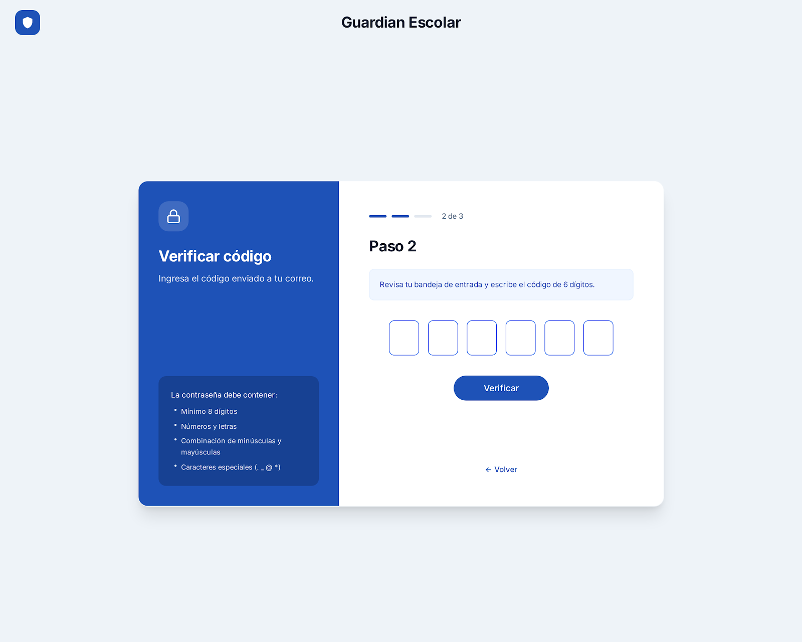
--
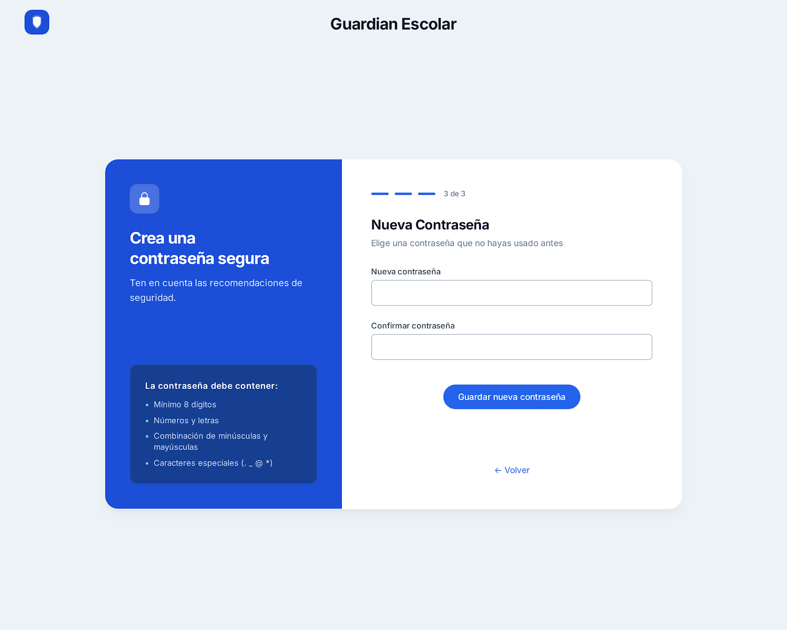

**Resultado esperado:** El sistema muestra el mensaje "Contraseña actualizada" y permite iniciar sesión con la nueva contraseña.

**Observaciones o restricciones:** En cualquier paso se puede pulsar “← Volver al inicio de sesión” para cancelar el proceso.

## 4. Menú principal y navegación del panel web

El panel web organiza sus opciones bajo el menú "ADMINISTRAR", con las siguientes secciones (algunas exclusivas del rol Superadministrador):

| **Sección**                                          | **Disponible para**               | **Descripción breve**                                                            |
|------------------------------------------------------|-----------------------------------|----------------------------------------------------------------------------------|
| Usuarios (Estudiante, Acudiente, Conductor, Familia) | Administrador                     | Registro y gestión de las personas vinculadas al transporte escolar.             |
| Buses                                                | Administrador                     | Registro y gestión de los buses de la institución.                               |
| Paradas                                              | Administrador                     | Registro y gestión de las paradas del recorrido.                                 |
| Rutas                                                | Administrador                     | Registro y gestión de las rutas escolares.                                       |
| Escuelas                                             | Superadministrador                | Registro y gestión de las instituciones educativas registradas en la plataforma. |
| Administradores                                      | Superadministrador                | Registro y gestión de las cuentas de administrador de cada institución.          |
| Perfil                                               | Administrador, Superadministrador | Datos personales, seguridad, configuración y soporte del usuario del panel.      |

## 5. Módulos del panel web

### 5.1 Panel principal — Dashboard administrador

| **Descripción:**          | Vista principal del administrador, con métricas de rutas activas, estudiantes registrados, alertas del día y el listado de últimas alertas. |
|---------------------------|---------------------------------------------------------------------------------------------------------------------------------------------|
| **Rol que puede usarlo:** | Administrador.                                                                                                                              |
| **Ruta:**                 | Pantalla inicial tras iniciar sesión como administrador.                                                                                    |

**Pasos para utilizarlo:**

- Iniciar sesión con una cuenta de administrador.

- Revisar las tarjetas de métricas: "Rutas activas", "Estudiantes" y "Alertas hoy".

- Consultar el listado de "Últimas alertas" (tipo de novedad, conductor, ruta, placa y hora).

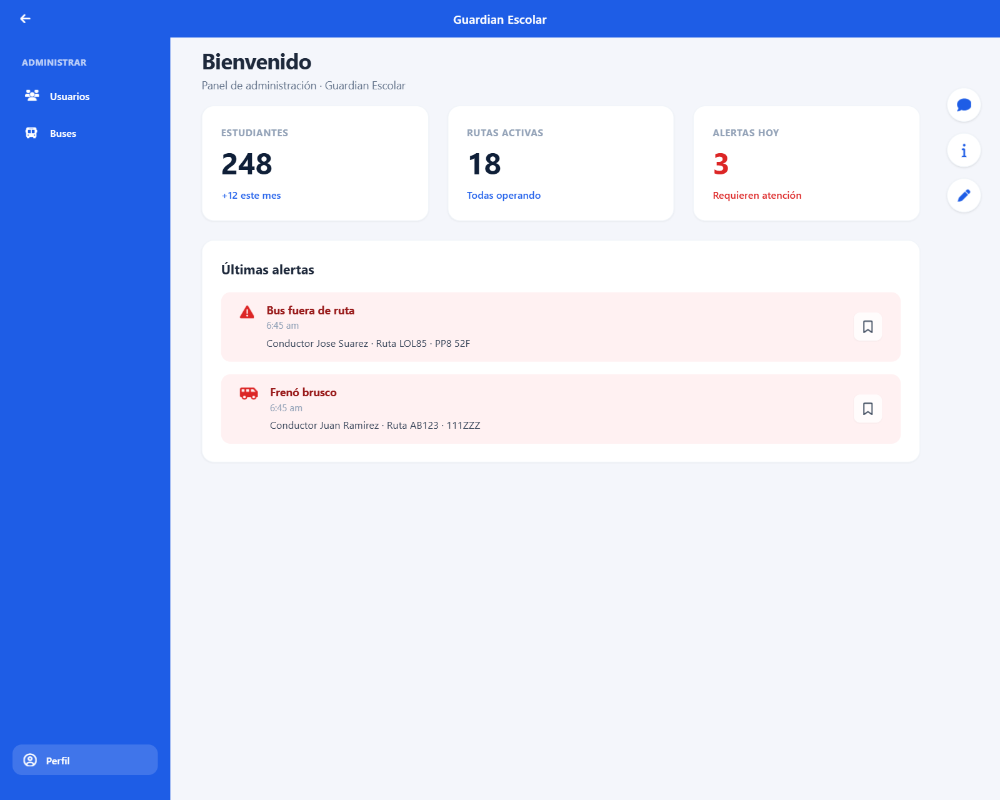

**Resultado esperado:** El administrador obtiene una visión general y actualizada del estado del transporte escolar de su institución.

**Observaciones o restricciones:** Los datos mostrados corresponden únicamente a la institución del administrador que inició sesión.

### 5.2 Panel principal — Dashboard superadministrador

| **Descripción:**          | Vista principal del superadministrador, con métricas globales de colegios registrados, administradores y comentarios/calificaciones recibidas de los usuarios. |
|---------------------------|----------------------------------------------------------------------------------------------------------------------------------------------------------------|
| **Rol que puede usarlo:** | Superadministrador.                                                                                                                                            |
| **Ruta:**                 | Pantalla inicial tras iniciar sesión como superadministrador.                                                                                                  |

**Pasos para utilizarlo:**

- Iniciar sesión con una cuenta de superadministrador.

- Revisar las tarjetas de métricas: "Colegios registrados", "Administradores" y "Comentarios hoy".

- Consultar el listado de "Últimos comentarios" enviados por los usuarios, junto con su calificación.

**Captura de pantalla:**

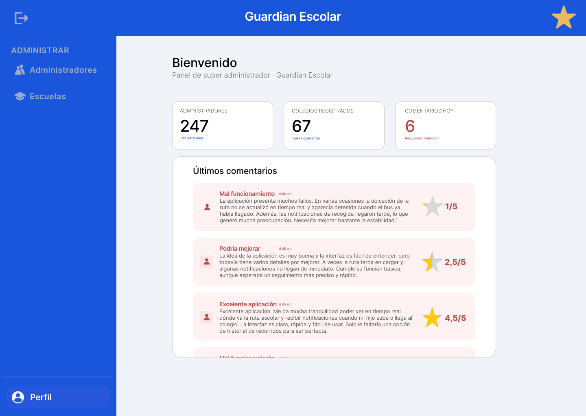

**Resultado esperado:** El superadministrador obtiene una visión general del funcionamiento de la plataforma a nivel de todas las instituciones registradas.

**Observaciones o restricciones:** Esta vista solo está disponible para el rol Superadministrador.

### 5.3 Gestión de estudiantes

| **Descripción:**          | Permite registrar, consultar, editar y ver el detalle de los estudiantes de la institución. |
|---------------------------|---------------------------------------------------------------------------------------------|
| **Rol que puede usarlo:** | Administrador.                                                                              |
| **Ruta:**                 | ADMINISTRAR \> Estudiante.                                                                  |

**Pasos para utilizarlo:**

- Para registrar: diligenciar nombres, apellidos, tipo y número de identificación, curso, teléfono, dirección, correo electrónico y fecha de nacimiento, y pulsar "Registrar".

- Para consultar: usar el buscador o revisar el listado de "Estudiantes registrados".

- Para ver el detalle: pulsar "Perfil" sobre el estudiante deseado.

- Para editar: abrir el detalle del estudiante y actualizar los campos necesarios.

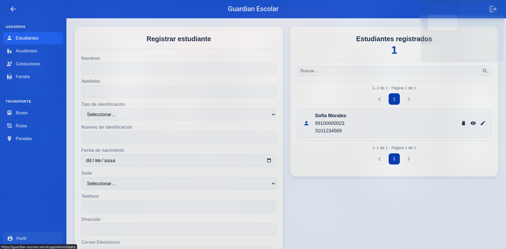

**Resultado esperado:** El sistema muestra el mensaje "Registro creado exitosamente" o "Registro actualizado exitosamente", y el estudiante queda disponible en el listado.

**Observaciones o restricciones:** No se debe registrar dos veces el mismo número de identificación.

### 5.4 Gestión de acudientes

| **Descripción:**          | Permite registrar, consultar, editar y ver el detalle de los acudientes de la institución. |
|---------------------------|--------------------------------------------------------------------------------------------|
| **Rol que puede usarlo:** | Administrador.                                                                             |
| **Ruta:**                 | ADMINISTRAR \> Acudiente.                                                                  |

**Pasos para utilizarlo:**

- Para registrar: diligenciar nombres, apellidos, tipo y número de identificación, teléfono, dirección, correo electrónico y fecha de nacimiento, y pulsar "Registrar".

- Para ver el detalle: pulsar sobre el acudiente en el listado.

- Para editar: abrir el detalle y actualizar los campos necesarios.

**Captura de pantalla:**

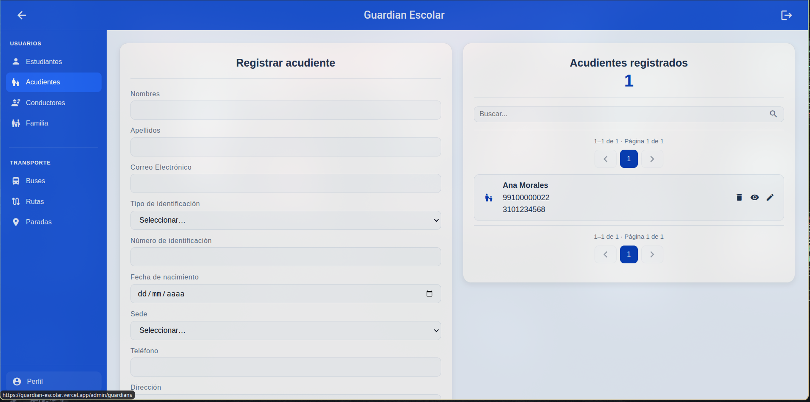

**Resultado esperado:** El acudiente queda registrado y disponible para asociarse a una familia y a uno o más estudiantes.

**Observaciones o restricciones:** No se debe registrar dos veces el mismo número de identificación.

### 5.5 Gestión de conductores

| **Descripción:**          | Permite registrar, consultar, editar y ver el detalle de los conductores de la institución. |
|---------------------------|---------------------------------------------------------------------------------------------|
| **Rol que puede usarlo:** | Administrador.                                                                              |
| **Ruta:**                 | ADMINISTRAR \> Conductor.                                                                   |

**Pasos para utilizarlo:**

- Para registrar: diligenciar nombres, apellidos, tipo y número de identificación, número y vencimiento de licencia, dirección, correo electrónico y fecha de nacimiento, y pulsar "Registrar".

- Para ver el detalle: pulsar sobre el conductor en el listado (incluye estado de la licencia).

- Para editar: abrir el detalle y actualizar los campos necesarios.

**Captura de pantalla:**

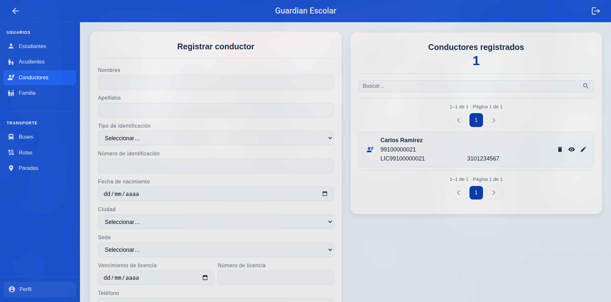

**Resultado esperado:** El conductor queda registrado y disponible para asignarse a un bus y una ruta.

**Observaciones o restricciones:** El sistema advierte del estado de vigencia de la licencia de conducción.

### 5.6 Gestión de familias

| **Descripción:**          | Permite registrar y administrar el núcleo familiar, asociando un acudiente con uno o más estudiantes. |
|---------------------------|-------------------------------------------------------------------------------------------------------|
| **Rol que puede usarlo:** | Administrador.                                                                                        |
| **Ruta:**                 | ADMINISTRAR \> Familia.                                                                               |

**Pasos para utilizarlo:**

- Para registrar: diligenciar nombre de familia, acudiente, estudiante(s) y observaciones, y pulsar "Registrar".

- Para ver el detalle: pulsar sobre la familia en el listado (acudiente y otros miembros).

- Para editar: actualizar nombre, miembros u observaciones, o pulsar "Agregar acudiente" / "Agregar estudiante" para vincular más integrantes.

- Para eliminar un integrante: seleccionar el miembro y confirmar en el mensaje "¿Seguro de que quiere eliminarlo de la familia?".

**Captura de pantalla:**

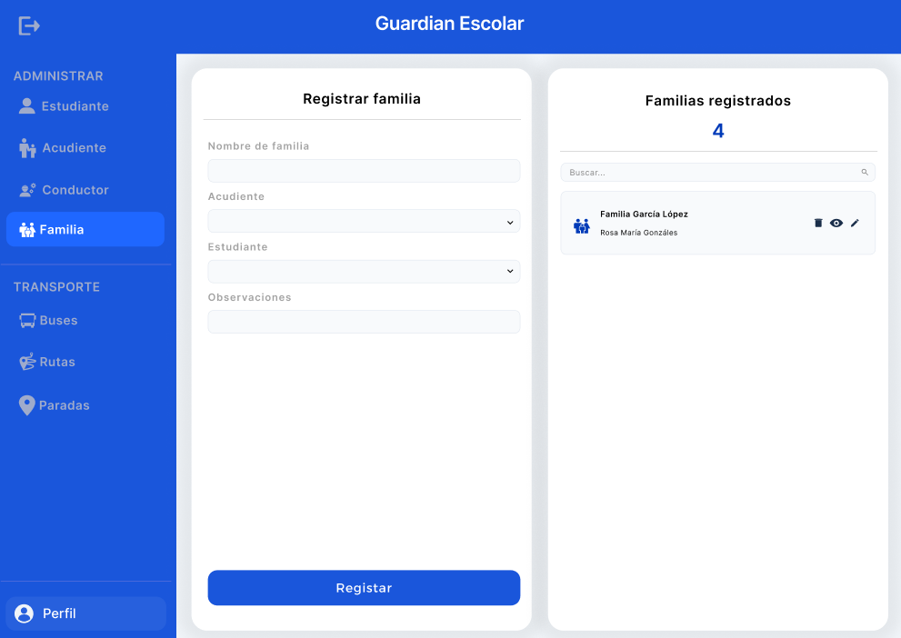

**Resultado esperado:** La familia queda registrada con sus integrantes asociados correctamente.

**Observaciones o restricciones:** Eliminar un integrante de la familia no elimina su registro individual como estudiante o acudiente.

### 5.7 Gestión de buses

| **Descripción:**          | Permite registrar, consultar, editar y ver el detalle de los buses de la institución. |
|---------------------------|---------------------------------------------------------------------------------------|
| **Rol que puede usarlo:** | Administrador.                                                                        |
| **Ruta:**                 | ADMINISTRAR \> Buses.                                                                 |

**Pasos para utilizarlo:**

- Para registrar: diligenciar matrícula, conductor, modelo, capacidad, vigencia del SOAT y estado del GPS, y pulsar "Registrar".

- Para ver el detalle: pulsar sobre el bus en el listado (marca, capacidad, estado del GPS, conductor y vigencia del SOAT).

- Para editar: abrir el detalle y actualizar los campos necesarios.

**Captura de pantalla:**

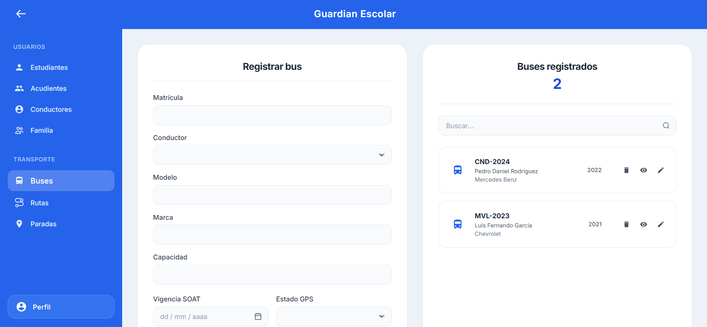

**Resultado esperado:** El bus queda registrado y disponible para asignarse a una ruta.

**Observaciones o restricciones:** El estado del SOAT y del GPS deben mantenerse actualizados para el correcto monitoreo.

### 5.8 Gestión de paradas

| **Descripción:**          | Permite registrar, consultar, editar y eliminar las paradas del recorrido escolar. |
|---------------------------|------------------------------------------------------------------------------------|
| **Rol que puede usarlo:** | Administrador.                                                                     |
| **Ruta:**                 | ADMINISTRAR \> Paradas.                                                            |

**Pasos para utilizarlo:**

- Para registrar: diligenciar nombre de la parada, ciudad, dirección, latitud y longitud, y pulsar "Registrar".

- Para ver el detalle: pulsar sobre la parada en el listado.

- Para editar: abrir el detalle y actualizar los campos necesarios.

- Para eliminar una parada de una ruta: confirmar en el mensaje "¿Seguro de querer sacar la parada de la ruta?".

**Captura de pantalla:**

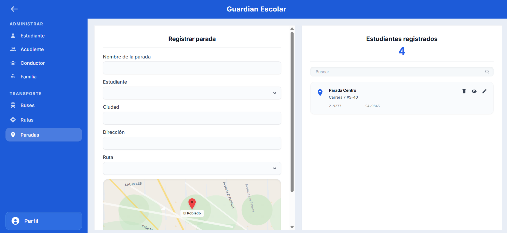

**Resultado esperado:** El sistema muestra el mensaje "Registro creado/actualizado/eliminado exitosamente" según la operación realizada.

**Observaciones o restricciones:** La latitud y longitud deben ser exactas, ya que se usan para el trazado de la ruta en el mapa.

### 5.9 Gestión de rutas

| **Descripción:**          | Permite registrar, consultar, editar y asociar paradas a las rutas escolares. |
|---------------------------|-------------------------------------------------------------------------------|
| **Rol que puede usarlo:** | Administrador.                                                                |
| **Ruta:**                 | ADMINISTRAR \> Rutas.                                                         |

**Pasos para utilizarlo:**

- Para registrar: diligenciar nombre de la ruta, sector/barrio, hora de inicio, hora de finalización y destino, y pulsar "Registrar".

- Para ver el detalle: pulsar sobre la ruta en el listado (incluye las paradas asociadas).

- Para editar: actualizar nombre, horarios o lugar destino, y pulsar "Agregar parada" para vincular nuevas paradas.

**Captura de pantalla:**

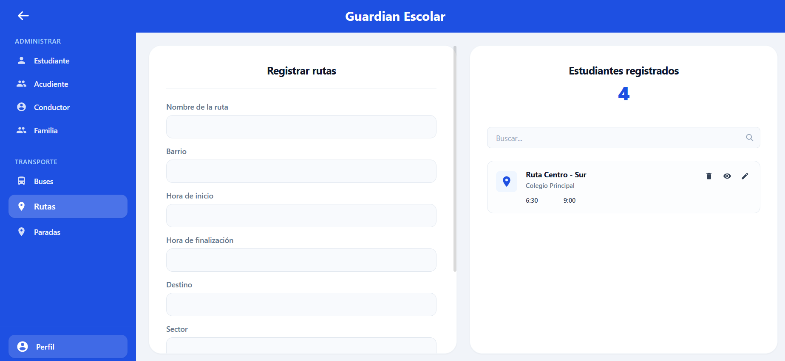

**Resultado esperado:** La ruta queda registrada con sus paradas y horarios, disponible para asignarse a un bus y un conductor.

**Observaciones o restricciones:** Una ruta puede tener varias paradas asociadas; el orden de las paradas define el recorrido mostrado en la app móvil.

### 5.10 Administración de administradores

| **Descripción:**          | Permite registrar, consultar y ver el detalle de las cuentas de administrador de las instituciones. |
|---------------------------|-----------------------------------------------------------------------------------------------------|
| **Rol que puede usarlo:** | Superadministrador.                                                                                 |
| **Ruta:**                 | ADMINISTRAR \> Administradores.                                                                     |

**Pasos para utilizarlo:**

- Para registrar: diligenciar nombres, apellidos, correo electrónico, identificación, teléfono, dirección y fecha de nacimiento, y pulsar "Registrar".

- Para ver el detalle: pulsar sobre el administrador en el listado.

**Captura de pantalla:**

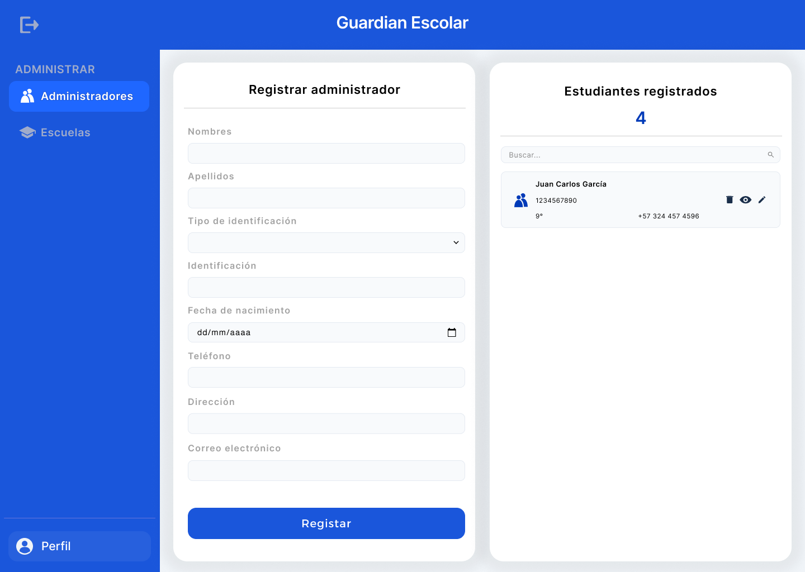

**Resultado esperado:** La cuenta de administrador queda creada y disponible para iniciar sesión en el panel de su institución.

**Observaciones o restricciones:** Función exclusiva del rol Superadministrador.

### 5.11 Administración de escuelas

| **Descripción:**          | Permite registrar, consultar, editar y ver el detalle de las instituciones educativas registradas en la plataforma. |
|---------------------------|---------------------------------------------------------------------------------------------------------------------|
| **Rol que puede usarlo:** | Superadministrador.                                                                                                 |
| **Ruta:**                 | ADMINISTRAR \> Escuelas.                                                                                            |

**Pasos para utilizarlo:**

- Para registrar: diligenciar nombre de la escuela, logo, ciudad, dirección, nivel educativo, correo electrónico, página web y teléfono, y pulsar "Registrar".

- Para ver el detalle: pulsar sobre la escuela en el listado.

- Para editar: abrir el detalle y actualizar los campos necesarios.

**Captura de pantalla:**

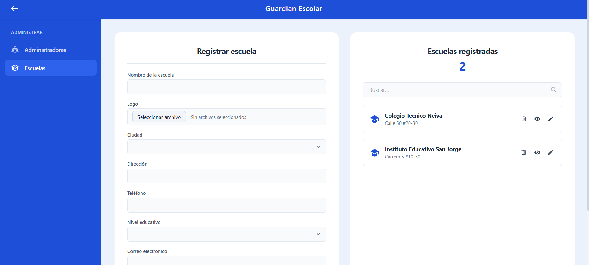

**Resultado esperado:** La institución educativa queda registrada y disponible para asociar administradores, estudiantes y rutas.

**Observaciones o restricciones:** Función exclusiva del rol Superadministrador.

### 5.12 Configuración de usuario (perfil del administrador)

| **Descripción:**          | Permite consultar y actualizar la información del administrador (nombre, identificación, fecha de nacimiento, correo, dirección, escuela, teléfono y contraseña), así como cambiar el idioma y el tema del panel. |
|---------------------------|-------------------------------------------------------------------------------------------------------------------------------------------------------------------------------------------------------------------|
| **Rol que puede usarlo:** | Administrador, Superadministrador.                                                                                                                                                                                |
| **Ruta:**                 | Perfil \> Configuración de usuario.                                                                                                                                                                               |

**Pasos para utilizarlo:**

- Ingresar a "Perfil" y revisar la información del administrador.

- Para cambiar el teléfono: ingresar a "Cambiar teléfono", escribir el nuevo número y pulsar "Enviar código".

- Para cambiar el correo o la contraseña: seguir el proceso de verificación por correo (Paso 1 de 3) y pulsar "Enviar código".

- Para cambiar el idioma o el tema del panel: ingresar a "Cambiar idioma" o "Cambiar tema" y seleccionar la opción deseada.

**Captura de pantalla:**

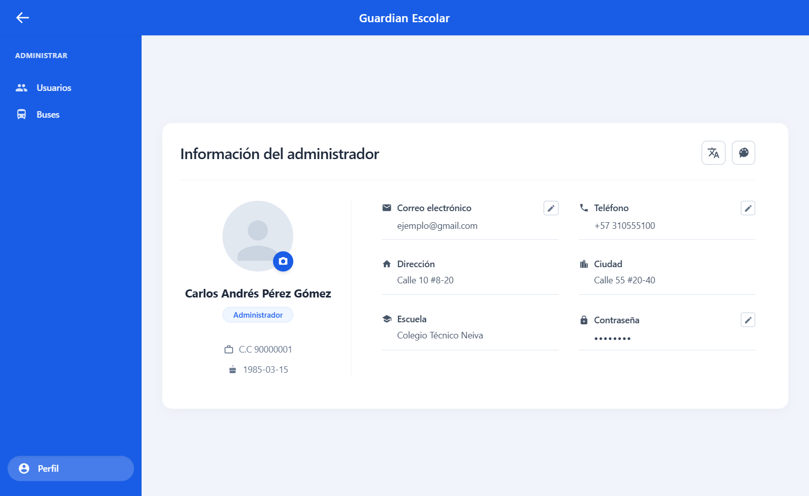

**Resultado esperado:** El sistema muestra un mensaje de confirmación ("Teléfono actualizado", "Correo actualizado" o "Contraseña restablecida") y refleja los nuevos datos o preferencias.

**Observaciones o restricciones:** "¿Necesitas ayuda?" el panel muestra un correo y teléfono de soporte para casos en los que el administrador no pueda completar la verificación.

## 6. Mensajes y validaciones (web)

| **Mensaje del sistema**                          | **Significado**                                                                                        | **Acción del usuario**                                  |
|--------------------------------------------------|--------------------------------------------------------------------------------------------------------|---------------------------------------------------------|
| Registro creado exitosamente                     | El nuevo registro (estudiante, acudiente, conductor, bus, parada, ruta, etc.) se guardó correctamente. | Continuar con el proceso.                               |
| Registro actualizado exitosamente                | Los cambios realizados sobre un registro existente se guardaron.                                       | Verificar la información actualizada.                   |
| Registro eliminado exitosamente                  | El registro fue eliminado del sistema.                                                                 | Confirmar que ya no aparece en el listado.              |
| ¿Seguro que quiere eliminar el registro?         | Advertencia antes de una eliminación definitiva; los datos no podrán recuperarse automáticamente.      | Confirmar solo si se está seguro, o cancelar la acción. |
| Contraseña actualizada / Contraseña restablecida | El cambio de contraseña se realizó con éxito.                                                          | Iniciar sesión con la nueva contraseña.                 |
| Correo actualizado / Teléfono actualizado        | El dato de contacto fue modificado con éxito.                                                          | Verificar el nuevo dato en el perfil.                   |

## 7. Cierre de sesión (web)

Para salir de forma segura del panel, el administrador o superadministrador debe ingresar al menú "Perfil" y seleccionar la opción de cerrar sesión. El sistema finaliza la sesión activa y regresa a la pantalla de Login. Se recomienda cerrar sesión siempre que se use un computador compartido o público.

# Preguntas frecuentes

## Aplicativo móvil

| **Pregunta**                                         | **Respuesta**                                                                                                      |
|------------------------------------------------------|--------------------------------------------------------------------------------------------------------------------|
| ¿Qué hago si olvidé mi contraseña? | En la pantalla "Iniciar sesión", pulsar "¿Olvidaste tu contraseña?" y seguir los pasos de verificación por correo. |
| ¿Por qué no veo la ubicación del bus en tiempo real? | Verificar que el dispositivo tenga conexión a internet activa y que los permisos de ubicación estén habilitados.   |
| ¿Qué hago si mi código QR ya no funciona?            | Cada código es de un solo uso; si ya se utilizó, la aplicación genera uno nuevo automáticamente.                   |
| ¿Cómo reporto un problema con la aplicación? | Desde Mi perfil \> Sobre nosotros \> Soporte, describir el inconveniente y pulsar Enviar. |

## Panel web

| **Pregunta**                                                 | **Respuesta**                                                                                                |
|--------------------------------------------------------------|--------------------------------------------------------------------------------------------------------------|
| ¿Qué hago si olvidé mi contraseña de administrador?          | En la pantalla de Login, pulsar "¿Olvidaste tu contraseña?" y completar los 3 pasos de verificación.         |
| ¿Por qué no puedo ver la sección Escuelas o Administradores? | Esas secciones son exclusivas del rol Superadministrador.                                                    |
| ¿Qué pasa si elimino un registro por error?                  | El sistema solicita confirmación antes de eliminar; una vez eliminado, los datos deben volver a registrarse. |
| ¿A quién contacto si tengo un problema técnico?              | Usar la opción "Soporte" del perfil y describir el inconveniente; la solicitud queda registrada para atención del administrador. |

# Glosario

| **Término**             | **Definición**                                                                                                |
|-------------------------|---------------------------------------------------------------------------------------------------------------|
| Acudiente               | Persona responsable de uno o varios estudiantes ante la institución educativa.                                |
| Ruta                    | Recorrido asignado a un bus escolar, con sus paradas, horarios y destino.                                     |
| Parada                  | Punto geográfico donde el bus recoge o deja estudiantes.                                                      |
| Código QR de abordaje   | Código de un solo uso que un estudiante presenta para registrar su subida o bajada del bus.                   |
| Administrador           | Usuario del panel web responsable de la gestión del transporte escolar de una institución.                    |
| Superadministrador      | Usuario del panel web con permisos sobre todas las instituciones registradas en la plataforma.                |
| Alerta                  | Notificación generada automáticamente ante una novedad del recorrido (retraso, desvío, frenada brusca, etc.). |

# Anexos

Referencia de las pantallas del proyecto de Figma utilizadas para elaborar este manual (archivo "Mockup"):

## Canvas móvil

| **Pantalla**                                 | **node-id**                 |
|----------------------------------------------|-----------------------------|
| Bienvenida                                   | 33:6872                     |
| Inicio de sesion                             | 33:6895                     |
| Olvido contraseña 1 / 2 / 3                  | 33:6915 / 33:6985 / 33:6930 |
| GPS - padres / estudiantes / conductores     | 33:6788 / 33:6826 / 33:6732 |
| Mi ruta                                      | 33:7165                     |
| Rutas cercanas - emergente                   | 33:7795                     |
| Paradas - emergente                          | 33:7640                     |
| Alertas / Filtros de alertas                 | 33:7522 / 33:7454           |
| Qr escaneable / Activar QR / Empezar escaneo | 33:7788 / 33:7870 / 33:7886 |
| Mi perfil / Mis datos                        | 33:7215 / 33:7276           |
| Actualizar telefono / Actualizar correo      | 33:7324 / 33:7336           |
| Mi familia                                   | 33:7307                     |
| Seguridad / Cambiar contraseña               | 33:7349 / 33:7370           |
| Cambiar idioma / Cambiar tema                | 33:7435 / 33:7993           |
| Soporte                                      | 33:7409                     |
| Políticas de privacidad / Quiénes somos      | 33:7384 / 33:7394           |

## Canvas web

| **Pantalla**                                                            | **node-id**                    |
|-------------------------------------------------------------------------|--------------------------------|
| Landing page azul                                                       | 5:10461                        |
| Login                                                                   | 5:10526                        |
| forgot password (email / code / reset)                                  | 559:1779 / 561:1888 / 561:1972 |
| Dashboard admin                                                         | 5:10588                        |
| Dashboard superadmin                                                    | 5:10679                        |
| Estudiantes / Informacion del estudiante / Editar estudiante            | 5:11372 / 5:13232 / 5:13343    |
| Acudiente / Informacion del acudiente / Editar acudiente                | 5:11545 / 5:13270 / 5:13369    |
| Conductores / Informacion del conductor / Editar conductor              | 5:11703 / 5:13305 / 5:13392    |
| Familias / Informacion de la familia / Editar familia                   | 5:12188 / 5:12941 / 5:12955    |
| Buses / Informacion del bus / Editar bus                                | 5:12356 / 5:13420 / 5:12987    |
| Paradas / Informacion de la parada / Editar parada                      | 5:12537 / 5:13442 / 5:13010    |
| Rutas / Informacion de la ruta / Editar ruta                            | 5:12724 / 5:13458 / 5:13026    |
| Administracion de administradores / Informacion del Administrador       | 5:11878 / 5:13633              |
| Administracion de escuelas / Informacion de la Escuela / Editar escuela | 5:12037 / 5:13669 / 5:13711    |
| Configuracion de usuario / Cambiar telefono / Cambiar correo            | 5:10903 / 5:11012 / 5:11104    |
| Cambiar idioma / Cambiar tema                                           | 5:10947 / 5:14930              |
| Feedback admins - emergente / Feedback enviado                          | 638:734 / 5:13629              |

