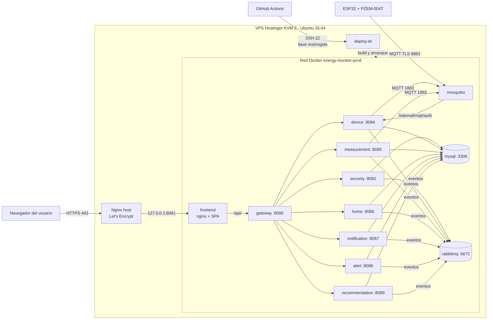
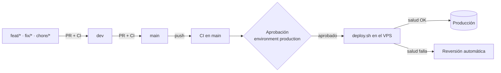

**SERVICIO NACIONAL DE APRENDIZAJE – SENA**

**CENTRO DE LA INDUSTRIA, LA EMPRESA Y LOS SERVICIOS (CIES)**

**REGIONAL HUILA**

Programa de Formación: Tecnología en Análisis y Desarrollo de Software (ADSO)

Ficha: 3145556

**MANUAL DE IMPLEMENTACIÓN Y DESPLIEGUE**

**Proyecto: Monitor de Consumo Eléctrico (EnergyMonitor)**

*Aplicación web, API gateway y servicios Spring Boot, base de datos, cola de mensajes, broker MQTT y medidores ESP32 + PZEM-004T publicados en un VPS, con integración y despliegue continuos*

| **Dato**             | **Información**                                                                 |
|----------------------|---------------------------------------------------------------------------------|
| Integrantes          | Juan Esteban Cortés Parra, Miguel Ángel García Artunduaga                       |
| Centro de Formación  | Centro de la Industria, la Empresa y los Servicios (CIES) – SENA Regional Huila |
| Programa             | Tecnología en Análisis y Desarrollo de Software (ADSO)                          |
| Ficha                | 3145556                                                                         |
| Tipo de documento    | Manual de implementación y despliegue                                           |
| Versión             | 1.4                                                                             |
| Fecha de elaboración | 16 de octubre de 2026 (actualizado el 28 de octubre de 2026)                    |

Neiva, Huila · Colombia · 2026

> **Convención de este documento.** El dominio público del proyecto es `energy-monitor.tech` y
> `<IP_VPS>` es la IP pública del servidor. En el servidor el dominio se define una sola vez
> (`export DOMAIN=energy-monitor.tech`) y los comandos lo usan como `$DOMAIN`. Ningún valor secreto
> (contraseñas, claves, tokens) aparece en este informe.

# Control de versiones del documento

| **Versión** | **Fecha**  | **Descripción del cambio**                                                                                                                                                  | **Responsable**      |
|-------------|------------|-----------------------------------------------------------------------------------------------------------------------------------------------------------------------------|----------------------|
| 1.0         | 16/10/2026 | Creación del informe y runbook de despliegue en producción: web, API, MySQL y broker MQTT en VPS Hostinger con Docker Compose, Nginx y Let's Encrypt; verificación y reversión. | Equipo desarrollador |
| 1.1         | 20/10/2026 | Estrategia de integración y despliegue continuo con GitHub Actions (sección 9); selección y costo del plan Hostinger KVM 2 (3.2); dominio real; evidencias de la ejecución en el VPS; incidentes del despliegue real; actualización y reversión automatizadas. | Equipo desarrollador |
| 1.2         | 24/10/2026 | Arquitectura de servicios en producción: API gateway y servicios de seguridad, dispositivos y mediciones junto al backend (home, alert, recommendation y notification), RabbitMQ con *transactional outbox* y broker autenticado por el servicio de dispositivos; variables nuevas y retiradas (`MEASUREMENT_CONTEXT`, `MQTT_MEASUREMENT_SERVICE_USER/PASS` en lugar de `MQTT_BACKEND_USER/PASS`); `deploy.sh` con siete componentes; pipelines y secretos en cada repositorio; primer despliegue de los servicios en un servidor existente (4.12). | Equipo desarrollador |
| 1.3         | 28/10/2026 | Migración completa: hogares, notificaciones, alertas y recomendaciones como servicios independientes y retiro del backend; `deploy.sh` con diez componentes; pipelines y secretos en los diez repositorios desplegables; migración ejecutada en el servidor (4.13) con sus incidentes (sección 7); registro con verificación previa del correo, términos y código de borrado de cuenta (`SECURITY_ACCOUNT_DELETION_CODE_MAIL_ENABLED`). | Equipo desarrollador |
| 1.4         | 28/10/2026 | Cambios posteriores a la migración (sección 4.14): perfil con foto en seguridad y hogares, alerta de consumo inusual en alertas y notificaciones, y Novedades de la web armadas con el historial de git en cada build (el `Dockerfile` instala git). | Equipo desarrollador |

# Tabla de contenido

| **Sección**                    | **Contenido principal**                                                  |
|--------------------------------|--------------------------------------------------------------------------|
| Resumen ejecutivo              | Qué se despliega, dónde y con qué.                                       |
| 1 · Información general        | Ficha técnica, historial y resumen de cambios del despliegue.            |
| 2 · Alcance y arquitectura     | Componentes, topología, matriz de red y responsabilidades.               |
| 3 · Preparación y seguridad    | Inventario, selección del plan y costos, variables de entorno, respaldo. |
| 4 · Runbook de despliegue      | Paso a paso: DNS, servidor, código, secretos, TLS, arranque, admin y primer despliegue de los servicios. |
| 5 · Integración IoT            | Broker MQTT con TLS público, certificado y vinculación de medidores.     |
| 6 · Pruebas y evidencias       | Pruebas de humo, comandos y evidencias para el cierre académico.         |
| 7 · Incidentes y decisiones    | Problemas encontrados en el despliegue y decisiones técnicas.            |
| 8 · Operación y contingencia   | Monitoreo, actualización, respaldo, reversión, seguridad y acceso SSH.   |
| 9 · Estrategia CI/CD           | Integración y despliegue continuos con GitHub Actions.                   |
| 10 · Conclusiones              | Estado del despliegue, límites y próximos pasos.                         |
| Anexos                         | Rutas, comandos y repositorios de referencia.                            |

> **Alcance de la evidencia.** Las verificaciones ejecutadas en el servidor de producción se marcan
> **«Confirmado»**; las que aún no tienen una salida o captura adjunta se marcan **«Pendiente de
> evidencia»** y no se presentan como hechos.

# Resumen ejecutivo

EnergyMonitor mide el consumo eléctrico de electrodomésticos con módulos ESP32 + PZEM-004T V3 que
publican telemetría por MQTT con TLS; el servicio de mediciones la almacena en MySQL, los servicios
de alertas y de recomendaciones la evalúan, el de notificaciones avisa a los usuarios y la aplicación
web React la presenta a los miembros de cada hogar. Desde el 28 de octubre de 2026 la API está
repartida en siete servicios Spring Boot detrás de un **API gateway**: seguridad, dispositivos,
mediciones, hogares, notificaciones, alertas y recomendaciones. El backend monolítico
(`energy-monitor-backend`) se retiró y su repositorio queda como historial, con el firmware del
medidor. Las rutas públicas de la API no cambiaron para los clientes.

El sistema está desplegado en un **VPS Hostinger plan KVM 2** (2 vCPU, 8 GB de RAM) con **Ubuntu
26.04 LTS**, contratado por un mes a **48.000 COP**. Toda la plataforma corre en **Docker Compose** desde el
repositorio `energy-monitor-infra` (`docker-compose.prod.yml`): MySQL 8.4, RabbitMQ 4.1, el API
gateway, los siete servicios, el broker Mosquitto con
autenticación delegada al servicio de dispositivos y el frontend servido por nginx. **Nginx en el host** es el único
punto de entrada HTTP/HTTPS, con certificados **Let's Encrypt** emitidos por Certbot. La web y la API
se publican en `https://energy-monitor.tech`; los medidores se conectan a
`mqtts://mqtt.energy-monitor.tech:8883`.

Las actualizaciones se hacen con **GitHub Actions**: cada *pull request* ejecuta las pruebas, y cada
cambio que llega a `main` se despliega en el servidor tras una **aprobación manual**, con respaldo
previo de la base de datos, prueba de salud y **reversión automática** si algo falla.

La aplicación móvil queda **fuera del alcance** de este despliegue.

# 1. Información general y control de versiones

## 1.1 Ficha técnica

| **Campo**                    | **Información registrada**                                                   |
|------------------------------|------------------------------------------------------------------------------|
| Sistema                      | EnergyMonitor · monitor de consumo eléctrico doméstico con IoT               |
| Modalidad                    | Aplicación web React/Vite, API gateway y siete servicios Spring Boot (seguridad, dispositivos, mediciones, hogares, notificaciones, alertas y recomendaciones), RabbitMQ, broker MQTT y firmware ESP32 |
| Ambiente                     | Producción / despliegue demostrativo accesible por Internet                  |
| Proveedor de infraestructura | Hostinger VPS · plan **KVM 2** · Ubuntu 26.04 LTS                            |
| Costo de infraestructura     | 48.000 COP/mes con contrato mensual (27.900 COP/mes con contrato anual); detalle en 3.2 |
| Dominio                      | `energy-monitor.tech` (web y API) · `mqtt.energy-monitor.tech` (broker)      |
| Repositorio de despliegue    | `energy-monitor-infra`, archivo `docker-compose.prod.yml`                    |
| Integración y despliegue     | GitHub Actions (`.github/workflows/ci-cd.yml` en el gateway, los siete servicios, la web y la infraestructura) |
| Rama desplegada              | `main` en los diez repositorios desplegados                                  |
| Fecha de consolidación       | 16 de octubre de 2026; despliegue continuo activo desde el 19 de octubre; servicios de seguridad, dispositivos y mediciones desde el 24 de octubre; hogares, notificaciones, alertas y recomendaciones y retiro del backend el 28 de octubre |
| Etiqueta de release          | Tag anotado `final-delivery-2026` en `main` de cada repositorio (aplicación web en la versión `1.0.0`)     |
| Versión de este informe      | 1.4                                                                          |

## 1.2 Historial documental

| **Versión** | **Fecha**  | **Descripción**                                                        |
|-------------|------------|------------------------------------------------------------------------|
| 1.0         | 16/10/2026 | Runbook de despliegue de web, API, MySQL y broker MQTT en producción.  |
| 1.1         | 20/10/2026 | Estrategia CI/CD, plan KVM 2 y costos, evidencias e incidentes reales. |
| 1.2         | 24/10/2026 | API gateway, servicios de seguridad, dispositivos y mediciones, RabbitMQ y variables nuevas. |
| 1.3         | 28/10/2026 | Servicios de hogares, notificaciones, alertas y recomendaciones; retiro del backend; migración ejecutada en el servidor. |

## 1.3 Resumen de cambios que habilitan el despliegue

- Consolidación de todo lo de Docker en `energy-monitor-infra`: pila local, modo desarrollo y
  `docker-compose.prod.yml` para servidor, ahora con el frontend incluido.
- Retiro del repositorio `energy-monitor-devices`: el firmware pasa a `firmware/` del backend y la
  configuración del broker a `infra/mosquitto/`.
- Imagen Docker del frontend (build de Vite + nginx) que sirve la SPA y reenvía solo `/api/` a la
  API (desde la versión 1.2, al API gateway): un único origen, sin CORS entre dominios, y
  `/internal/**` nunca expuesto.
- Permisos del volumen del broker corregidos (servicio `mosquitto-data-owner`), apagado ordenado del
  backend (`stop_grace_period: 30s`) y `SERVER_FORWARD_HEADERS_STRATEGY=native` detrás del proxy.
- Plantillas versionadas en `infra/deploy/`: sitio de Nginx, hook de renovación del certificado del
  broker y respaldo diario de MySQL; `make-admin.sh --prod` para el primer administrador.
- Corrección en el backend: errores del cliente (parámetro faltante, tipo inválido, ruta
  inexistente) responden 4xx en lugar de 500.
- Pipelines de GitHub Actions en los tres repositorios y script `infra/deploy/deploy.sh`, que
  despliega un componente con respaldo, prueba de salud y reversión automática (sección 9).
- **Versión 1.2 (24 de octubre de 2026):** los contextos de seguridad, dispositivos y mediciones
  salieron del backend a servicios propios (`en-monitor-security-service` :8082,
  `en-monitor-device-service` :8084 y `en-monitor-measurement-service` :8085), con un API gateway
  (`en-monitor-api-gateway` :8080) como única entrada de la API. El backend (:8083) conserva `home`,
  `alert`, `recommendation` y `notification`, más tres paquetes intermediarios sin dominio ni tablas
  (`security`, `device` y `measurement`). Los servicios se hablan por REST interno (`/internal/**`
  con `X-Internal-Token`) y por eventos en RabbitMQ 4.1 con *transactional outbox*. El broker
  autentica contra el servicio de dispositivos, el servicio de mediciones es el único que guarda la
  telemetría y el backend ya no se conecta al broker. Cada servicio nuevo tiene su pipeline y
  `deploy.sh` acepta siete componentes.
- **Versión 1.3 (28 de octubre de 2026):** los contextos `home`, `notification`, `alert` y
  `recommendation` salieron del backend a `en-monitor-home-service` :8086,
  `en-monitor-notification-service` :8087, `en-monitor-alert-service` :8088 y
  `en-monitor-recommendation-service` :8089, y el backend se retiró: el repositorio
  `energy-monitor-backend` queda como historial y con el firmware. `deploy.sh` acepta diez
  componentes, cada servicio tiene su pipeline y la migración se ejecutó en el servidor el 28 de
  octubre (4.13). Variables nuevas: `HOME_CONTEXT`, `NOTIFICATION_CONTEXT`, `ALERT_CONTEXT` y
  `RECOMMENDATION_CONTEXT`, y el interruptor `SECURITY_ACCOUNT_DELETION_CODE_MAIL_ENABLED` del código
  de borrado de cuenta.
# 2. Alcance, topología y arquitectura

## 2.1 Componentes desplegados

| **Componente**    | **Tecnología / función**                                                        | **Publicación**                         |
|-------------------|---------------------------------------------------------------------------------|-----------------------------------------|
| Proxy HTTPS       | Nginx en el host, certificados Let's Encrypt (Certbot)                          | `https://energy-monitor.tech` (80 → 443) |
| Frontend web      | React 19 + Vite; contenedor nginx que sirve la SPA y reenvía `/api/` al gateway | Detrás del proxy (127.0.0.1:8081)       |
| API gateway       | Spring Cloud Gateway (Spring Boot 4.0.8, Java 21), contenedor `gateway` :8080: única entrada de la API, CORS, validación del token, límite de los POST públicos de cuenta, rechazo de `/internal/**` | `/api/v1/**` a través del frontend      |
| Servicio de seguridad | Java 21, Spring Boot 4.1.1, contenedor `security` :8082: cuentas, sesiones, JWT RS256, Google, RBAC y administración de usuarios | Solo red Docker interna |
| Servicio de dispositivos | Java 21, Spring Boot 4.1.1, contenedor `device` :8084: vinculación, credenciales, autenticación y ACL del broker, comandos y conectividad | Solo red Docker interna |
| Servicio de mediciones | Java 21, Spring Boot 4.1.1, contenedor `measurement` :8085: único que guarda la telemetría; historial, estadísticas, consumo y niveles | Solo red Docker interna |
| Servicio de hogares | Java 21, Spring Boot 4.1.1, contenedor `home` :8086: hogares, miembros, roles, favoritos, umbrales, eliminación y transferencia; responde las verificaciones que le hacen los demás servicios | Solo red Docker interna |
| Servicio de notificaciones | Java 21, Spring Boot 4.1.1, contenedor `notification` :8087: entregas, preferencias, correo (el único que envía correo), Web Push, push Expo, avisos in-app y actividad de hogares y dispositivos | Solo red Docker interna |
| Servicio de alertas | Java 21, Spring Boot 4.1.1, contenedor `alert` :8088: alertas de consumo y de conectividad a partir de las lecturas y de los eventos de los dispositivos | Solo red Docker interna |
| Servicio de recomendaciones | Java 21, Spring Boot 4.1.1, contenedor `recommendation` :8089: reglas de ahorro evaluadas cada hora | Solo red Docker interna |
| Cola de mensajes  | RabbitMQ 4.1, volumen `rabbitmq-data`: eventos entre servicios (*outbox*) y pedidos de correo | Red Docker; consola en 127.0.0.1:15672 |
| Base de datos     | MySQL 8.4, una sola base `energy_monitor` compartida (cada servicio con sus tablas), volumen `mysql-data` | Solo red Docker interna |
| Broker MQTT       | Mosquitto 2.0 + mosquitto-go-auth (auth y ACL delegadas al servicio de dispositivos) | `mqtt.energy-monitor.tech:8883` (TLS)   |
| Medidores         | ESP32 + PZEM-004T V3, firmware con raíces de Let's Encrypt                      | Conexión saliente al broker             |
| CI/CD             | GitHub Actions + `infra/deploy/deploy.sh` en el VPS                             | SSH con llave restringida               |

## 2.2 Diagrama de arquitectura



*Figura 1. Topología lógica: clientes, proxy, gateway y servicios, persistencia, cola de mensajes, broker y canal de despliegue. Las llamadas REST internas entre servicios (`/internal/**`) se omiten para no recargar la figura.*

El dominio principal sirve la web y, por la ruta `/api/`, la API. El nginx del frontend solo
reenvía `/api/` al API gateway, que reparte cada ruta a su servicio (`/api/v1/auth/**`,
`/api/v1/admin/users/**`, `/api/v1/admin/roles/**` y `/api/v1/support/**` a seguridad;
`/api/v1/homes/{homeId}/devices/**` y `/api/v1/appliance-types/**` a dispositivos;
`/api/v1/measurements/**`, `/api/v1/consumption-levels/**` y `/api/v1/homes/{homeId}/consumption/**` a
mediciones; el resto de `/api/v1/homes/**` y `/api/v1/home-types/**` a hogares; `/api/v1/notifications/**` y
`/api/v1/admin/notifications/**` a notificaciones; `/api/v1/alerts/**` a alertas;
`/api/v1/recommendations/**` a recomendaciones; cualquier otra ruta responde 404) y rechaza `/internal/**`. Así, los endpoints
internos entre servicios y con los que el broker autentica a cada cliente (`/internal/mqtt/auth/**`)
no son alcanzables desde Internet. El broker es el único servicio publicado directamente (8883,
TLS), porque los medidores no hablan HTTP.

## 2.3 Matriz de red y puertos

| **Servicio**          | **Dirección / puerto**                  | **Exposición**              |
|-----------------------|-----------------------------------------|-----------------------------|
| SSH                   | 22                                      | Público (administración y GitHub Actions) |
| Nginx host            | 80 (redirección) / 443 (TLS)            | Público                     |
| Frontend (nginx)      | 127.0.0.1:8081 → contenedor :80         | Solo host                   |
| API gateway           | contenedor :8080                        | Privado (red Docker)        |
| Seguridad, dispositivos, mediciones, hogares, notificaciones, alertas y recomendaciones | contenedores :8082, :8084, :8085, :8086, :8087, :8088 y :8089 | Privado (red Docker)  |
| RabbitMQ              | contenedor :5672 (AMQP); consola 127.0.0.1:15672 | Privado; consola solo por túnel SSH |
| MySQL 8.4             | contenedor :3306                        | Privado (red Docker)        |
| Mosquitto interno     | contenedor :1883 (sin TLS)              | Privado (red Docker)        |
| Mosquitto dispositivos| 8883 (TLS)                              | Público                     |

## 2.4 Separación de responsabilidades

El navegador habla solo con `https://energy-monitor.tech`: la SPA y la API comparten origen, y la
sesión web viaja en cookies HttpOnly. El API gateway es la única entrada de la API y valida el
token (RS256) salvo en los endpoints públicos. El servicio de seguridad gestiona cuentas, sesiones,
JWT y administración; el de dispositivos, la vinculación y las credenciales, y es la única fuente de
verdad de qué dispositivo puede conectarse: el broker no guarda usuarios y le pregunta por cada
conexión y cada tópico (con caché de 5 min). El servicio de mediciones es el único que guarda la
telemetría y anuncia cada lectura por RabbitMQ (`measurement.recorded`); el de hogares gestiona
hogares, miembros y umbrales; el de alertas crea las alertas con las lecturas y los eventos de los
dispositivos; el de recomendaciones las evalúa cada hora; y el de notificaciones las entrega y es el
único que envía correo. Los servicios se consultan
entre sí por `/internal/**` (solo desde la red Docker y con el encabezado `X-Internal-Token`) y se
avisan por eventos en RabbitMQ con *transactional outbox* (entrega al menos una vez y colas con
*dead-letter* tras tres intentos). Todos usan la misma base MySQL, cada uno con sus tablas y sus
changesets de Liquibase. Los medidores solo abren conexiones salientes, así que funcionan detrás de
cualquier router doméstico.

# 3. Requisitos previos y preparación

## 3.1 Inventario de plataforma

| **Recurso**          | **Configuración**                                                              |
|----------------------|--------------------------------------------------------------------------------|
| VPS                  | Hostinger KVM 2 · 2 vCPU · 8 GB RAM · 100 GB NVMe · Ubuntu 26.04 LTS (hostname `srv2066688`) |
| Orquestación         | Docker Engine + plugin Docker Compose v2                                       |
| Proxy / TLS          | Nginx en el host; Let's Encrypt con Certbot (renovación automática)            |
| Compilación          | En el propio VPS (`--build`): Maven dentro de la imagen de cada servicio Java, Vite en la del frontend |
| CI/CD                | GitHub Actions (runners `ubuntu-latest` alojados por GitHub)                   |
| Dominio              | `energy-monitor.tech` con registros A para `@`, `www` y `mqtt`                 |

## 3.2 Selección del proveedor y del plan

**Requisitos que debía cumplir la infraestructura:**

- Exponer un **puerto TCP propio (8883)** para MQTT con TLS, además de HTTP/HTTPS: muchas
  plataformas PaaS solo publican HTTP, y un VPS da control total de puertos y firewall.
- Ejecutar **cuatro contenedores permanentes** (MySQL, backend JVM, Mosquitto y frontend) y, en cada
  despliegue, **compilar** el backend con Maven y el frontend con Vite en el mismo servidor.
- Costo mensual fijo y predecible, en pesos, acorde a un proyecto formativo.
- Proveedor con panel en español, firewall administrable y gestión de DNS del dominio.

**Comparación de planes VPS de Hostinger:**

| **Plan** | **vCPU** | **RAM** | **Disco NVMe** | **Evaluación para EnergyMonitor**                                                       |
|----------|----------|---------|----------------|-----------------------------------------------------------------------------------------|
| KVM 1    | 1        | 4 GB    | 50 GB          | Insuficiente: la JVM, MySQL y una compilación de Maven simultánea agotan la memoria y obligan a usar swap. |
| **KVM 2**| **2**    | **8 GB**| **100 GB**     | **Elegido**: compila y ejecuta toda la pila sin swap, con margen para crecer en medidores e historial. |
| KVM 4    | 4        | 16 GB   | 200 GB         | Sobredimensionado para la carga de un piloto; duplica el costo sin beneficio actual.    |

**Decisión:** plan **KVM 2**. Con 2 vCPU la compilación no bloquea al backend en ejecución, y los
8 GB de RAM (7,7 GB utilizables según el sistema operativo) alcanzan para la JVM del backend, MySQL,
Mosquitto, nginx y una compilación al mismo tiempo. Si la carga crece, Hostinger permite subir de
plan sin reinstalar.

> **Versión 1.2.** Con la arquitectura de servicios la pila pasó a nueve contenedores permanentes
> (MySQL, RabbitMQ, el gateway, los servicios de seguridad, dispositivos y mediciones, el backend,
> Mosquitto y el frontend), cinco de ellos JVM, en el mismo plan KVM 2. El consumo de recursos con
> esa pila no se ha medido todavía (6.1).

**Plazo de contratación:** el precio del plan depende del plazo. El proyecto lo contrató **por un
mes** (48.000 COP), suficiente para la demostración y la sustentación sin comprometer un pago anual.
Para una operación continua conviene el contrato de 12 meses:

| **Plazo de contratación** | **Precio mensual** | **Costo de 12 meses** | **Observación**                                      |
|---------------------------|--------------------|-----------------------|------------------------------------------------------|
| Mensual (contratado)      | 48.000 COP         | 576.000 COP           | Sin compromiso; se renueva mes a mes                 |
| Anual                     | 27.900 COP         | 334.800 COP           | Pago anticipado; ahorra 241.200 COP al año (≈ 42 %)  |

**Costos de operación del despliegue actual:**

| **Concepto**                 | **Costo**             | **Observación**                                  |
|------------------------------|-----------------------|--------------------------------------------------|
| VPS Hostinger KVM 2          | 48.000 COP/mes        | Contrato mensual                                 |
| Dominio `energy-monitor.tech`| 0 COP                 | Obtenido sin costo; revisar el precio de renovación antes del vencimiento |
| Certificados TLS             | 0 COP                 | Let's Encrypt (gratuito, renovación automática)  |
| GitHub y GitHub Actions      | 0 COP                 | Dentro de los minutos incluidos sin costo        |
| **Total infraestructura**    | **48.000 COP/mes**    | Con contrato anual: 27.900 COP/mes               |

## 3.3 Checklist de prerrequisitos

- Registros DNS A de `energy-monitor.tech`, `www.energy-monitor.tech` y `mqtt.energy-monitor.tech`
  apuntando a `<IP_VPS>`.
- Acceso SSH al VPS con un usuario con `sudo` (o root), con una llave personal distinta de la de
  GitHub Actions (8.5).
- Puertos 80 y 443 libres para Nginx (no instalar otro proxy que compita por ellos) y 8883 libre
  para el broker.
- Cambios fusionados en `main` en `energy-monitor-infra`, `en-monitor-api-gateway`,
  `en-monitor-security-service`, `en-monitor-device-service`, `en-monitor-measurement-service`,
  `en-monitor-home-service`, `en-monitor-notification-service`, `en-monitor-alert-service`,
  `en-monitor-recommendation-service` y `Energy-Monitor-application`.
- Cuenta de correo para envío (contraseña de aplicación de Gmail) y, si se usa, cliente OAuth de
  Google con `https://energy-monitor.tech` en *Authorized JavaScript origins*.
- Secretos gestionados fuera de los repositorios, con permisos restringidos (`chmod 600`).

## 3.4 Gestión de variables de entorno

Se documentan solo valores públicos; los secretos se generan en el servidor y viven en
`infra/.env.prod` (ignorado por git, permisos 600).

| **Capa**   | **Variable / valor sin secretos**                                        | **Propósito**                                   |
|------------|---------------------------------------------------------------------------|-------------------------------------------------|
| Código     | `SECURITY_CONTEXT`, `DEVICE_CONTEXT`, `MEASUREMENT_CONTEXT`, `HOME_CONTEXT`, `NOTIFICATION_CONTEXT`, `ALERT_CONTEXT`, `RECOMMENDATION_CONTEXT`, `GATEWAY_CONTEXT`, `FRONTEND_CONTEXT` (por defecto `../backend/...` y `../frontend/energy-monitor-web`) | Clones desde los que se construye cada imagen |
| Gateway    | `SECURITY_CORS_ALLOWED_ORIGINS=https://energy-monitor.tech,https://www.energy-monitor.tech` | Orígenes permitidos (el CORS lo responde el gateway) |
| Notificaciones | `NOTIFICATION_WEB_URL=https://energy-monitor.tech`                    | Enlaces de los correos de alerta                |
| Dispositivos | `DEVICE_MQTT_PUBLIC_HOST=mqtt.energy-monitor.tech` · `DEVICE_MQTT_PUBLIC_PORT=8883` | Broker que la web escribe al medidor |
| Seguridad  | `JWT_KEYS_DIR=/opt/energy-monitor/keys` · `BACKEND_UID/GID=10001`         | Par RSA de los JWT y usuario con el que corre el servicio de seguridad, el único que lee `private.pem`; los demás reciben solo `public.pem` |
| Seguridad  | `SECURITY_ACCOUNT_DELETION_CODE_MAIL_ENABLED=true`                        | Interruptor del correo con el código de borrado de una cuenta de Google; se enciende solo cuando el servicio de notificaciones ya está desplegado (con el interruptor apagado, pedir el código responde 503) |
| Notificaciones | `MAIL_HOST=smtp.gmail.com` · `MAIL_PORT=587` · `MAIL_FROM=...`    | Correo de recuperación, verificación, código de borrado y alertas (solo el servicio de notificaciones envía correo) |
| Mensajería | `RABBITMQ_USERNAME=energy-monitor`                                        | Usuario de RabbitMQ, el mismo en todos los servicios |
| Broker     | `MQTT_DEVICE_SERVICE_USER=em-device-service` · `MQTT_MEASUREMENT_SERVICE_USER=em-measurement-service` | Usuarios MQTT de los servicios de dispositivos y de mediciones |
| Todos      | `MYSQL_PASSWORD`, `MYSQL_ROOT_PASSWORD`, `SECURITY_RESET_PEPPER`, `RABBITMQ_PASSWORD`, `INTERNAL_API_TOKEN`, `MQTT_DEVICE_SERVICE_PASS`, `MQTT_MEASUREMENT_SERVICE_PASS`, `MAIL_PASSWORD`, `GOOGLE_CLIENT_SECRET`, `NOTIFICATION_VAPID_PRIVATE_KEY`, `EXPO_ACCESS_TOKEN` (valores omitidos) | Secretos protegidos |
| Broker     | `MQTT_CERT_DIR=/opt/energy-monitor/mqtt-certs`                            | Certificado Let's Encrypt de `mqtt.energy-monitor.tech` |
| Web        | `VITE_API_BASE_URL=""` (fijo en la compose)                               | API en el mismo origen                          |
| Web        | `VITE_GOOGLE_CLIENT_ID=<id público>`                                      | Botón de Google                                 |
| Proxy      | `WEB_PORT=8081`                                                           | Puerto local al que apunta Nginx                |
| GitHub     | `DEPLOY_HOST`, `DEPLOY_USER`, `DEPLOY_SSH_KEY`, `DEPLOY_KNOWN_HOSTS` (secretos del environment `production` de cada repositorio) | Acceso de GitHub Actions al VPS (9.8) |

Las direcciones internas entre servicios (`SECURITY_SERVICE_URL`, `DEVICE_SERVICE_URL`,
`MEASUREMENT_SERVICE_URL`, `HOME_SERVICE_URL`, `NOTIFICATION_SERVICE_URL`, `ALERT_SERVICE_URL` y
`RECOMMENDATION_SERVICE_URL`) están fijas en `docker-compose.prod.yml` y no van en `.env.prod`.
`INTERNAL_API_TOKEN` y `RABBITMQ_PASSWORD` tienen el mismo valor en todos los servicios: cada
contenedor los toma de `.env.prod`.

> **Variables retiradas.** En la versión 1.2, `MQTT_BACKEND_USER/PASS`, `MQTT_CLIENT_ID` y
> `DEVICE_OFFLINE_AFTER` dejaron de ser del backend, que no se conecta al broker. En la versión 1.3,
> con el backend retirado, `BACKEND_CONTEXT` ya no existe. Los interruptores `HOME_OUTBOX_RELAY_ENABLED`,
> `ACCOUNT_DELETED_CONSUMER_ENABLED`, `SECURITY_EVENTS_CONSUMER_ENABLED`, `ALERT_EVENTS_CONSUMER_ENABLED`,
> `ALERT_CONSUMERS_ENABLED`, `ALERT_SERVICE_OUTBOX_RELAY_ENABLED`, `RECOMMENDATION_SCHEDULER_ENABLED` y
> `RECOMMENDATION_OUTBOX_RELAY_ENABLED` valen `true` por defecto: en `.env.prod` deben borrarse si
> estaban en `false`.

> **Importante.** Las variables `VITE_*` se incorporan al compilar la imagen del frontend: cambiar
> `.env.prod` después no modifica una imagen ya construida; hay que reconstruir `frontend`.

## 3.5 Respaldo y contingencia previa

En una instalación nueva no hay datos que respaldar. En cada despliegue posterior `deploy.sh`
ejecuta automáticamente el respaldo de MySQL y registra la versión anterior de cada repositorio
(sección 9.6). Además:

1. Conservar una copia segura de `.env.prod`, de `/opt/energy-monitor/keys` y del certificado del
   broker fuera del servidor.
2. Confirmar que ningún procedimiento ejecuta `docker compose down -v` ni borra volúmenes.
3. En una actualización manual, ejecutar antes `infra/deploy/backup-mysql.sh` y comprobar que el
   archivo `.sql.gz` no esté vacío.

# 4. Procedimiento de despliegue paso a paso (runbook)

Este procedimiento corresponde a la **instalación inicial** del servidor. Las actualizaciones
posteriores las hace GitHub Actions (sección 9). Todos los comandos se ejecutan en el VPS por SSH.
Definir primero las variables de la sesión:

```bash
export DOMAIN=energy-monitor.tech
export EM=/opt/energy-monitor
```

## 4.1 Dominio y DNS

En el panel de Hostinger (Dominios → DNS / Nameservers) crear los registros **A**:

| **Nombre** | **Tipo** | **Valor**   | **TTL** |
|------------|----------|-------------|---------|
| `@`        | A        | `<IP_VPS>`  | 300     |
| `www`      | A        | `<IP_VPS>`  | 300     |
| `mqtt`     | A        | `<IP_VPS>`  | 300     |

Verificar la propagación antes de pedir certificados:

```bash
getent hosts $DOMAIN www.$DOMAIN mqtt.$DOMAIN
```

## 4.2 Preparación del servidor

```bash
sudo apt update && sudo apt -y upgrade
sudo apt -y install ca-certificates curl git openssl ufw nginx certbot python3-certbot-nginx

# Docker Engine + Compose (script oficial; revisar su contenido antes de ejecutarlo)
curl -fsSL https://get.docker.com -o get-docker.sh
less get-docker.sh
sudo sh get-docker.sh
# Si el repositorio de Docker aún no publica paquetes para 26.04, usar los de Ubuntu:
#   sudo apt -y install docker.io docker-compose-v2
docker --version && docker compose version
```

Firewall (los puertos que publica Docker no pasan por ufw; por eso la compose solo publica en
`127.0.0.1` lo que no debe ser público):

```bash
sudo ufw allow OpenSSH
sudo ufw allow 80/tcp
sudo ufw allow 443/tcp
sudo ufw allow 8883/tcp
sudo ufw enable
sudo ufw status
```

En el **firewall del panel de Hostinger** (si está activo) abrir los mismos puertos: 22, 80, 443 y
8883.

Con el plan KVM 2 (8 GB) no se necesita swap. En un plan con menos de 4 GB de RAM sí hay que crearla
para que compilen Maven y Vite:

```bash
sudo fallocate -l 2G /swapfile && sudo chmod 600 /swapfile
sudo mkswap /swapfile && sudo swapon /swapfile
echo '/swapfile none swap sw 0 0' | sudo tee -a /etc/fstab
```

## 4.3 Código fuente

La compose de producción construye el gateway, los siete servicios y el frontend desde clones
vecinos de `infra`. Los diez clones siguen la rama `main`, que es la que despliega GitHub Actions:

```bash
sudo mkdir -p $EM && sudo chown "$USER": $EM && cd $EM
git clone --branch main https://github.com/Juan-Cortes2045/energy-monitor-infra.git infra
git clone --branch main https://github.com/Juan-Cortes2045/en-monitor-api-gateway.git backend/en-monitor-api-gateway
git clone --branch main https://github.com/Juan-Cortes2045/en-monitor-security-service.git backend/en-monitor-security-service
git clone --branch main https://github.com/Juan-Cortes2045/en-monitor-device-service.git backend/en-monitor-device-service
git clone --branch main https://github.com/Juan-Cortes2045/en-monitor-measurement-service.git backend/en-monitor-measurement-service
git clone --branch main https://github.com/angelgarcia0/en-monitor-home-service.git backend/en-monitor-home-service
git clone --branch main https://github.com/angelgarcia0/en-monitor-notification-service.git backend/en-monitor-notification-service
git clone --branch main https://github.com/angelgarcia0/en-monitor-alert-service.git backend/en-monitor-alert-service
git clone --branch main https://github.com/angelgarcia0/en-monitor-recommendation-service.git backend/en-monitor-recommendation-service
git clone --branch main https://github.com/Juan-Cortes2045/Energy-Monitor-application.git frontend/energy-monitor-web
```

Si algún clon está en otra ruta, se indica en `.env.prod` con su variable `*_CONTEXT` (3.4).

Si un repositorio es privado, crear una clave SSH en el servidor (`ssh-keygen -t ed25519`),
registrarla como *Deploy key* de solo lectura en GitHub (Settings → Deploy keys) y clonar con la URL
SSH (`git@github.com:...`).

## 4.4 Secretos y claves

```bash
# Par RSA de los JWT: private.pem solo lo lee el servicio de seguridad (uid 10001);
# public.pem lo leen también el gateway y los demás servicios
sudo mkdir -p $EM/keys
sudo openssl genpkey -algorithm RSA -pkeyopt rsa_keygen_bits:2048 -out $EM/keys/private.pem
sudo openssl rsa -in $EM/keys/private.pem -pubout -out $EM/keys/public.pem
sudo chown -R 10001:10001 $EM/keys && sudo chmod 600 $EM/keys/private.pem && sudo chmod 644 $EM/keys/public.pem

# Valores aleatorios para .env.prod (se copian a mano; no se guardan en el historial)
openssl rand -hex 24   # MYSQL_PASSWORD
openssl rand -hex 24   # MYSQL_ROOT_PASSWORD
openssl rand -hex 32   # SECURITY_RESET_PEPPER
openssl rand -hex 24   # RABBITMQ_PASSWORD
openssl rand -hex 32   # INTERNAL_API_TOKEN
openssl rand -hex 24   # MQTT_DEVICE_SERVICE_PASS
openssl rand -hex 24   # MQTT_MEASUREMENT_SERVICE_PASS
```

Claves VAPID para push en el navegador (una vez por entorno). Cada valor debe quedar en **una sola
línea**, sin espacios ni saltos (ver incidente en la sección 7):

```bash
openssl ecparam -name prime256v1 -genkey -noout -out vapid.pem
echo "NOTIFICATION_VAPID_PRIVATE_KEY=$(openssl ec -in vapid.pem -outform DER | tail -c +8 | head -c 32 | base64 -w0 | tr '+/' '-_' | tr -d '=')"
echo "NOTIFICATION_VAPID_PUBLIC_KEY=$(openssl ec -in vapid.pem -pubout -outform DER | tail -c 65 | base64 -w0 | tr '+/' '-_' | tr -d '=')"
rm vapid.pem
```

## 4.5 Proxy HTTPS: Nginx y Let's Encrypt

```bash
cd $EM/infra
sed "s/DOMINIO/$DOMAIN/g" deploy/nginx-energy-monitor.conf | sudo tee /etc/nginx/sites-available/energy-monitor >/dev/null
sudo ln -sf /etc/nginx/sites-available/energy-monitor /etc/nginx/sites-enabled/energy-monitor
sudo rm -f /etc/nginx/sites-enabled/default
test -s /etc/nginx/sites-available/energy-monitor && echo "sitio OK"   # no debe quedar vacío
sudo nginx -t && sudo systemctl reload nginx

# Certificado de la web y la API (Certbot agrega el bloque 443 y la redirección a HTTPS)
sudo certbot --nginx -d $DOMAIN -d www.$DOMAIN
```

El sitio reenvía **todo** el dominio a `127.0.0.1:8081` (nginx del frontend), reemplaza
`X-Forwarded-For` por la IP real del cliente para que no pueda falsificarse y admite cuerpos de
hasta 10 MB. Si el certificado ya existe pero el sitio se regeneró, se reinstala con
`sudo certbot install --nginx --cert-name $DOMAIN`.

## 4.6 Certificado del broker MQTT

El broker usa su propio certificado Let's Encrypt para `mqtt.energy-monitor.tech`. Certbot lo emite
por HTTP-01 a través de Nginx y el hook `renew-mqtt-cert.sh` lo copia donde lo lee Mosquitto
(uid 1000) en la emisión y en cada renovación:

```bash
sudo certbot certonly --nginx -d mqtt.$DOMAIN
sudo cp $EM/infra/deploy/renew-mqtt-cert.sh /etc/letsencrypt/renewal-hooks/deploy/energy-monitor-mqtt.sh
sudo chmod 755 /etc/letsencrypt/renewal-hooks/deploy/energy-monitor-mqtt.sh
sudo MQTT_DOMAIN=mqtt.$DOMAIN /etc/letsencrypt/renewal-hooks/deploy/energy-monitor-mqtt.sh
ls -l $EM/mqtt-certs          # server.crt y server.key, dueño 1000
```

Si `mqtt-certs` queda vacío, Mosquitto se reinicia en bucle: ejecutar de nuevo el hook (última línea
con `MQTT_DOMAIN`).

## 4.7 Configuración de producción (.env.prod)

```bash
cd $EM/infra
cp .env.prod.example .env.prod && chmod 600 .env.prod
nano .env.prod
```

Valores a completar (además de los secretos generados en 4.4). Las rutas `*_CONTEXT`,
`RABBITMQ_USERNAME`, `MQTT_DEVICE_SERVICE_USER` y `MQTT_MEASUREMENT_SERVICE_USER` ya traen su valor
por defecto en la plantilla:

```
SECURITY_CORS_ALLOWED_ORIGINS=https://energy-monitor.tech,https://www.energy-monitor.tech
NOTIFICATION_WEB_URL=https://energy-monitor.tech
DEVICE_MQTT_PUBLIC_HOST=mqtt.energy-monitor.tech
JWT_KEYS_DIR=/opt/energy-monitor/keys
MQTT_CERT_DIR=/opt/energy-monitor/mqtt-certs
BACKEND_UID=10001
BACKEND_GID=10001
MAIL_USERNAME / MAIL_PASSWORD / MAIL_FROM
GOOGLE_CLIENT_ID / GOOGLE_CLIENT_SECRET / VITE_GOOGLE_CLIENT_ID   (opcional)
NOTIFICATION_VAPID_PUBLIC_KEY / NOTIFICATION_VAPID_PRIVATE_KEY    (opcional)
EXPO_ACCESS_TOKEN                                                 (opcional)
```

Validar sin arrancar nada:

```bash
docker compose -f docker-compose.prod.yml --env-file .env.prod config -q && echo OK
```

## 4.8 Construcción y arranque

Primero se crea el alias `emc`, para no repetir el archivo de producción en cada comando (un
`docker compose` sin `-f docker-compose.prod.yml` usaría la pila local y fallaría):

```bash
echo "alias emc='docker compose -f $EM/infra/docker-compose.prod.yml --env-file $EM/infra/.env.prod --project-directory $EM/infra'" >> ~/.bashrc
source ~/.bashrc

emc up -d --build
emc ps
emc logs -f security device measurement home notification alert recommendation gateway     # Ctrl+C para salir
```

La primera construcción tarda varios minutos (dependencias de Maven y npm, una imagen por servicio
Java). En el primer arranque cada servicio aplica con Liquibase sus propios changesets sobre la base
compartida; los servicios tardan unos 2 minutos en quedar listos y, mientras tanto, la web puede
responder **502** o la API **503**. Está listo cuando `emc ps` muestra `gateway`, `security`,
`device`, `measurement`, `home`, `notification`, `alert` y `recommendation` en estado `(healthy)`. Los servicios no publican puertos en el
host; su salud se consulta dentro del contenedor:

```bash
emc exec gateway curl -fsS http://localhost:8080/actuator/health    # {"status":"UP"...}
emc exec home curl -fsS http://localhost:8086/actuator/health    # igual en security :8082, device :8084, measurement :8085, notification :8087, alert :8088 y recommendation :8089
```

## 4.9 Primer administrador

Ninguna cuenta es administradora al instalar. Registrar la cuenta en `https://energy-monitor.tech`
y luego:

```bash
cd $EM/infra
./make-admin.sh --prod correo-del-admin@ejemplo.com
```

Sin `--prod` el script busca la pila local y no encuentra `MYSQL_ROOT_PASSWORD`. Cerrar sesión y
volver a entrar: el menú muestra **Administración**. Desde ahí ese administrador otorga el rol a
otras cuentas.

## 4.10 Respaldo diario

```bash
sudo crontab -e
# agregar:
0 3 * * * /opt/energy-monitor/infra/deploy/backup-mysql.sh >> /var/log/energy-monitor-backup.log 2>&1
```

Ejecutarlo una vez a mano para comprobarlo: `sudo $EM/infra/deploy/backup-mysql.sh`. Los respaldos
se conservan 14 días en `/opt/energy-monitor/backups`.

## 4.11 Habilitar el despliegue continuo

Al terminar la instalación inicial se configura GitHub Actions (sección 9.8). Desde ese momento no
se vuelve a desplegar a mano.

## 4.12 Primer despliegue de los servicios en un servidor existente

Un servidor instalado con una versión anterior (solo el backend) pasa a la arquitectura de servicios
en tres pasos, en este orden. En los tres, los changesets de Liquibase que ya había aplicado el
backend se reconocen en `DATABASECHANGELOG` (se movieron con la misma ruta) y no se repiten.

1. **Gateway y servicio de seguridad.** Clonar `en-monitor-api-gateway` y
   `en-monitor-security-service` en `backend/`; agregar a `.env.prod` `RABBITMQ_PASSWORD`,
   `INTERNAL_API_TOKEN` y `SECURITY_CONTEXT`/`GATEWAY_CONTEXT`, conservando el mismo
   `SECURITY_RESET_PEPPER` (con otro, los códigos de recuperación ya enviados dejan de servir), y
   ejecutar `deploy/deploy.sh infra`: crea RabbitMQ, construye el servicio de seguridad y el gateway y
   recrea el resto.
2. **Servicio de dispositivos.** Va junto, en `main`, con el backend sin módulo de dispositivos y las
   rutas nuevas del gateway. Clonar `en-monitor-device-service` en `backend/`, agregar a `.env.prod`
   `DEVICE_CONTEXT` y `MQTT_DEVICE_SERVICE_PASS` y ejecutar `deploy/deploy.sh infra`: construye el
   servicio, recrea el backend, el gateway y el broker, que desde ahí pregunta a `device:8084`. Solo
   se crea `device_outbox`; los medidores siguen con su `device_code` y su API key y no hace falta
   volver a vincularlos.
3. **Servicio de mediciones.** Va junto, en `main`, con el backend sin módulo de mediciones, las rutas
   nuevas del gateway y el servicio de dispositivos que reconoce al usuario MQTT nuevo:
   1. Respaldo de MySQL (`deploy/backup-mysql.sh`).
   2. Clonar `en-monitor-measurement-service` en `backend/` (`--branch main`) y agregar a `.env.prod`
      `MEASUREMENT_CONTEXT` y `MQTT_MEASUREMENT_SERVICE_PASS` (`openssl rand -hex 24`).
      `MQTT_BACKEND_USER/PASS` ya no se usan.
   3. Desplegar primero el servicio de dispositivos (`deploy.sh device`): desde ahí el broker acepta
      al usuario de mediciones.
   4. `deploy/deploy.sh infra`: construye el servicio de mediciones (aplica `measurement-004`, su
      *outbox*), recrea el backend sin cliente MQTT y el gateway con las rutas nuevas. Las lecturas
      siguen en la misma tabla `measurement`: el historial no se mueve.

Desde ese punto, cada repositorio nuevo despliega su propio servicio con su pipeline (9.4).

## 4.13 Migración del 28 de octubre de 2026 (ejecutada)

Este es el procedimiento que se ejecutó en el servidor el 28 de octubre de 2026 para pasar de los
tres servicios y el backend a los siete servicios y retirar el backend, con lo observado en cada
paso. Los incidentes están en la sección 7.

1. **Respaldo.** `deploy/backup-mysql.sh` generó el `.sql.gz` en `/opt/energy-monitor/backups`.
2. **Eventos pendientes del backend.** La tabla `backend_outbox` no existía en ese servidor (la
   versión instalada era anterior), así que no había eventos por vaciar. Si existiera, no debe
   quedar ninguna fila con `published_at IS NULL` antes de retirar el backend.
3. **Clones.** Los cuatro repositorios nuevos en `main` (4.3).
4. **`.env.prod`.** Sin los interruptores antiguos en `false` y con los valores requeridos
   presentes (revisados sin imprimirlos).
5. **`deploy.sh infra`.** Construyó home, notification, alert y recommendation, eliminó el
   contenedor del backend (`--remove-orphans`) y recreó Mosquitto. La segunda ejecución terminó en
   `OK` a las 03:54, con infra en `ceb1543` (la primera tuvo el incidente 1 de la sección 7).
6. **Un servicio a la vez.** `deploy.sh gateway`, `device` (de `b64bda5` a `06c1bdc`),
   `measurement`, `frontend` y `security`: traen las rutas nuevas del gateway y los cambios de
   cuentas. Cada uno terminó en `OK`.
7. **Colas del backend.** `rabbitmqctl delete_queue` de las diez colas `energy-monitor-backend.*`
   (con sus `.dlq`), que ya nadie consume.
8. **Verificación.** `emc ps` con los ocho servicios en `healthy`, `GET /api/v1/homes` → 401 y,
   en los logs, solo dos líneas de error de `measurement` («Lost connection» del cliente MQTT) que
   coinciden con los reinicios de Mosquitto de `deploy.sh infra` y se recuperan solas.
9. **Código de borrado de cuenta.** Comprobar que la cola `notification-service.notification.mail`
   tiene el *binding* de `mail.account-deletion`, agregar
   `SECURITY_ACCOUNT_DELETION_CODE_MAIL_ENABLED=true` a `.env.prod` y volver a ejecutar
   `deploy.sh infra` (`OK` a las 04:00).

**Orden que importa.** La web nueva debe desplegarse antes o a la vez que seguridad: el servicio de
seguridad nuevo responde 202 al registro y exige `acceptTerms` (428 si falta), que la web anterior
no envía. En el servidor se desplegó `frontend` con la versión anterior porque el PR de la web a
`main` no se había fusionado (incidente 3). Después se fusionó (commit `698d4c9` de `main`) y el
equipo confirmó el 28 de octubre que la web nueva ya está desplegada.

## 4.14 Cambios posteriores a la migración (28 de octubre de 2026)

Cinco repositorios recibieron funciones nuevas después de la migración. No hay cambios de base de datos ni variables nuevas de `.env.prod`.

| Repositorio | Cambio | Componente de `deploy.sh` |
|---|---|---|
| `en-monitor-notification-service` | Texto del correo y del push de la alerta `alert.anomaly.device` | `notification` |
| `en-monitor-alert-service` | Regla de consumo inusual: una lectura de al menos 200 W y 2,5 veces la potencia habitual del dispositivo (promedio horario de los 7 días anteriores, sin la última hora), con 24 horas de historial y un promedio de 5 W o más | `alert` |
| `en-monitor-security-service` | El perfil interno (`/internal/users/profiles`) incluye `profileImage` | `security` |
| `en-monitor-home-service` | `GET /api/v1/homes/{homeId}/members` devuelve `profileImage` de cada miembro | `home` |
| `Energy-Monitor-application` | Modales de ayuda en Ajustes (documentación por rol, soporte para usuarios y novedades), visor de fotos, fotos de los miembros, lista de hogares que se cierra al hacer clic fuera y aviso del push en Brave | `frontend` |

**Orden de despliegue.** Notificaciones antes que alertas (la primera alerta sale redactada), seguridad antes que hogares (las fotos aparecen desde el inicio) y la web al final. Cada paso es un `deploy.sh <componente>` o la aprobación del *environment* `production` del repositorio.

**Novedades de la web.** El `Dockerfile` instala git y `.dockerignore` ya no excluye `.git`: `vite.config.js` arma la lista con los commits `feat`, `fix` y `perf` del historial en cada build, así que cada despliegue de la web publica sus propias novedades. Si el build no tiene git, la lista queda vacía y el modal lo dice. Tras el primer despliegue hay que abrir Ajustes → Novedades y comprobar que muestra cambios.

**Parámetros opcionales del servicio de alertas** (propiedades de Spring, no están en la compose): `alert.anomaly.window` (por defecto `P7D`) y `alert.anomaly.baseline-ttl` (por defecto `PT10M`).

# 5. Integración IoT

## 5.1 Objetivo y servicio expuesto

Permitir que los medidores de cualquier hogar publiquen su telemetría por Internet sin abrir puertos
en el router: el ESP32 solo abre una conexión saliente a `mqtt.energy-monitor.tech:8883` con TLS.

## 5.2 Autenticación delegada al servicio de dispositivos

Mosquitto no guarda usuarios. Con `mosquitto-go-auth` pregunta al servicio de dispositivos
(`device:8084`) por cada conexión (`POST /internal/mqtt/auth/user`, `device_code` / `api_key`) y por
cada tópico (`POST /internal/mqtt/auth/acl`), con caché de 5 minutos. El servicio solo guarda el
SHA-256 de cada clave. Esos endpoints solo aceptan llamadas desde la red interna de Docker
(`MQTT_AUTH_ALLOWED_NETWORKS=172.16.0.0/12,127.0.0.1/32`, fija en la compose) y además no pasan por
el proxy ni por el gateway.

Clientes que acepta el broker:

| **Cliente**                  | **Usuario**                                   | **Qué hace**                                                         |
|------------------------------|-----------------------------------------------|----------------------------------------------------------------------|
| Servicio de dispositivos     | `MQTT_DEVICE_SERVICE_USER` (`em-device-service`) | Lee telemetría y estado para la conectividad (OFFLINE tras 150 s sin datos); único que publica comandos |
| Servicio de mediciones       | `MQTT_MEASUREMENT_SERVICE_USER` (`em-measurement-service`) | Solo lee la telemetría y guarda cada lectura                 |
| Medidor ESP32                | `device_code` + API key                       | Publica solo en sus tópicos `energy-monitor/devices/{deviceId}/telemetry` (cada 60 s) y `/status` (retenido y *last will*), y recibe `/command` |

Los dos servicios se conectan por el listener interno sin TLS (`tcp://mosquitto:1883`). Ningún otro
servicio se conecta al broker: el de alertas recibe cada lectura por RabbitMQ (`measurement.recorded`).

## 5.3 Certificado y firmware

En producción el broker presenta el certificado Let's Encrypt de `mqtt.energy-monitor.tech`. El
firmware (`energy-monitor-backend/firmware/esp32-pzem-monitor`) ya incluye las raíces ISRG Root X1 y
X2, así que **no requiere recompilarse** para producción. La CA de desarrollo (`dev_ca.h`) solo se
usa con la pila local.

## 5.4 Vinculación de un medidor

1. El propietario del hogar abre `https://energy-monitor.tech` en Chrome/Edge (HTTPS es obligatorio
   para Web Bluetooth) y entra a **Hogar → Dispositivos → Vincular dispositivo**.
2. Mantiene presionado BOOT 3 s en el ESP32 (LED parpadeando) y lo selecciona.
3. La web escribe al módulo la Wi-Fi del hogar, su `device_code`, la `api_key` y el broker
   `mqtt.energy-monitor.tech:8883` que entrega el servicio de dispositivos (`DEVICE_MQTT_PUBLIC_HOST`).
4. El módulo se conecta; el broker registra `New client connected ... u'<device_code>'` y la web
   muestra el dispositivo **ONLINE**.

# 6. Plan de verificación y pruebas de humo

## 6.1 Matriz de estado por componente

| **Verificación**                    | **Evidencia esperada**                                                        | **Estado**                 |
|-------------------------------------|-------------------------------------------------------------------------------|----------------------------|
| Compose de producción               | `docker compose ... config -q` sin errores (también en cada PR de infra)      | Confirmado                 |
| Suites de pruebas de los servicios  | En verde (28/10/2026): seguridad 774, hogares 260, notificaciones 235, mediciones 151, dispositivos 129, alertas 128, recomendaciones 71 y gateway 69; web 253; móvil 78. En la versión 1.1 el backend único tenía 1131 | Confirmado |
| Pruebas de punta a punta            | `infra/e2e/`: `device-flow` (24), `measurement-flow` (28), `alert-flow` (36), `activity-flow` (60) y `account-deletion-flow` (12) sobre la pila local | Confirmado (pila local) |
| Pruebas y build de la web           | Pruebas Vitest y `npm run build` correctos (local y en GitHub Actions)        | Confirmado                 |
| Plantilla de Nginx                  | `nginx -t` correcto (en cada PR de infra)                                     | Confirmado                 |
| DNS                                 | Los tres nombres resuelven a `<IP_VPS>`                                       | Confirmado                 |
| Web HTTPS                           | `https://energy-monitor.tech` → 200; `http://` → 301 a HTTPS                  | Confirmado                 |
| Certificados                        | Let's Encrypt válidos hasta el 14/01/2027, renovación automática             | Confirmado                 |
| API a través del proxy              | `GET /api/v1/homes` sin sesión → 401 (lo responde el gateway)                 | Confirmado                 |
| `/internal/**` no expuesto          | `POST https://energy-monitor.tech/internal/mqtt/auth/user` → 405 de nginx, no llega a la API | Confirmado |
| Servicios Java y Liquibase          | `gateway`, `security`, `device`, `measurement`, `home`, `notification`, `alert` y `recommendation` en `(healthy)` (`deploy.sh` lo exige en cada despliegue); confirmado en el servidor el 28/10/2026 | Confirmado |
| Broker TLS                          | `openssl s_client` a `mqtt.energy-monitor.tech:8883` → `Verify return code: 0` | Confirmado                |
| Despliegue continuo                 | Ejecuciones en verde de los pipelines con aprobación (9.9); todos los repositorios, salvo la aplicación móvil, tienen CI/CD y están en producción (confirmado por el equipo el 28/10/2026) | Confirmado                 |
| Respaldo                            | `.sql.gz` generado por `deploy.sh` en cada despliegue                         | Confirmado                 |
| Servicios suscritos al broker       | Log del broker: `New client connected ... u'em-device-service'` y `u'em-measurement-service'` | Pendiente de evidencia |
| Registro, login y recuperación      | Cuenta creada, correo de verificación/recuperación con enlaces al dominio     | Pendiente de evidencia     |
| Administración                      | `make-admin.sh --prod` y menú **Administración** visible                      | Pendiente de evidencia     |
| Medidor en producción               | Vinculación por Bluetooth, estado ONLINE y mediciones en la web               | Pendiente de evidencia     |
| Respaldo diario programado          | Entrada en `crontab` y archivo del día en `/opt/energy-monitor/backups`       | Pendiente de evidencia     |
| Renovación de certificados          | `certbot renew --dry-run` sin errores                                         | Pendiente de evidencia     |
| Rendimiento con varios usuarios     | No se han realizado pruebas de carga                                          | Pendiente                  |
| Recursos con la pila de servicios   | Uso de CPU y RAM del VPS con los ocho servicios Java (`docker stats`)         | Pendiente de evidencia     |
| Migración del 28/10/2026            | `deploy.sh infra` `OK`, `/api/v1/homes` → 401, `mail.account-deletion` enlazada y colas del backend borradas (4.13) | Confirmado                 |
| Web con términos y reglas de Google | La web desplegada es la de `main` y el registro responde 202 | Confirmado por el equipo (28/10/2026) |
| Novedades de la web                 | El build en Docker incluye el historial de git y el modal de Novedades muestra cambios | Pendiente de evidencia     |
| Código de borrado de cuenta de Google | Correo recibido y cuenta borrada con una cuenta de prueba en producción     | Pendiente de evidencia     |

## 6.2 Comandos de comprobación

Desde cualquier equipo:

```bash
curl -s -o /dev/null -w '%{http_code}\n' https://energy-monitor.tech                          # 200
curl -s -o /dev/null -w '%{http_code}\n' http://energy-monitor.tech                           # 301
curl -s -o /dev/null -w '%{http_code}\n' https://energy-monitor.tech/api/v1/homes             # 401 (hogares)
curl -s -o /dev/null -w '%{http_code}\n' https://energy-monitor.tech/api/v1/appliance-types   # 401 (dispositivos)
curl -s -o /dev/null -w '%{http_code}\n' https://energy-monitor.tech/api/v1/consumption-levels # 401 (mediciones)
curl -s -o /dev/null -w '%{http_code}\n' -X POST https://energy-monitor.tech/internal/mqtt/auth/user  # 405
echo | openssl s_client -connect energy-monitor.tech:443 -servername energy-monitor.tech 2>/dev/null | openssl x509 -noout -enddate
openssl s_client -connect mqtt.energy-monitor.tech:8883 -servername mqtt.energy-monitor.tech </dev/null 2>/dev/null | grep 'Verify return code'
```

En el servidor:

```bash
emc ps                                                   # los ocho servicios Java (healthy)
emc exec gateway curl -fsS http://localhost:8080/actuator/health
emc logs --tail 50 mosquitto | grep 'New client connected'
for r in infra backend/en-monitor-api-gateway backend/en-monitor-security-service \
         backend/en-monitor-device-service backend/en-monitor-measurement-service \
         backend/en-monitor-home-service backend/en-monitor-notification-service \
         backend/en-monitor-alert-service backend/en-monitor-recommendation-service \
         frontend/energy-monitor-web; do
  echo "$r: $(git -C /opt/energy-monitor/$r log -1 --oneline)"
done                                                     # debe coincidir con main en GitHub
ls -lh /opt/energy-monitor/backups | tail -3
sudo certbot renew --dry-run
```

## 6.3 Evidencias requeridas para el cierre académico

- Captura de `https://energy-monitor.tech` abierto con el candado de HTTPS y del panel con un hogar.
- Salida de `emc ps` con los contenedores en estado `Up` y los ocho servicios Java `(healthy)` (sin
  datos sensibles).
- Salida de `actuator/health` del gateway y de `openssl s_client` al broker, con fecha.
- Captura del medidor vinculado en estado ONLINE y de mediciones recibidas.
- Captura del correo de verificación o recuperación con el enlace al dominio público.
- Salida de `certbot renew --dry-run` y de un respaldo generado.
- Capturas de las ejecuciones de GitHub Actions del gateway, los siete servicios, la web e
  infra en verde y de la aprobación del environment `production`.

# 7. Incidentes encontrados y decisiones técnicas

**Durante la preparación (entorno local):**

| **Situación**                                    | **Causa observada**                                                                 | **Acción aplicada / lección**                                                                                  |
|--------------------------------------------------|-------------------------------------------------------------------------------------|----------------------------------------------------------------------------------------------------------------|
| El ESP32 no conectaba (`X509 verification failed`) | El certificado de desarrollo no incluía la IP actual del PC                        | `prepare.sh` incluye siempre `DEVICE_MQTT_PUBLIC_HOST`; en producción se usa Let's Encrypt con dominio.        |
| El broker rechazaba al ESP32 (`unknown ca`)      | El firmware se había compilado con otra CA de desarrollo                            | Reflashear desde el equipo cuya CA coincide; en producción las raíces Let's Encrypt evitan el problema.        |
| El firmware no cabía (108 %)                     | Esquema de particiones por defecto (1,2 MB)                                         | Usar *Minimal SPIFFS (1.9MB APP with OTA)*; la NVS no se mueve y se conserva la vinculación.                   |
| Mosquitto no guardaba su base (`Permission denied`) | El volumen nace con dueño root y Mosquitto corre como uid 1000                    | Servicio `mosquitto-data-owner` que entrega el volumen a uid 1000 antes de arrancar el broker.                  |
| El backend terminaba con código 137 al detenerse | El apagado ordenado superaba los 10 s por defecto                                   | `stop_grace_period: 30s`.                                                                                      |
| Errores del cliente respondían 500               | El manejador global de excepciones capturaba también los errores de Spring MVC      | Se conserva el estado 4xx del framework; detectado por una prueba nueva del controlador de recomendaciones.   |
| Detrás del proxy todas las peticiones tenían la IP del proxy | El backend ignora `X-Forwarded-For` por diseño                           | `SERVER_FORWARD_HEADERS_STRATEGY=native` y Nginx del host reemplaza el encabezado con la IP real.             |
| `make-admin.sh` no servía en el servidor         | Buscaba el contenedor local y leía `.env`                                           | Opción `--prod`: usa el servicio `mysql` de `docker-compose.prod.yml` y `.env.prod`.                           |
| Docker repartido en tres repositorios            | Compose del backend, de `devices` y de `infra` con nombres y volúmenes en conflicto | Todo Docker en `infra`; firmware en el backend; `devices` archivado.                                           |
| Proxy único                                      | Varios proxies competirían por 80/443                                               | Nginx del host como único punto de entrada; Docker publica en `127.0.0.1` todo lo que no es el broker.         |

**Durante el despliegue en el VPS y la puesta en marcha del CI/CD:**

| **Situación**                                    | **Causa observada**                                                                 | **Acción aplicada / lección**                                                                                  |
|--------------------------------------------------|-------------------------------------------------------------------------------------|----------------------------------------------------------------------------------------------------------------|
| `docker compose ps` no mostraba los servicios    | El comando sin `-f docker-compose.prod.yml` apunta a la pila local                  | Alias `emc` con el archivo, el `.env.prod` y el directorio del proyecto (4.8).                                 |
| La web no cargaba («No se puede acceder a este sitio») | El archivo del sitio de Nginx quedó vacío al generarlo                        | Regenerar con `sed … \| sudo tee`, comprobar con `test -s` y reinstalar el certificado con `certbot install` (4.5). |
| El backend se reiniciaba en bucle (`WebPushSender`) | Claves VAPID mal formadas en `.env.prod` (cortadas o con saltos de línea)        | Regenerarlas en el servidor y pegarlas en una sola línea (4.4).                                                |
| Mosquitto se reiniciaba en bucle                 | `mqtt-certs` vacío: el hook del certificado no se había ejecutado                   | Ejecutar el hook con `MQTT_DOMAIN` tras emitir el certificado (4.6).                                           |
| La web respondía 502 justo después de desplegar  | El backend tarda unos 2 minutos en arrancar                                         | Esperar `actuator/health` UP; `deploy.sh` espera hasta 300 s antes de declarar éxito o revertir.               |
| Desplegar el frontend reconstruía también el backend | En la compose el frontend depende del backend                                   | `deploy.sh` usa `up -d --build --no-deps <servicio>`: solo cambia el componente desplegado.                     |
| La huella del servidor no coincidía              | `ssh-keygen -lf` se ejecutó en el PC y no en el servidor                            | Comparar la huella de `ssh-keyscan` con la de `/etc/ssh/ssh_host_ed25519_key.pub` **en el servidor**.          |
| El SSH personal terminaba en `Uso: deploy.sh …`  | El agente SSH del PC ofrecía la llave de GitHub Actions, restringida a `deploy.sh`  | Entrada en `~/.ssh/config` con `IdentitiesOnly yes` y la llave personal (8.5).                                 |

**Durante la migración del 28 de octubre de 2026 (4.13):**

| **Situación**                                    | **Causa observada**                                                                 | **Acción aplicada / lección**                                                                                  |
|--------------------------------------------------|-------------------------------------------------------------------------------------|----------------------------------------------------------------------------------------------------------------|
| `deploy.sh infra` no terminaba y repetía `no such service: backend` | El script ya cargado en memoria era el anterior y seguía exigiendo la salud del contenedor `backend`, que el `git pull` de infra acababa de quitar de la compose | `Ctrl+C` antes de los 900 s de espera (que habrían disparado una reversión) y volver a ejecutar `deploy.sh infra`, que ya lee el script nuevo. Lección: cuando un cambio modifica `deploy.sh`, el primer despliegue corre con el script anterior; se ejecuta dos veces o se hace `git pull` de infra antes. |
| `docker compose ps` pedía todas las variables    | Se ejecutó sin `-f docker-compose.prod.yml --env-file .env.prod`                    | Usar el alias `emc` (4.8); no hay daño, solo el archivo equivocado.                                            |
| La web desplegada seguía siendo la anterior (`version actual e59bece`, `version nueva e59bece`) | La versión nueva de la web no estaba fusionada en `main` | Fusionar el PR de `dev` a `main` y desplegar `frontend`. Mientras tanto, el registro y el inicio con Google responden 428. Lección: comprobar con `git log` que `main` contiene lo que se va a desplegar y desplegar la web antes que seguridad. |
| El job de despliegue fallaba con `remote username contains invalid characters` o `hostname contains invalid characters` | El secreto `DEPLOY_USER` o `DEPLOY_HOST` se guardó con un salto de línea o un espacio al final | Volver a escribir el valor a mano, sin pegarlo ni pulsar Enter al final, y usar *Re-run failed jobs* (9.8). |
| Los repositorios de hogares, notificaciones, alertas y recomendaciones no desplegaban | Les faltaba el environment `production` con sus cuatro secretos, y el de notificaciones no tenía pipeline | Crear el environment y los secretos en cada repositorio (9.8) y el `ci-cd.yml` de notificaciones (9.4). |

# 8. Operación, mantenimiento y plan de reversión

## 8.1 Monitoreo operativo

```bash
emc ps
docker stats --no-stream
emc logs --tail 100 gateway
emc logs --tail 100 security device measurement home notification alert recommendation
emc logs --tail 100 mosquitto
emc exec rabbitmq rabbitmqctl list_queues name messages      # las colas .dlq deben quedar en 0
sudo tail -n 50 /var/log/nginx/error.log
df -h && free -h
```

La consola de RabbitMQ (127.0.0.1:15672) se abre desde el equipo del administrador con un túnel:
`ssh -L 15672:127.0.0.1:15672 energy-monitor`. Una API que responde **503** indica que el gateway no
alcanza al servicio de esa ruta, y **504**, que el servicio tardó más de 30 s.

## 8.2 Actualización de la aplicación

La vía normal es **GitHub Actions** (sección 9): fusionar el cambio en `main`, aprobar el despliegue
en *Review deployments* y revisar que el job termine en verde.

Si GitHub no está disponible, el mismo script se puede ejecutar a mano en el servidor; hace exactamente
lo mismo que el pipeline (respaldo, `git pull` de `main`, build, prueba de salud y reversión):

```bash
sudo /opt/energy-monitor/infra/deploy/deploy.sh security     # o device, measurement, home, notification, alert, recommendation, gateway, frontend, infra
```

Liquibase aplica solo los changesets nuevos de cada servicio al arrancar. Un despliegue de `infra`
vuelve a aplicar la compose, crea o construye los servicios nuevos y recrea Mosquitto para tomar
cambios en `mosquitto.conf`.

## 8.3 Reversión controlada

1. **Automática:** si la prueba de salud falla tras un despliegue, `deploy.sh` vuelve el repositorio
   a la versión anterior, reconstruye el servicio y deja el job de GitHub en rojo.
2. **Manual de código:** volver a desplegar una versión anterior con un *revert* en `main` (queda
   trazado en el historial y pasa por el mismo pipeline). Evitar `git reset --hard` en el servidor.
3. **Datos:** si una migración Liquibase dañó datos, detener los servicios que escriben en la base
   (`emc stop gateway security device measurement home notification alert recommendation`),
   restaurar el último respaldo de `/opt/energy-monitor/backups` (comando en
   `deploy/backup-mysql.sh`) y desplegar la versión anterior. Cada changeset tiene `rollback`, pero
   restaurar el respaldo es lo más seguro.
4. **Certificado del broker:** `sudo certbot renew` y ejecutar el hook a mano (4.6).
5. Después de cualquier reversión repetir las pruebas de 6.2.

## 8.4 Seguridad y buenas prácticas

- Acceso de clientes solo por HTTPS (443) y MQTT TLS (8883); certificados con renovación automática.
- Solo 8081 (web) y 15672 (consola de RabbitMQ) ligados a `127.0.0.1`; el gateway, los servicios,
  MySQL, AMQP y el listener MQTT 1883 solo en la red Docker.
- `/internal/**` no pasa por el proxy, el gateway lo rechaza y los servicios solo lo aceptan desde
  la red Docker y con el encabezado `X-Internal-Token` (`INTERNAL_API_TOKEN`), comparado en tiempo
  constante.
- `.env.prod` (600), `keys/` (dueño 10001) y `mqtt-certs/` fuera de los repositorios.
- `X-Forwarded-For` reemplazado en Nginx para que el límite de intentos use la IP real; el gateway
  y el servicio de seguridad solo lo aceptan si la conexión viene de la red de Docker. El gateway
  limita además los POST públicos de cuenta (20 por IP y ruta por minuto; responde 429).
- Respaldos diarios y antes de cada despliegue, con prueba de restauración periódica: un volumen de
  Docker no es un respaldo.
- Nunca `docker compose down -v` en producción: borra la base de datos.
- Swagger no queda expuesto: `/v3/api-docs` y `/swagger-ui` no pasan por el proxy ni por el
  gateway. Para apagarlo también dentro del servidor, agregar a cada servicio
  `SPRINGDOC_APIDOCS_ENABLED=false` y `SPRINGDOC_SWAGGERUI_ENABLED=false`.
- La llave de GitHub Actions solo puede ejecutar `deploy.sh` (9.7) y los despliegues requieren
  aprobación humana.

## 8.5 Acceso administrativo por SSH

El servidor tiene dos llaves autorizadas con propósitos distintos: la **personal** del
administrador (consola completa) y la de **GitHub Actions** (restringida a `deploy.sh`). Si el
agente SSH del equipo tiene cargadas las dos, puede ofrecer primero la de GitHub y la conexión
termina con `Uso: deploy.sh security|device|measurement|home|notification|alert|recommendation|gateway|frontend|infra`. Para
evitarlo, en el equipo del administrador:

```
# ~/.ssh/config
Host energy-monitor <IP_VPS>
  HostName <IP_VPS>
  User root
  IdentityFile ~/.ssh/id_ed25519
  IdentitiesOnly yes
```

Y autorizar la llave personal una sola vez con `ssh-copy-id -i ~/.ssh/id_ed25519.pub energy-monitor`.
La terminal web del panel de Hostinger sirve de acceso de emergencia. Nunca se borra de
`/root/.ssh/authorized_keys` la línea `command="…deploy.sh"…`: es la que usa GitHub Actions.

# 9. Estrategia de integración y despliegue continuo (CI/CD)

## 9.1 Objetivo

Que ningún cambio llegue a producción sin pasar las pruebas automáticas, que llegar a producción no
dependa de ejecutar comandos a mano, y que un despliegue fallido no deje el servicio caído.

## 9.2 Herramienta elegida

Se eligió **GitHub Actions** frente a otras opciones:

| **Opción**        | **Ventajas**                                                     | **Desventajas para este proyecto**                                     |
|-------------------|------------------------------------------------------------------|------------------------------------------------------------------------|
| **GitHub Actions**| Integrado en los repositorios que ya usa el equipo; *environments* con aprobación y secretos; runners gratuitos; sin servidor adicional. | Ejecuciones limitadas a los minutos incluidos.               |
| Jenkins           | Muy flexible, autoalojado.                                       | Requiere otro servidor o consumir RAM del VPS; mantenimiento y plugins. |
| GitLab CI/CD      | Pipelines potentes y registro de imágenes.                       | Obliga a migrar o espejar los repositorios de GitHub.                  |
| Despliegue manual | Ningún costo de configuración.                                   | Propenso a errores (ver sección 7), sin pruebas obligatorias ni trazabilidad. |

## 9.3 Flujo de ramas



*Figura 2. De la rama de trabajo a producción.*

- **Todos los repositorios** (gateway, siete servicios, web e infra): `feat/*`, `fix/*` o
  `chore/*` → PR a `dev` → PR de `dev` a `main`. En infra el *check* corre en los PR hacia `main`.
- Las reglas de las ramas `dev` y `main` exigen PR y que el *check* de CI esté en verde para fusionar.
- Solo `main` se despliega; `dev` es la rama de integración y no tiene servidor propio.

## 9.4 Pipelines por repositorio

Cada repositorio tiene un archivo `.github/workflows/ci-cd.yml` con dos jobs:

| **Repositorio**              | **Job de CI (check obligatorio)** | **Qué valida**                                                                                         | **Se ejecuta en**            |
|------------------------------|-----------------------------------|--------------------------------------------------------------------------------------------------------|------------------------------|
| `en-monitor-api-gateway`     | `Tests`                           | Java 21 + `./mvnw test` (69 pruebas); no necesita base de datos. Si falla, guarda los reportes de Surefire. | PR y push a `dev`/`main` |
| `en-monitor-security-service` | `Tests`                          | Java 21 + `./mvnw test` contra un MySQL 8.4 de servicio (774 pruebas), con un par RSA desechable. | PR y push a `dev`/`main` |
| `en-monitor-device-service`  | `Tests` y `Docker image`          | Java 21 + `./mvnw test` contra un MySQL 8.4 de servicio (129 pruebas), con una clave pública desechable; además construye la imagen Docker. | PR y push a `dev`/`main` |
| `en-monitor-measurement-service` | `Tests` y `Docker image`      | Java 21 + `./mvnw test` contra un MySQL 8.4 de servicio (151 pruebas), con una clave pública desechable; además construye la imagen Docker. | PR y push a `dev`/`main` |
| `en-monitor-home-service`    | `Tests` y `Docker image`          | Java 21 + `./mvnw test` contra un MySQL 8.4 de servicio (260 pruebas), con una clave pública desechable; además construye la imagen Docker. | PR y push a `dev`/`main` |
| `en-monitor-notification-service` | `Tests` y `Docker image`     | Java 21 + `./mvnw test` contra un MySQL 8.4 de servicio (235 pruebas), con una clave pública desechable; además construye la imagen Docker. Se incorporó el 28 de octubre de 2026. | PR y push a `dev`/`main` |
| `en-monitor-alert-service`   | `Tests` y `Docker image`          | Java 21 + `./mvnw test` contra un MySQL 8.4 de servicio (128 pruebas), con una clave pública desechable; además construye la imagen Docker. | PR y push a `dev`/`main` |
| `en-monitor-recommendation-service` | `Tests` y `Docker image`   | Java 21 + `./mvnw test` contra un MySQL 8.4 de servicio (71 pruebas), con una clave pública desechable; además construye la imagen Docker. | PR y push a `dev`/`main` |
| `Energy-Monitor-application` | `Tests and build`                 | Node 22, `npm ci`, pruebas Vitest y `npm run build` de producción.                                     | PR y push a `dev`/`main`     |
| `energy-monitor-infra`       | `Validate compose and scripts`    | `docker compose config` de los tres modos, `bash -n` y `shellcheck` de los scripts, `nginx -t` de la plantilla del sitio. | PR y push a `main` |

El último job, **`Deploy to production`**, solo corre en `main` (por push o con *Run workflow*) y
solo si el CI pasó. Espera la aprobación del environment `production`, ejecuta por SSH
`deploy.sh <componente>` (`gateway`, `security`, `device`, `measurement`, `home`, `notification`, `alert`,
`recommendation`, `frontend` o `infra`, según el repositorio) y termina con una prueba de humo pública contra
`https://energy-monitor.tech` (por ejemplo, `/api/v1/homes` o `/api/v1/consumption-levels` devuelven
401 a través del gateway). Los números de pruebas de la tabla son los del 28 de octubre de 2026.

Ajustes comunes:

- `concurrency`: un PR nuevo cancela la ejecución anterior del mismo PR; los despliegues nunca se
  cancelan a medias y se encolan.
- `permissions: contents: read`: el pipeline no puede modificar el repositorio.
- Ningún secreto real se usa en las pruebas: cada servicio genera valores desechables en el runner.

## 9.5 Por qué se compila en el servidor

Las imágenes se construyen en el VPS (`up -d --build`) en lugar de publicarse en un registro de
imágenes. Así no se necesita un registro ni credenciales adicionales, y la compose de producción es
la misma que la de la instalación inicial. El costo es que cada despliegue de un servicio Java tarda
unos minutos de compilación en el servidor, cubierto por los 2 vCPU y 8 GB del plan KVM 2 (3.2).

## 9.6 Qué hace `deploy.sh` en el servidor

`infra/deploy/deploy.sh <security|device|measurement|home|notification|alert|recommendation|gateway|frontend|infra>`:

1. Toma un **candado** (`flock`): dos despliegues que lleguen a la vez desde repositorios distintos
   se ejecutan uno tras otro.
2. Registra la versión actual del repositorio del componente.
3. Ejecuta el **respaldo de MySQL** (`backup-mysql.sh`).
4. Hace `git fetch` y `merge --ff-only` de `origin/main`: si el clon del servidor tuviera cambios
   propios, se detiene en lugar de mezclar.
5. Reconstruye y arranca **solo** ese servicio (`up -d --build --no-deps`): el frontend depende del
   gateway y este de los servicios, y sin `--no-deps` se reconstruirían también. Para `infra` vuelve
   a aplicar toda la compose (`up -d --remove-orphans`, que crea o construye los servicios nuevos) y
   recrea Mosquitto.
6. Espera hasta 300 s (configurable con `HEALTH_TIMEOUT_S`) a que los ocho servicios Java
   (`security`, `device`, `measurement`, `home`, `notification`, `alert`, `recommendation` y
   `gateway`) estén `healthy` según el *healthcheck* de su contenedor (`/actuator/health` dentro de
   la red Docker), la web responda 200 y `/api/v1/homes` responda 401 a través del gateway.
7. Si la prueba falla, muestra los últimos logs, vuelve a la versión anterior, la reconstruye y
   termina con error, con lo que el job de GitHub queda en rojo.

## 9.7 Seguridad del pipeline

- **Llave dedicada y restringida:** GitHub entra con una llave ed25519 propia. En
  `authorized_keys` tiene `command="/opt/energy-monitor/infra/deploy/deploy.sh"` y
  `no-port-forwarding,no-agent-forwarding,no-X11-forwarding,no-pty`: solo puede ejecutar ese script
  con uno de los diez argumentos válidos. No abre consola ni ejecuta otros comandos. Con un
  argumento distinto responde `Uso: deploy.sh security|device|measurement|home|notification|alert|recommendation|gateway|frontend|infra`
  y cierra.
- **Servidor verificado:** el runner usa `StrictHostKeyChecking=yes` con la huella del servidor
  guardada en `DEPLOY_KNOWN_HOSTS`, así que no se conecta a un servidor suplantado.
- **Aprobación humana:** el environment `production` tiene *Required reviewers* y solo admite la
  rama `main`.
- **Secretos en GitHub:** `DEPLOY_HOST`, `DEPLOY_USER`, `DEPLOY_SSH_KEY` y `DEPLOY_KNOWN_HOSTS`
  viven como secretos del environment y no aparecen en los logs. Los secretos de la aplicación siguen
  solo en `.env.prod` del servidor: GitHub nunca los conoce.

## 9.8 Configuración (una vez)

1. Clones del servidor en `main` (4.3).
2. En el equipo del administrador, crear la llave dedicada:
   `ssh-keygen -t ed25519 -N "" -C github-actions-deploy -f ~/.ssh/energy-monitor-deploy`.
3. En el servidor, agregar la `.pub` a `/root/.ssh/authorized_keys` con el prefijo
   `command="/opt/energy-monitor/infra/deploy/deploy.sh",no-port-forwarding,no-agent-forwarding,no-X11-forwarding,no-pty`.
4. Obtener la huella: `ssh-keyscan -t ed25519 <IP_VPS> > ~/.ssh/energy-monitor-known_hosts` y
   compararla con `ssh-keygen -lf /etc/ssh/ssh_host_ed25519_key.pub` **ejecutado en el servidor**.
5. Probar la llave: `ssh -i ~/.ssh/energy-monitor-deploy root@<IP_VPS> algo` debe responder con el
   mensaje de uso, y `... frontend` debe desplegar.
6. En cada repositorio con pipeline (`en-monitor-api-gateway`, `en-monitor-security-service`,
   `en-monitor-device-service`, `en-monitor-measurement-service`, `en-monitor-home-service`,
   `en-monitor-notification-service`, `en-monitor-alert-service`,
   `en-monitor-recommendation-service`, `Energy-Monitor-application` y `energy-monitor-infra`): *Settings → Environments → New
   environment* `production`, con *Required reviewers*, *Deployment branches* = `main` y los cuatro
   secretos (`DEPLOY_HOST`, `DEPLOY_USER`, `DEPLOY_SSH_KEY`, `DEPLOY_KNOWN_HOSTS`). Un repositorio
   nuevo necesita su propio environment: los secretos no se comparten entre repositorios. Los
   valores se escriben a mano, sin comillas, espacios ni salto de línea al final: un espacio
   sobrante en `DEPLOY_USER` o `DEPLOY_HOST` hace fallar el job con `contains invalid characters`.
   Para los repositorios de otra cuenta (hogares, notificaciones, alertas y recomendaciones) hacen
   falta permisos de administrador.
7. Ejecutar una vez cada pipeline y luego, en *Settings → Rules → Rulesets* de `dev` y `main`,
   exigir los checks `Tests` (gateway y servicios), `Tests and build` (web) y `Validate
   compose and scripts` (infra).

## 9.9 Evidencias de ejecución

Primera ejecución de los tres pipelines sobre `main` (19 de octubre de 2026, *Run workflow* con
aprobación del environment `production`):

| **Pipeline**   | **Commit** | **CI**                                  | **Deploy to production** | **Resultado** |
|----------------|------------|-----------------------------------------|--------------------------|---------------|
| Web CI/CD      | `2b41cb3`  | Tests and build · 33 s                  | 7 s                      | Success       |
| Infra CI/CD    | `7324110`  | Validate compose and scripts · 10 s     | 7 s                      | Success       |
| Backend CI/CD  | `90ae5ef`  | Tests · 23 min 9 s                      | 7 s                      | Success       |

La duración total de cada ejecución incluye el tiempo de espera de la aprobación manual. Los
despliegues tardaron 7 s porque el servidor ya tenía esos commits; un despliegue con cambios
incluye además la compilación de la imagen en el VPS. Esa ejecución corresponde a la versión 1.1,
con el backend único; las ejecuciones de los pipelines del gateway y de los servicios no se
registran en esta tabla. Los commits de `main` en producción el 28 de octubre de 2026 están en
`15-enlaces-repositorios-github/enlaces.md`.

## 9.10 Limitaciones y mejoras previstas

| **Limitación**                                              | **Mejora propuesta**                                                      |
|-------------------------------------------------------------|---------------------------------------------------------------------------|
| Las pruebas del backend tardaban unos 23 minutos por ejecución con las 1131 pruebas de la versión 1.1; no se ha vuelto a medir con los ocho servicios | Paralelizar la suite o separar las pruebas de integración más lentas.     |
| No hay entorno de *staging*: `dev` no se despliega           | Un segundo stack en el mismo VPS (otro proyecto Compose) para `dev`.       |
| Se compila en el servidor de producción                      | Construir las imágenes en GitHub y publicarlas en GitHub Container Registry. |
| La app móvil no tiene pipeline                               | Build de Android con EAS en GitHub Actions.                               |
| No hay versiones etiquetadas                                 | Etiquetar `v1.0.0` y desplegar por etiqueta.                              |

# 10. Conclusiones y estado del despliegue

EnergyMonitor está **desplegado y operativo** en `https://energy-monitor.tech`, en un VPS Hostinger
KVM 2 contratado por un mes a 48.000 COP (27.900 COP/mes si se contrata por un año). Un solo archivo de Compose levanta base de datos, cola de mensajes,
API gateway, los siete servicios (seguridad, dispositivos, mediciones, hogares, notificaciones,
alertas y recomendaciones), broker y frontend; Nginx
centraliza HTTPS; el gateway es la única entrada de la API; el broker es el único servicio publicado
directamente y delega toda decisión de acceso en el servicio de dispositivos; y los medidores
funcionan en producción sin recompilar el firmware. El paso a la arquitectura de servicios (24 y 28 de
octubre de 2026) no cambió las rutas públicas de la API ni obligó a volver a vincular los medidores.

Con GitHub Actions, cada cambio pasa por pruebas automáticas antes de fusionarse y llega a producción
con aprobación, respaldo previo, prueba de salud y reversión automática. Los incidentes del
despliegue manual (sección 7) quedaron resueltos dentro del propio script o documentados en el
runbook.

Para cerrar el despliegue como listo para uso real faltan las evidencias marcadas como pendientes en
la sección 6.1 (medidor en producción, correo, administración, respaldo programado y renovación de
certificados) y medir el consumo de recursos con varios medidores conectados. Tras la migración del
28 de octubre el equipo confirmó que la web nueva y todos los servicios están desplegados y que todos
los repositorios, salvo la aplicación móvil, tienen CI/CD en producción; falta solo la evidencia del
borrado de una cuenta de Google con el código por correo. La aplicación móvil se desplegará en una fase posterior y su APK
debe reconstruirse, porque el anterior no envía `acceptTerms`. La migración a microservicios de los
cuatro módulos que seguían en el backend (`home`, `alert`, `recommendation` y `notification`),
realizada por Miguel Ángel García Artunduaga, terminó el 28 de octubre de 2026 y el backend se
retiró; cada servicio nuevo ya tiene su repositorio, su contenedor y su componente de `deploy.sh`.

> **Resultado.** Despliegue en producción y CI/CD **confirmados** con ejecuciones reales; las
> verificaciones funcionales restantes están señaladas para no confundir configuración con pruebas
> finales.

# Anexo A. Rutas y comandos de referencia

| **Elemento**                    | **Ubicación / comando**                                               |
|---------------------------------|-----------------------------------------------------------------------|
| Compose de producción           | `/opt/energy-monitor/infra/docker-compose.prod.yml`                   |
| Configuración (protegida)       | `/opt/energy-monitor/infra/.env.prod`                                 |
| Código de los servicios         | `/opt/energy-monitor/backend/` (`en-monitor-api-gateway`, `en-monitor-security-service`, `en-monitor-device-service`, `en-monitor-measurement-service`, `en-monitor-home-service`, `en-monitor-notification-service`, `en-monitor-alert-service`, `en-monitor-recommendation-service`) |
| Código web                      | `/opt/energy-monitor/frontend/energy-monitor-web`                     |
| Claves JWT                      | `/opt/energy-monitor/keys`                                            |
| Certificado del broker          | `/opt/energy-monitor/mqtt-certs` (copiado de `/etc/letsencrypt/live/mqtt.energy-monitor.tech/`) |
| Respaldos                       | `/opt/energy-monitor/backups` (14 días)                               |
| Sitio Nginx                     | `/etc/nginx/sites-available/energy-monitor`                           |
| Hook de renovación              | `/etc/letsencrypt/renewal-hooks/deploy/energy-monitor-mqtt.sh`        |
| Estado                          | `emc ps`                                                              |
| Desplegar a mano                | `sudo /opt/energy-monitor/infra/deploy/deploy.sh security\|device\|measurement\|home\|notification\|alert\|recommendation\|gateway\|frontend\|infra` |
| Consola de RabbitMQ             | `ssh -L 15672:127.0.0.1:15672 energy-monitor` y abrir `http://localhost:15672` |
| Primer administrador            | `./make-admin.sh --prod correo@ejemplo.com`                           |
| Firmware                        | `energy-monitor-backend/firmware/esp32-pzem-monitor` (repositorio retirado, conservado con el firmware) |
| Pipelines                       | `.github/workflows/ci-cd.yml` en el gateway, los siete servicios, la web e infra |
| Candado de despliegue           | `/var/lock/energy-monitor-deploy.lock`                                |

# Anexo B. Repositorios de referencia

1. `energy-monitor-infra`: `README.md`, `docker-compose.prod.yml`, `deploy/deploy.sh` y
   `.github/workflows/ci-cd.yml`: modos de ejecución, servicios, procedimiento de despliegue y
   pipeline de infraestructura.
2. `energy-monitor-backend` (retirado): `firmware/README.md`, contrato MQTT y firmware del medidor, y
   su `README.md` con el historial del monolito.
3. `Energy-Monitor-application` (frontend web): `Dockerfile`, `nginx.conf` y
   `.github/workflows/ci-cd.yml`: imagen del frontend, proxy de `/api/` y pipeline de la web.
4. `en-monitor-api-gateway`, `en-monitor-security-service`, `en-monitor-device-service`,
   `en-monitor-measurement-service`, `en-monitor-home-service`, `en-monitor-notification-service`,
   `en-monitor-alert-service` y `en-monitor-recommendation-service`: `README.md`, `Dockerfile` y `.github/workflows/ci-cd.yml` de
   cada uno (y `docs/Architecture.md` en los tres primeros): rutas del gateway, API interna, eventos,
   variables y pipeline de cada servicio.

*Nota de trazabilidad: los comandos reflejan los archivos versionados en estos repositorios. Los
resultados marcados como confirmados provienen de la ejecución real en el servidor y en GitHub
Actions.*
