**SERVICIO NACIONAL DE APRENDIZAJE – SENA (National Learning Service)**

**CENTER FOR INDUSTRY, BUSINESS AND SERVICES (CIES)**

**HUILA REGIONAL**

Training Program: Technology in Software Analysis and Development (ADSO)

Group (Ficha): 3145556

**SOFTWARE TECHNICAL MANUAL**

**Project: Electrical Consumption Monitor**

*System technical document: architecture, technologies, code structure, database, modules, API and security*

| **Item**             | **Information**                                                                 |
|----------------------|---------------------------------------------------------------------------------|
| Team members         | Juan Esteban Cortés Parra, Miguel Ángel García Artunduaga                       |
| Instructor           | Instructor team of ficha 3145556                                |
| Training center      | Center for Industry, Business and Services (CIES) – SENA Huila Regional         |
| Program              | Technology in Software Analysis and Development (ADSO)                          |
| Group (Ficha)        | 3145556                                                                         |
| Document type        | Software technical manual                                                       |
| Version              | 1.4                                                                             |
| Date prepared        | October 7, 2026 (update: October 28, 2026)                                      |

Year 2026

# 2. Document version control

The change history of this manual is recorded in the following table. Every relevant change to the software must be reflected in a new version of the document.

| **Version** | **Date**   | **Description of the change**                                                                                                                                                                                                | **Owner**            |
|-------------|------------|------------------------------------------------------------------------------------------------------------------------------------------------------------------------------------------------------------------------------|----------------------|
| 1.0         | 10/07/2026 | Initial version of the technical manual: general description, technologies, architecture, folder structure, database, modules, API and security of the current software version.                                            | Development team     |
| 1.0         | 10/07/2026 | Addition of the officially approved diagrams: ERD, class diagram, architecture and authentication sequence, plus the data dictionary.                                                                                       | Development team     |
| 1.1         | 10/13/2026 | Update to the final state: seven active modules, 29 tables, devices and MQTT broker, complete API, identity from the JWT, device key hashing, mobile application integrated with the API and current limitations.           | Development team     |
| 1.2         | 10/24/2026 | Update to the architecture in production (https://energy-monitor.tech): API gateway (8080) and security (8082), device (8084) and measurement (8085) microservices; backend as a modular monolith with home, alert, recommendation and notification (8083); internal REST `/internal/**` and RabbitMQ events with transactional outbox; repositories, variables, deployment and pending work (migration of the four remaining modules in progress). | Development team |
| 1.3         | 10/25/2026 | Data dictionary: the push_device table is added (mobile app installations with push through the Expo relay); 30 tables documented. | Development team |
| 1.4         | 10/28/2026 | Migration finished: seven microservices (security 8082, device 8084, measurement 8085, home 8086, notification 8087, alert 8088 and recommendation 8089) behind the API gateway; energy-monitor-backend retired. Gateway routes, internal REST and RabbitMQ events per service; activity notifications; administrator role and its web screens; dictionary regenerated from Liquibase (37 tables, every column) and SQL script in `06-base-datos`. | Development team |

# 3. Table of contents

- [2. Document version control](#2-document-version-control)
- [3. Table of contents](#3-table-of-contents)
- [4. Introduction](#4-introduction)
- [5. Objective](#5-objective)
- [6. Technical scope](#6-technical-scope)
- [7. General system description](#7-general-system-description)
  - [7.1 What is the system?](#71-what-is-the-system)
  - [7.2 Main components](#72-main-components)
  - [7.3 System roles](#73-system-roles)
  - [7.4 Implementation status by domain](#74-implementation-status-by-domain)
- [8. Technologies used](#8-technologies-used)
  - [8.1 Main dependencies of the services (pom.xml)](#81-main-dependencies-of-the-services-pomxml)
  - [8.2 Available scripts](#82-available-scripts)
- [9. System architecture](#9-system-architecture)
  - [9.1 General architecture](#91-general-architecture)
  - [9.2 Architectural style and design patterns](#92-architectural-style-and-design-patterns)
  - [9.3 Communication between components](#93-communication-between-components)
- [10. Project structure](#10-project-structure)
  - [10.1 Structure of the backend services](#101-structure-of-the-backend-services)
  - [10.2 Structure of the web application](#102-structure-of-the-web-application)
  - [10.3 Structure of the mobile application](#103-structure-of-the-mobile-application)
  - [10.4 Purpose of the main folders](#104-purpose-of-the-main-folders)
- [11. Database](#11-database)
  - [11.1 Entity-relationship diagram](#111-entity-relationship-diagram)
  - [11.2 Main tables](#112-main-tables)
  - [11.3 Data dictionary](#113-data-dictionary)
- [12. Technical modules](#12-technical-modules)
  - [12.1 Overview of the services](#121-overview-of-the-services)
  - [12.2 Domain class diagram](#122-domain-class-diagram)
  - [12.3 Backend services by context](#123-backend-services-by-context)
  - [12.4 Web front-end module](#124-web-front-end-module)
  - [12.5 Mobile front-end module](#125-mobile-front-end-module)
- [13. API or system routes](#13-api-or-system-routes)
  - [13.1 Common response codes](#131-common-response-codes)
  - [13.2 Request and response example](#132-request-and-response-example)
- [14. Security](#14-security)
  - [14.1 Implemented controls](#141-implemented-controls)
  - [14.2 Known limitations and risks](#142-known-limitations-and-risks)
  - [14.3 Good practices for developers](#143-good-practices-for-developers)
- [15. Software version control](#15-software-version-control)
- [16. Maintenance recommendations](#16-maintenance-recommendations)
  - [16.1 Code updates](#161-code-updates)
  - [16.2 Database backups](#162-database-backups)
  - [16.3 Support and incident resolution](#163-support-and-incident-resolution)
  - [16.4 Declared pending work](#164-declared-pending-work)
- [17. Glossary](#17-glossary)
- [18. Annexes](#18-annexes)
  - [Annex A. Configuration and commands](#annex-a-configuration-and-commands)
- [Annex B. ERD by context](#annex-b-erd-by-context)
- [Annex C. Class diagram by domain](#annex-c-class-diagram-by-domain)

# 4. Introduction

This document is the technical manual of the "Electrical Consumption Monitor" software (product name of the application: EnergyMonitor), a project developed by trainees of the Software Analysis and Development program, group (ficha) 3145556, of the Center for Industry, Business and Services (CIES) – SENA Huila Regional.

The system monitors the consumption of electrical energy in households: a measuring device (ESP32 with a PZEM-004T V3 sensor) sends its readings over MQTT, the measurement service stores them and computes statistics, the alert service detects high consumption, reached limits and disconnections, the recommendation service proposes saving actions every hour, the notification service warns by email, in the browser, in the mobile app and in the application inbox, and the web and mobile applications let users query the information. The solution consists of an API gateway, seven microservices (security, device, measurement, home, notification, alert and recommendation), a RabbitMQ message broker, an MQTT broker, a measuring device, a web application, an Android mobile application and a MySQL database. The former modular backend (energy-monitor-backend) was retired on October 27, 2026: each of its modules moved to its microservice.

This manual is aimed at developers, technical support staff, the evaluating instructor and, in general, anyone who needs to understand, extend or maintain the software. Its purpose is to describe how the system is built, not how it is used: the user manual covers day-to-day use, the installation manual covers start-up and the administrator manual covers account management and backups.

The information recorded here was obtained directly from the source code of the project's repositories (API gateway, seven microservices, web, mobile and infrastructure), from the Liquibase changesets and from the documents of this final documentation, so that it matches the final version of the delivered software.

| **Information source**               | **Location**                                                                                                                                     |
|--------------------------------------|--------------------------------------------------------------------------------------------------------------------------------------------------|
| API gateway                          | en-monitor-api-gateway (Java 21 + Spring Boot 4.0.8 + Spring Cloud Gateway Server Web MVC)                                                       |
| Microservices                        | en-monitor-security-service, en-monitor-device-service, en-monitor-measurement-service, en-monitor-home-service, en-monitor-notification-service, en-monitor-alert-service and en-monitor-recommendation-service (Java 21 + Spring Boot 4.1.1) |
| Retired backend                      | energy-monitor-backend (archived; it only keeps the history and the `firmware/` folder)                                                           |
| Web application source code          | Energy-Monitor-application (React 19 + Vite 8)                                                                                                   |
| Mobile application source code       | Energy-Monitor-Mobile (Expo SDK 57 + React Native 0.86)                                                                                          |
| Device firmware                      | `firmware/` folder of energy-monitor-backend (ESP32 + PZEM-004T V3, firmware 1.3.8)                                                              |
| Infrastructure and MQTT broker       | energy-monitor-infra (Docker Compose, Mosquitto 2 with mosquitto-go-auth, RabbitMQ 4.1, MySQL 8.4, deployment)                                  |
| Requirements specification           | [`02-especificacion-requisitos`](../../01-requirements-specification/en/requirements-specification.md) (codes RF-xxx and RNF-xxx)                 |
| Software design                      | [`05-diseno-software`](../../04-software-design/en/software-design-overview.md): architectural model (05.1), data model (05.2), class model (05.3), patterns (05.4) and interfaces (05.5) |
| Data model                           | Liquibase changesets in `src/main/resources/db/changelog` of each service, [data dictionary](../../04-software-design/en/data-dictionary.md), [SQL script](../../04-software-design/database/energy_monitor.sql) and [ERD and class diagram](../../04-software-design/diagrams/) |

# 5. Objective

> Document the architecture, technologies, project structure, database, technical modules, API, security and maintenance recommendations of the "Electrical Consumption Monitor" system, so that a developer outside the team can understand the software, continue its development and support it without prior knowledge of the project.

- Describe the microservice architecture with an API gateway, the communication between services (internal REST and RabbitMQ events), the communication with the devices and the design patterns used in each component.

- Detail the exact technologies and versions used in the backend services, in the two front-ends and in the device.

- Explain how the source code is organized and the purpose of each folder.

- Document the data model: entity-relationship diagram, main tables and data dictionary.

- Relate each service to its files, tables, endpoints and events.

- Describe the services exposed by the REST API and the security mechanisms applied.

- Set recommendations for updating, backing up and supporting the system.

# 6. Technical scope

The technical manual covers the following aspects of the system:

| **Covers**                                                                              | **Does not cover**                                                                                                   |
|-----------------------------------------------------------------------------------------|----------------------------------------------------------------------------------------------------------------------|
| General architecture, services, layers and design patterns of the backend and the front-ends. | Installation, start-up and production deployment procedures (covered by the installation manual).                    |
| Technologies, libraries and versions used, as well as their dependencies.               | Usage steps, screens and messages for the end user (covered by the user manual).                                     |
| Folder and file structure of the project's repositories.                                | Management of users, roles, administrative reports and backups (covered by the administrator manual).                |
| Database: ERD, tables, relationships and data dictionary.                               | Electrical design and wiring of the measuring device (described in the installation manual).                         |
| Backend services, web front and mobile front, with their repository, files and tables.  | User stories, use cases and acceptance criteria (analysis documents).                                                |
| REST API: method, route, parameters, authentication and responses; gateway routes, internal communication between services and the MQTT contract. | Load testing.                                                                                                 |
| Security: authentication, authorization, encryption, validations and known limitations. | Costs, project plan and management reports.                                                                         |
| Version control and maintenance recommendations.                                        |                                                                                                                      |

**Documented version:** code on the `dev` branch of the repositories as of October 27, 2026, with the migration to microservices finished and energy-monitor-backend retired (commits in section 15). Production (https://energy-monitor.tech) is updated from `main` with the deployment flow of section 16.1. The work that remains pending is described in sections 14.2 and 16.4.

# 7. General system description

## 7.1 What is the system?

"Electrical Consumption Monitor" (EnergyMonitor) is a web and mobile solution that lets users know how much energy their households consume, identify the devices that use the most energy, receive alerts when consumption exceeds the set limits and get recommendations to reduce spending and the electricity bill. The readings are taken by a measuring device connected to each appliance.

## 7.2 Main components

| **Component**        | **Type**                                  | **Function**                                                                                                                                                                                 |
|----------------------|-------------------------------------------|----------------------------------------------------------------------------------------------------------------------------------------------------------------------------------------------|
| API gateway          | Server (Java 21 + Spring Cloud Gateway, port 8080) | Single entry point of the API: routes each request to the owning service, answers CORS, validates the token (except on the public endpoints), limits the public account POSTs, answers 404 to the routes no service serves and rejects `/internal/**`. |
| Security service     | Microservice (Java 21 + Spring Boot, port 8082) | Accounts, registration with email verification, acceptance of the terms, sign-in (including Google), JWT RS256 and rotating refresh token, HttpOnly cookie sessions for the web, password recovery, profile, account deletion (with the password or with a code for Google accounts), RBAC, user administration and support contacts. |
| Device service       | Microservice (Java 21 + Spring Boot, port 8084) | Linking, editing, credentials and unlinking of devices, appliance catalog, MQTT broker authentication and ACL, MQTT commands and connectivity of the modules. |
| Measurement service  | Microservice (Java 21 + Spring Boot, port 8085) | The only subscriber that stores telemetry; history, latest reading, statistics, household consumption and consumption levels; publishes every reading as `measurement.recorded`. |
| Home service         | Microservice (Java 21 + Spring Boot, port 8086) | Homes, members with OWNER/MEMBER roles, joining with the access code, favorites, ownership transfer, consumption thresholds and home types; answers the other services who may act on a home and publishes the activity of the homes. |
| Notification service | Microservice (Java 21 + Spring Boot, port 8087) | Email (verification, recovery and deletion codes; alerts and recommendations), Web Push, mobile push (Expo), activity notifications in the inbox, in-app notices for administrators and each user's preferences. |
| Alert service        | Microservice (Java 21 + Spring Boot, port 8088) | Threshold (HIGH/CRITICAL), daily or monthly limit, connectivity and linked-device alerts, from `measurement.recorded` and the device events; announces them as `alert.raised`. |
| Recommendation service | Microservice (Java 21 + Spring Boot, port 8089) | Evaluates five saving rules every hour on the hourly energy of each home and announces every new recommendation as `recommendation.created`. |
| Message broker       | RabbitMQ 4.1                              | Carries the events between services (accounts, mails, homes, devices, measurements, alerts and recommendations) published with transactional outbox. |
| Web application      | SPA (React 19 + Vite 8)                   | Public landing page, sign-in, household panel, consumption, history, users, devices (linking over the browser's Bluetooth), thresholds, notifications, settings, account and administration screens. |
| Mobile application   | Android app (Expo SDK 57)                 | Same user features as the web (no landing page and no administration), linking of the module over native Bluetooth and push notifications. Android only. |
| MQTT broker          | Eclipse Mosquitto 2 + mosquitto-go-auth   | Receives the telemetry and status of the devices over MQTT 3.1.1 with TLS and authenticates each client against the device service.                                                        |
| Device               | ESP32 + PZEM-004T V3 sensor (firmware 1.3.8) | Measures voltage, current, active power and energy; publishes one reading every 60 seconds and its status every five minutes.                                                           |
| Database             | MySQL 8.4                                 | A single database (`energy_monitor`) shared by the seven services; each service owns its tables and applies only its changesets (37 tables). |
| Email                | SMTP (Gmail with an app password; Mailpit locally) | Sent only by the notification service: verification, recovery and account deletion codes requested by the security service, and the alert, recommendation and activity emails. |

## 7.3 System roles

| **Role**                     | **Description**                                                                                  | **How it is implemented**                                                                                                            |
|------------------------------|--------------------------------------------------------------------------------------------------|--------------------------------------------------------------------------------------------------------------------------------------|
| Household owner (OWNER)      | Creates and manages a household: shares the access code, configures thresholds, manages devices, removes members, transfers ownership or deletes the household. | OWNER enum of the user_home table of the home service, with domain permissions by strategy (`OwnerPermissions`). Each household has exactly one OWNER. |
| Household member (MEMBER)    | Views the consumption, history, devices, thresholds and notifications of the household joined with the access code; may leave the household. | MEMBER enum of the user_home table (`MemberPermissions`). A user can be OWNER in one household and MEMBER in another.           |
| System user                  | Personal account with profile and language, theme and notification preferences.                 | user table with ACTIVE / INACTIVE / BLOCKED status.                                                                                  |
| Access control (RBAC)        | Global functional permissions grouped into system roles.                                         | system_role, permission, user_system_role and system_role_permission tables of the security service; checked on every request (they do not travel in the JWT). The other services ask for them through `GET /internal/users/{id}/permissions`. |
| Administrator (ADMIN)        | Global account management: user directory, account status, administrator role and platform notices. | Global ADMIN role seeded by `security-025` with USER.READ, USER.MANAGE and ROLE.MANAGE: `/api/v1/admin/users` and `/api/v1/admin/roles` (security) and `/api/v1/admin/notifications` (notification). Administration screens exist only on the web. The first administrator is granted with `make-admin.sh` of energy-monitor-infra. ADMIN gives no access to any household. |

## 7.4 Implementation status by domain

The system is documented as built. The table relates each requirement group of the [requirements specification](../../01-requirements-specification/en/requirements-specification.md) to the service that implements it.

| **Requirement group**                             | **Software service / module**                      | **Status**                                                                                                                                                                                     |
|---------------------------------------------------|----------------------------------------------------|------------------------------------------------------------------------------------------------------------------------------------------------------------------------------------------------|
| RF-SEC – User and Profile Management              | en-monitor-security-service + auth, account and Admin (web and mobile; Admin web only) | Implemented: registration with email verification and acceptance of the terms, sign-in (including Google), session refresh and sign-out, password recovery and change, profile, permissions, user administration and account deletion. |
| RF-HOM – Household Management                     | en-monitor-home-service + dashboard and DetailHome (web) / homes (mobile) | Implemented: create a household, join with the access code, members, favorites, thresholds, household deletion and ownership transfer (web and mobile). Pending: device history limited to the linking period (RF-HOM-11). |
| RF-DEV – Device Management                        | en-monitor-device-service + Devices (web and mobile) | Implemented: appliance catalog, Bluetooth linking (Web Bluetooth on the web, native BLE in the app), editing, new Wi-Fi credentials, unlinking, MQTT authorization and connectivity. |
| RF-MED – Measurements and Consumption             | en-monitor-measurement-service + Consumption and History (web and mobile) | Implemented: MQTT telemetry ingestion, statistics, household consumption summary and history (the connection status is recorded by the device service). |
| RF-ALE – Alerts                                   | en-monitor-alert-service + Notifications (web and mobile) | Implemented: linked device, disconnection, high or critical consumption and daily or monthly limit alerts.                                                                            |
| RF-REC – Saving Recommendations                   | en-monitor-recommendation-service                  | Implemented: five saving rules evaluated every hour.                                                                                                                                           |
| RF-NOT – Notifications                            | en-monitor-notification-service                    | Implemented: delivery by email, Web Push and mobile push (Expo) according to each user's preferences, activity notifications in the inbox and in-app notices for administrators.           |
| RF-CLI – Web and mobile applications              | Web application and mobile application             | Implemented. The landing page and the administration screens exist only on the web; the mobile app has no automated tests.                                                                    |

# 8. Technologies used

The following table records the languages, frameworks, libraries, database, design and version control tools used in the project, with their version or usage detail.

| **Component**                  | **Technology**                           | **Version / detail**                                                                               |
|--------------------------------|------------------------------------------|----------------------------------------------------------------------------------------------------|
| Backend language               | Java                                     | Java 21 (LTS) in the gateway and the seven services                                                |
| Backend framework              | Spring Boot                              | Spring Boot 4.1.1 (Spring Framework 7) in the seven services; 4.0.8 in the gateway                 |
| API gateway                    | Spring Cloud Gateway Server Web MVC      | Spring Cloud 2025.1.3, Apache HttpClient 5 and Caffeine; routing, security, ratelimit and error packages |
| Architectural style            | Microservices + hexagonal architecture   | 7 microservices behind the gateway, each with its repository, its deployment and its tables        |
| Backend build                  | Maven Wrapper                            | mvnw / mvnw.cmd in each repository, spring-boot-maven-plugin                                       |
| Persistence                    | Spring Data JPA + Hibernate              | ddl-auto = validate (the schema is defined by Liquibase)                                           |
| Database migrations            | Liquibase                                | db/changelog with changesets and rollback in each service; shared DATABASECHANGELOG table          |
| Database engine                | MySQL                                    | MySQL 8.4, shared energy_monitor schema (ADR-003)                                                  |
| Authentication and authorization | Spring Security + OAuth2 Resource Server | JWT RS256 signed only by the security service (PEM private key); the gateway and the services validate it with the public key; BCrypt for passwords |
| Data validation                | Jakarta Bean Validation                  | @NotBlank, @Size, @NotNull, @Positive, @Pattern                                                    |
| API documentation              | springdoc-openapi                        | Swagger UI and /v3/api-docs in each service                                                        |
| Email and push                 | spring-boot-starter-mail + Web Push + Expo | SMTP with STARTTLS, only from the notification service; browser push with VAPID keys and mobile app push through the Expo relay |
| Messaging between services     | RabbitMQ 4.1 + Spring AMQP               | One topic exchange per producing service, transactional outbox with a relay every second, durable queues with dead-letter |
| Internal communication         | REST `/internal/**`                      | X-Internal-Token header (INTERNAL_API_TOKEN) from loopback or the Docker network; Caffeine caches  |
| Messaging with devices         | MQTT 3.1.1 with TLS                      | Eclipse Mosquitto 2 + mosquitto-go-auth; the device and measurement services subscribe as MQTT clients (Eclipse Paho) |
| Monitoring and health          | Spring Boot Actuator                     | /actuator/health and /actuator/info in each service                                                |
| Backend tests                  | JUnit 5 + Spring Boot Test               | Test methods in the code on 10/27/2026: security 740, home 260, notification 218, measurement 149, device 124, alert 119, recommendation 71 and gateway 63 (count of `@Test` annotations, not of a run) |
| Containers and deployment      | Docker Compose + Nginx + Certbot         | energy-monitor-infra repository: local, development and production modes; HTTPS with Let's Encrypt |
| Continuous integration and deployment | GitHub Actions                    | tests and build on every PR and push to dev and main; deployment from main with approval of the production environment |
| Web front-end                  | React + Vite                             | React 19.2, Vite 8.0, JavaScript (ESM), no TypeScript                                              |
| Web routing                    | react-router-dom                         | react-router-dom 7 with protected routes, permission guards and nested layouts                     |
| API consumption (web)          | axios                                    | axios 1 with request and response interceptors                                                     |
| Forms and validation (web)     | react-hook-form + zod                    | react-hook-form 7, zod 4, @hookform/resolvers                                                      |
| Charts (web)                   | recharts                                 | recharts 3.8 (AreaChart, PieChart, BarChart)                                                       |
| Internationalization           | i18next + react-i18next                  | 4 languages on web and mobile: es, en, fr, pt                                                      |
| Styles (web)                   | CSS Modules + CSS variables              | own design system in src/design, four themes (two light and two dark)                              |
| Tests (web)                    | Vitest + Testing Library                 | vitest 5, jsdom, 38 test files                                                                     |
| Mobile app                     | Expo + React Native                      | Expo SDK 57, React Native 0.86.3, TypeScript 6 (strict), Android only                              |
| Mobile routing                 | Expo Router                              | file-based routes in src/app with typed routes                                                     |
| Bluetooth and push (mobile)    | react-native-ble-plx + expo-notifications | BLE linking of the ESP32 and push notifications through Expo                                      |
| Secure session (mobile)        | expo-secure-store                        | Tokens in the device secure store (Keystore on Android, Keychain on iOS); Android backups disabled (`allowBackup: false`) |
| Charts (mobile)                | react-native-chart-kit                   | LineChart, BarChart and PieChart on top of react-native-svg                                        |
| Styles (mobile)                | StyleSheet                               | own design system in src/constants (theme, colors, spacing), four themes                           |
| Device                         | ESP32 + PZEM-004T V3                     | firmware 1.3.8 (Arduino), Modbus RTU at 9600 baud, MQTT 3.1.1 with TLS on port 8883                |
| Version control                | Git and GitHub                           | code and documentation repositories                                                                |
| Design and diagrams            | Draw.io and PlantUML                     | use cases, activities, ERD, class diagram and architecture                                         |

> *Note on global state: the global state of the web and of the app is handled with React Context and `useSyncExternalStore`.*

## 8.1 Main dependencies of the services (pom.xml)

The seven microservices share the base: spring-boot-starter-webmvc, spring-boot-starter-data-jpa, spring-boot-starter-security, spring-boot-starter-security-oauth2-resource-server, spring-boot-starter-validation, spring-boot-starter-liquibase, spring-boot-starter-actuator, spring-boot-starter-amqp, springdoc-openapi-starter-webmvc-ui, mysql-connector-j (runtime) and the test starters. The device and measurement services add spring-integration-mqtt with Eclipse Paho; the notification service, spring-boot-starter-mail and the Web Push libraries; and the services that ask other services for data, caffeine for their caches. The gateway declares spring-cloud-starter-gateway-server-webmvc, httpclient5, spring-boot-starter-security, spring-boot-starter-security-oauth2-resource-server, spring-boot-starter-actuator and caffeine.

## 8.2 Available scripts

| **Repository**  | **Script**                      | **Function**                                                                     |
|-----------------|---------------------------------|----------------------------------------------------------------------------------|
| gateway and services | mvnw spring-boot:run       | Builds and starts each service: gateway 8080, security 8082, device 8084, measurement 8085, home 8086, notification 8087, alert 8088 and recommendation 8089. |
| gateway and services | mvnw test                  | Runs the repository test suite (the services with a database need MySQL running). |
| gateway and services | mvnw package               | Generates the executable JAR file in /target.                                    |
| infra           | docker compose up -d --build    | Starts the complete local stack (MySQL, RabbitMQ, Mosquitto, the gateway, the seven services and the web). |
| infra           | docker compose -f docker-compose.yml -f docker-compose.dev.yml up -d mysql rabbitmq mosquitto | Development mode: only MySQL, RabbitMQ and Mosquitto in Docker; the services run with ./mvnw. |
| infra           | prepare.sh / make-admin.sh      | Generates RSA keys, `.env` and broker certificates / grants the global ADMIN role to an account. |
| infra           | e2e/device-flow.sh, measurement-flow.sh, activity-flow.sh, alert-flow.sh, recommendation-flow.sh, account-deletion-flow.sh | End-to-end tests on the local stack. |
| web             | npm run dev                     | Starts the Vite development server at http://localhost:5173.                     |
| web             | npm run build / npm run preview | Builds the application into /dist and serves it for review.                     |
| web             | npm test                        | Runs the tests with Vitest.                                                      |
| web             | npm run lint                    | Analyzes the code with ESLint.                                                   |
| mobile          | npm run start                   | Starts the Expo Metro Bundler.                                                   |
| mobile          | npm run android                 | Runs the application on an Android emulator or device.                          |
| mobile          | npm run lint                    | Analyzes the code with ESLint (there are no automated tests).                    |
| firmware (backend/firmware) | arduino-cli compile / upload | Builds and uploads the firmware over USB (no over-the-air update, OTA).     |

# 9. System architecture

## 9.1 General architecture

The system follows a layered client-server architecture, with the logic split into seven microservices behind an API gateway and an additional channel for the devices. The presentation layer consists of the web application and the mobile application, which only call the gateway; the logic layer consists of the security, device, measurement, home, notification, alert and recommendation microservices, which communicate through internal REST (`/internal/**`) and RabbitMQ events; the data layer is a single shared MySQL database, accessed through JPA/Hibernate and managed with Liquibase, in which each service owns its tables; and the measuring devices publish their readings over MQTT with TLS to a Mosquitto broker that asks the device service to authenticate them. The modular backend energy-monitor-backend no longer runs: the gateway answers 404 to any route no service serves.

> **Images and diagrams (Figures 1 to 11):** the figures are part of this document. The PNG images of Figures 3 to 11 are in the `assets/figures` folder, and the PlantUML sources they come from, generated from the Liquibase changelogs and the code, are in `../04-software-design/diagrams`.

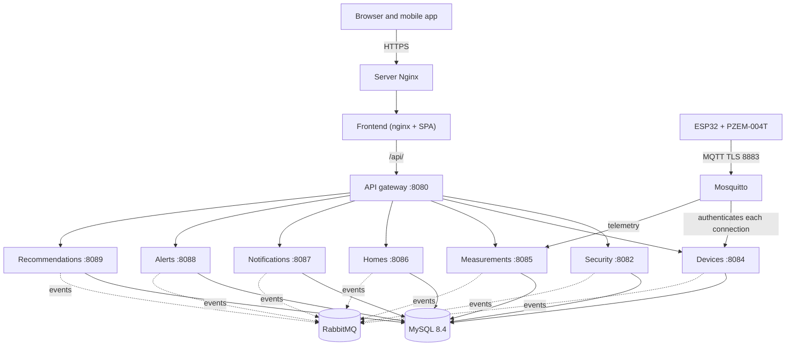

**Figure 1.** *General system architecture (presentation, entry, logic, messaging, data and devices).*

| **Layer**        | **Technology**                                        | **Responsibility**                                                                                                   |
|------------------|-------------------------------------------------------|----------------------------------------------------------------------------------------------------------------------|
| Presentation     | React 19 (web) and Expo SDK 57 (mobile, Android)      | User interface, form validation, session handling and consumption of the REST API through the gateway.               |
| Entry            | Spring Cloud Gateway (en-monitor-api-gateway, 8080)   | Routing by path prefix, CORS, token validation, rate limit, 404 for routes without an owner and rejection of `/internal/**`. |
| Logic            | Spring Boot 4.1.1 + Spring Security                   | Seven microservices with hexagonal architecture: authentication, authorization, use cases, business rules, MQTT ingestion, alerts, recommendations, notifications and event publication. |
| Messaging        | RabbitMQ 4.1 + transactional outbox                   | Events between services with at-least-once delivery and queues with dead-letter.                                     |
| Data             | MySQL 8.4 + Spring Data JPA + Liquibase               | A single shared database; each service owns its tables and applies only its changesets; no foreign keys between services. |
| Devices          | ESP32 + PZEM-004T V3 + Mosquitto 2                    | Measurement, MQTT publication with TLS (port 8883) and authentication of each device against the device service.     |
| Cross-cutting    | Docker Compose (energy-monitor-infra), Nginx + Certbot, GitHub Actions, SMTP and Actuator | Containers, HTTPS in production, continuous integration and deployment, email and health of each service. |

**Backend services.** All in Java 21; Spring Boot 4.1.1 except the gateway (4.0.8, because Spring Cloud 2025.1 is the release that supports it). The microservices follow a hexagonal architecture (ports and adapters) with the `domain`, `application`, `adapter`, `infrastructure` and `api` layers; the gateway has no domain (`routing`, `security`, `ratelimit` and `error` packages).

| **Service (repository)**         | **Port**   | **Responsibility**                                                                                                                                                        |
|----------------------------------|------------|---------------------------------------------------------------------------------------------------------------------------------------------------------------------------|
| en-monitor-api-gateway           | 8080       | Single entry point of the API (Spring Cloud Gateway Server Web MVC, Spring Cloud 2025.1.3). Answers CORS, validates the token (RS256, issuer and expiry) except on the public endpoints, reads the token from the web's HttpOnly `em_access` cookie (`AccessTokenCookieFilter`), limits the public account POSTs (20 per IP and path per minute, then 429), rejects `/internal/**`, answers 404 to what no service serves, 503 when the service does not answer and 504 when it takes more than 30 seconds. |
| en-monitor-security-service      | 8082       | Accounts, registration with email verification (`pending_registration`), acceptance of the terms (428 without it), sign-in, Google (code on the web, ID token in the app), JWT RS256 (15-minute access token) and rotating refresh token, HttpOnly cookie sessions for the web, password recovery, profile, account deletion, RBAC and user administration, support contacts (`GET /api/v1/support/contacts`, public). |
| en-monitor-device-service        | 8084       | Devices: linking, editing, credential reissue (API key stored as a SHA-256 hash), unlinking, appliance catalog, MQTT broker authentication and ACL (Mosquitto go-auth asks it), MQTT commands to the modules and connectivity (subscribed to telemetry and status; offline after 150 seconds without data). |
| en-monitor-measurement-service   | 8085       | Measurements: the only subscriber that stores telemetry (MQTT), history, latest reading, statistics, household consumption (summary and history) and consumption levels; publishes every reading as `measurement.recorded` and offers an internal API of levels, hourly energy and reporting devices. |
| en-monitor-home-service          | 8086       | Homes, joining with the access code, members and roles, favorites, ownership transfer, leaving and deleting the home, thresholds (6 kWh per day and 180 kWh per month by default) and home types; internal API of access, limits, home summary and account deletion check; publishes `home.deleted` and the activity of the homes. |
| en-monitor-notification-service  | 8087       | Code mails (`mail.*`), delivery of alerts and recommendations by email, Web Push and mobile push according to each member's preferences, activity notifications (`/api/v1/notifications/activity`), in-app notices for administrators (`/api/v1/admin/notifications`), preferences, push subscriptions and delivery log. |
| en-monitor-alert-service         | 8088       | Alerts: consumes `measurement.recorded` and the `device.*` events, creates THRESHOLD (including the unusual consumption alert of an appliance, `alert.anomaly.device`), LIMIT, CONNECTIVITY and DEVICE alerts, resolves them, serves them at `/api/v1/alerts` and announces each one as `alert.raised`. |
| en-monitor-recommendation-service | 8089      | Recommendations: every hour evaluates the PEAK_HOURS, SAVING, HISTORICAL_COMPARISON, THRESHOLD and HIGH_CONSUMPTION rules on the homes with readings in the last week, serves them at `/api/v1/recommendations` and announces each one as `recommendation.created`. |

## 9.2 Architectural style and design patterns

- **Microservices behind an API gateway.** Each bounded context (security, device, measurement, home, notification, alert and recommendation) is a service with its repository, its deployment and its tables. They were extracted one by one from the former modular backend (Spring Modulith), which was retired when the migration finished. The gateway (en-monitor-api-gateway) is the single entry point of the API and routes by path prefix, from the most specific to the most general; the clients call the same routes as always, so the migration did not change the public API.

- **Hexagonal architecture per service.** Inside each microservice live the api, domain (pure model, no Spring), application (input ports `port/in`, output ports `port/out`, use cases `usecase`, commands and results), adapter (input `adapter/in/web`, `adapter/in/internal`, `adapter/in/messaging`, `adapter/in/mqtt`, `adapter/in/scheduler` and output `adapter/out/persistence`, `out/messaging`, `out/event`, `out/home`, `out/device`, `out/measurement`, `out/push`…) and infrastructure layers with the Spring configuration.

- **Events between services with RabbitMQ and transactional outbox.** What a service must tell another is written to its outbox table in the same transaction as the change; a relay publishes it every second with broker confirmation. Delivery is at least once, consumers tolerate duplicates (they drop them by message id or are idempotent) and each queue is durable, with dead-letter after three attempts (detail in section 9.3).

- **Observer on integration events.** The alert service reacts to every `measurement.recorded` (threshold, limit and linked device) and to `device.connectivity-lost` / `device.connectivity-restored` (connectivity); the notification service reacts to `alert.raised`, `recommendation.created`, the account events, the mail requests and the activity of homes and devices.

- **Strategy for role-based authorization in the home.** `UserHome.getPermissions()` returns `OwnerPermissions` or `MemberPermissions` (interface `UserPermissions`), and the use cases of the home service decide with it what each member may do.

- **Factory Method in the domain.** Entities are created with static factories that set their invariants: `Alert.threshold`, `Alert.limit`, `Alert.connectivity` and `Alert.device`; `Notification.pending` and `Notification.pendingInApp`; `UserHome.owner` and `UserHome.member`; `Recommendation.create`; `PendingRegistration.request`.

- **Shared database (ADR-003).** All services use the same MySQL database; each one owns its tables and applies only its Liquibase changesets. There are no foreign keys between services: the other contexts are referenced by identifier.

- **Scheduled recommendations.** The recommendation service listens to no events: `RecommendationScheduler` runs every hour (`RECOMMENDATION_EVALUATE_INTERVAL`) the pure rules of `RecommendationRules` with the hourly energy it asks the measurement service for.

- **API without an HTTP session on the server.** The services keep no HTTP session: each request carries a JWT. The mobile app sends it in the Authorization header and keeps it in the device secure store; the web receives it in HttpOnly cookies (`em_access` and `em_refresh`) that the gateway turns into `Authorization: Bearer`. The CORS policy is resolved only in the gateway, explicitly and closed by default.

- **Front-end by capabilities (features).** Both the web and the mobile app organize the code in folders by functional capability (auth, dashboard, homes, notifications, Admin…) with their own components, styles, zod validations and tests. Global state is handled with React Context; the web stores in localStorage only the non-secret session data (account, profile, permissions and session id), never the tokens.

## 9.3 Communication between components

The client applications communicate only with the API gateway through HTTP requests in JSON format under the /api/v1 prefix; in production Nginx terminates HTTPS at https://energy-monitor.tech and the requests to /api/ reach the gateway through the nginx of the web container. The gateway validates the token and forwards each request to the service that owns the path. The mobile app sends the Authorization: Bearer \<accessToken\> header; the web receives the tokens in HttpOnly cookies and the gateway turns the `em_access` cookie into that header (only when the request brings `X-Requested-With: XMLHttpRequest`). The user's identity is obtained exclusively from the `sub` claim of the JWT through `CurrentUserResolver` in each service; the X-User-Id header is ignored. The web front automatically renews the access token on a 401 response through POST /auth/refresh, with refresh token rotation and a lock between tabs with the Web Locks API.

| **Communication element**    | **Detail**                                                                                       |
|------------------------------|--------------------------------------------------------------------------------------------------|
| Protocol (clients)           | HTTP/1.1 over HTTPS in production (Nginx + Let's Encrypt); HTTP in local development.            |
| Format                       | JSON (Content-Type: application/json).                                                           |
| Entry point                  | API gateway: https://energy-monitor.tech/api/v1 in production, http://localhost:8080/api/v1 in development. |
| API prefix                   | /api/v1 (all public routes; the `/internal/**` routes never go through the gateway).             |
| Authentication               | Authorization: Bearer \<JWT RS256\> expiring after 15 minutes (mobile) or HttpOnly `em_access` cookie (web). The gateway and each service validate signature, issuer and expiry. |
| Identity                     | `sub` claim of the JWT; X-User-Id is ignored.                                                    |
| Allowed origin (CORS)        | Only in the gateway, which drops the Origin header before forwarding. Closed by default; the origins are set with SECURITY_CORS_ALLOWED_ORIGINS of the gateway (e.g. http://localhost:5173). Methods: GET, POST, PUT, DELETE and OPTIONS. |
| Error handling               | Response with the ApiError structure: timestamp, status, error, message, path and fieldErrors. The gateway's own answers (401, 404, 429, 503 and 504) use the same shape. |
| Documentation                | OpenAPI and Swagger UI at /v3/api-docs and /swagger-ui.html of each service (in development mode, on ports 8082 and 8084 to 8089). |
| Service health               | GET /actuator/health of each service returns {"status":"UP"} (includes database and RabbitMQ).   |
| Internal communication       | REST `/internal/**` between services with the X-Internal-Token header, and RabbitMQ 4.1 events (AMQP, port 5672) with transactional outbox. |
| Devices (MQTT)               | MQTT 3.1.1; port 8883 with TLS (devices, `mqtt.energy-monitor.tech:8883` in production) and 1883 only inside Docker (device and measurement services). |

**API gateway routes.** The device and household consumption routes are evaluated before the general home route, so `/api/v1/homes/{homeId}`, its members, favorite, owner and thresholds go to the home service.

| **Routes**                                                                                             | **Service**                              |
|--------------------------------------------------------------------------------------------------------|------------------------------------------|
| `/api/v1/auth/**`, `/api/v1/admin/users/**`, `/api/v1/admin/roles/**`, `/api/v1/support/**`             | en-monitor-security-service (8082)       |
| `/api/v1/homes/{homeId}/devices/**`, `/api/v1/appliance-types/**`                                      | en-monitor-device-service (8084)         |
| `/api/v1/measurements/**`, `/api/v1/consumption-levels/**`, `/api/v1/homes/{homeId}/consumption/**`    | en-monitor-measurement-service (8085)    |
| Rest of `/api/v1/homes/**`, `/api/v1/home-types/**`                                                    | en-monitor-home-service (8086)           |
| `/api/v1/notifications/**`, `/api/v1/admin/notifications/**`                                           | en-monitor-notification-service (8087)   |
| `/api/v1/alerts/**`                                                                                    | en-monitor-alert-service (8088)          |
| `/api/v1/recommendations/**`                                                                           | en-monitor-recommendation-service (8089) |
| `/internal/**`                                                                                         | Never forwarded (401 without a token, 403 with one) |
| Any other route, the rest of `/api/v1/**` included                                                     | 404                                      |

**Internal REST between services.** The `/internal/**` routes are accepted only from loopback or the Docker network (`172.16.0.0/12`, `INTERNAL_API_ALLOWED_NETWORKS`) **and** with the `X-Internal-Token` header (value of `INTERNAL_API_TOKEN`, the same in all services), compared in constant time; with no token configured every call is refused. The broker authentication (`/internal/mqtt/**`) only requires the allowed network.

| **Caller**             | **Endpoint**                                                                                                   | **Purpose**                                                                          |
|------------------------|----------------------------------------------------------------------------------------------------------------|--------------------------------------------------------------------------------------|
| security → home        | `GET /internal/accounts/{id}/deletion-check`                                                                   | May the account be deleted? (204 yes; 409 when it is the only owner of a home with other members). |
| home → security        | `POST /internal/users/profiles`                                                                                | Names and emails of the members of a home.                                           |
| device, measurement, alert, recommendation → home | `GET /internal/homes/{homeId}/access?userId=`                                       | Is the caller a member or the owner of the home? (never cached).                     |
| measurement, alert, recommendation → home | `GET /internal/homes/{homeId}/thresholds`                                                   | Daily and monthly limits of the home (404 = no limits).                              |
| notification → home    | `GET /internal/homes/{homeId}`                                                                                 | Name and members of a home, to deliver alerts, recommendations and activity.         |
| notification → security | `POST /internal/users/profiles`, `GET /internal/users/{id}/permissions`, `GET /internal/administrators`      | Names and emails, USER.READ permission and administrators (in-app notices).          |
| measurement, alert, recommendation, notification → device | `GET /internal/devices/{id}`, `GET /internal/homes/{homeId}/devices`           | Home and name of a module and modules of a home (30-second cache; previous copy up to 1 hour when it does not answer). |
| alert, recommendation → measurement | `GET /internal/consumption-levels`, `GET /internal/measurements/hourly-energy`, `GET /internal/measurements/reporting-devices` | Level of a reading and hourly energy for the limit alerts and the recommendations. |
| Mosquitto → device     | `POST /internal/mqtt/auth/user`, `POST /internal/mqtt/auth/acl`                                                | Authenticate and authorize each MQTT client.                                         |

**RabbitMQ events.** Each producer writes the message to its outbox table in the same transaction as the change; a relay publishes it every second, oldest first, and marks it as published only when the broker confirms it and a queue takes it. Delivery is at least once and the queues are durable, with their `.dlq` (dead-letter) after three attempts (1, 2 and 4 seconds).

| **Exchange / routing key**                                                                                         | **Outbox (producer)**              | **Consumer queue**                               | **Effect**                                                                                       |
|--------------------------------------------------------------------------------------------------------------------|------------------------------------|--------------------------------------------------|--------------------------------------------------------------------------------------------------|
| `energy-monitor.security` / `account.registered`, `account.administered`, `account.deleted` | `security_outbox` (security) | `notification-service.notification.account-events`; `home-service.home.account-deleted` (`account.deleted` only) | Notification: in-app notices for administrators and clean-up of the preferences and push devices of deleted accounts. Home: drops the memberships and deletes the homes with no other members. |
| `energy-monitor.security` / `mail.email-verification`, `mail.password-reset`, `mail.account-deletion` | `security_outbox` (security; they expire with `expires_at`) | `notification-service.notification.mail` | Mailing of the codes (only the notification service sends email). |
| `energy-monitor.security` / `account.first-signed-in`; `energy-monitor.home` / `home.created`, `home.member-joined`, `home.member-left`, `home.member-removed`, `home.thresholds-updated`, `home.ownership-transferred`, `home.deleted`; `energy-monitor.device` / `device.linked`, `device.unlinked` | `security_outbox`, `home_outbox`, `device_outbox` | `notification-service.notification.activity` | Activity notifications (welcome and changes of homes and devices) in the inbox and through the chosen channels. |
| `energy-monitor.home` / `home.deleted`                                                                             | `home_outbox` (home)               | `device-service.device.home-deleted`             | Unlinks the modules of the home, revokes their keys and sends them the `unlink` command.         |
| `energy-monitor.device` / `device.linked`, `device.unlinked`, `device.connectivity-lost`, `device.connectivity-restored` | `device_outbox` (device)  | `alert-service.device.events`; `measurement-service.device.events` (linked and unlinked only) | Alert: CONNECTIVITY and its resolution, and newly linked device. Measurement: clears its device cache. |
| `energy-monitor.measurement` / `measurement.recorded`                                                              | `measurement_outbox` (measurement; published ones are purged after 7 days) | `alert-service.measurement.recorded` | Threshold, limit and linked-device alerts. |
| `energy-monitor.alert` / `alert.raised`                                                                            | `alert_outbox` (alert)             | `notification-service.notification.alert-raised` | Delivery of the alert to the members of the home by email and push.                           |
| `energy-monitor.recommendation` / `recommendation.created`                                                         | `recommendation_outbox` (recommendation) | `notification-service.notification.recommendation-created` | Delivery of the recommendation to the members of the home.                              |

An outbox stops at a message no queue takes (so the order is never lost), which is why each consumer declares its queue at start-up and is deployed before its producer. The switches that turn on each consumer and each relay are in Annex A.

**MQTT contract.**

| **Parameter**             | **Value**                                                                                                                              |
|---------------------------|----------------------------------------------------------------------------------------------------------------------------------------|
| Client ID                 | `esp32-{deviceId}`                                                                                                                     |
| User / password           | `device_code` / `api_key` (the device service only stores the hash of the key)                                                         |
| Keep alive and last will  | 15-second keep alive; the broker publishes the last will about 22 seconds after a power cut                                            |
| QoS                       | 0 for telemetry and status; 1 for the command                                                                                          |
| Cadence                   | Telemetry every 60 seconds; status every five minutes and on connect; offline after 150 seconds of silence                             |
| Telemetry topic           | `energy-monitor/devices/{deviceId}/telemetry`                                                                                          |
| Status topic              | `energy-monitor/devices/{deviceId}/status` (retained)                                                                                  |
| Command topic             | `energy-monitor/devices/{deviceId}/command` (QoS 1, retained): `{"cmd":"unlink"}` when the device is unlinked                          |

The broker (`iegomez/mosquitto-go-auth` image) stores no users: it authenticates each client against the device service (`/internal/mqtt/auth/user`) with a five-minute cache, and its ACL lets each device use only its own topics (`/internal/mqtt/auth/acl`). There are three MQTT clients: the device service (`MQTT_DEVICE_SERVICE_USER`: reads telemetry and status and is the only one that publishes commands), the measurement service (`MQTT_MEASUREMENT_SERVICE_USER`: only reads telemetry) and each ESP32 module (`device_code` and API key). The services take the `deviceId` from the topic and drop the messages whose body claims another device.

The following figure describes the complete flow of a sign-in and the subsequent access to a protected resource.

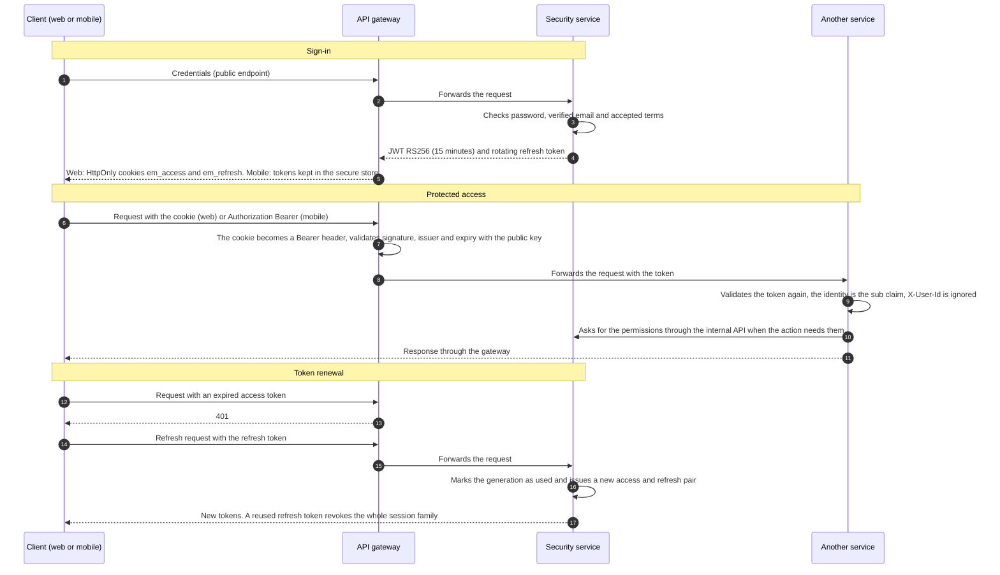

**Figure 2.** *Authentication sequence: sign-in, protected access and token renewal.*

# 10. Project structure

The project is distributed across eleven current code repositories (API gateway, seven microservices, web front, mobile app and infrastructure), the retired backend and the documentation repositories. The following table summarizes their content and how to run them.

| **Repository**             | **Type**                           | **Technology**                                          | **Entry point**                                                      | **Run**                                        |
|----------------------------|------------------------------------|---------------------------------------------------------|----------------------------------------------------------------------|------------------------------------------------|
| en-monitor-api-gateway     | API gateway                        | Java 21 + Spring Boot 4.0.8 + Spring Cloud Gateway + Maven | com/energymonitor/gateway/ApiGatewayApplication.java             | ./mvnw spring-boot:run (port 8080)             |
| en-monitor-security-service | Security microservice             | Java 21 + Spring Boot 4.1.1 + Maven                     | com/energymonitor/security/SecurityServiceApplication.java           | ./mvnw spring-boot:run (port 8082)             |
| en-monitor-device-service  | Device microservice                | Java 21 + Spring Boot 4.1.1 + Maven                     | com/energymonitor/device/DeviceServiceApplication.java               | ./mvnw spring-boot:run (port 8084)             |
| en-monitor-measurement-service | Measurement microservice       | Java 21 + Spring Boot 4.1.1 + Maven                     | com/energymonitor/measurement/MeasurementServiceApplication.java     | ./mvnw spring-boot:run (port 8085)             |
| en-monitor-home-service    | Home microservice                  | Java 21 + Spring Boot 4.1.1 + Maven                     | com/energymonitor/home/HomeServiceApplication.java                   | ./mvnw spring-boot:run (port 8086)             |
| en-monitor-notification-service | Notification microservice     | Java 21 + Spring Boot 4.1.1 + Maven                     | com/energymonitor/notification/NotificationServiceApplication.java   | ./mvnw spring-boot:run (port 8087)             |
| en-monitor-alert-service   | Alert microservice                 | Java 21 + Spring Boot 4.1.1 + Maven                     | com/energymonitor/alert/AlertServiceApplication.java                 | ./mvnw spring-boot:run (port 8088)             |
| en-monitor-recommendation-service | Recommendation microservice | Java 21 + Spring Boot 4.1.1 + Maven                     | com/energymonitor/recommendation/RecommendationServiceApplication.java | ./mvnw spring-boot:run (port 8089)           |
| Energy-Monitor-application | Web application (front-end)        | React 19 + Vite 8 (JavaScript)                          | src/main.jsx on index.html                                           | npm install / npm run dev (port 5173)          |
| Energy-Monitor-Mobile      | Mobile application (front-end)     | Expo SDK 57 + React Native 0.86                         | src/app/\_layout.tsx (expo-router/entry)                             | npm install / npm run start                    |
| energy-monitor-infra       | Infrastructure and deployment      | Docker Compose, Mosquitto 2, RabbitMQ 4.1, MySQL 8.4, Nginx | docker-compose.yml, docker-compose.dev.yml and docker-compose.prod.yml | docker compose up -d --build            |
| energy-monitor-backend     | Retired backend (archived) and firmware | Java 21 + Spring Modulith (historical); Arduino firmware | firmware/esp32-pzem-monitor/esp32-pzem-monitor.ino             | No longer runs; only arduino-cli upload of the firmware |
| energy-monitor-docs-final  | Final documentation                | Markdown (ES and EN)                                    | README.md                                                            | Does not need to run                           |

The legacy energy-monitor-devices repository (old firmware and broker) is no longer used to run anything: the firmware lives in `firmware/` of energy-monitor-backend (to which infra's `prepare.sh` writes `dev_ca.h`) and the broker in energy-monitor-infra.

## 10.1 Structure of the backend services

All microservices have the same shape. Each one keeps the package it had in the backend and its changesets with the same relative path, so Liquibase recognizes them as already applied on a migrated database:

```
en-monitor-<context>-service/
├── pom.xml                       Maven definition and dependencies
├── mvnw / mvnw.cmd               Maven Wrapper (no Maven install needed)
├── Dockerfile                    multi-stage image (Maven + JRE 21, unprivileged user uid 10001)
├── .env.example                  environment variable template
├── README.md                     what it serves, whom it calls, events and deployment
├── docs/Architecture.md          design and decisions (gateway, security, device and home)
├── .github/workflows/ci-cd.yml   tests, Docker image and deployment
└── src/
    ├── main/
    │   ├── java/com/energymonitor/<context>/
    │   │   ├── <Context>ServiceApplication.java   entry point
    │   │   ├── api/               public contracts of the service (event DTOs)
    │   │   ├── domain/model/      pure domain entities
    │   │   ├── application/       port/in, port/out, usecase, command, result, exception
    │   │   ├── adapter/in/        web (REST), internal (/internal/**), messaging (RabbitMQ), mqtt, scheduler
    │   │   ├── adapter/out/       persistence, messaging (outbox, relay, publisher), clients of other services
    │   │   └── infrastructure/    Spring configuration (security, RabbitMQ, clients, Liquibase)
    │   └── resources/
    │       ├── application.yaml                  base configuration
    │       ├── application-local.yaml(.example)  local profile
    │       └── db/changelog/                     Liquibase master + changesets of the context
    └── test/java/com/energymonitor/<context>/   unit, web, persistence tests and BehindGatewayTest
```

| **Service**  | **Package**                    | **Changelog**                       | **Notable input adapters**            |
|--------------|--------------------------------|-------------------------------------|---------------------------------------|
| gateway      | com.energymonitor.gateway      | (no database)                       | routing, security, ratelimit, error   |
| security     | com.energymonitor.security     | db/changelog/security/              | AuthController, AdminController, SupportController, InternalController |
| device       | com.energymonitor.device       | db/changelog/device/                | HomeDeviceController, ApplianceTypeController, BrokerAuthController, InternalDeviceController, ConnectivityMqttConsumer, HomeDeletedConsumer, DeviceInactivityScheduler |
| measurement  | com.energymonitor.measurement  | db/changelog/measurement/           | MeasurementController, ConsumptionLevelController, HomeConsumptionController, InternalMeasurementController, TelemetryMqttConsumer, DeviceLinksConsumer |
| home         | com.energymonitor.home         | db/changelog/home/                  | HomeController, HomeThresholdsController, HomeTypeController, HomeAccessController, HomeLimitsController, HomeSummaryController, AccountDeletionCheckController, AccountDeletedConsumer |
| notification | com.energymonitor.notification | db/changelog/notification/          | NotificationChannelsController, ActivityNotificationsController, AdminNotificationsController, AccountEventsConsumer, MailRequestsConsumer, HomeMessagesConsumer, ActivityEventsConsumer |
| alert        | com.energymonitor.alert        | db/changelog/alert/                 | AlertController, MeasurementRecordedConsumer, DeviceEventsConsumer |
| recommendation | com.energymonitor.recommendation | db/changelog/recommendation/    | RecommendationController, RecommendationScheduler |

**Internal organization of a service (example with home):**

```
home/
├── package-info.java        documents the boundaries of the service
├── api/                     public contract (messages it publishes)
├── domain/model/            pure domain entities (Home, UserHome, HomeThresholds,
│                            UserPermissions, OwnerPermissions, MemberPermissions, Role…)
├── application/
│   ├── port/in/             input ports (CreateHome, JoinHome, DeleteHome…)
│   ├── port/out/            output ports (persistence, profiles, events)
│   ├── usecase/             implementation of the use cases
│   ├── command/ result/     input and output structures
│   └── exception/           application exceptions
├── adapter/
│   ├── in/web/              REST controllers, DTOs and error handlers
│   ├── in/internal/         internal API for other services (access, limits, summary, account deletion)
│   ├── in/messaging/        account.deleted consumer (RabbitMQ)
│   ├── out/messaging/       home.* outbox, relay and RabbitMQ publisher
│   ├── out/security/        client of the security service (profiles)
│   └── out/persistence/     JPA entities, repositories, mappers and adapters
└── infrastructure/          Spring configuration
```

The retired backend (energy-monitor-backend) was a Spring Modulith modular monolith with the home, alert, recommendation and notification modules and the security, device and measurement intermediary packages. Its code stays in the repository history; it is no longer built or deployed (`deploy.sh` does not accept `backend`).

## 10.2 Structure of the web application

```
Energy-Monitor-application/
├── index.html · package.json · vite.config.js
├── vitest.config.js · eslint.config.js · .env.example
├── public/ (icons and resources)
└── src/
    ├── main.jsx          mounts the providers and App
    ├── App.jsx · index.css
    ├── routes/           AppRoutes, ProtectedRoute, GuestRoute, HomeRoute,
    │                     RequirePermission (global permission) and UserOnlyRoute (hides homes from ADMIN)
    ├── context/          HomeContext, ThemeContext, NotificationCenterContext
    ├── services/
    │   ├── http/         httpClient (axios), interceptors and errors
    │   ├── auth/         authApi, googleSignIn, session (localStorage, no tokens), usePermissions
    │   ├── admin/        adminApi (users, roles and administration notices)
    │   ├── home/         homeApi (homes, members, thresholds, consumption)
    │   ├── devices/      deviceApi and bleProvisioning (Web Bluetooth)
    │   ├── alerts/       alertApi
    │   ├── recommendations/  recommendationApi
    │   └── notifications/    notificationApi, activity and webPush
    ├── components/       layout/ (Navbar, MainLayout, Sidebar, Footer) and shared/
    ├── design/           design system (Button, Input, Card, Badge…)
    ├── features/         landingPage, auth (with LegalModal), dashboard, DetailHome,
    │                     Favorites, Notifications, Account, SettingsPage, Admin
    ├── i18n/             locales es, en, fr and pt (includes admin.json and legalModal.json)
    └── test/setup.js    Vitest configuration
```

## 10.3 Structure of the mobile application

```
Energy-Monitor-Mobile/
├── app.json · package.json · tsconfig.json · eas.json · AGENTS.md · .env.example
├── assets/               icons and splash screen
└── src/
    ├── app/              Expo Router routes:
    │                     _layout.tsx (providers and Stack), index.tsx (login),
    │                     register.tsx, verify-account.tsx, recover-password.tsx,
    │                     verify-recover-password.tsx, new-password.tsx,
    │                     dashboard.tsx, homes.tsx (redirects to the dashboard), home/[id].tsx,
    │                     favorites.tsx, notifications.tsx, settings.tsx, account.tsx
    ├── components/       Button, Card, Input, Modal, Chart, OtpInput… + layout/ (AuthGate, Sidebar, BottomTabBar)
    ├── config/           env.ts (EXPO_PUBLIC_API_BASE_URL) and easProjectId.ts
    ├── constants/        theme, colors, spacing, typography
    ├── context/          HomeContext, UserContext, ThemeContext, NotificationCenterContext
    ├── services/         http, auth (session with expo-secure-store), home, devices (ble/),
    │                     measurement, alerts, recommendations and notifications (pushRegistration)
    ├── features/         auth (with LegalModal), dashboard, homes, favorites,
    │                     notifications, settings, account
    ├── i18n/             locales es, en, fr and pt
    └── validation/       i18n messages of the zod schemas
```

## 10.4 Purpose of the main folders

| **Folder**                                                                 | **Purpose**                                                                              |
|----------------------------------------------------------------------------|------------------------------------------------------------------------------------------|
| \<service\>/src/main/java/com/energymonitor/\<context\>/domain/model       | Pure domain entities, without Spring dependencies.                                       |
| \<service\>/src/main/java/com/energymonitor/\<context\>/application        | Use cases, input and output ports, commands, results and exceptions.                     |
| \<service\>/src/main/java/com/energymonitor/\<context\>/adapter/in/web     | REST controllers, DTOs and exception handlers (@RestControllerAdvice).                   |
| \<service\>/src/main/java/com/energymonitor/\<context\>/adapter/in/internal | Internal API `/internal/**` for the other services.                                     |
| \<service\>/src/main/java/com/energymonitor/\<context\>/adapter/in/messaging and out/messaging | RabbitMQ consumers; outbox, relay and event publisher.                  |
| \<service\>/src/main/java/com/energymonitor/\<context\>/adapter/out/persistence | JPA entities, repositories, mappers and persistence adapters.                       |
| \<service\>/src/main/java/com/energymonitor/\<context\>/adapter/out/{home,device,measurement,security} | Clients of the internal API of other services, with cache.      |
| \<service\>/src/main/resources/db/changelog                                | Liquibase changesets of the tables of that service, with their rollback.                 |
| \<service\>/src/test/java                                                  | Unit, web integration, persistence and behind-the-gateway security tests.               |
| en-monitor-api-gateway/src/main/java/com/energymonitor/gateway             | Routes (routing), token validation and CORS (security), rate limit (ratelimit) and errors (error). |
| web/src/routes                                                             | Route definitions, guards (session, guest, permission, user only) and layouts of the SPA. |
| web/src/services                                                           | API access layer: HTTP client, interceptors, session and endpoints per domain.          |
| web/src/features                                                           | Screens and components grouped by feature (Admin included).                             |
| web/src/design                                                             | Reusable interface components (buttons, cards, fields) and their styles.                |
| mobile/src/app                                                             | Expo Router file-based routes that mount each screen.                                    |
| mobile/src/services                                                        | REST API client of the mobile application (same pattern as the web), BLE and push.       |
| mobile/src/features                                                        | Screens, components, hooks and validations per feature.                                  |
| energy-monitor-backend/firmware/esp32-pzem-monitor                         | Device firmware and configuration files.                                                 |
| infra/docker-compose\*.yml and infra/mosquitto                             | Local stack, development mode and production (MySQL, RabbitMQ, Mosquitto, gateway, services and web) and broker configuration. |
| infra/deploy, infra/e2e and infra/make-admin.sh                            | Deployment (deploy.sh, Nginx, MySQL backup, MQTT certificate renewal), end-to-end tests and granting the first administrator. |

# 11. Database

**Engine:** MySQL 8.4, run in a Docker container (energy-monitor-infra repository).

**Schema:** energy_monitor, a single database shared by the services (ADR-003). This chapter documents 37 tables spread across the seven services that have a database. The application user is energy_app.

**Owner of each table:** each service owns its tables and applies only its changesets: security (16 tables), device (5), measurement (3), home (5), notification (4), alert (2) and recommendation (2). The retired backend no longer creates tables; a migrated database may still hold its unused `backend_outbox`.

**Schema management:** Liquibase applies the versioned changesets in src/main/resources/db/changelog of each service; they all share the DATABASECHANGELOG table, and the changesets that left the backend kept their path, so they are not run again. Hibernate is configured with ddl-auto = validate, that is, it only checks that the schema matches the entities and never creates tables by itself.

**Conventions:** snake_case names; VARCHAR(10) primary keys; audit columns created_at, updated_at and deleted_at in the business tables; soft delete; indexes with the idx\_\[table\]\_\[columns\] pattern. References between services are stored as application-level identifiers and do not create SQL foreign keys.

**Artifacts of the `06-base-datos` folder:** [data dictionary](../../04-software-design/en/data-dictionary.md) (the same as section 11.3), [SQL script](../../04-software-design/database/energy_monitor.sql) with the final state of the schema and its seed data, and the PlantUML sources of the [ERD](../../04-software-design/diagrams/er-model.wsd) and of the [class diagram](../../04-software-design/diagrams/class-diagram.wsd).

## 11.1 Entity-relationship diagram

The diagram shows the entities of the system grouped by their owning service, with their attributes, keys and relationships. The dotted relationships between services represent application references (no SQL foreign key). The current source is [`MER.wsd`](../../04-software-design/diagrams/er-model.wsd), generated from the changelogs, and Figure 3 is its rendering.

> **Reading tip:** because of its size, the diagram is shown on a landscape page; in Word it can be enlarged with the zoom to read the attributes of each entity. Annex B includes the same model broken down by context, for better readability.
>
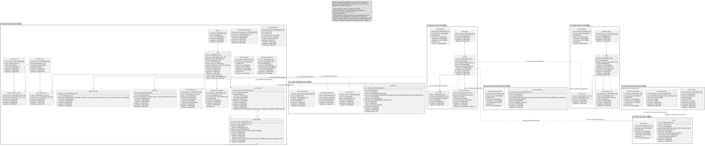

**Figure 3.** *Complete entity-relationship diagram (ERD) of the "Electrical Consumption Monitor" system.*

## 11.2 Main tables

The following table lists the 37 tables, the owning service, their description, their primary key and the foreign keys that exist inside the service.

| **#** | **Table** | **Owner service** | **Description** | **Primary key** | **Foreign keys (inside the service)** |
|---|---|---|---|---|---|
| 1 | person | security (8082) | Records the personal data associated with a user. | id_person | — |
| 2 | user | security (8082) | Manages the user's credentials, status and access data. | id_user | person_id → person |
| 3 | user_configuration | security (8082) | Stores each user's configuration preferences. | id_configuration | user_id → user |
| 4 | password_reset_token | security (8082) | Stores tokens for password recovery. | id_reset_token | user_id → user |
| 5 | user_session | security (8082) | Records the user's active and renewable sessions. | id_user_session | user_id → user |
| 6 | security_configuration | security (8082) | Defines configurable security parameters of the system. | id_security_configuration | — |
| 7 | password_policy | security (8082) | Defines the password validation and expiration rules. | id_password_policy | — |
| 8 | login_error_log | security (8082) | Records the errors produced during login. | id_login_error | user_id → user |
| 9 | system_role | security (8082) | Defines the roles available in the system. | id_system_role | — |
| 10 | permission | security (8082) | Defines the functional permissions of the system. | id_permission | — |
| 11 | user_system_role | security (8082) | Relates users to system roles. | user_id, system_role_id | user_id → user; system_role_id → system_role |
| 12 | system_role_permission | security (8082) | Relates roles to permissions. | system_role_id, permission_id | system_role_id → system_role; permission_id → permission |
| 13 | audit_log | security (8082) | Records the relevant actions executed by users. | id_audit_log | user_id → user |
| 14 | refresh_token | security (8082) | Each row is a refresh token generation. | id_refresh_token | id_user_session → user_session; parent_id → refresh_token |
| 15 | security_outbox | security (8082) | Transactional outbox of the service: events it publishes to RabbitMQ. | id_message | — |
| 16 | pending_registration | security (8082) | Registrations waiting for the email verification. | id_user | — |
| 17 | appliance_type | device (8084) | Catalog of appliance types. | id_appliance_type | — |
| 18 | device | device (8084) | Records the installed measurement devices. | id_device | appliance_type_id → appliance_type |
| 19 | device_status_log | device (8084) | Records the status and connectivity of the devices. | id_device_status | device_id → device |
| 20 | device_home | device (8084) | Relates devices to households. | device_id, home_id | device_id → device |
| 21 | device_outbox | device (8084) | Transactional outbox of the service: events it publishes to RabbitMQ. | id_message | — |
| 22 | measurement | measurement (8085) | Stores the recorded electrical measurements. | id_measurement | — |
| 23 | consumption_level | measurement (8085) | Defines risk levels and their consumption ranges. | id_consumption_level | — |
| 24 | measurement_outbox | measurement (8085) | Transactional outbox of the service: events it publishes to RabbitMQ. | id_message | — |
| 25 | home_type | home (8086) | Catalog of household types. | id_home_type | — |
| 26 | home | home (8086) | Records the households managed by the system. | id_home | home_type_id → home_type |
| 27 | home_thresholds | home (8086) | Configures a household's consumption limits. | id_threshold | home_id → home |
| 28 | user_home | home (8086) | Relates users to households and defines their role. | user_id, home_id | home_id → home |
| 29 | home_outbox | home (8086) | Transactional outbox of the service: events it publishes to RabbitMQ. | id_message | — |
| 30 | notification | notification (8087) | Record of the delivery of a message to the user. | id_notification | — |
| 31 | notification_preference | notification (8087) | Notification channel preferences of each user (email and push). | user_id | — |
| 32 | push_subscription | notification (8087) | Push notification subscriptions of the user's browsers. | id_push_subscription | — |
| 33 | push_device | notification (8087) | Mobile app installations that receive push notifications through the Expo relay (one row per installation). | id_push_device | — |
| 34 | alert | alert (8088) | Alerts of a home: reading above the power threshold (THRESHOLD, level HIGH or CRITICAL), daily or monthly limit reached (LIMIT), device offline (CONNECTIVITY) and first reading of a newly linked device (DEVICE). | id_alert | — |
| 35 | alert_outbox | alert (8088) | Transactional outbox of the service: events it publishes to RabbitMQ. | id_message | — |
| 36 | recommendation | recommendation (8089) | Saving recommendations the recommendation service generates every hour from the hourly energy of the home; device_id empty when it applies to the whole home. | id_recommendation | — |
| 37 | recommendation_outbox | recommendation (8089) | Transactional outbox of the service: events it publishes to RabbitMQ. | id_message | — |

## 11.3 Data dictionary

The data dictionary describes each table of the schema field by field: data type, size or values, whether it accepts nulls, constraints and description. It was generated from the Liquibase changesets of the services, which are the source of truth of the schema; it is the same content as [`06-base-datos/diccionario-datos`](../../04-software-design/en/data-dictionary.md), which also lists the seed data. For the integrity rules see also [`05.2-data-model.md`](../../04-software-design/en/data-model.md).

**Constraint legend:** PK = primary key; FK = foreign key inside the same service; UNIQUE = unique value (with the name of the constraint); DEFAULT = default value; *Null* = Yes when the column accepts NULL; for ENUMs the *Size / values* column lists the allowed values.

### person

*Records the personal data associated with a user.*

**Owner service:** en-monitor-security-service · **Changesets:** security-001-create-person, security-018-drop-person-contact-data, security-020-drop-person-cellphone

| **Field** | **Type** | **Size / values** | **Null** | **Constraint** | **Description** |
|---|---|---|---|---|---|
| id_person | VARCHAR | 10 | No | PK | Person identifier |
| name | VARCHAR | 100 | No | — | Person's first names |
| last_name | VARCHAR | 100 | Yes | — | Person's last name (optional) |
| created_at | TIMESTAMP | — | No | DEFAULT CURRENT_TIMESTAMP | Creation timestamp of the row (audit) |
| updated_at | TIMESTAMP | — | No | DEFAULT CURRENT_TIMESTAMP ON UPDATE CURRENT_TIMESTAMP | Timestamp of the last change (audit) |
| deleted_at | TIMESTAMP | — | Yes | — | Soft-delete timestamp; empty while the row is current |

**Indexes:** None

### user

*Manages the user's credentials, status and access data.*

**Owner service:** en-monitor-security-service · **Changesets:** security-002-create-user, security-017-add-user-profile-image, security-022-widen-user-profile-image, security-024-add-user-google-subject, security-029-add-user-terms-accepted-at

| **Field** | **Type** | **Size / values** | **Null** | **Constraint** | **Description** |
|---|---|---|---|---|---|
| id_user | VARCHAR | 10 | No | PK | User identifier |
| person_id | VARCHAR | 10 | No | UNIQUE (uk_user_person_id); FK → person.id_person | Associated person |
| password_hash | VARCHAR | 255 | No | — | Password hash |
| email | VARCHAR | 255 | No | UNIQUE (uk_user_email) | Email address |
| email_verified | BOOLEAN | — | No | — | Indicates whether the email was verified |
| registration_date | TIMESTAMP | — | No | — | Registration date and time |
| status | ENUM | ACTIVE, INACTIVE, BLOCKED | No | — | Account status |
| failed_login_attempts | INT | — | No | — | Number of failed attempts |
| last_login_at | TIMESTAMP | — | Yes | — | Last login |
| created_at | TIMESTAMP | — | No | DEFAULT CURRENT_TIMESTAMP | Creation timestamp of the row (audit) |
| updated_at | TIMESTAMP | — | No | DEFAULT CURRENT_TIMESTAMP ON UPDATE CURRENT_TIMESTAMP | Timestamp of the last change (audit) |
| deleted_at | TIMESTAMP | — | Yes | — | Soft-delete timestamp; empty while the row is current |
| profile_image | MEDIUMTEXT | — | Yes | — | Account profile image (base64 data URL) |
| google_subject | VARCHAR | 255 | Yes | UNIQUE (uq_user_google_subject) | Stable identifier (sub) of the Google account the account was created with; empty if registered with a password |
| terms_accepted_at | TIMESTAMP | — | Yes | — | When the account accepted the terms and conditions; empty forces the acceptance at the next sign-in (answer 428) |

**Indexes:** None

### user_configuration

*Stores each user's configuration preferences.*

**Owner service:** en-monitor-security-service · **Changesets:** security-003-create-user-configuration

| **Field** | **Type** | **Size / values** | **Null** | **Constraint** | **Description** |
|---|---|---|---|---|---|
| id_configuration | VARCHAR | 10 | No | PK | Configuration identifier |
| user_id | VARCHAR | 10 | No | UNIQUE (uk_user_configuration_user_id); FK → user.id_user | Configured user |
| notify_by_email | BOOLEAN | — | No | — | Enables email notifications |
| notify_by_push | BOOLEAN | — | No | — | Enables push notifications |
| color_theme | VARCHAR | 50 | Yes | — | Color theme |
| language | VARCHAR | 50 | Yes | — | Preferred language |
| social_provider | VARCHAR | 50 | Yes | — | Social authentication provider |
| created_at | TIMESTAMP | — | No | DEFAULT CURRENT_TIMESTAMP | Creation timestamp of the row (audit) |
| updated_at | TIMESTAMP | — | No | DEFAULT CURRENT_TIMESTAMP ON UPDATE CURRENT_TIMESTAMP | Timestamp of the last change (audit) |
| deleted_at | TIMESTAMP | — | Yes | — | Soft-delete timestamp; empty while the row is current |

**Indexes:** None

### password_reset_token

*Stores tokens for password recovery.*

**Owner service:** en-monitor-security-service · **Changesets:** security-004-create-password-reset-token, security-021-add-password-reset-token-attempts

| **Field** | **Type** | **Size / values** | **Null** | **Constraint** | **Description** |
|---|---|---|---|---|---|
| id_reset_token | VARCHAR | 10 | No | PK | Token identifier |
| user_id | VARCHAR | 10 | No | FK → user.id_user | Owner user |
| reset_token_hash | VARCHAR | 64 | No | UNIQUE (uk_password_reset_token_reset_token_hash) | HMAC-SHA256 hash (with pepper) of the recovery code |
| used | BOOLEAN | — | No | — | Indicates whether the token was used |
| created_at | TIMESTAMP | — | No | DEFAULT CURRENT_TIMESTAMP | Creation timestamp of the row (audit) |
| expiration_at | TIMESTAMP | — | No | — | Expiration date |
| updated_at | TIMESTAMP | — | No | DEFAULT CURRENT_TIMESTAMP ON UPDATE CURRENT_TIMESTAMP | Timestamp of the last change (audit) |
| deleted_at | TIMESTAMP | — | Yes | — | Soft-delete timestamp; empty while the row is current |
| attempts | INT | — | No | DEFAULT 0 | Attempts to redeem the code |

**Indexes:** None

### user_session

*Records the user's active and renewable sessions.*

**Owner service:** en-monitor-security-service · **Changesets:** security-005-create-user-session, security-014-add-session-revocation, security-016-drop-session-refresh-token

| **Field** | **Type** | **Size / values** | **Null** | **Constraint** | **Description** |
|---|---|---|---|---|---|
| id_user_session | VARCHAR | 10 | No | PK | Session identifier |
| user_id | VARCHAR | 10 | No | FK → user.id_user | Session user |
| revoked | BOOLEAN | — | No | — | Indicates whether the session was revoked |
| ip_address | VARCHAR | 45 | Yes | — | IP address |
| user_agent | VARCHAR | 150 | Yes | — | Client agent |
| created_at | TIMESTAMP | — | No | DEFAULT CURRENT_TIMESTAMP | Creation timestamp of the row (audit) |
| expiration_at | TIMESTAMP | — | No | — | Expiration date |
| closed_at | TIMESTAMP | — | Yes | — | Closing date |
| updated_at | TIMESTAMP | — | No | DEFAULT CURRENT_TIMESTAMP ON UPDATE CURRENT_TIMESTAMP | Timestamp of the last change (audit) |
| deleted_at | TIMESTAMP | — | Yes | — | Soft-delete timestamp; empty while the row is current |
| revoked_at | TIMESTAMP | — | Yes | — | Date and time of session revocation |
| revoked_reason | ENUM | REFRESH_TOKEN_REUSE, PASSWORD_CHANGED, ADMINISTRATIVE | Yes | — | Reason for revocation |

**Indexes:** None

### security_configuration

*Defines configurable security parameters of the system.*

**Owner service:** en-monitor-security-service · **Changesets:** security-006-create-security-configuration

| **Field** | **Type** | **Size / values** | **Null** | **Constraint** | **Description** |
|---|---|---|---|---|---|
| id_security_configuration | VARCHAR | 10 | No | PK | Configuration identifier |
| config_name | VARCHAR | 100 | No | UNIQUE (uk_security_configuration_config_name) | Configuration name |
| config_value | VARCHAR | 100 | No | — | Configuration value |
| description | VARCHAR | 255 | Yes | — | Description |
| created_at | TIMESTAMP | — | No | DEFAULT CURRENT_TIMESTAMP | Creation timestamp of the row (audit) |
| updated_at | TIMESTAMP | — | No | DEFAULT CURRENT_TIMESTAMP ON UPDATE CURRENT_TIMESTAMP | Timestamp of the last change (audit) |
| deleted_at | TIMESTAMP | — | Yes | — | Soft-delete timestamp; empty while the row is current |

**Indexes:** None

### password_policy

*Defines the password validation and expiration rules.*

**Owner service:** en-monitor-security-service · **Changesets:** security-007-create-password-policy

| **Field** | **Type** | **Size / values** | **Null** | **Constraint** | **Description** |
|---|---|---|---|---|---|
| id_password_policy | VARCHAR | 10 | No | PK | Policy identifier |
| min_length | INT | — | No | — | Minimum length |
| max_length | INT | — | No | — | Maximum length |
| require_uppercase | BOOLEAN | — | No | — | Requires uppercase letters |
| require_numbers | BOOLEAN | — | No | — | Requires numbers |
| require_symbols | BOOLEAN | — | No | — | Requires symbols |
| expiration_days | INT | — | No | — | Days of validity |
| created_at | TIMESTAMP | — | No | DEFAULT CURRENT_TIMESTAMP | Creation timestamp of the row (audit) |
| updated_at | TIMESTAMP | — | No | DEFAULT CURRENT_TIMESTAMP ON UPDATE CURRENT_TIMESTAMP | Timestamp of the last change (audit) |
| deleted_at | TIMESTAMP | — | Yes | — | Soft-delete timestamp; empty while the row is current |

**Indexes:** None

### login_error_log

*Records the errors produced during login.*

**Owner service:** en-monitor-security-service · **Changesets:** security-008-create-login-error-log, security-027-login-error-email-not-verified

| **Field** | **Type** | **Size / values** | **Null** | **Constraint** | **Description** |
|---|---|---|---|---|---|
| id_login_error | VARCHAR | 10 | No | PK | Error identifier |
| user_id | VARCHAR | 10 | Yes | FK → user.id_user | Related user, if any |
| error_type | ENUM | INVALID_PASSWORD, USER_NOT_FOUND, ACCOUNT_BLOCKED, ACCOUNT_INACTIVE, EMAIL_NOT_VERIFIED | No | — | Error type |
| description | VARCHAR | 500 | Yes | — | Error description |
| ip_address | VARCHAR | 45 | Yes | — | IP address |
| created_at | TIMESTAMP | — | No | DEFAULT CURRENT_TIMESTAMP | Creation timestamp of the row (audit) |
| updated_at | TIMESTAMP | — | No | DEFAULT CURRENT_TIMESTAMP ON UPDATE CURRENT_TIMESTAMP | Timestamp of the last change (audit) |
| deleted_at | TIMESTAMP | — | Yes | — | Soft-delete timestamp; empty while the row is current |

**Indexes:** None

### system_role

*Defines the roles available in the system.*

**Owner service:** en-monitor-security-service · **Changesets:** security-009-create-system-role

| **Field** | **Type** | **Size / values** | **Null** | **Constraint** | **Description** |
|---|---|---|---|---|---|
| id_system_role | VARCHAR | 10 | No | PK | Role identifier |
| name | VARCHAR | 50 | No | UNIQUE (uk_system_role_name) | Role name |
| description | VARCHAR | 200 | Yes | — | Description |
| enabled | BOOLEAN | — | No | — | Indicates whether it is enabled |
| created_at | TIMESTAMP | — | No | DEFAULT CURRENT_TIMESTAMP | Creation timestamp of the row (audit) |
| updated_at | TIMESTAMP | — | No | DEFAULT CURRENT_TIMESTAMP ON UPDATE CURRENT_TIMESTAMP | Timestamp of the last change (audit) |
| deleted_at | TIMESTAMP | — | Yes | — | Soft-delete timestamp; empty while the row is current |

**Indexes:** None

### permission

*Defines the functional permissions of the system.*

**Owner service:** en-monitor-security-service · **Changesets:** security-010-create-permission

| **Field** | **Type** | **Size / values** | **Null** | **Constraint** | **Description** |
|---|---|---|---|---|---|
| id_permission | VARCHAR | 10 | No | PK | Permission identifier |
| code | VARCHAR | 30 | No | UNIQUE (uk_permission_code) | Unique code |
| name | VARCHAR | 50 | No | — | Permission name |
| description | VARCHAR | 100 | Yes | — | Description |
| created_at | TIMESTAMP | — | No | DEFAULT CURRENT_TIMESTAMP | Creation timestamp of the row (audit) |
| updated_at | TIMESTAMP | — | No | DEFAULT CURRENT_TIMESTAMP ON UPDATE CURRENT_TIMESTAMP | Timestamp of the last change (audit) |
| deleted_at | TIMESTAMP | — | Yes | — | Soft-delete timestamp; empty while the row is current |

**Indexes:** None

### user_system_role

*Relates users to system roles.*

**Owner service:** en-monitor-security-service · **Changesets:** security-011-create-user-system-role

| **Field** | **Type** | **Size / values** | **Null** | **Constraint** | **Description** |
|---|---|---|---|---|---|
| user_id | VARCHAR | 10 | No | PK; FK → user.id_user | Related user |
| system_role_id | VARCHAR | 10 | No | PK; FK → system_role.id_system_role | Assigned role |
| assigned_at | TIMESTAMP | — | No | — | Assignment date |
| created_at | TIMESTAMP | — | No | DEFAULT CURRENT_TIMESTAMP | Creation timestamp of the row (audit) |
| updated_at | TIMESTAMP | — | No | DEFAULT CURRENT_TIMESTAMP ON UPDATE CURRENT_TIMESTAMP | Timestamp of the last change (audit) |
| deleted_at | TIMESTAMP | — | Yes | — | Soft-delete timestamp; empty while the row is current |

**Indexes:** None

### system_role_permission

*Relates roles to permissions.*

**Owner service:** en-monitor-security-service · **Changesets:** security-012-create-system-role-permission

| **Field** | **Type** | **Size / values** | **Null** | **Constraint** | **Description** |
|---|---|---|---|---|---|
| system_role_id | VARCHAR | 10 | No | PK; FK → system_role.id_system_role | Related role |
| permission_id | VARCHAR | 10 | No | PK; FK → permission.id_permission | Assigned permission |
| assigned_at | TIMESTAMP | — | No | — | Assignment date |
| created_at | TIMESTAMP | — | No | DEFAULT CURRENT_TIMESTAMP | Creation timestamp of the row (audit) |
| updated_at | TIMESTAMP | — | No | DEFAULT CURRENT_TIMESTAMP ON UPDATE CURRENT_TIMESTAMP | Timestamp of the last change (audit) |
| deleted_at | TIMESTAMP | — | Yes | — | Soft-delete timestamp; empty while the row is current |

**Indexes:** None

### audit_log

*Records the relevant actions executed by users.*

**Owner service:** en-monitor-security-service · **Changesets:** security-013-create-audit-log

| **Field** | **Type** | **Size / values** | **Null** | **Constraint** | **Description** |
|---|---|---|---|---|---|
| id_audit_log | VARCHAR | 10 | No | PK | Record identifier |
| user_id | VARCHAR | 10 | Yes | FK → user.id_user | User who executed the action |
| action | ENUM | CREATE, UPDATE, DELETE, LOGIN, LOGIN_FAILED, LOGOUT | No | — | Audited action |
| description | VARCHAR | 255 | Yes | — | Description |
| ip_address | VARCHAR | 45 | Yes | — | IP address |
| application | VARCHAR | 255 | Yes | — | Source application |
| created_at | TIMESTAMP | — | No | DEFAULT CURRENT_TIMESTAMP | Creation timestamp of the row (audit) |
| updated_at | TIMESTAMP | — | No | DEFAULT CURRENT_TIMESTAMP ON UPDATE CURRENT_TIMESTAMP | Timestamp of the last change (audit) |
| deleted_at | TIMESTAMP | — | Yes | — | Soft-delete timestamp; empty while the row is current |

**Indexes:** None

### refresh_token

*Each row is a refresh token generation. Only the SHA-256 hash of the secret is stored, never the secret in plain text. family_id groups all generations of the same login and parent_id chains the genealogy.*

**Owner service:** en-monitor-security-service · **Changesets:** security-015-create-refresh-token

| **Field** | **Type** | **Size / values** | **Null** | **Constraint** | **Description** |
|---|---|---|---|---|---|
| id_refresh_token | VARCHAR | 10 | No | PK | Token generation identifier |
| id_user_session | VARCHAR | 10 | No | FK → user_session.id_user_session | Session to which the generation belongs |
| family_id | VARCHAR | 10 | No | — | Identifier of the root of the generation family |
| parent_id | VARCHAR | 10 | Yes | FK → refresh_token.id_refresh_token | Generation that this one replaces |
| token_hash | VARCHAR | 64 | No | UNIQUE (uk_refresh_token_hash) | SHA-256 hash of the secret (never the secret in plain text) |
| status | ENUM | ACTIVE, ROTATED, REVOKED, EXPIRED | No | — | Lifecycle status of the generation |
| created_at | TIMESTAMP | — | No | DEFAULT CURRENT_TIMESTAMP | Creation timestamp of the row (audit) |
| expires_at | TIMESTAMP | — | No | — | Expiration date |
| rotated_at | TIMESTAMP | — | Yes | — | Date on which it was replaced |
| revoked_at | TIMESTAMP | — | Yes | — | Revocation date |
| revoked_reason | ENUM | REFRESH_TOKEN_REUSE, PASSWORD_CHANGED, ADMINISTRATIVE | Yes | — | Reason for revocation |
| updated_at | TIMESTAMP | — | No | DEFAULT CURRENT_TIMESTAMP ON UPDATE CURRENT_TIMESTAMP | Timestamp of the last change (audit) |
| deleted_at | TIMESTAMP | — | Yes | — | Soft-delete timestamp; empty while the row is current |

**Indexes:** `ix_refresh_token_family_id` (family_id); `ix_refresh_token_user_session` (id_user_session)

### security_outbox

*Transactional outbox of the service: every event the service publishes to RabbitMQ is written here in the same transaction as the change, and a relay publishes it every second, oldest first.*

**Owner service:** en-monitor-security-service · **Changesets:** security-026-create-security-outbox

| **Field** | **Type** | **Size / values** | **Null** | **Constraint** | **Description** |
|---|---|---|---|---|---|
| id_message | VARCHAR | 10 | No | PK | Message identifier; travels as the RabbitMQ message id so consumers can drop duplicates |
| message_type | VARCHAR | 60 | No | — | Message type (routing key), for example `home.deleted` |
| payload | TEXT | — | Yes | — | Event body as JSON |
| occurred_at | DATETIME | 6 | No | — | When the change happened (publication order) |
| expires_at | DATETIME | 6 | Yes | — | From this instant the message is no longer published (security_outbox only, for the mails with a code) |
| published_at | DATETIME | 6 | Yes | — | When the broker confirmed the message; empty while pending |
| discarded_at | DATETIME | 6 | Yes | — | When the message was discarded without being published (expired, or written by the tests) |
| attempts | INT | — | No | DEFAULT 0 | Publication attempts made |
| last_error | VARCHAR | 255 | Yes | — | Last publication error (for example, no queue took the message) |

**Indexes:** `idx_security_outbox_pending` (published_at, discarded_at, occurred_at)

### pending_registration

*Registrations waiting for the email verification. No account (person or user) exists until the code is verified; the request expires after 24 hours and an hourly job deletes it.*

**Owner service:** en-monitor-security-service · **Changesets:** security-028-create-pending-registration

| **Field** | **Type** | **Size / values** | **Null** | **Constraint** | **Description** |
|---|---|---|---|---|---|
| id_user | VARCHAR | 10 | No | PK | Identifier reserved for the account created when the email is verified |
| email | VARCHAR | 255 | No | UNIQUE (uq_pending_registration_email) | Email of the request (normalised to lower case) |
| name | VARCHAR | 100 | No | — | First name entered at registration |
| last_name | VARCHAR | 100 | Yes | — | Last name entered at registration (optional) |
| password_hash | VARCHAR | 255 | No | — | BCrypt hash of the chosen password |
| profile_image | MEDIUMTEXT | — | Yes | — | Profile picture sent at registration (base64 data URL), optional |
| ip_address | VARCHAR | 45 | Yes | — | IP address the registration came from |
| requested_at | DATETIME | 6 | No | — | When it was requested; used as the date the terms were accepted |
| expires_at | DATETIME | 6 | No | — | Expiry of the request (24 hours) |

**Indexes:** `idx_pending_registration_expires_at` (expires_at)

### appliance_type

*Catalog of appliance types.*

**Owner service:** en-monitor-device-service · **Changesets:** device-001-create-appliance-type

| **Field** | **Type** | **Size / values** | **Null** | **Constraint** | **Description** |
|---|---|---|---|---|---|
| id_appliance_type | VARCHAR | 10 | No | PK | Type identifier |
| name | VARCHAR | 50 | No | UNIQUE (uk_appliance_type_name) | Type name |
| created_at | TIMESTAMP | — | No | DEFAULT CURRENT_TIMESTAMP | Creation timestamp of the row (audit) |
| updated_at | TIMESTAMP | — | No | DEFAULT CURRENT_TIMESTAMP ON UPDATE CURRENT_TIMESTAMP | Timestamp of the last change (audit) |
| deleted_at | TIMESTAMP | — | Yes | — | Soft-delete timestamp; empty while the row is current |

**Indexes:** None

### device

*Records the installed measurement devices.*

**Owner service:** en-monitor-device-service · **Changesets:** device-002-create-device, device-007-add-api-key-hash, device-008-drop-clear-api-key

| **Field** | **Type** | **Size / values** | **Null** | **Constraint** | **Description** |
|---|---|---|---|---|---|
| id_device | VARCHAR | 10 | No | PK | Device identifier |
| name | VARCHAR | 50 | No | — | Name |
| appliance_type_id | VARCHAR | 10 | No | FK → appliance_type.id_appliance_type | Appliance type |
| location | VARCHAR | 50 | Yes | — | Location |
| description | VARCHAR | 200 | Yes | — | Description |
| installation_date | TIMESTAMP | — | No | — | Installation date |
| device_code | VARCHAR | 6 | No | UNIQUE (uk_device_device_code) | 6-character code of the module; it is also its MQTT user name |
| api_key_hash | VARCHAR | 64 | No | — | SHA-256 hash of the integration key (the key is not stored in clear) |
| created_at | TIMESTAMP | — | No | DEFAULT CURRENT_TIMESTAMP | Creation timestamp of the row (audit) |
| updated_at | TIMESTAMP | — | No | DEFAULT CURRENT_TIMESTAMP ON UPDATE CURRENT_TIMESTAMP | Timestamp of the last change (audit) |
| deleted_at | TIMESTAMP | — | Yes | — | Soft-delete timestamp; empty while the row is current |

**Indexes:** None

### device_status_log

*Records the status and connectivity of the devices.*

**Owner service:** en-monitor-device-service · **Changesets:** device-003-create-device-status-log, device-005-status-log-last-seen-precision

| **Field** | **Type** | **Size / values** | **Null** | **Constraint** | **Description** |
|---|---|---|---|---|---|
| id_device_status | VARCHAR | 10 | No | PK | Record identifier |
| device_id | VARCHAR | 10 | Yes | FK → device.id_device | Related device |
| status | ENUM | ONLINE, OFFLINE | No | — | Device status |
| signal_strength | INT | — | Yes | — | Signal strength |
| last_seen | TIMESTAMP | 6 | No | — | Last connection date |
| created_at | TIMESTAMP | — | No | DEFAULT CURRENT_TIMESTAMP | Creation timestamp of the row (audit) |
| updated_at | TIMESTAMP | — | No | DEFAULT CURRENT_TIMESTAMP ON UPDATE CURRENT_TIMESTAMP | Timestamp of the last change (audit) |
| deleted_at | TIMESTAMP | — | Yes | — | Soft-delete timestamp; empty while the row is current |

**Indexes:** None

### device_home

*Relates devices to households.*

**Owner service:** en-monitor-device-service · **Changesets:** device-004-create-device-home

| **Field** | **Type** | **Size / values** | **Null** | **Constraint** | **Description** |
|---|---|---|---|---|---|
| device_id | VARCHAR | 10 | No | PK; FK → device.id_device | Related device |
| home_id | VARCHAR | 10 | No | PK; home (application reference, no FK) | Related household |
| created_at | TIMESTAMP | — | No | DEFAULT CURRENT_TIMESTAMP | Creation timestamp of the row (audit) |
| updated_at | TIMESTAMP | — | No | DEFAULT CURRENT_TIMESTAMP ON UPDATE CURRENT_TIMESTAMP | Timestamp of the last change (audit) |
| deleted_at | TIMESTAMP | — | Yes | — | Soft-delete timestamp; empty while the row is current |

**Indexes:** None

### device_outbox

*Transactional outbox of the service: every event the service publishes to RabbitMQ is written here in the same transaction as the change, and a relay publishes it every second, oldest first.*

**Owner service:** en-monitor-device-service · **Changesets:** device-009-create-device-outbox

| **Field** | **Type** | **Size / values** | **Null** | **Constraint** | **Description** |
|---|---|---|---|---|---|
| id_message | VARCHAR | 10 | No | PK | Message identifier; travels as the RabbitMQ message id so consumers can drop duplicates |
| message_type | VARCHAR | 60 | No | — | Message type (routing key), for example `home.deleted` |
| payload | TEXT | — | No | — | Event body as JSON |
| occurred_at | DATETIME | 6 | No | — | When the change happened (publication order) |
| published_at | DATETIME | 6 | Yes | — | When the broker confirmed the message; empty while pending |
| discarded_at | DATETIME | 6 | Yes | — | When the message was discarded without being published (expired, or written by the tests) |
| attempts | INT | — | No | DEFAULT 0 | Publication attempts made |
| last_error | VARCHAR | 255 | Yes | — | Last publication error (for example, no queue took the message) |

**Indexes:** `idx_device_outbox_pending` (published_at, discarded_at, occurred_at)

### measurement

*Stores the recorded electrical measurements.*

**Owner service:** en-monitor-measurement-service · **Changesets:** measurement-001-create-measurement

| **Field** | **Type** | **Size / values** | **Null** | **Constraint** | **Description** |
|---|---|---|---|---|---|
| id_measurement | VARCHAR | 10 | No | PK | Measurement identifier |
| device_id | VARCHAR | 10 | No | — | Device that generates the measurement |
| date_time | TIMESTAMP | — | No | — | Date and time of the measurement |
| voltage | DOUBLE | — | No | — | Measured voltage |
| current | DOUBLE | — | No | — | Measured current |
| active_power | DOUBLE | — | No | — | Active power |
| stored_energy | DOUBLE | — | No | — | Accumulated energy |
| created_at | TIMESTAMP | — | No | DEFAULT CURRENT_TIMESTAMP | Creation timestamp of the row (audit) |
| updated_at | TIMESTAMP | — | No | DEFAULT CURRENT_TIMESTAMP ON UPDATE CURRENT_TIMESTAMP | Timestamp of the last change (audit) |
| deleted_at | TIMESTAMP | — | Yes | — | Soft-delete timestamp; empty while the row is current |

**Indexes:** None

### consumption_level

*Defines risk levels and their consumption ranges.*

**Owner service:** en-monitor-measurement-service · **Changesets:** measurement-002-create-consumption-level

| **Field** | **Type** | **Size / values** | **Null** | **Constraint** | **Description** |
|---|---|---|---|---|---|
| id_consumption_level | VARCHAR | 10 | No | PK | Level identifier |
| name | ENUM | LOW, MEDIUM, HIGH, CRITICAL | No | UNIQUE (uk_consumption_level_name) | Risk level |
| description | VARCHAR | 200 | No | — | Description |
| min_limit | DOUBLE | — | No | — | Lower limit |
| max_limit | DOUBLE | — | No | — | Upper limit |
| created_at | TIMESTAMP | — | No | DEFAULT CURRENT_TIMESTAMP | Creation timestamp of the row (audit) |
| updated_at | TIMESTAMP | — | No | DEFAULT CURRENT_TIMESTAMP ON UPDATE CURRENT_TIMESTAMP | Timestamp of the last change (audit) |
| deleted_at | TIMESTAMP | — | Yes | — | Soft-delete timestamp; empty while the row is current |

**Indexes:** None

### measurement_outbox

*Transactional outbox of the service: every event the service publishes to RabbitMQ is written here in the same transaction as the change, and a relay publishes it every second, oldest first.*

**Owner service:** en-monitor-measurement-service · **Changesets:** measurement-004-create-measurement-outbox

| **Field** | **Type** | **Size / values** | **Null** | **Constraint** | **Description** |
|---|---|---|---|---|---|
| id_message | VARCHAR | 10 | No | PK | Message identifier; travels as the RabbitMQ message id so consumers can drop duplicates |
| message_type | VARCHAR | 60 | No | — | Message type (routing key), for example `home.deleted` |
| payload | TEXT | — | No | — | Event body as JSON |
| occurred_at | DATETIME | 6 | No | — | When the change happened (publication order) |
| published_at | DATETIME | 6 | Yes | — | When the broker confirmed the message; empty while pending |
| discarded_at | DATETIME | 6 | Yes | — | When the message was discarded without being published (expired, or written by the tests) |
| attempts | INT | — | No | DEFAULT 0 | Publication attempts made |
| last_error | VARCHAR | 255 | Yes | — | Last publication error (for example, no queue took the message) |

**Indexes:** `idx_measurement_outbox_pending` (published_at, discarded_at, occurred_at); `idx_measurement_outbox_discarded` (discarded_at)

### home_type

*Catalog of household types.*

**Owner service:** en-monitor-home-service · **Changesets:** home-001-create-home-type

| **Field** | **Type** | **Size / values** | **Null** | **Constraint** | **Description** |
|---|---|---|---|---|---|
| id_home_type | VARCHAR | 10 | No | PK | Type identifier |
| name | VARCHAR | 50 | No | UNIQUE (uk_home_type_name) | Household type name |
| created_at | TIMESTAMP | — | No | DEFAULT CURRENT_TIMESTAMP | Creation timestamp of the row (audit) |
| updated_at | TIMESTAMP | — | No | DEFAULT CURRENT_TIMESTAMP ON UPDATE CURRENT_TIMESTAMP | Timestamp of the last change (audit) |
| deleted_at | TIMESTAMP | — | Yes | — | Soft-delete timestamp; empty while the row is current |

**Indexes:** None

### home

*Records the households managed by the system.*

**Owner service:** en-monitor-home-service · **Changesets:** home-002-create-home

| **Field** | **Type** | **Size / values** | **Null** | **Constraint** | **Description** |
|---|---|---|---|---|---|
| id_home | VARCHAR | 10 | No | PK | Household code |
| name | VARCHAR | 50 | No | — | Household name |
| home_type_id | VARCHAR | 10 | No | FK → home_type.id_home_type | Household type |
| address | VARCHAR | 200 | No | — | Address |
| access_code | VARCHAR | 8 | No | UNIQUE (uk_home_access_code) | 8-character access code (upper-case letters and digits) other users join the home with |
| description | VARCHAR | 200 | Yes | — | Description |
| creation_date | TIMESTAMP | — | No | — | Creation date |
| created_at | TIMESTAMP | — | No | DEFAULT CURRENT_TIMESTAMP | Creation timestamp of the row (audit) |
| updated_at | TIMESTAMP | — | No | DEFAULT CURRENT_TIMESTAMP ON UPDATE CURRENT_TIMESTAMP | Timestamp of the last change (audit) |
| deleted_at | TIMESTAMP | — | Yes | — | Soft-delete timestamp; empty while the row is current |

**Indexes:** None

### home_thresholds

*Configures a household's consumption limits.*

**Owner service:** en-monitor-home-service · **Changesets:** home-003-create-home-thresholds, home-006-add-threshold-limit-period

| **Field** | **Type** | **Size / values** | **Null** | **Constraint** | **Description** |
|---|---|---|---|---|---|
| id_threshold | VARCHAR | 10 | No | PK | Threshold identifier |
| home_id | VARCHAR | 10 | No | UNIQUE (uk_home_thresholds_home_id); FK → home.id_home | Configured household |
| daily_limit | DOUBLE | — | No | — | Daily consumption limit |
| monthly_limit | DOUBLE | — | No | — | Monthly consumption limit |
| use_system_default | BOOLEAN | — | No | — | Uses default limits |
| created_at | TIMESTAMP | — | No | DEFAULT CURRENT_TIMESTAMP | Creation timestamp of the row (audit) |
| updated_at | TIMESTAMP | — | No | DEFAULT CURRENT_TIMESTAMP ON UPDATE CURRENT_TIMESTAMP | Timestamp of the last change (audit) |
| deleted_at | TIMESTAMP | — | Yes | — | Soft-delete timestamp; empty while the row is current |
| limit_period | ENUM | DAILY, MONTHLY | No | DEFAULT 'DAILY' | Limit set by the owner (DAILY or MONTHLY) |

**Indexes:** None

### user_home

*Relates users to households and defines their role.*

**Owner service:** en-monitor-home-service · **Changesets:** home-004-create-user-home

| **Field** | **Type** | **Size / values** | **Null** | **Constraint** | **Description** |
|---|---|---|---|---|---|
| user_id | VARCHAR | 10 | No | PK; user (application reference, no FK) | Related user |
| home_id | VARCHAR | 10 | No | PK; FK → home.id_home | Related household |
| role | ENUM | OWNER, MEMBER | No | — | User's role in the household |
| favorite | BOOLEAN | — | No | — | Indicates whether it is the favorite household |
| created_at | TIMESTAMP | — | No | DEFAULT CURRENT_TIMESTAMP | Creation timestamp of the row (audit) |
| updated_at | TIMESTAMP | — | No | DEFAULT CURRENT_TIMESTAMP ON UPDATE CURRENT_TIMESTAMP | Timestamp of the last change (audit) |
| deleted_at | TIMESTAMP | — | Yes | — | Soft-delete timestamp; empty while the row is current |

**Indexes:** None

### home_outbox

*Transactional outbox of the service: every event the service publishes to RabbitMQ is written here in the same transaction as the change, and a relay publishes it every second, oldest first.*

**Owner service:** en-monitor-home-service · **Changesets:** home-007-create-home-outbox

| **Field** | **Type** | **Size / values** | **Null** | **Constraint** | **Description** |
|---|---|---|---|---|---|
| id_message | VARCHAR | 10 | No | PK | Message identifier; travels as the RabbitMQ message id so consumers can drop duplicates |
| message_type | VARCHAR | 60 | No | — | Message type (routing key), for example `home.deleted` |
| payload | TEXT | — | No | — | Event body as JSON |
| occurred_at | DATETIME | 6 | No | — | When the change happened (publication order) |
| published_at | DATETIME | 6 | Yes | — | When the broker confirmed the message; empty while pending |
| discarded_at | DATETIME | 6 | Yes | — | When the message was discarded without being published (expired, or written by the tests) |
| attempts | INT | — | No | DEFAULT 0 | Publication attempts made |
| last_error | VARCHAR | 255 | Yes | — | Last publication error (for example, no queue took the message) |

**Indexes:** `idx_home_outbox_pending` (published_at, discarded_at, occurred_at)

### notification

*Record of the delivery of a message to the user. Alert and Recommendation are events; Notification records whether the message was delivered, through which channel and its read status.*

**Owner service:** en-monitor-notification-service · **Changesets:** notification-001-create-notification, notification-004-add-in-app-admin-notifications, notification-006-add-activity-sources, notification-007-add-message-params

| **Field** | **Type** | **Size / values** | **Null** | **Constraint** | **Description** |
|---|---|---|---|---|---|
| id_notification | VARCHAR | 10 | No | PK | Notification identifier |
| user_id | VARCHAR | 10 | No | user (application reference, no FK) | Recipient user |
| home_id | VARCHAR | 10 | Yes | home (application reference, no FK) | Related home |
| channel | ENUM | EMAIL, PUSH, IN_APP | No | — | Channel: EMAIL, PUSH or IN_APP (inbox of the web and the app) |
| source_type | ENUM | ALERT, RECOMMENDATION, SECURITY, ADMINISTRATION, ACCOUNT, HOME, DEVICE | No | — | Source: ALERT, RECOMMENDATION, SECURITY, ADMINISTRATION, ACCOUNT, HOME or DEVICE |
| source_id | VARCHAR | 10 | Yes | (source_type) (application reference, no FK) | Origin identifier |
| message_key | VARCHAR | 100 | No | — | Message key |
| delivery_status | ENUM | PENDING, SENT, FAILED | No | — | Delivery status |
| sent_at | TIMESTAMP | — | Yes | — | Send date |
| read_at | TIMESTAMP | — | Yes | — | Read date |
| failure_reason | VARCHAR | 200 | Yes | — | Reason for delivery failure |
| created_at | TIMESTAMP | — | No | DEFAULT CURRENT_TIMESTAMP | Creation timestamp of the row (audit) |
| updated_at | TIMESTAMP | — | No | DEFAULT CURRENT_TIMESTAMP ON UPDATE CURRENT_TIMESTAMP | Timestamp of the last change (audit) |
| deleted_at | TIMESTAMP | — | Yes | — | Soft-delete timestamp; empty while the row is current |
| message_params | TEXT | — | Yes | — | Text parameters as JSON (names of the home, the device or the people at the time of the event), so the client translates the text |

**Indexes:** `idx_notification_user_channel_created` (user_id, channel, created_at); `idx_notification_source` (source_type, source_id)

### notification_preference

*Notification channel preferences of each user (email and push).*

**Owner service:** en-monitor-notification-service · **Changesets:** notification-002-create-notification-preference

| **Field** | **Type** | **Size / values** | **Null** | **Constraint** | **Description** |
|---|---|---|---|---|---|
| user_id | VARCHAR | 10 | No | PK; user (application reference, no FK) | User who owns the preferences (primary key) |
| email_enabled | BOOLEAN | — | No | DEFAULT TRUE | Delivery of alerts and recommendations by email |
| push_enabled | BOOLEAN | — | No | DEFAULT TRUE | Delivery through browser notification |
| created_at | TIMESTAMP | — | No | DEFAULT CURRENT_TIMESTAMP | Creation timestamp of the row (audit) |
| updated_at | TIMESTAMP | — | No | DEFAULT CURRENT_TIMESTAMP ON UPDATE CURRENT_TIMESTAMP | Timestamp of the last change (audit) |
| deleted_at | TIMESTAMP | — | Yes | — | Soft-delete timestamp; empty while the row is current |

**Indexes:** None

### push_subscription

*Push notification subscriptions of the user's browsers.*

**Owner service:** en-monitor-notification-service · **Changesets:** notification-003-create-push-subscription

| **Field** | **Type** | **Size / values** | **Null** | **Constraint** | **Description** |
|---|---|---|---|---|---|
| id_push_subscription | VARCHAR | 10 | No | PK | Subscription identifier |
| user_id | VARCHAR | 10 | No | user (application reference, no FK) | Subscribed user |
| endpoint | VARCHAR | 500 | No | UNIQUE (uk_push_subscription_endpoint) | Address of the browser push service (unique) |
| p256dh | VARCHAR | 100 | No | — | Public encryption key of the subscription |
| auth | VARCHAR | 50 | No | — | Authentication secret of the subscription |
| created_at | TIMESTAMP | — | No | DEFAULT CURRENT_TIMESTAMP | Creation timestamp of the row (audit) |
| updated_at | TIMESTAMP | — | No | DEFAULT CURRENT_TIMESTAMP ON UPDATE CURRENT_TIMESTAMP | Timestamp of the last change (audit) |
| deleted_at | TIMESTAMP | — | Yes | — | Soft-delete timestamp; empty while the row is current |

**Indexes:** `idx_push_subscription_user_id` (user_id)

### push_device

*Mobile app installations that receive push notifications through the Expo relay (one row per installation). It is not another kind of PushSubscription: a relay token carries no endpoint or encryption keys.*

**Owner service:** en-monitor-notification-service · **Changesets:** notification-005-create-push-device

| **Field** | **Type** | **Size / values** | **Null** | **Constraint** | **Description** |
|---|---|---|---|---|---|
| id_push_device | VARCHAR | 10 | No | PK | Installation identifier |
| user_id | VARCHAR | 10 | No | user (application reference, no FK) | User who owns the installation (indexed) |
| token | VARCHAR | 255 | No | UNIQUE (uk_push_device_token) | Push token of the installation; registering it again changes its owner |
| platform | VARCHAR | 10 | No | — | Platform of the installation (the published app is Android: ANDROID) |
| created_at | TIMESTAMP | — | No | DEFAULT CURRENT_TIMESTAMP | Creation timestamp of the row (audit) |
| updated_at | TIMESTAMP | — | No | DEFAULT CURRENT_TIMESTAMP ON UPDATE CURRENT_TIMESTAMP | Timestamp of the last change (audit) |
| deleted_at | TIMESTAMP | — | Yes | — | Soft-delete timestamp; empty while the row is current |

**Indexes:** `idx_push_device_user_id` (user_id)

### alert

*Alerts of a home: reading above the power threshold (THRESHOLD, level HIGH or CRITICAL), daily or monthly limit reached (LIMIT), device offline (CONNECTIVITY) and first reading of a newly linked device (DEVICE).*

**Owner service:** en-monitor-alert-service · **Changesets:** alert-001-create-alert, alert-002-add-device-alert-type, alert-003-add-limit-alert-type

| **Field** | **Type** | **Size / values** | **Null** | **Constraint** | **Description** |
|---|---|---|---|---|---|
| id_alert | VARCHAR | 10 | No | PK | Alert identifier |
| home_id | VARCHAR | 10 | No | home (application reference, no FK) | Household it applies to |
| device_id | VARCHAR | 10 | Yes | device (application reference, no FK) | Related device |
| type | ENUM | THRESHOLD, CONNECTIVITY, DEVICE, LIMIT | No | — | Alert type: THRESHOLD, CONNECTIVITY, DEVICE or LIMIT |
| message_key | VARCHAR | 100 | No | — | Key of the text the client translates (alert.threshold.high, alert.threshold.critical, alert.limit.daily, alert.limit.monthly, alert.connectivity.offline, alert.device.linked) |
| date_time | TIMESTAMP | — | No | — | Date and time |
| alert_status | ENUM | PENDING, RESOLVED | No | — | PENDING while active; RESOLVED once resolved or marked as read |
| consumption_level_id | VARCHAR | 10 | Yes | consumption_level (application reference, no FK) | Associated consumption level |
| measurement_id | VARCHAR | 10 | Yes | measurement (application reference, no FK) | Associated measurement |
| created_at | TIMESTAMP | — | No | DEFAULT CURRENT_TIMESTAMP | Creation timestamp of the row (audit) |
| updated_at | TIMESTAMP | — | No | DEFAULT CURRENT_TIMESTAMP ON UPDATE CURRENT_TIMESTAMP | Timestamp of the last change (audit) |
| deleted_at | TIMESTAMP | — | Yes | — | Soft-delete timestamp; empty while the row is current |

**Indexes:** `idx_alert_home_id` (home_id)

### alert_outbox

*Transactional outbox of the service: every event the service publishes to RabbitMQ is written here in the same transaction as the change, and a relay publishes it every second, oldest first.*

**Owner service:** en-monitor-alert-service · **Changesets:** alert-004-create-alert-outbox

| **Field** | **Type** | **Size / values** | **Null** | **Constraint** | **Description** |
|---|---|---|---|---|---|
| id_message | VARCHAR | 10 | No | PK | Message identifier; travels as the RabbitMQ message id so consumers can drop duplicates |
| message_type | VARCHAR | 60 | No | — | Message type (routing key), for example `home.deleted` |
| payload | TEXT | — | No | — | Event body as JSON |
| occurred_at | DATETIME | 6 | No | — | When the change happened (publication order) |
| published_at | DATETIME | 6 | Yes | — | When the broker confirmed the message; empty while pending |
| discarded_at | DATETIME | 6 | Yes | — | When the message was discarded without being published (expired, or written by the tests) |
| attempts | INT | — | No | DEFAULT 0 | Publication attempts made |
| last_error | VARCHAR | 255 | Yes | — | Last publication error (for example, no queue took the message) |

**Indexes:** `idx_alert_outbox_pending` (published_at, discarded_at, occurred_at)

### recommendation

*Saving recommendations the recommendation service generates every hour from the hourly energy of the home; device_id empty when it applies to the whole home.*

**Owner service:** en-monitor-recommendation-service · **Changesets:** recommendation-001-create-recommendation

| **Field** | **Type** | **Size / values** | **Null** | **Constraint** | **Description** |
|---|---|---|---|---|---|
| id_recommendation | VARCHAR | 10 | No | PK | Recommendation identifier |
| home_id | VARCHAR | 10 | No | home (application reference, no FK) | Household it applies to |
| device_id | VARCHAR | 10 | Yes | device (application reference, no FK) | Related device |
| type | ENUM | SAVING, PEAK_HOURS, HIGH_CONSUMPTION, HISTORICAL_COMPARISON, THRESHOLD | No | — | Rule that produced it: PEAK_HOURS, SAVING, HISTORICAL_COMPARISON, THRESHOLD or HIGH_CONSUMPTION |
| message_key | VARCHAR | 100 | No | — | Text key (recommendation.peakHours, .standby, .aboveAverage, .limitProjection, .deviceIncrease) |
| date_time | TIMESTAMP | — | No | — | Date and time |
| status | ENUM | READ, UNREAD | No | — | UNREAD or READ |
| created_at | TIMESTAMP | — | No | DEFAULT CURRENT_TIMESTAMP | Creation timestamp of the row (audit) |
| updated_at | TIMESTAMP | — | No | DEFAULT CURRENT_TIMESTAMP ON UPDATE CURRENT_TIMESTAMP | Timestamp of the last change (audit) |
| deleted_at | TIMESTAMP | — | Yes | — | Soft-delete timestamp; empty while the row is current |

**Indexes:** `idx_recommendation_home_id` (home_id)

### recommendation_outbox

*Transactional outbox of the service: every event the service publishes to RabbitMQ is written here in the same transaction as the change, and a relay publishes it every second, oldest first.*

**Owner service:** en-monitor-recommendation-service · **Changesets:** recommendation-002-create-recommendation-outbox

| **Field** | **Type** | **Size / values** | **Null** | **Constraint** | **Description** |
|---|---|---|---|---|---|
| id_message | VARCHAR | 10 | No | PK | Message identifier; travels as the RabbitMQ message id so consumers can drop duplicates |
| message_type | VARCHAR | 60 | No | — | Message type (routing key), for example `home.deleted` |
| payload | TEXT | — | No | — | Event body as JSON |
| occurred_at | DATETIME | 6 | No | — | When the change happened (publication order) |
| published_at | DATETIME | 6 | Yes | — | When the broker confirmed the message; empty while pending |
| discarded_at | DATETIME | 6 | Yes | — | When the message was discarded without being published (expired, or written by the tests) |
| attempts | INT | — | No | DEFAULT 0 | Publication attempts made |
| last_error | VARCHAR | 255 | Yes | — | Last publication error (for example, no queue took the message) |

**Indexes:** `idx_recommendation_outbox_pending` (published_at, discarded_at, occurred_at)


# 12. Technical modules

## 12.1 Overview of the services

The backend keeps its seven bounded contexts, each in its microservice, plus the API gateway as a technical component without a domain. The migration from the modular backend finished on October 27, 2026 and energy-monitor-backend was retired.

| **Service**    | **Responsibility**                                                                     | **Controllers / consumers / use cases**                                                                                   | **Status** |
|----------------|----------------------------------------------------------------------------------------|---------------------------------------------------------------------------------------------------------------------------|------------|
| gateway (en-monitor-api-gateway, 8080) | Routing, CORS, token validation, rate limit and its own errors | GatewayRoutes, SecurityFilterChainConfiguration, AccessTokenCookieFilter, AuthRateLimitFilter and GatewayExceptionHandler | Active     |
| security (en-monitor-security-service, 8082) | Registration, email verification, terms, authentication (including Google), sessions, passwords, profile, RBAC, user administration, audit and account deletion | AuthController, AdminController, SupportController, InternalController + use cases | Active     |
| device (en-monitor-device-service, 8084) | Devices, linking, credentials, connection status, commands and broker authorization | HomeDeviceController, ApplianceTypeController, BrokerAuthController, InternalDeviceController, ConnectivityMqttConsumer, HomeDeletedConsumer + 5 services | Active     |
| measurement (en-monitor-measurement-service, 8085) | MQTT telemetry ingestion, history, statistics and household consumption | MeasurementController, ConsumptionLevelController, HomeConsumptionController, InternalMeasurementController, TelemetryMqttConsumer, DeviceLinksConsumer | Active     |
| home (en-monitor-home-service, 8086) | Homes, members, favorites, access code, thresholds, home deletion, ownership transfer and activity | HomeController, HomeThresholdsController, HomeTypeController, internal controllers, AccountDeletedConsumer + 20 use cases | Active     |
| notification (en-monitor-notification-service, 8087) | Email, Web Push and mobile push, preferences, activity, administrator notices and delivery log | NotificationChannelsController, ActivityNotificationsController, AdminNotificationsController + 4 RabbitMQ consumers + use cases | Active     |
| alert (en-monitor-alert-service, 8088) | Consumption, limit, linked-device and connectivity alerts, and their inbox | AlertController, MeasurementRecordedConsumer, DeviceEventsConsumer + 10 use cases                                       | Active     |
| recommendation (en-monitor-recommendation-service, 8089) | Saving rules evaluated every hour and recommendation inbox | RecommendationController, RecommendationScheduler + 2 services                                                            | Active     |

## 12.2 Domain class diagram

The class diagram models the domain classes, interfaces and enumerations of each service, together with the design patterns applied: Strategy for role-based authorization in the home (`UserPermissions`, `OwnerPermissions` and `MemberPermissions`), Observer for the reaction to the measurement and device events (RabbitMQ consumers of the alert service) and Factory Method for the creation of alerts, recommendations, memberships and notifications. The current source is [`06-base-datos/modelo-ER/Diagrama_clases.wsd`](../../04-software-design/diagrams/class-diagram.wsd) (copy in `05-diseno-software/*/assets/diagramas`). The patterns are described in [`05.4-design-patterns.md`](../../04-software-design/en/design-patterns.md) and the classes in [`05.3-class-model.md`](../../04-software-design/en/class-model.md).

> **Note:** like the ERD, the complete diagram is shown on a landscape page. Annex C breaks it down by domain for easier reading.
>
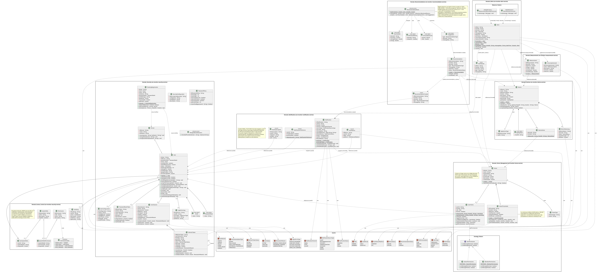

**Figure 4.** *Domain class diagram, including the Strategy, Observer and Factory Method patterns.*

## 12.3 Backend services by context

Each subsection states the repository of the service; file paths are relative to `src/main/java/com/energymonitor/` of that repository.

### 12.3.1 Security service (security)

**Function:** Identity, registration with email verification, acceptance of the terms, authentication, sessions, access control, user administration, audit and account deletion.

**Status:** Active · **Location:** en-monitor-security-service (port 8082).

**Related files:**

- security/adapter/in/web/AuthController.java (authentication, profile and account), AdminController.java (`/api/v1/admin/users` and `/api/v1/admin/roles`) and SupportController.java (support contacts)

- security/adapter/in/web/internal/InternalController.java (internal API: permissions, profiles and administrators)

- security/application/usecase/ (RegisterUserService, EmailVerificationService, AuthenticateUserService, SignInWithGoogleService, RefreshSessionService, LogoutUserSessionService, ChangePasswordService, CreatePasswordResetTokenService, ResetPasswordService, UpdateUserProfileService, DeleteAccountService, CheckPermissionService, AssignRoleService, RevokeRoleService, ManageUserStatusService…)

- security/domain/model/ (User, Person, PendingRegistration, Email, PasswordHash, PasswordPolicy, UserSession, RefreshToken, SystemRole, Permission, PermissionCodes, AuditLog, LoginErrorLog) and domain/service/MistypedEmailDomains (mistyped email domains)

- security/infrastructure/ (SecurityFilterChainConfiguration, JwtTokenIssuer, PemRsaKeys, JwtAuthenticationEntryPoint) and security/adapter/out/security/ (BCryptPasswordHasherAdapter, Sha256TokenHasher, PepperedHmacResetCodeHasher, InMemoryResetAttemptLimiter)

- security/adapter/out/messaging/ (OutboxWriter, OutboxRelay, RabbitOutboxPublisher: account events and mail requests) and the home service client for the deletion check

**Related tables:** person, user, user_configuration, password_reset_token, user_session, refresh_token, security_configuration, password_policy, login_error_log, system_role, permission, user_system_role, system_role_permission, audit_log, security_outbox and pending_registration.

**Main operations:**

- Store the registration request in `pending_registration` (202) and create the account only when the 6-digit code is verified (it expires within 15 to 30 minutes; the request expires after 24 hours); refuse mistyped or mail-less domains (400)

- Require the acceptance of the terms and conditions (`acceptTerms`) at registration, at the first Google sign-in and at the sign-in of accounts without acceptance (428 without it)

- Sign in with email and password (403 when the email is not verified) or with Google (code on the web, ID token in the app) and renew tokens; sign out

- Recover and change passwords (Google accounts have no password change: 409)

- Read and update the profile

- Query permissions (RBAC) and administer users: directory, status change and granting or revoking global roles (an administrator cannot change themselves: 409)

- Publish the support contacts (active administrators)

- Delete the account with the password or, for Google accounts, with a code sent by email (`SECURITY_ACCOUNT_DELETION_CODE_MAIL_ENABLED`); first it asks the home service through `/internal/accounts/{id}/deletion-check`, then it closes the sessions, soft-deletes the data, releases the email and the Google account and publishes `account.deleted`

- Ask the notification service, through RabbitMQ, to send the code mails (`mail.*`) and publish `account.registered`, `account.administered` and `account.first-signed-in`

- Record audit entries and failed attempts

### 12.3.2 Home service (home)

**Function:** Management of homes, members, favorites, consumption thresholds, home deletion, ownership transfer and announcement of the activity of the homes.

**Status:** Active · **Location:** en-monitor-home-service (port 8086).

**Related files:**

- home/adapter/in/web/HomeController.java, HomeThresholdsController.java, HomeTypeController.java and CurrentUserResolver.java

- home/adapter/in/internal/ (HomeAccessController, HomeLimitsController, HomeSummaryController and AccountDeletionCheckController: internal API for the other services)

- home/adapter/in/messaging/AccountDeletedConsumer.java (queue `home-service.home.account-deleted`) and home/adapter/out/messaging/ (HomeOutboxWriter, HomeOutboxRelay, RabbitHomeOutboxPublisher, HomeMessageTypes: publishes `home.*`)

- home/application/usecase/ (CreateHomeService, JoinHomeService, LeaveHomeService, ListHomesService, ListMembersService, RemoveUserService, ToggleFavoriteService, DeleteHomeService, TransferHomeOwnershipService, HomeRemoval, RemoveDeletedAccountService, CheckAccountDeletionService, DescribeHomeAccessService, DescribeHomeLimitsService, DescribeHomeService, GetHomeThresholdsService, UpdateHomeThresholdsService, ListHomeTypesService, GetHomeTypeService)

- home/domain/model/ (Home, HomeType, HomeThresholds, UserHome, Role, UserPermissions, OwnerPermissions, MemberPermissions)

**Related tables:** home, home_type, home_thresholds, user_home and home_outbox.

**Main operations:**

- Create a home and generate its 8-character access code; join a home with the code (there are no email invitations)

- List homes (with role and favorite) and members (with the names it asks the security service for)

- Mark as favorite, remove members (OWNER only) and leave the home (the last owner cannot leave)

- Read, update (OWNER only, daily or monthly limit) and reset thresholds (6 kWh per day and 180 kWh per month)

- Delete the home (OWNER only): soft delete of `home`, `user_home` and `home_thresholds` and, in the same transaction, `home.deleted` in `home_outbox`; the device service consumes it, unlinks the modules, revokes their keys and sends them the MQTT unlink command. The same happens on `account.deleted` of the only owner of a home without other members

- Transfer ownership to a member (OWNER only; atomic role swap) and publish `home.ownership-transferred`

- Publish the activity (`home.created`, `home.member-joined`, `home.member-left`, `home.member-removed`, `home.thresholds-updated`, `home.ownership-transferred` and `home.deleted`, with the name of the home and its members)

- Answer the internal API: a user's access to a home, limits, summary (name and members) and whether an account may be deleted (409 when it is the only owner of a home with other members)

### 12.3.3 Measurement service (measurement)

**Function:** Ingestion and analysis of electrical consumption measurements.

**Status:** Active · **Location:** en-monitor-measurement-service (port 8085).

**Related files:**

- measurement/adapter/in/web/MeasurementController.java, ConsumptionLevelController.java, HomeConsumptionController.java

- measurement/adapter/in/internal/InternalMeasurementController.java (internal API: levels, hourly energy and reporting devices)

- measurement/adapter/in/mqtt/ (TelemetryMqttConsumer, MqttTopics, MqttIngestionConfiguration; the subscription is turned on with `MEASUREMENT_MQTT_ENABLED`)

- measurement/adapter/in/messaging/DeviceLinksConsumer.java (consumes `device.linked` and `device.unlinked` to clear its cache)

- measurement/application/usecase/ (RegisterMeasurementService, ListMeasurementsService, GetLatestMeasurementService, GetConsumptionStatisticsService, HomeConsumptionUseCase, HourlyEnergyCalculator, ListConsumptionLevelsService, TimeRange)

- measurement/adapter/out/messaging/ (MeasurementOutboxWriter, MeasurementOutboxRelay, RabbitMeasurementOutboxPublisher, MeasurementOutboxPurge: publish `measurement.recorded`) and the clients of the home and device services

**Related tables:** measurement, consumption_level and measurement_outbox (the connection status is recorded in device_status_log, of the device service).

**Main operations:**

- Store the readings arriving over MQTT (voltage, current, active power, accumulated energy) with the device timestamp; it is the only subscriber that stores them

- Query history by device and date range and the latest measurement (only members of the home the device is linked to)

- Compute statistics and the household consumption summary and history (day, week, month or year)

- Publish every reading as `measurement.recorded` on RabbitMQ

- Answer the internal API: consumption levels, hourly energy and reporting devices

### 12.3.4 Alert service (alert)

**Function:** Generation and inbox of consumption, limit, linked-device and connectivity alerts.

**Status:** Active · **Location:** en-monitor-alert-service (port 8088).

**Unusual consumption rule (`RegisterAnomalyAlertService`):** a reading is an anomaly when its power is at least 200 W (`MIN_POWER`) and at least 2.5 times (`FACTOR`) the usual power of the appliance. The usual power is the mean of its hourly average power over the previous 7 days, excluding the last hour, and it only counts with at least 24 hours of history (`MIN_HOURS`) and a mean of at least 5 W (`MIN_BASELINE`); a new or almost idle appliance does not raise the alert. The baseline is requested from the measurement service (`DeviceBaselineAdapter`). The alert is of type `THRESHOLD` with `messageKey = alert.anomaly.device`, resolves by itself when consumption returns to normal and is announced by email and push like any alert. The thresholds are constants in the code (DT-27).

**Related files:**

- alert/adapter/in/web/AlertController.java (query, read and delete)

- alert/adapter/in/messaging/MeasurementRecordedConsumer.java (queue `alert-service.measurement.recorded`) and DeviceEventsConsumer.java (queue `alert-service.device.events`)

- alert/application/usecase/ (ListAlertsService, GetAlertService, ResolveAlertService, DeleteAlertsService, RegisterThresholdAlertService, RegisterLimitAlertService, RegisterConnectivityAlertService, RegisterDeviceLinkedAlertService, ResolveConnectivityAlertsService, AlertAccessService)

- alert/adapter/out/ (home, device and measurement: internal API clients; messaging: AlertOutboxWriter, AlertOutboxRelay, RabbitAlertOutboxPublisher)

**Related tables:** alert and alert_outbox.

**Main operations:**

- Raise a THRESHOLD alert of level HIGH or CRITICAL when a reading exceeds the power threshold (only one while it stays active) and resolve it with a low reading

- Raise LIMIT alerts when the daily or monthly limit of the home is reached (zone `ALERT_LIMIT_ZONE`) and DEVICE alerts with the first reading of a newly linked device

- Raise and resolve CONNECTIVITY alerts (device offline and its reconnection)

- List alerts by home and status, read one, mark it as read and delete the resolved ones

- Announce every new alert as `alert.raised` (outbox)

### 12.3.5 Notification service (notification)

**Function:** Delivery of alerts, recommendations and activity by email, Web Push and mobile push; code mails; preferences; in-app notices for administrators; delivery log.

**Status:** Active · **Location:** en-monitor-notification-service (port 8087).

**Related files:**

- notification/adapter/in/web/NotificationChannelsController.java, ActivityNotificationsController.java (`/api/v1/notifications/activity`) and AdminNotificationsController.java (`/api/v1/admin/notifications`)

- notification/adapter/in/messaging/ (AccountEventsConsumer, MailRequestsConsumer, HomeMessagesConsumer and ActivityEventsConsumer)

- notification/application/usecase/ (NotifyAlert, AlertMessages, NotifyActivity, ActivityInbox, ActivityMessages, AdminNotifications, ManageNotificationChannels, MemberChannels, SendEmailVerification, SendPasswordResetEmail, SendAccountDeletionCode)

- notification/infrastructure/mail/ (EmailSender, MailDeliveryConfiguration, AbandonedDeliverySweeper) and notification/adapter/out/push/ (WebPushSender and ExpoPushSender)

- notification/adapter/out/ (security, home and device: internal API clients) and persistence

**Related tables:** notification, notification_preference, push_subscription and push_device.

**Main operations:**

- Send the verification, recovery and account deletion mails requested by the security service (it is the only service that sends email)

- Deliver each alert and recommendation to the members of the home by email, Web Push and mobile push (Expo) according to their preferences

- Record and deliver the activity notifications (welcome, homes and devices) in the inbox of the web and the app, with the text key and the names at that moment (`message_params`), and through the chosen channels

- Record in-app notices for the administrators when an account registers or another administrator changes the status or the roles of an account

- Record the delivery status (PENDING, SENT, FAILED) and sweep abandoned deliveries

- Manage the preferences, the browser push subscriptions and the mobile app devices; clean up the data of deleted accounts

### 12.3.6 Device service (device)

**Function:** Registration and linking of devices, credentials (API key), connection status, commands and MQTT broker authorization.

**Status:** Active · **Location:** en-monitor-device-service (port 8084).

**Related files:**

- device/adapter/in/web/HomeDeviceController.java, ApplianceTypeController.java and BrokerAuthController.java

- device/adapter/in/internal/InternalDeviceController.java (internal API for the measurement, alert, recommendation and notification services)

- device/application/usecase/ (HomeDeviceService, BrokerAccessService, DeviceConnectivityService, DeviceReportService, DeviceQueryService)

- device/domain/model/ (Device, DeviceHome, DeviceStatusLog, ApplianceType, ApiKeyHash)

- device/adapter/in/mqtt/ConnectivityMqttConsumer.java, device/adapter/in/messaging/HomeDeletedConsumer.java (queue `device-service.device.home-deleted`), device/adapter/in/event/DeviceCommandListener.java and device/adapter/in/scheduler/DeviceInactivityScheduler.java

- device/adapter/out/ (mqtt/MqttDeviceCommandAdapter, messaging/ with DeviceOutboxRelay and RabbitDeviceOutboxPublisher, home/ to ask the home service for access, persistence and credential generators)

**Related tables:** device, appliance_type, device_status_log, device_home and device_outbox.

**Main operations:**

- Link a device to a home (OWNER only), edit it, issue new credentials to change its Wi-Fi and unlink it (member or OWNER permission is asked to the home service)

- Authenticate the device and authorize its topics for Mosquitto (only the SHA-256 hash of the key is stored)

- Record connectivity from the telemetry and the retained status, and mark the device offline after 150 seconds of silence (`DeviceInactivityScheduler`)

- Publish `device.linked`, `device.unlinked`, `device.connectivity-lost` and `device.connectivity-restored` on RabbitMQ

- Send the MQTT unlink command when the device is unlinked or when `home.deleted` arrives

### 12.3.7 Recommendation service (recommendation)

**Function:** Saving recommendations generated from the measured consumption.

**Status:** Active · **Location:** en-monitor-recommendation-service (port 8089).

**Related files:**

- recommendation/adapter/in/web/RecommendationController.java

- recommendation/adapter/in/scheduler/RecommendationScheduler.java (every hour; first evaluation after `RECOMMENDATION_INITIAL_DELAY`)

- recommendation/application/usecase/ (EvaluateRecommendationsService, RecommendationInboxService)

- recommendation/domain/service/RecommendationRules.java (pure rules, no I/O) and domain/model (Recommendation, Suggestion, HourSample, MonitoredDevice, ConsumptionLimit)

- recommendation/adapter/out/ (home, device and measurement: internal API clients; messaging: outbox of `recommendation.created`)

**Related tables:** recommendation and recommendation_outbox.

**Main operations:**

- Evaluate every hour, for the homes with readings in the last week, five rules: PEAK_HOURS (at least 40 % of the 7-day energy between 18:00 and 22:00 local time, minimum 2 kWh), SAVING (a device that is not always on draws 15 W or more between 01:00 and 05:00 on three nights in a row), HISTORICAL_COMPARISON (25 % more than the previous week), THRESHOLD (the current pace exceeds the limit of the home) and HIGH_CONSUMPTION (a device's mean power 30 % above the 21 days before); the same advice is not repeated within 7 days

- List the recommendations of a home, mark them as read and delete the read ones

- Announce every new recommendation as `recommendation.created` (outbox)

## 12.4 Web front-end module

**Function:** public landing page and interface to query, manage and administer the electrical consumption (React SPA)

**Related files:**

- src/routes/AppRoutes.jsx (routes), ProtectedRoute.jsx (session), GuestRoute.jsx (login and registration only without a session), RequirePermission.jsx (global permission), UserOnlyRoute.jsx (sends ADMIN to the administration) and HomeRoute.jsx (home detail)

- src/services/http/httpClient.js (axios client towards the gateway, interceptors, HttpOnly cookie session with `X-Session-Transport: cookie` and token renewal)

- src/services/auth (including usePermissions), admin, home, devices, alerts, recommendations and notifications (consumed endpoints)

- src/context/HomeContext.jsx, ThemeContext.jsx and NotificationCenterContext.jsx (global state)

- src/features/ (landingPage, auth, dashboard, DetailHome, Favorites, Notifications, Account, SettingsPage, Admin)

**Screens and routes:**

| **Route**                                                 | **Screen**                  | **Function**                                                                               |
|-----------------------------------------------------------|-----------------------------|--------------------------------------------------------------------------------------------|
| /home, /about, /support                                   | Landing page                | Public presentation, about and support pages (FAQ and contact with the active administrators), with footer. |
| /login, /register                                         | Login and Registration      | Authentication (including Google) and account creation with zod validation and acceptance of the terms and privacy policy (legal window). |
| /VerifyAccount, /recover-password, /verifyRecoverPassword | Verification and recovery   | Email verification code and password recovery.                                             |
| /dashboard                                                | Household panel             | Household cards, create household, join with code and favorites (not visible to ADMIN).    |
| /homes/:homeId                                            | Household detail            | Six tabs: Consumption, History, Users (remove and transfer ownership), Devices (link over Bluetooth, edit, change Wi-Fi, delete), Thresholds and Home (code, leave or delete household). |
| /favorites                                                | Favorites                   | List of households marked as favorites (not visible to ADMIN).                             |
| /notifications                                            | Notifications               | User: All, Alerts, Recommendations and Activity tabs with a filter by household or account; read and delete. ADMIN: administration notices. |
| /settings                                                 | Settings                    | Language, theme, notifications (email and push; not for ADMIN) and help center.            |
| /account                                                  | Account                     | Profile, photo, password (not for Google accounts) and account deletion (with password or code). |
| /admin/users                                              | Administration (ADMIN only) | User directory with search and pagination, status change and administrator role (requires USER.READ; actions according to USER.MANAGE and ROLE.MANAGE). |

**Main operations:** sign in and out, register and verify the account, accept the terms, recover the password, create and join households, mark favorites, view and manage members and thresholds, link and manage devices, view consumption and history, view alerts, recommendations and activity, turn on push notifications, delete the household or transfer its ownership, change language and theme, and administer accounts (ADMIN).

## 12.5 Mobile front-end module

**Function:** "EnergyMonitor" Android application connected to the REST API

**Related files:**

- src/app/ (Expo Router routes: \_layout, index, register, verify-account, recover-password, verify-recover-password, new-password, dashboard, homes, home/\[id\], favorites, notifications, settings, account)

- src/services/ (http, auth with the session in expo-secure-store, home, devices with ble/, measurement, alerts, recommendations, notifications with pushRegistration)

- src/features/ (auth with LegalModal, dashboard, homes, favorites, notifications, settings, account)

- src/context/ (HomeContext, UserContext, ThemeContext, NotificationCenterContext)

- src/components/ and src/constants/ (own design system with StyleSheet; side menu and bottom bar)

**Main operations:** registration with the terms and the privacy policy in a window (same texts as the web) and password rules shown as a persistent hint, code verification, password recovery, Google sign-in, household panel, household detail with six tabs (including ownership transfer and household deletion), linking of the module over native Bluetooth, favorites, notifications (alerts, recommendations and activity, with a household filter) and push, language (es, en, fr, pt), theme (four) and notification settings, and account management.

**October 2026 changes:** session tokens in the device secure store (Keystore/Keychain, with `AFTER_FIRST_UNLOCK_THIS_DEVICE_ONLY`); Android backups disabled; accessibility (screen reader labels, roles and states on the controls, titles marked as headings, larger touch targets, labeled OTP digits that accept a pasted code); icons instead of emojis; page title on Settings and My account; app name "EnergyMonitor".

> **Current limitations:** the app has no landing page and no administration screens (administration is done only on the web), has no automated tests and is not available for iPhone.

# 13. API or system routes

**Base URL:** https://energy-monitor.tech/api/v1 in production and http://localhost:8080/api/v1 in development (API gateway) \| **Format:** JSON \| **Interactive documentation:** /swagger-ui.html and /v3/api-docs of each service

All business routes are under `/api/v1` and go through the gateway, which forwards them to the owning service according to the "API gateway routes" table of section 9.3. The migration did not change the routes the clients already used. Two internal routes for the broker and the infrastructure routes are added. Every route not shown as public requires a valid JWT (Authorization header or the web's `em_access` cookie); if the token is missing, expired or invalid, the gateway answers 401 without forwarding the request, and if the user lacks the required permission, the service answers 403.

| **Method** | **Route**                                             | **Description**                                                       | **Parameters**                                                         | **Authentication** |
|------------|-------------------------------------------------------|-----------------------------------------------------------------------|------------------------------------------------------------------------|--------------------|
| POST       | /api/v1/auth/register                                 | Stores the registration request and sends the code (202; 409 when the email already has an account; 428 without accepting the terms). | body: email, password, name, lastName (optional), profileImage (optional), acceptTerms | Public |
| POST       | /api/v1/auth/email/verify                             | Verifies the email with the 6-digit code and creates the account.     | body: email, code                                                      | Public             |
| POST       | /api/v1/auth/email/verification/resend                | Sends the verification code again (always answers 202).               | body: email                                                            | Public             |
| POST       | /api/v1/auth/login                                    | Authenticates and returns access token and refresh token (403 without a verified email; 428 without accepted terms). | body: email, password, acceptTerms (optional)  | Public             |
| POST       | /api/v1/auth/google                                   | Signs in or registers the account with Google (428 when a new account does not accept the terms; 503 when not configured). | body: code (web) or idToken (app), acceptTerms | Public |
| POST       | /api/v1/auth/refresh                                  | Renews the access token and rotates the refresh token.                | body: refreshToken (mobile) or em_refresh cookie (web)                 | Public             |
| POST       | /api/v1/auth/logout                                   | Closes the registered session.                                        | body: idUserSession                                                    | JWT                |
| POST       | /api/v1/auth/password/forgot                          | Requests the password recovery code (202; 404 when the email has no account). | body: email                                                    | Public             |
| POST       | /api/v1/auth/password/reset                           | Resets the password with the received code.                           | body: email, resetToken, newPassword                                   | Public             |
| POST       | /api/v1/auth/password/change                          | Changes the password knowing the current one (409 for Google accounts). | body: currentPassword, newPassword                                   | JWT                |
| PUT        | /api/v1/auth/profile                                  | Updates first name, last name, image or email.                        | body: name, lastName, profileImage, newEmail                           | JWT                |
| POST       | /api/v1/auth/account/delete/code                      | Sends the deletion code to a Google account (202; 409 when the account has a password; 503 when the code mail is turned off). | none | JWT |
| POST       | /api/v1/auth/account/delete                           | Deletes the account after confirming the password or the code (409 when it is the only owner of a home with members). | body: password or code         | JWT                |
| GET        | /api/v1/auth/account                                  | Returns the authenticated account (includes `googleAccount`).         | none (identity from the JWT)                                           | JWT                |
| GET        | /api/v1/auth/permissions                              | Lists the user's permission codes.                                    | none                                                                   | JWT                |
| GET        | /api/v1/admin/users                                   | User directory (requires USER.READ).                                  | query: q, page, size (1 to 50; 20 by default)                          | JWT                |
| GET        | /api/v1/admin/roles                                   | Lists the assignable global roles (requires USER.READ).               | none                                                                   | JWT                |
| PUT        | /api/v1/admin/users/{idUser}/status                   | Changes the status of another account (requires USER.MANAGE; 409 on one's own). | path: idUser; body: status (ACTIVE, INACTIVE or BLOCKED)     | JWT                |
| PUT        | /api/v1/admin/users/{idUser}/roles/{roleName}         | Grants a global role (requires ROLE.MANAGE).                          | path: idUser, roleName                                                 | JWT                |
| DELETE     | /api/v1/admin/users/{idUser}/roles/{roleName}         | Revokes a global role (requires ROLE.MANAGE).                         | path: idUser, roleName                                                 | JWT                |
| GET        | /api/v1/support/contacts                              | Name and email of each active administrator, for the support page.    | none                                                                   | Public             |
| GET        | /api/v1/measurements                                  | Lists the measurements of a device in a range.                        | query: deviceId (required), from, to                                   | JWT                |
| GET        | /api/v1/measurements/latest                           | Returns the latest measurement of a device.                           | query: deviceId                                                        | JWT                |
| GET        | /api/v1/measurements/statistics                       | Consumption statistics of the period.                                 | query: deviceId, from, to                                              | JWT                |
| GET        | /api/v1/consumption-levels                            | Lists the consumption levels (LOW, MEDIUM, HIGH, CRITICAL).           | none                                                                   | JWT                |
| GET        | /api/v1/homes/{homeId}/consumption/summary           | Household consumption summary.                                        | path: homeId; query: zone (UTC by default)                             | JWT                |
| GET        | /api/v1/homes/{homeId}/consumption/history           | Household consumption history by period.                              | path: homeId; query: period (day, week, month or year), zone           | JWT                |
| POST       | /api/v1/homes                                         | Creates a household and returns its access code.                      | body: name, homeTypeId, address, description                           | JWT                |
| GET        | /api/v1/homes                                         | Lists the user's households with their role and whether each is a favorite. | none                                                             | JWT                |
| GET        | /api/v1/homes/{homeId}/members                        | Lists the members of a household with names and roles.                | path: homeId                                                           | JWT                |
| POST       | /api/v1/homes/join                                    | Joins a household with its access code.                               | body: accessCode                                                       | JWT                |
| PUT        | /api/v1/homes/{homeId}/favorite                       | Marks or unmarks a household as favorite.                             | path: homeId                                                           | JWT                |
| DELETE     | /api/v1/homes/{homeId}/members/{userId}               | Removes a member (OWNER only).                                        | path: homeId, userId                                                   | JWT                |
| DELETE     | /api/v1/homes/{homeId}/members/me                     | Lets the user leave the household (not the last owner).               | path: homeId                                                           | JWT                |
| DELETE     | /api/v1/homes/{homeId}                                | Deletes the household (OWNER only): 204; 403 for a MEMBER; 404 when not a member. | path: homeId                                               | JWT                |
| PUT        | /api/v1/homes/{homeId}/owner                          | Transfers ownership to a member: 204; 403, 404 and 409 depending on the case. | path: homeId; body: newOwnerId                                 | JWT                |
| GET        | /api/v1/homes/{homeId}/thresholds                     | Reads the household thresholds.                                       | path: homeId                                                           | JWT                |
| PUT        | /api/v1/homes/{homeId}/thresholds                     | Updates the household limit (OWNER only).                             | path: homeId; body: limitPeriod (DAILY or MONTHLY), limit              | JWT                |
| POST       | /api/v1/homes/{homeId}/thresholds/defaults            | Resets the thresholds to the system values (6 kWh per day and 180 kWh per month). | path: homeId                                               | JWT                |
| GET        | /api/v1/home-types                                    | Lists the available household types.                                  | none                                                                   | JWT                |
| GET        | /api/v1/home-types/{idHomeType}                       | Reads a household type.                                               | path: idHomeType                                                       | JWT                |
| GET        | /api/v1/appliance-types                               | Lists the appliance catalog.                                          | none                                                                   | JWT                |
| GET        | /api/v1/homes/{homeId}/devices                        | Lists the devices of the household.                                   | path: homeId                                                           | JWT                |
| POST       | /api/v1/homes/{homeId}/devices                        | Links a device and returns its credentials and the broker address (OWNER only). | body: deviceCode, name, applianceTypeId, location            | JWT                |
| PUT        | /api/v1/homes/{homeId}/devices/{deviceId}             | Edits appliance, name and location (OWNER only).                      | path: homeId, deviceId; body: name, applianceTypeId, location          | JWT                |
| POST       | /api/v1/homes/{homeId}/devices/{deviceId}/credentials | Issues a new key to change the Wi-Fi network (invalidates the previous one). | path: homeId, deviceId                                          | JWT                |
| DELETE     | /api/v1/homes/{homeId}/devices/{deviceId}             | Unlinks the device (OWNER only).                                      | path: homeId, deviceId                                                 | JWT                |
| GET        | /api/v1/alerts                                        | Lists the alerts of a household.                                      | query: homeId (required), status (PENDING \| RESOLVED)                 | JWT                |
| GET        | /api/v1/alerts/{idAlert}                              | Reads an alert.                                                       | path: idAlert                                                          | JWT                |
| PUT        | /api/v1/alerts/{idAlert}/read                         | Marks an alert as read (409 for system alerts that resolve themselves). | path: idAlert                                                        | JWT                |
| DELETE     | /api/v1/alerts/{idAlert}                              | Deletes a resolved alert.                                             | path: idAlert                                                          | JWT                |
| DELETE     | /api/v1/alerts                                        | Deletes all the resolved alerts of a household.                       | query: homeId                                                          | JWT                |
| GET        | /api/v1/recommendations                               | Lists the recommendations of a household.                             | query: homeId                                                          | JWT                |
| PUT        | /api/v1/recommendations/{idRecommendation}/read       | Marks a recommendation as read.                                       | path: idRecommendation                                                 | JWT                |
| DELETE     | /api/v1/recommendations/{idRecommendation}            | Deletes a read recommendation (409 when it is unread).                | path: idRecommendation                                                 | JWT                |
| DELETE     | /api/v1/recommendations                               | Deletes all the read recommendations of a household.                  | query: homeId                                                          | JWT                |
| GET        | /api/v1/notifications/activity                        | Activity notifications of the user (account, households and devices). | query: homeId (optional)                                               | JWT                |
| PUT        | /api/v1/notifications/activity/{id}/read              | Marks an activity notification as read.                               | path: id                                                               | JWT                |
| PUT        | /api/v1/notifications/activity/read                   | Marks all the activity notifications (or those of a household) as read. | query: homeId (optional)                                             | JWT                |
| DELETE     | /api/v1/notifications/activity/{id}                   | Deletes an activity notification.                                     | path: id                                                               | JWT                |
| GET        | /api/v1/notifications/preferences                     | Reads the user's notification preferences.                            | none                                                                   | JWT                |
| PUT        | /api/v1/notifications/preferences                     | Updates the email and push preferences.                               | body: emailEnabled, pushEnabled                                        | JWT                |
| GET        | /api/v1/notifications/push/public-key                 | Returns the VAPID public key (empty when push is disabled).           | none                                                                   | JWT                |
| POST       | /api/v1/notifications/push/subscriptions              | Registers a browser push subscription.                                | body: endpoint, keys (p256dh, auth)                                    | JWT                |
| POST       | /api/v1/notifications/push/subscriptions/remove       | Removes a push subscription.                                          | body: endpoint                                                         | JWT                |
| POST       | /api/v1/notifications/push/devices                    | Registers the mobile app installation for push (Expo).                | body: token, platform (ANDROID or IOS)                                 | JWT                |
| POST       | /api/v1/notifications/push/devices/remove             | Removes the push registration of an app installation.                 | body: token                                                            | JWT                |
| GET        | /api/v1/notifications/push/devices/available          | Tells whether app push is configured (404 when it is not).            | none                                                                   | JWT                |
| GET        | /api/v1/admin/notifications                           | In-app notices of the administrator (requires USER.READ).             | none                                                                   | JWT                |
| PUT        | /api/v1/admin/notifications/{id}/read                 | Marks an administrator notice as read.                                | path: id                                                               | JWT                |
| DELETE     | /api/v1/admin/notifications/{id}                      | Deletes an administrator notice.                                      | path: id                                                               | JWT                |
| POST       | /internal/mqtt/auth/user                              | Internal (device service): Mosquitto authenticates an MQTT client (five-minute cache). The gateway rejects it. | body: username, password, clientid | Internal network |
| POST       | /internal/mqtt/auth/acl                               | Internal (device service): Mosquitto authorizes a client's topic. The gateway rejects it. | body: username, clientid, topic, acc | Internal network   |
| GET        | /actuator/health                                      | Status of each service (UP / DOWN).                                   | none                                                                   | Public             |
| GET        | /swagger-ui.html and /v3/api-docs                     | Interactive API documentation of each service (OpenAPI).              | none                                                                   | Public             |
| OPTIONS    | /\*\*                                                 | CORS preflight (answered by the gateway).                             | Origin and Access-Control-Request-\* headers                           | Public             |

> *The `/internal/mqtt/**` routes only accept calls from the `MQTT_AUTH_ALLOWED_NETWORKS` networks; the other `/internal/**` routes (section 9.3) also require the `X-Internal-Token` header. The gateway never forwards them (401 without a token, 403 with one) and the web's nginx only forwards `/api/`.*

## 13.1 Common response codes

| **Code**        | **When it happens**                                                           | **Response structure**                                         |
|-----------------|-------------------------------------------------------------------------------|----------------------------------------------------------------|
| 200 / 201 / 202 / 204 | Successful operation (query, creation, accepted request or deletion without content). | Body with the corresponding resource or message.     |
| 400             | Invalid data (Bean Validation or zod schema in the client), mistyped or non-existent email domain, expired code. | ApiError with fieldErrors detailing each field. |
| 401             | Missing or expired token or invalid credentials (the gateway answers it before forwarding). | ApiError with a generic message (does not reveal whether the email exists). |
| 403             | Blocked or inactive account, unverified email at sign-in, or insufficient permission (e.g. a MEMBER tries to delete the household). | ApiError. |
| 404             | Non-existent resource (household, alert, member…), household the user does not belong to, or route no service serves (gateway). | ApiError or {"error": "..."} depending on the service. |
| 409             | Conflict (email already registered, last owner who cannot leave, transfer to the current owner, administrator changing themselves, account that is the only owner of a household with members). | ApiError. |
| 422             | The password does not meet the security policy.                               | ApiError.                                                      |
| 428             | The terms and conditions have not been accepted (registration, Google or sign-in). | ApiError.                                                 |
| 429             | Attempt limit reached in verification, recovery or deletion with a code (security service), or more than 20 public account POSTs per IP and path in one minute (gateway). | ApiError with a Retry-After header. |
| 503             | A service refuses the connection (gateway), an internal service the operation depends on does not answer, or Google sign-in without configured credentials. | ApiError. |
| 504             | A service takes more than 30 seconds to answer (gateway).                     | ApiError.                                                      |
| 500             | Unhandled internal error.                                                     | ApiError without a stack trace (a stack trace is never leaked). |

## 13.2 Request and response example

```
POST /api/v1/auth/login
Content-Type: application/json

{ "email": "user@mail.com", "password": "********" }

200 OK

{
  "accessToken": "eyJhbGciOiJSUzI1NiIsImV4cCI6MTc2…",
  "refreshToken": "7f3c…",
  "tokenType": "Bearer",
  "expiresIn": 900,
  "account": { "idUser": "user000001", "email": "user@mail.com", "status": "ACTIVE" }
}
```

This is the answer the mobile app receives; it keeps the tokens in the device secure store. With the `X-Session-Transport: cookie` header (the one the web sends) the security service delivers the tokens in the HttpOnly `em_access` and `em_refresh` cookies, and `accessToken` and `refreshToken` arrive as `null`.

# 14. Security

## 14.1 Implemented controls

| **Control**                   | **Technical implementation**                                                                                                                                                                            |
|-------------------------------|---------------------------------------------------------------------------------------------------------------------------------------------------------------------------------------------------------|
| Authentication                | JWT signed with RS256 by the security service, the only one holding the private key (PEM); the gateway and the other services validate it with the public key (signature, issuer and expiry), so a service reached without going through the gateway is not left open either. Access token lifetime: 15 minutes; no roles inside the JWT; claims sub (idUser), person_id and email. |
| Identity                      | All services get the user from the `sub` claim through `CurrentUserResolver`; the X-User-Id header is ignored.                                                                                          |
| Verification and terms        | No account exists until the email is verified (`pending_registration`, 24 hours); sign-in requires a verified email (403) and accepted terms (`user.terms_accepted_at`, 428). |
| Sessions                      | No HTTP session on the server (STATELESS). The mobile app receives the tokens in the body and keeps them in the system secure store (expo-secure-store: Keystore/Keychain), with Android backups disabled; the web, in HttpOnly and SameSite=Strict cookies (Secure in production): `em_access` (Path=/api) and `em_refresh` (Path=/api/v1/auth). The gateway only uses the cookie when the request brings `X-Requested-With: XMLHttpRequest`, a header a form or an image of another site cannot send (CSRF protection). |
| Session renewal               | Stateful opaque refresh token, rotated on each use, stored as a SHA-256 hash with family_id and parent_id to detect reuse (replay) and revoked when the password changes or the account is blocked. |
| Password hashing              | BCrypt (BCryptPasswordHasherAdapter) isolated from the domain; passwords are never stored in clear text.                                                                                                |
| Password policy               | password_policy table: minimum length 8 and maximum 64, requires upper case, digits and symbols, expires after 90 days. Non-compliance =\> 422. The clients show the rules as a persistent hint.       |
| Global authorization (RBAC)   | Five-table chain (system_role, permission, user_system_role, system_role_permission and user) checked live in the security service; permissions available at GET /api/v1/auth/permissions. The notification service asks for USER.READ through the internal API. An administrator cannot change their own status or roles (409). The gateway decides no permissions. |
| Household authorization       | OWNER and MEMBER roles per household resolved with the Strategy pattern (`OwnerPermissions`, `MemberPermissions`) in the home service; the other services ask it through `/internal/homes/{homeId}/access` without caching, so a removed member loses access immediately. |
| Input validation              | Bean Validation on the DTOs of the services (@NotBlank, @Size, @NotNull, @Positive, @Pattern), email domain validation and zod schemas in the forms of the front-ends.                                  |
| CORS                          | Only in the gateway, which drops the Origin header before forwarding. Closed by default: explicit list of origins (SECURITY_CORS_ALLOWED_ORIGINS of the gateway), no wildcards and handling of the OPTIONS preflight; methods GET, POST, PUT, DELETE and OPTIONS. |
| Attempt limits                | In-memory limiters: in the gateway, 20 POSTs per IP and path per minute on the public account endpoints =\> 429 with Retry-After; in the security service, 10 attempts per IP every 15 minutes in password recovery, five attempts per email and window in verification and five attempts in 15 minutes in the deletion with a code. |
| Protection against enumeration | Failed login with a generic message; the unverified email check happens after the password. By documented decision, password/forgot answers 404 when the email has no account (as registration answers 409 when it exists), and the per-IP limit is charged before the lookup. |
| One-time codes                | Recovery: 6 digits, 15 minutes, single use, stored as HMAC-SHA256 with a pepper (SECURITY_RESET_PEPPER). Verification and Google account deletion: derived (HMAC with the same pepper over the account, the email and the 15-minute window), never stored. |
| Device credentials            | Each device uses `device_code` and `api_key`; the device service only stores the SHA-256 hash of the key (`api_key_hash`). Mosquitto authenticates the device against the device service and the ACL limits its topics. |
| Device transport              | MQTT 3.1.1 with TLS on port 8883; port 1883 only exists inside the Docker network and the `/internal/mqtt/**` routes are accepted only from allowed networks.                                          |
| Internal communication        | The `/internal/**` routes require loopback or the Docker network (`172.16.0.0/12`) and the `X-Internal-Token` header (`INTERNAL_API_TOKEN`), compared in constant time; with no token configured every call is refused. The gateway never forwards them and in Docker only the web (80), the gateway for the app on the LAN (8080, only in the local stack), MQTT with TLS (8883) and, on 127.0.0.1, the administration ports are published. |
| Audit                         | audit_log (actions, IP, user; includes the status and role changes made by administrators) and login_error_log (failed attempts) tables. The gateway appends the client IP to X-Forwarded-For and the services only take it from that header when the connection comes from loopback or the Docker network. |
| Documentation                 | The OpenAPI endpoint of each service declares the bearerAuth scheme; the only public endpoints are the authentication ones, `GET /api/v1/support/contacts` and the infrastructure ones.                  |
| Transport                     | In production it is served over HTTPS (Nginx + Certbot with Let's Encrypt) at https://energy-monitor.tech, and MQTT with TLS at mqtt.energy-monitor.tech:8883; local development uses HTTP. |

## 14.2 Known limitations and risks

> The following points are declared by the team itself and must be taken into account before extending the system.

| **Limitation**                                                                                 | **Impact**                                                                            | **Recommendation**                                                                  |
|------------------------------------------------------------------------------------------------|---------------------------------------------------------------------------------------|-------------------------------------------------------------------------------------|
| Telemetry and status with MQTT QoS 0.                                                          | A reading can be lost (no duplicates).                                                | Evaluate an MQTT client with QoS 1 (for example espMqttClient).                     |
| Mosquitto depends on the device service to authenticate each client.                           | If the service goes down, new MQTT logins are refused and connected modules only publish while the cached ACL decisions last (5 minutes). | Watch the health of the device service; the deployment waits for every service to be `healthy`. |
| An outbox stops at a message no queue takes.                                                   | If a producer is deployed before its consumer's queue exists, its other events wait behind. | Deploy the consumer first (order documented in the installation manual) and watch `last_error` of the `*_outbox` tables. |
| Attempt limiters (gateway and security) in memory and outbox relays designed for a single instance. | They reset on every start and are not shared between instances; a second instance could reorder messages. | Use Redis or another shared store when scaling to several instances.       |
| No over-the-air (OTA) firmware update.                                                         | Updating the firmware requires a USB cable.                                           | Evaluate OTA in a future version.                                                   |
| The persistence tests are not hermetic.                                                        | They need the MySQL of the infrastructure repository running and SPRING_DATASOURCE_PASSWORD. | Use a database container for tests.                                          |
| The access token stays valid up to 15 minutes after the account is deleted or blocked.         | Short window of residual access.                                                      | Accepted; documented.                                                               |
| The ADMIN role is not denied on the household routes by the server.                            | Only the web hides those screens (UserOnlyRoute); the mobile app does not distinguish administrators. | Deny the household endpoints to administrator accounts on the server or document their use. |
| Web Bluetooth limited to Chrome, Edge and Chrome for Android, and to HTTPS or localhost.       | Other browsers use the Wi-Fi setup portal or the mobile app; on iOS there is no web push without installing the web. | Keep the `EnergyMonitor-Setup` portal as an alternative.     |
| The device history is not limited to the linking period.                                       | A household can see measurements of an earlier period from another household.         | Limit the history to the linking period (RF-HOM-11).                                |
| The mobile application has no automated tests and no iPhone version.                           | Verification of the app is manual.                                                    | Add tests and evaluate publishing on iOS.                                           |
| The notification service has no CI/CD workflow in the reviewed local repository.              | Its deployment is not automated like the others.                                      | Add `.github/workflows/ci-cd.yml` with the same scheme as the other services.      |

## 14.3 Good practices for developers

- Never commit the .env files (of each service and of infra), application-local.yaml or the RSA keys (\*.pem); they are already declared in .gitignore. Only the security service receives the private key; the other services receive only `public.pem`.

- Do not log passwords, tokens or recovery codes.

- Keep the dependencies of the backend services and of the front-ends up to date and review their security advisories.

- Every new feature must validate its input in the service that serves it, regardless of the client validations.

- Between services, communicate only through the internal REST and the RabbitMQ events; never import entities or repositories of another service or create foreign keys between services.

- A new public endpoint in the security service must also be added to the gateway's list of public endpoints (`SecurityFilterChainConfiguration`), and a new route under `/api/v1` must be registered in `GatewayRoutes`: without it the gateway answers 404.

- A new event must have its queue declared by the consumer before the producer publishes it.

- Rotate the JWT keys, the recovery pepper and the `INTERNAL_API_TOKEN` (in all services at once) if a leak is suspected.

# 15. Software version control

The project uses Git with a remote repository on GitHub. Each component of the system is developed in an independent repository to make its deployment and review easier. The commit column shows the last `dev` commit reviewed for this manual (10/27/2026) and the `main` one, which is the one deployed.

| **Repository**             | **Content**                                                      | **Notes**                                                                                 |
|----------------------------|------------------------------------------------------------------|-------------------------------------------------------------------------------------------|
| en-monitor-api-gateway     | API gateway in Java 21 / Spring Boot 4.0.8 / Spring Cloud Gateway. | https://github.com/Juan-Cortes2045/en-monitor-api-gateway; `dev` at `d377c14`, `main` at `c070cec`. |
| en-monitor-security-service | Security microservice in Java 21 / Spring Boot 4.1.1.           | https://github.com/Juan-Cortes2045/en-monitor-security-service; `dev` at `13f3a12`, `main` at `334691a`. Changesets security-001 to 030. |
| en-monitor-device-service  | Device microservice.                                             | https://github.com/Juan-Cortes2045/en-monitor-device-service; `dev` at `9dac108`, `main` at `b64bda5`. Changesets device-001 to 009. |
| en-monitor-measurement-service | Measurement microservice.                                    | https://github.com/Juan-Cortes2045/en-monitor-measurement-service; `dev` at `b722669`, `main` at `ee2cb81`. Changesets measurement-001 to 004. |
| en-monitor-home-service    | Home microservice.                                               | https://github.com/angelgarcia0/en-monitor-home-service; `dev` at `aedd2aa`, `main` at `7d78c3d`. Changesets home-001 to 007. |
| en-monitor-notification-service | Notification microservice.                                  | https://github.com/angelgarcia0/en-monitor-notification-service; `dev` at `146c49f`, `main` at `713be4e`. Changesets notification-001 to 007. |
| en-monitor-alert-service   | Alert microservice.                                              | https://github.com/angelgarcia0/en-monitor-alert-service; `dev` at `f3f60b1`, `main` at `e66b9aa`. Changesets alert-001 to 004. |
| en-monitor-recommendation-service | Recommendation microservice.                              | https://github.com/angelgarcia0/en-monitor-recommendation-service; `dev` at `400dc7e`, `main` at `6e5f5bd`. Changesets recommendation-001 and 002. |
| Energy-Monitor-application | React 19 / Vite 8 web application.                               | https://github.com/Juan-Cortes2045/Energy-Monitor-application; `dev` at `8457d50`, `main` at `e59bece`. Vitest tests (38 files). |
| Energy-Monitor-Mobile      | Expo SDK 57 mobile application.                                  | https://github.com/angelgarcia0/Energy-Monitor-Mobile; `dev` at `1e4109b`, `main` at `894b65a`. Includes LICENSE, AGENTS.md and eas.json. |
| energy-monitor-infra       | Docker Compose (local, development and production), Mosquitto, Nginx and deployment. | https://github.com/Juan-Cortes2045/energy-monitor-infra; `dev` at `7986ae3`, `main` at `eaf961b`. Includes deploy.sh, make-admin.sh and the end-to-end tests (e2e/). |
| energy-monitor-backend     | Retired modular backend and ESP32 firmware.                      | https://github.com/Juan-Cortes2045/energy-monitor-backend; archived (`dev` at `8fc6c27`, "Refactor/retire backend"). Keeps the firmware/ folder. |
| energy-monitor-docs-final  | Final bilingual documentation (ES and EN).                       | General document, requirements specification, technical proposal, design, database and manuals. Other documentation repositories: en-monitor-docs and Energy-Monitor-Documentation. |
| energy-monitor-devices     | Old firmware and broker (legacy).                                | No longer used to run anything; the firmware is in energy-monitor-backend and the broker in energy-monitor-infra. |

- All repositories have the `main` (production) and `dev` (integration) branches. Working branches follow the `[type]/[name-in-kebab-case]` convention (feat/*, fix/*, chore/*) and commits follow Conventional Commits with the message in English.

- Code is integrated through a pull request to `dev` and then from `dev` to `main`.

- Each code repository has a GitHub Actions workflow that runs the tests and the build on every pull request and push to `dev` and `main`; after a push to `main` and the approval of the `production` environment, it deploys over SSH with `infra/deploy/deploy.sh security|device|measurement|home|notification|alert|recommendation|gateway|frontend|infra` (section 16.1). In the reviewed copy, en-monitor-notification-service has no `ci-cd.yml`.

- Before merging changes, run the test suite of the affected repository (./mvnw test in each service) and the web front tests (npm test).

- Database schema changes are made only through a new Liquibase changeset with rollback, in the service that owns the table; changesets already applied are never edited.

- Integration branches must keep the code buildable and the tests green.

- Delivered versions are tagged to keep the exact reference of the software documented in this manual.

# 16. Maintenance recommendations

## 16.1 Code updates

| **Area**      | **Recommendation**                                                                                                                                                                |
|---------------|-----------------------------------------------------------------------------------------------------------------------------------------------------------------------------------|
| Backend       | Build with ./mvnw clean test (.\mvnw.cmd on Windows) in each service repository before every delivery. |
| Database      | Create a new changeset for each schema change in the repository of the service that owns the table, with a sequential identifier of its context and its rollback; start MySQL from energy-monitor-infra (development mode) to test against a real MySQL 8.4; regenerate the dictionary, the script and the ERD of `06-base-datos`. |
| Dependencies  | Update Spring Boot, Spring Cloud, Expo or React in test branches, running the complete suite before merging (the gateway stays on Spring Boot 4.0 because Spring Cloud 2025.1 is the release that supports it). |
| Web front     | Keep `VITE_API_BASE_URL` pointing at the gateway and the list of allowed origins (SECURITY_CORS_ALLOWED_ORIGINS of the gateway); run npm test and npm run lint again.            |
| Mobile front  | Review the versioned Expo 57 documentation before adding native libraries; there are no automated tests, so verification is manual.                                               |
| Devices       | Rebuild and upload the firmware over USB after changing config.h or the certificate; renew the broker certificate and restart the `mosquitto` container (in production the Certbot hook `deploy/renew-mqtt-cert.sh` does it). |
| Deployment    | Deploy from `main` with GitHub Actions and `infra/deploy/deploy.sh <component>`: backs up MySQL, updates and rebuilds only that service, waits for every Java service to be `healthy`, the web to answer 200 and `/api/v1/homes` to answer 401 through the gateway, and rolls back if it fails. Before that, run the `infra/e2e/` tests on the local stack. |
| Security      | Review every quarter the RBAC permissions, the accounts with the ADMIN role, the password policy and the validity of the JWT keys.                                                |

## 16.2 Database backups

Before every relevant update, back up the energy_monitor schema, shared by all the services. In production, `deploy.sh` backs up MySQL before each deployment and `deploy/backup-mysql.sh` makes a daily logical backup. Recommended manual procedure:

1.  Stop writing information (do not run measurement loads during the backup).

2.  Run the dump: mysqldump -h localhost -u energy_app -p energy_monitor \> backup_energy_monitor_YYYY-MM-DD.sql

3.  Save the file in a secure folder outside the repository, with the date in its name.

4.  Verify the backup by restoring it on a test database before considering it valid.

5.  Restore: mysql -h localhost -u energy_app -p energy_monitor \< backup_energy_monitor_YYYY-MM-DD.sql

## 16.3 Support and incident resolution

| **Symptom**                             | **Suggested check**                                                                                                                  |
|-----------------------------------------|--------------------------------------------------------------------------------------------------------------------------------------|
| A service does not start                | Check its port (8080, 8082 or 8084 to 8089), the MySQL and RabbitMQ containers (docker compose ps in infra) and the SPRING_DATASOURCE_PASSWORD variable. Without RabbitMQ, /actuator/health answers DOWN. |
| The API answers 403/401 massively       | Check that SECURITY_JWT_PUBLIC_KEY_PATH of each service is the public key of the security service's pair, and the server date and time. |
| The gateway answers 503 or 504          | The service that owns the path is not running or takes more than 30 seconds; check its health with docker compose ps.                |
| The gateway answers 404 on a `/api/v1` route | The route is not registered in `GatewayRoutes` (there is no longer a backend serving the rest).                                 |
| Internal calls fail (503, missing names) | Check that INTERNAL_API_TOKEN has the same value in all services and that the called service is running.                            |
| The web front does not reach the API    | Confirm that the gateway answers on port 8080 and that SECURITY_CORS_ALLOWED_ORIGINS of the gateway includes the origin http://localhost:5173. |
| Emails do not arrive                    | Check MAIL_HOST, MAIL_PORT, MAIL_USERNAME and MAIL_PASSWORD of the notification service, the `notification-service.notification.mail` queue and its `.dlq`, and `last_error` of `security_outbox`. |
| A device does not send readings         | Check the broker (docker compose logs mosquitto), that the device service is running (the broker asks it about each client), DEVICE_MQTT_PUBLIC_HOST (never localhost), the TLS certificate and the ESP32 serial output. |
| Readings arrive but no alerts are raised | Check that the alert service is `healthy`, `ALERT_CONSUMERS_ENABLED`, the `alert-service.measurement.recorded` queue (or its `.dlq`) and the INTERNAL_API_TOKEN. |
| No recommendations appear               | Check `RECOMMENDATION_SCHEDULER_ENABLED`, that the household has readings in the last week and the log of the recommendation service (it evaluates every hour). |
| An outbox does not move                 | Read `last_error` of the producer's `*_outbox` table: usually the consumer's queue is missing (deploy it first).                      |
| Migrations fail on start-up             | Check the Liquibase log and the order of the changesets in the db.changelog-master.xml of the failing service.                      |
| Error messages are not readable         | Check the browser console and the ApiError body returned by the API.                                                                 |

## 16.4 Declared pending work

- Limit the device history to the linking period (RF-HOM-11).

- Deny the household endpoints to administrator accounts on the server (today only the web hides those screens) and also send the administrator notices by email or push.

- Add automated tests to the mobile application.

- Add the CI/CD workflow to the notification service.

- Evaluate MQTT with QoS 1 so that no readings are lost.

- Evaluate over-the-air (OTA) firmware updates.

- Move the firmware out of the retired energy-monitor-backend repository and decide what to do with the legacy `energy-monitor-devices` repository (archive or delete it).

- Drop from the migrated database the `backend_outbox` table of the retired backend and the `energy-monitor-backend.*` queues left in RabbitMQ.

# 17. Glossary

| **Term**              | **Definition**                                                                                                                        |
|-----------------------|---------------------------------------------------------------------------------------------------------------------------------------|
| ADSO                  | Software Analysis and Development: SENA technology program the project belongs to (group 3145556).                                    |
| REST API              | HTTP-based programming interface that exposes resources in JSON format under versioned routes (/api/v1).                              |
| API gateway           | Service that is the single entry point of the API (en-monitor-api-gateway): routes each request to the owning service, validates the token and answers CORS. |
| Access token          | Short-lived JWT (15 minutes) that proves the user's identity on each request.                                                         |
| Bounded context       | Domain context (security, home, measurement…) with its own tables and API; in this project each one is a microservice.               |
| Microservice          | Independent application, with its repository, its deployment and its tables, that implements a context (security, device, measurement, home, notification, alert or recommendation). |
| Activity notification | Notice in the inbox (and through the chosen channels) of what happened in the account, its households and its devices.               |
| RabbitMQ              | Message broker (AMQP) that carries the events between services.                                                                       |
| Transactional outbox  | Pattern in which the message is saved in an outbox table in the same transaction as the change and a relay later publishes it to RabbitMQ. |
| Dead-letter (.dlq)    | Queue a message moves to after failing three attempts, so it does not block the main queue.                                           |
| X-Internal-Token      | Header with the shared secret (INTERNAL_API_TOKEN) required by the internal `/internal/**` routes between services.                   |
| BCrypt                | Salted hash algorithm used to store passwords irreversibly.                                                                           |
| BLE / Web Bluetooth   | Bluetooth Low Energy, with which the app (native) and the web (browser API) hand the Wi-Fi network and the credentials to the module. |
| MQTT broker           | Server (Eclipse Mosquitto) that receives the messages published by the devices and delivers them to the subscribers.                 |
| CORS                  | HTTP policy that controls from which origins (e.g. http://localhost:5173) the browser may call the API.                               |
| Changeset             | Liquibase migration unit: versioned instruction to create or modify tables.                                                           |
| CurrentUserResolver   | Component of each service that gets the user's identity from the `sub` claim of the JWT.                                              |
| Docker Compose        | Tool that defines and starts containers (for example mysql:8.4) with a single command; the project's is in energy-monitor-infra.      |
| DTO                   | Data transfer object: JSON input or output structure of an endpoint.                                                                  |
| ER / ERD              | Entity-relationship diagram: logical model of the tables and their relationships.                                                     |
| JWT                   | JSON Web Token: signed token (RS256) that carries the user's identity.                                                                |
| Liquibase             | Schema manager: applies database changesets in a controlled and versioned way.                                                        |
| Modular monolith (retired) | Former shape of the backend (energy-monitor-backend, Spring Modulith) with several contexts in a single application.            |
| MQTT / QoS            | Messaging protocol for devices and delivery quality level (0: at most once; 1: at least once).                                        |
| PK / Primary key      | Field that uniquely identifies a row (in this project, VARCHAR(10)).                                                                  |
| FK / Foreign key      | Field that references another table inside the same service. Between services only IDs are stored (no SQL FK).                        |
| RBAC                  | Role-based access control: system_role, permission, user_system_role and system_role_permission.                                      |
| Refresh token         | Long-lived opaque token stored as a SHA-256 hash that allows renewing the access token (rotation and reuse detection).                |
| SHA-256               | Cryptographic hash function used to store refresh tokens, device keys and, with a pepper HMAC, recovery codes.                       |
| SPA                   | Single Page Application: web application that runs entirely in the browser and navigates without reloading (React + react-router).  |
| Swagger / OpenAPI     | Interactive documentation generated automatically at /swagger-ui.html.                                                                |
| Thresholds            | Daily and monthly consumption limits configurable per household that trigger alerts.                                                  |
| Soft delete           | No physical DELETEs are run: a value in deleted_at indicates the row was deleted.                                                     |
| Web Push              | Browser notifications delivered even when the tab is closed, with VAPID keys.                                                         |
| X-User-Id             | Header the services ignore: the identity always comes from the `sub` claim of the JWT.                                                |

# 18. Annexes

## Annex A. Configuration and commands

**Environment variables.** Each service reads its secrets from its own .env file (imported through spring.config.import), whose structure is documented in its .env.example and which is read as `.properties` (values without quotes and without `$`); in Docker, the values come from `infra/.env` (or `.env.prod` on the server) of the energy-monitor-infra repository. The web front uses .env.local with VITE_API_BASE_URL and VITE_GOOGLE_CLIENT_ID, and the mobile app uses .env with EXPO_PUBLIC_API_BASE_URL. For security reasons no real values are published:

| **Variable**                                                 | **Description**                                                                                      |
|--------------------------------------------------------------|------------------------------------------------------------------------------------------------------|
| MYSQL_PASSWORD / MYSQL_ROOT_PASSWORD                         | Passwords of the application user and of the MySQL root user (set in infra/.env).                   |
| SPRING_DATASOURCE_PASSWORD                                   | Password of energy_app in each service with a database and in its tests.                             |
| SECURITY_JWT_PRIVATE_KEY_PATH / SECURITY_JWT_PUBLIC_KEY_PATH | Absolute paths to the RSA key pair used by RS256: the private one only in the security service; the public one in the gateway and in all services. |
| SECURITY_RESET_PEPPER                                        | Security service: pepper of the HMAC-SHA256 of the recovery, verification and deletion codes.        |
| SECURITY_SESSION_COOKIE_SECURE                               | Security service: Secure flag of the session cookies (turned off only on sites served over HTTP).    |
| SECURITY_EMAIL_DOMAIN_CHECK_ENABLED                          | Security service: DNS check of the email domain (on by default).                                    |
| SECURITY_ACCOUNT_DELETION_CODE_MAIL_ENABLED                  | Security service: mailing of the deletion code to Google accounts (off by default; turn it on only with the notification service deployed). |
| SECURITY_CORS_ALLOWED_ORIGINS / SECURITY_CORS_ALLOWED_ORIGIN_PATTERNS | Gateway: origins allowed by CORS (none by default; http://localhost:5173 in development).     |
| GOOGLE_CLIENT_ID / GOOGLE_CLIENT_SECRET                      | Security service: OAuth credentials for Google sign-in; empty, the button answers 503.               |
| INTERNAL_API_TOKEN                                           | Secret of the X-Internal-Token header; same value in all services.                                   |
| INTERNAL_API_ALLOWED_NETWORKS                                | Networks allowed to call the `/internal/**` routes of each service.                                  |
| SECURITY_SERVICE_URL / DEVICE_SERVICE_URL / MEASUREMENT_SERVICE_URL / HOME_SERVICE_URL / NOTIFICATION_SERVICE_URL / ALERT_SERVICE_URL / RECOMMENDATION_SERVICE_URL | Address of each service (8082, 8084, 8085, 8086, 8087, 8088 and 8089). The gateway uses all of them; each service, those of the services it calls. |
| RABBITMQ_HOST / RABBITMQ_PORT / RABBITMQ_USERNAME / RABBITMQ_PASSWORD | RabbitMQ connection of the seven services.                                                 |
| MQTT_BROKER_URL / MQTT_CLIENT_ID                             | Device and measurement services: connection to the MQTT broker (internal listener 1883).            |
| MQTT_DEVICE_SERVICE_USER / MQTT_DEVICE_SERVICE_PASS          | MQTT user of the device service (reads telemetry and status, publishes commands).                    |
| MQTT_MEASUREMENT_SERVICE_USER / MQTT_MEASUREMENT_SERVICE_PASS | MQTT user of the measurement service (reads telemetry only).                                        |
| MEASUREMENT_MQTT_ENABLED                                     | Measurement service: turns on the telemetry subscription (off by default; the infra stack turns it on). |
| MQTT_AUTH_ALLOWED_NETWORKS                                   | Device service: networks allowed to call the internal broker authentication routes.                 |
| DEVICE_MQTT_PUBLIC_HOST / DEVICE_MQTT_PUBLIC_PORT            | Device service: broker address handed to the device when it is linked (port 8883).                  |
| DEVICE_OFFLINE_AFTER                                         | Device service: silence after which a device is marked offline (PT150S).                            |
| MAIL_HOST / MAIL_PORT / MAIL_USERNAME / MAIL_PASSWORD / MAIL_FROM | Notification service: SMTP server (smtp.gmail.com:587 by default) and sender account.           |
| NOTIFICATION_WEB_URL / NOTIFICATION_VAPID_PUBLIC_KEY / NOTIFICATION_VAPID_PRIVATE_KEY / NOTIFICATION_VAPID_SUBJECT | Notification service: links of the emails and VAPID keys of browser push. |
| EXPO_ACCESS_TOKEN                                            | Notification service: Expo token for mobile app push; empty, there is no push in the app.            |
| SECURITY_EVENTS_CONSUMER_ENABLED / ALERT_EVENTS_CONSUMER_ENABLED / ACTIVITY_CONSUMER_ENABLED | Notification service: consumers of account events and mails, of alerts and recommendations, and of activity (on by default). |
| HOME_OUTBOX_RELAY_ENABLED / ACCOUNT_DELETED_CONSUMER_ENABLED | Home service: relay of `home_outbox` and consumer of `account.deleted` (on by default).              |
| ALERT_CONSUMERS_ENABLED / ALERT_OUTBOX_RELAY_ENABLED (in infra, ALERT_SERVICE_OUTBOX_RELAY_ENABLED) / ALERT_LIMIT_ZONE | Alert service: consumers, relay of `alert_outbox` and time zone of the limit alerts. |
| RECOMMENDATION_SCHEDULER_ENABLED / RECOMMENDATION_OUTBOX_RELAY_ENABLED / RECOMMENDATION_EVALUATE_INTERVAL / RECOMMENDATION_INITIAL_DELAY / RECOMMENDATION_ZONE | Recommendation service: hourly evaluation, relay, frequency, first wait (PT2M) and zone. |
| GATEWAY_CONNECT_TIMEOUT / GATEWAY_READ_TIMEOUT / GATEWAY_RATE_LIMIT_REQUESTS / GATEWAY_RATE_LIMIT_WINDOW | Gateway: timeouts (2 s and 30 s) and limit of public POSTs (20 per minute). |
| SECURITY_CONTEXT / DEVICE_CONTEXT / MEASUREMENT_CONTEXT / HOME_CONTEXT / NOTIFICATION_CONTEXT / ALERT_CONTEXT / RECOMMENDATION_CONTEXT / GATEWAY_CONTEXT / FRONTEND_CONTEXT | infra/.env: paths of the repositories when they are not cloned side by side. |
| VITE_API_BASE_URL / VITE_GOOGLE_CLIENT_ID (web front)        | Base URL of the gateway (empty in Docker: same origin) and Google client ID.                         |
| EXPO_PUBLIC_API_BASE_URL / EXPO_PUBLIC_GOOGLE_WEB_CLIENT_ID / EXPO_PUBLIC_EAS_PROJECT_ID (mobile app) | Base URL of the gateway (LAN IP of the PC in development), Google web ID for the native sign-in and Expo project for push. |

> *Variables retired with the backend: BACKEND_URL, BACKEND_INTERNAL_URL, BACKEND_CONTEXT and MQTT_BACKEND_USER / MQTT_BACKEND_PASS.*

**Operation commands:**

| **Command**                             | **Description**                                                                    |
|-----------------------------------------|------------------------------------------------------------------------------------|
| ./prepare.sh (in infra)                 | Generates the RSA pair, the `.env` and the development broker certificates.        |
| docker compose up -d --build (in infra) | Starts the complete local stack: MySQL, RabbitMQ, Mosquitto, the gateway, the seven services and the web (http://localhost). |
| docker compose -f docker-compose.yml -f docker-compose.dev.yml up -d mysql rabbitmq mosquitto (in infra) | Development mode: starts only MySQL, RabbitMQ and the broker. |
| docker compose down -v (in infra)       | Stops the containers and deletes their volumes (Liquibase rebuilds the schema).    |
| ./make-admin.sh [--prod] email (in infra) | Grants the global ADMIN role to an already registered account (idempotent).      |
| ./mvnw spring-boot:run (in each service; .\mvnw.cmd on Windows) | Starts the gateway (8080) or a service (8082, 8084 to 8089).               |
| ./mvnw test                             | Runs the test suite of the service.                                                |
| ./mvnw package                          | Generates the executable JAR in the /target folder.                                |
| npm install / npm run dev               | Installs dependencies and starts the web application (http://localhost:5173).      |
| npm test / npm run lint                 | Runs the tests and the static analysis of the web front.                           |
| npm run start / npm run android         | Starts the mobile application in Expo (Android device or emulator).                |
| e2e/\*.sh (in infra)                    | End-to-end tests on the local stack (device, measurement, activity, alert, recommendation and account deletion). |
| deploy/deploy.sh \<component\> (on the server) | Deploys a component; GitHub Actions calls it.                               |
| arduino-cli compile / upload (in firmware/esp32-pzem-monitor) | Builds and uploads the device firmware over USB.            |

**Post-installation check:** GET /actuator/health of each service answers {"status":"UP"} (docker compose ps shows gateway, security, device, measurement, home, notification, alert and recommendation as healthy), the home screen loads in the browser, registering an account sends the verification code, the created households appear in the application panel and the first reading of a linked device appears in the household.

# Annex B. ERD by context

Entity-relationship model broken down by service for easier reading. The conventions (snake_case, VARCHAR(10) primary keys, audit columns and soft delete) are the same as in the complete diagram of section 11.1. Generated from [`MER.wsd`](../../04-software-design/diagrams/er-model.wsd).

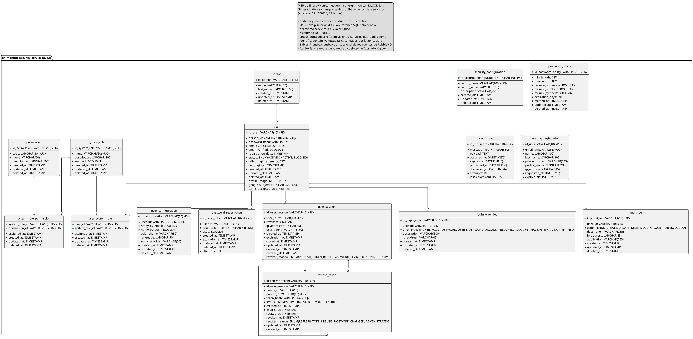

**Figure 5.** *Security service: people, users, pending registrations, sessions, tokens, roles, permissions, audit and outbox.*

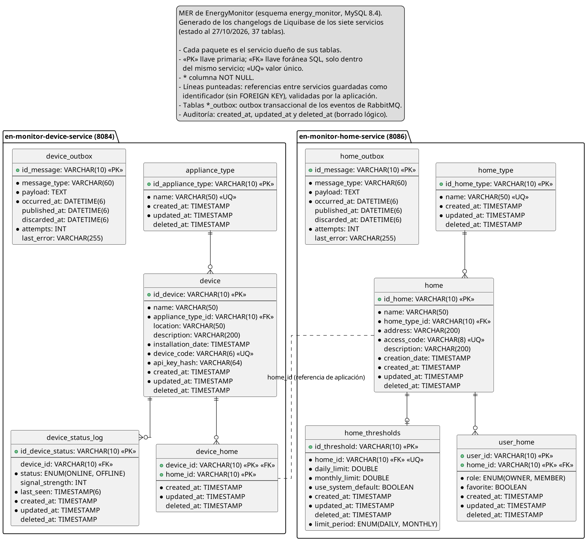

**Figure 6.** *Home and device services: households, members, thresholds, devices and their outboxes.*

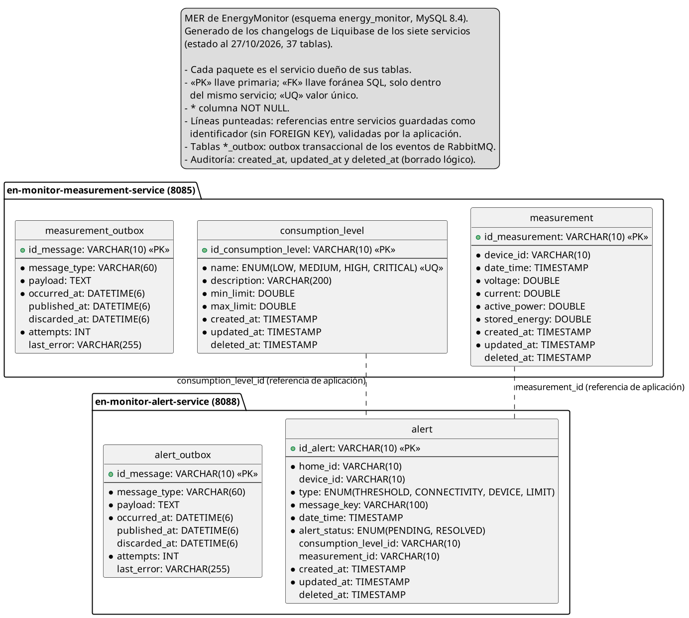

**Figure 7.** *Measurement and alert services: measurements, consumption levels, alerts and their outboxes.*

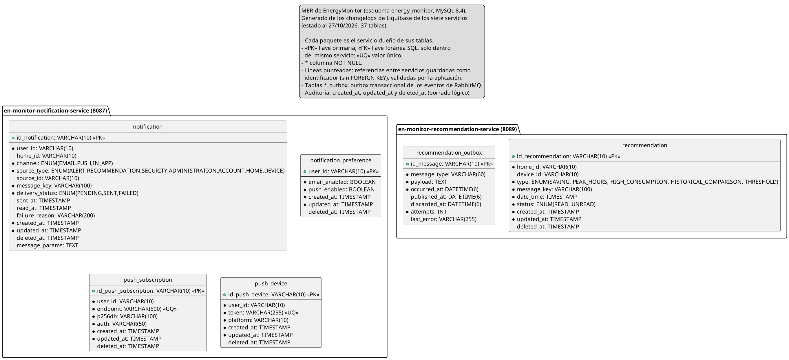

**Figure 8.** *Recommendation and notification services: recommendations, delivery log, preferences and push subscriptions.*

# Annex C. Class diagram by domain

Generated from [`Diagrama_clases.wsd`](../../04-software-design/diagrams/class-diagram.wsd).

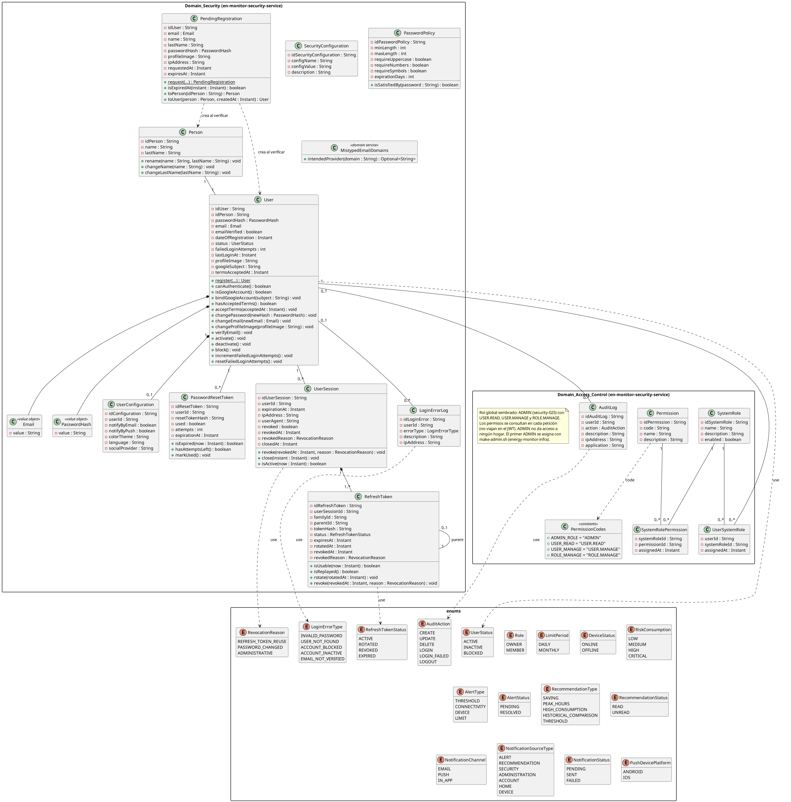

**Figure 9.** *Domain_Security and Domain_Access_Control domains, with the enumerations.*

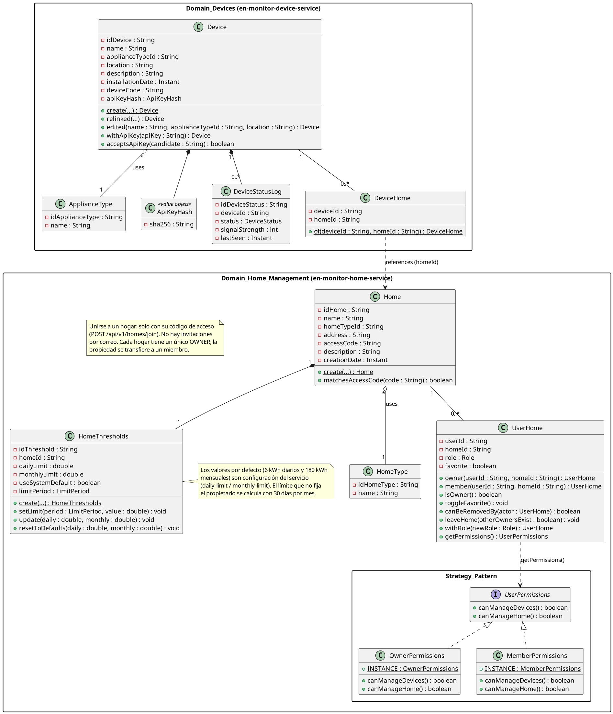

**Figure 10.** *Domain_Home_Management (with the Strategy pattern) and Domain_Devices domains.*

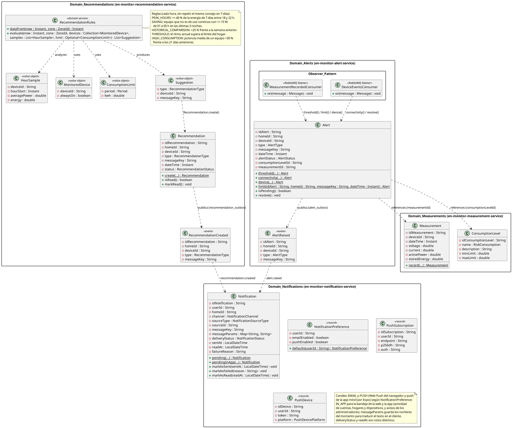

**Figure 11.** *Domain_Measurements, Domain_Alerts (Observer and Factory Method), Domain_Recommendations and Domain_Notifications domains.*
