**SERVICIO NACIONAL DE APRENDIZAJE – SENA**

**CENTRO DE LA INDUSTRIA, LA EMPRESA Y LOS SERVICIOS (CIES)**

**REGIONAL HUILA**

Programa de Formación: Tecnología en Análisis y Desarrollo de Software (ADSO)

Ficha: 3145556

**MANUAL TÉCNICO DEL SOFTWARE**

**Proyecto: Monitor de Consumo Eléctrico**

*Documento técnico del sistema: arquitectura, tecnologías, estructura del código, base de datos, módulos, API y seguridad*

| **Dato**             | **Información**                                                                 |
|----------------------|---------------------------------------------------------------------------------|
| Integrantes          | Juan Esteban Cortés Parra, Miguel Ángel García Artunduaga                       |
| Instructor           | Equipo de instructores de la ficha 3145556                                                               |
| Centro de Formación  | Centro de la Industria, la Empresa y los Servicios (CIES) – SENA Regional Huila |
| Programa             | Tecnología en Análisis y Desarrollo de Software (ADSO)                          |
| Ficha                | 3145556                                                                         |
| Tipo de documento    | Manual técnico de software                                                      |
| Versión              | 1.4                                                                             |
| Fecha de elaboración | 07 de octubre de 2026 (actualización: 28 de octubre de 2026)                    |

Año 2026

# 2. Control de versiones del documento

El historial de cambios del presente manual se registra en la siguiente tabla. Cada modificación relevante del software debe verse reflejada en una nueva versión del documento.

| **Versión** | **Fecha**  | **Descripción del cambio**                                                                                                                                                                                                   | **Responsable**      |
|-------------|------------|------------------------------------------------------------------------------------------------------------------------------------------------------------------------------------------------------------------------------|----------------------|
| 1.0         | 07/10/2026 | Creación inicial del manual técnico: descripción general, tecnologías, arquitectura, estructura de carpetas, base de datos, módulos, API y seguridad de la versión vigente del software.                                      | Equipo desarrollador |
| 1.0         | 07/10/2026 | Incorporación de los diagramas oficialmente aprobados: MER, diagrama de clases, arquitectura y secuencia de autenticación, además del diccionario de datos.                                                                  | Equipo desarrollador |
| 1.1         | 13/10/2026 | Actualización al estado final: siete módulos activos, 29 tablas, dispositivos y broker MQTT, API completa, identidad desde el JWT, hash de claves de dispositivo, aplicación móvil integrada con la API y limitaciones vigentes. | Equipo desarrollador |
| 1.2         | 24/10/2026 | Actualización a la arquitectura en producción (https://energy-monitor.tech): API gateway (8080) y microservicios de seguridad (8082), dispositivos (8084) y mediciones (8085); backend como monolito modular con home, alert, recommendation y notification (8083); REST interno `/internal/**` y eventos en RabbitMQ con transactional outbox; repositorios, variables, despliegue y trabajos pendientes (migración de los cuatro módulos restantes en curso). | Equipo desarrollador |
| 1.3         | 25/10/2026 | Diccionario de datos: se agrega la tabla push_device (instalaciones de la app móvil con push por el relay de Expo); 30 tablas documentadas. | Equipo desarrollador |
| 1.4         | 28/10/2026 | Migración terminada: siete microservicios (seguridad 8082, dispositivos 8084, mediciones 8085, hogares 8086, notificaciones 8087, alertas 8088 y recomendaciones 8089) detrás del API gateway; energy-monitor-backend retirado. Rutas del gateway, REST interno y eventos de RabbitMQ por servicio; notificaciones de actividad; rol administrador y sus pantallas web; diccionario regenerado desde Liquibase (37 tablas, todas las columnas) y script SQL en `06-base-datos`. | Equipo desarrollador |

# 3. Tabla de contenido

- [2. Control de versiones del documento](#2-control-de-versiones-del-documento)
- [3. Tabla de contenido](#3-tabla-de-contenido)
- [4. Introducción](#4-introducción)
- [5. Objetivo](#5-objetivo)
- [6. Alcance técnico](#6-alcance-técnico)
- [7. Descripción general del sistema](#7-descripción-general-del-sistema)
  - [7.1 ¿Qué es el sistema?](#71-qué-es-el-sistema)
  - [7.2 Componentes principales](#72-componentes-principales)
  - [7.3 Roles del sistema](#73-roles-del-sistema)
  - [7.4 Estado de implementación por dominio](#74-estado-de-implementación-por-dominio)
- [8. Tecnologías utilizadas](#8-tecnologías-utilizadas)
  - [8.1 Dependencias principales de los servicios (pom.xml)](#81-dependencias-principales-de-los-servicios-pomxml)
  - [8.2 Scripts disponibles](#82-scripts-disponibles)
- [9. Arquitectura del sistema](#9-arquitectura-del-sistema)
  - [9.1 Arquitectura general](#91-arquitectura-general)
  - [9.2 Estilo arquitectónico y patrones de diseño](#92-estilo-arquitectónico-y-patrones-de-diseño)
  - [9.3 Comunicación entre componentes](#93-comunicación-entre-componentes)
- [10. Estructura del proyecto](#10-estructura-del-proyecto)
  - [10.1 Estructura de los servicios del backend](#101-estructura-de-los-servicios-del-backend)
  - [10.2 Estructura de la aplicación web](#102-estructura-de-la-aplicación-web)
  - [10.3 Estructura de la aplicación móvil](#103-estructura-de-la-aplicación-móvil)
  - [10.4 Función de las carpetas principales](#104-función-de-las-carpetas-principales)
- [11. Base de datos](#11-base-de-datos)
  - [11.1 Diagrama entidad-relación](#111-diagrama-entidad-relación)
  - [11.2 Tablas principales](#112-tablas-principales)
  - [11.3 Diccionario de datos](#113-diccionario-de-datos)
- [12. Módulos técnicos](#12-módulos-técnicos)
  - [12.1 Vista general de los servicios](#121-vista-general-de-los-servicios)
  - [12.2 Diagrama de clases del dominio](#122-diagrama-de-clases-del-dominio)
  - [12.3 Servicios del backend por contexto](#123-servicios-del-backend-por-contexto)
  - [12.4 Módulo front-end web](#124-módulo-front-end-web)
  - [12.5 Módulo front-end móvil](#125-módulo-front-end-móvil)
- [13. API o rutas del sistema](#13-api-o-rutas-del-sistema)
  - [13.1 Códigos de respuesta habituales](#131-códigos-de-respuesta-habituales)
  - [13.2 Ejemplo de petición y respuesta](#132-ejemplo-de-petición-y-respuesta)
- [14. Seguridad](#14-seguridad)
  - [14.1 Controles implementados](#141-controles-implementados)
  - [14.2 Limitaciones y riesgos conocidos](#142-limitaciones-y-riesgos-conocidos)
  - [14.3 Buenas prácticas para los desarrolladores](#143-buenas-prácticas-para-los-desarrolladores)
- [15. Control de versiones del software](#15-control-de-versiones-del-software)
- [16. Recomendaciones de mantenimiento](#16-recomendaciones-de-mantenimiento)
  - [16.1 Actualizaciones del código](#161-actualizaciones-del-código)
  - [16.2 Copias de seguridad de la base de datos](#162-copias-de-seguridad-de-la-base-de-datos)
  - [16.3 Soporte y resolución de incidentes](#163-soporte-y-resolución-de-incidentes)
  - [16.4 Trabajos pendientes declarados](#164-trabajos-pendientes-declarados)
- [17. Glosario](#17-glosario)
- [18. Anexos](#18-anexos)
  - [Anexo A. Configuración y comandos](#anexo-a-configuración-y-comandos)
- [Anexo B. MER por contexto](#anexo-b-mer-por-contexto)
- [Anexo C. Diagrama de clases por dominio](#anexo-c-diagrama-de-clases-por-dominio)

# 4. Introducción

El presente documento es el manual técnico del software «Monitor de Consumo Eléctrico» (nombre comercial de la aplicación: EnergyMonitor), proyecto desarrollado por los aprendices del programa de formación en Análisis y Desarrollo de Software, ficha 3145556, del Centro de la Industria, la Empresa y los Servicios (CIES) – SENA Regional Huila.

El sistema permite monitorear el consumo de energía eléctrica en los hogares: un dispositivo de medición (ESP32 con sensor PZEM-004T V3) envía sus lecturas por MQTT, el servicio de mediciones las almacena y calcula estadísticas, el servicio de alertas detecta consumos altos, límites alcanzados y desconexiones, el servicio de recomendaciones propone acciones de ahorro cada hora, el servicio de notificaciones avisa por correo, por el navegador, a la app móvil y en la bandeja de la aplicación, y las aplicaciones web y móvil permiten consultar la información. La solución se compone de un API gateway, siete microservicios (seguridad, dispositivos, mediciones, hogares, notificaciones, alertas y recomendaciones), un broker de mensajes RabbitMQ, un broker MQTT, un dispositivo de medición, una aplicación web, una aplicación móvil Android y una base de datos MySQL. El antiguo backend modular (energy-monitor-backend) quedó retirado el 27 de octubre de 2026: cada uno de sus módulos pasó a su microservicio.

Este manual está dirigido a desarrolladores, personal de soporte técnico, el instructor evaluador y en general a cualquier persona que deba comprender, ampliar o dar mantenimiento al software. Su propósito es describir cómo está construido el sistema, no cómo se utiliza: para el uso cotidiano existe el manual de usuario, para la puesta en marcha el manual de instalación y para la gestión de cuentas y respaldos el manual de administrador.

La información aquí consignada fue obtenida directamente del código fuente de los repositorios del proyecto (API gateway, siete microservicios, web, móvil e infraestructura), de los changesets de Liquibase y de los documentos de esta documentación final, de modo que corresponda a la versión final del software entregado.

| **Fuente de información**            | **Ubicación**                                                                                                                                    |
|--------------------------------------|--------------------------------------------------------------------------------------------------------------------------------------------------|
| API gateway                          | en-monitor-api-gateway (Java 21 + Spring Boot 4.0.8 + Spring Cloud Gateway Server Web MVC)                                                       |
| Microservicios                       | en-monitor-security-service, en-monitor-device-service, en-monitor-measurement-service, en-monitor-home-service, en-monitor-notification-service, en-monitor-alert-service y en-monitor-recommendation-service (Java 21 + Spring Boot 4.1.1) |
| Backend retirado                     | energy-monitor-backend (archivado; solo conserva el historial y la carpeta `firmware/`)                                                          |
| Código fuente de la aplicación web   | Energy-Monitor-application (React 19 + Vite 8)                                                                                                   |
| Código fuente de la aplicación móvil | Energy-Monitor-Mobile (Expo SDK 57 + React Native 0.86)                                                                                          |
| Firmware del dispositivo             | carpeta `firmware/` de energy-monitor-backend (ESP32 + PZEM-004T V3, firmware 1.3.8)                                                             |
| Infraestructura y broker MQTT        | energy-monitor-infra (Docker Compose, Mosquitto 2 con mosquitto-go-auth, RabbitMQ 4.1, MySQL 8.4, despliegue)                                   |
| Especificación de requisitos         | [`02-especificacion-requisitos`](../../01-requirements-specification/es/requirements-specification.md) (códigos RF-xxx y RNF-xxx)                  |
| Diseño de software                   | [`05-diseno-software`](../../04-software-design/es/software-design-overview.md): modelo arquitectónico (05.1), modelo de datos (05.2), modelo de clases (05.3), patrones (05.4) e interfaces (05.5) |
| Modelo de datos                      | Changesets de Liquibase en `src/main/resources/db/changelog` de cada servicio, [diccionario de datos](../../04-software-design/es/data-dictionary.md), [script SQL](../../04-software-design/database/energy_monitor.sql) y [MER y diagrama de clases](../../04-software-design/diagrams/) |

# 5. Objetivo

> Documentar la arquitectura, las tecnologías, la estructura del proyecto, la base de datos, los módulos técnicos, la API, la seguridad y las recomendaciones de mantenimiento del sistema «Monitor de Consumo Eléctrico», de manera que un desarrollador ajeno al equipo pueda comprender el software, continuar su desarrollo y darle soporte sin necesidad de conocimiento previo del proyecto.

- Describir la arquitectura de microservicios con API gateway, la comunicación entre servicios (REST interno y eventos en RabbitMQ), la comunicación con los dispositivos y los patrones de diseño empleados en cada componente.

- Detallar las tecnologías y versiones exactas utilizadas en los servicios del backend, en los dos front-ends y en el dispositivo.

- Explicar la organización del código fuente y la función de cada carpeta.

- Documentar el modelo de datos: diagrama entidad-relación, tablas principales y diccionario de datos.

- Relacionar cada servicio con sus archivos, tablas, endpoints y eventos.

- Describir los servicios expuestos por la API REST y los mecanismos de seguridad aplicados.

- Establecer recomendaciones para la actualización, respaldo y soporte del sistema.

# 6. Alcance técnico

El manual técnico cubre los siguientes aspectos del sistema:

| **Sí cubre**                                                                            | **No cubre**                                                                                                         |
|-----------------------------------------------------------------------------------------|----------------------------------------------------------------------------------------------------------------------|
| Arquitectura general, servicios, capas y patrones de diseño del backend y de los front-ends. | Procedimientos de instalación, puesta en marcha y despliegue en producción (corresponde al manual de instalación).   |
| Tecnologías, librerías y versiones utilizadas, así como sus dependencias.               | Pasos de uso, pantallas y mensajes para el usuario final (corresponde al manual de usuario).                         |
| Estructura de carpetas y archivos de los repositorios del proyecto.                     | Gestión de usuarios, roles, reportes administrativos y copias de seguridad (corresponde al manual de administrador). |
| Base de datos: MER, tablas, relaciones y diccionario de datos.                          | Diseño eléctrico y cableado del dispositivo de medición (se describen en el manual de instalación).                  |
| Servicios del backend, front web y front móvil, con su repositorio, archivos y tablas.  | Historias de usuario, casos de uso y criterios de aceptación (documentos de análisis).                               |
| API REST: método, ruta, parámetros, autenticación y respuestas; rutas del gateway, comunicación interna entre servicios y el contrato MQTT. | Pruebas de carga.                                                                                                    |
| Seguridad: autenticación, autorización, cifrado, validaciones y limitaciones conocidas. | Costos, plan de proyectos e informes de gestión.                                                                     |
| Control de versiones y recomendaciones de mantenimiento.                                |                                                                                                                      |

**Versión documentada:** código de la rama `dev` de los repositorios al 27 de octubre de 2026, con la migración a microservicios terminada y energy-monitor-backend retirado (commits en la sección 15). Producción (https://energy-monitor.tech) se actualiza desde `main` con el flujo de despliegue de la sección 16.1. Los trabajos que siguen pendientes se describen en las secciones 14.2 y 16.4.

# 7. Descripción general del sistema

## 7.1 ¿Qué es el sistema?

«Monitor de Consumo Eléctrico» (EnergyMonitor) es una solución web y móvil que permite a los usuarios conocer cuánta energía consumen sus hogares, identificar los dispositivos que más energía utilizan, recibir alertas cuando el consumo supera los límites establecidos y obtener recomendaciones para reducir el gasto y la factura eléctrica. Las lecturas las toma un dispositivo de medición conectado a cada electrodoméstico.

## 7.2 Componentes principales

| **Componente**       | **Tipo**                                  | **Función**                                                                                                                                                                                  |
|----------------------|-------------------------------------------|----------------------------------------------------------------------------------------------------------------------------------------------------------------------------------------------|
| API gateway          | Servidor (Java 21 + Spring Cloud Gateway, puerto 8080) | Única entrada de la API: enruta cada petición al servicio dueño, responde CORS, valida el token (salvo en los endpoints públicos), limita los POST públicos de cuenta, responde 404 a las rutas que ningún servicio atiende y rechaza `/internal/**`. |
| Servicio de seguridad | Microservicio (Java 21 + Spring Boot, puerto 8082) | Cuentas, registro con verificación de correo, aceptación de términos, inicio de sesión (incluido Google), JWT RS256 y refresh rotativo, sesiones en cookies HttpOnly para la web, recuperación de contraseña, perfil, borrado de cuenta (con contraseña o con código para cuentas de Google), RBAC, administración de usuarios y contactos de soporte. |
| Servicio de dispositivos | Microservicio (Java 21 + Spring Boot, puerto 8084) | Vinculación, edición, credenciales y desvinculación de dispositivos, catálogo de electrodomésticos, autenticación y ACL del broker MQTT, comandos MQTT y conectividad de los módulos. |
| Servicio de mediciones | Microservicio (Java 21 + Spring Boot, puerto 8085) | Único suscriptor que guarda la telemetría; historial, última lectura, estadísticas, consumo del hogar y niveles de consumo; publica cada lectura como `measurement.recorded`. |
| Servicio de hogares  | Microservicio (Java 21 + Spring Boot, puerto 8086) | Hogares, miembros con roles OWNER/MEMBER, unión por código de acceso, favoritos, transferencia de propiedad, umbrales de consumo y tipos de hogar; responde a los demás servicios quién puede actuar sobre un hogar y publica la actividad de los hogares. |
| Servicio de notificaciones | Microservicio (Java 21 + Spring Boot, puerto 8087) | Correo (códigos de verificación, recuperación y borrado; alertas y recomendaciones), Web Push, push móvil (Expo), notificaciones de actividad en la bandeja, avisos in-app de los administradores y preferencias de cada usuario. |
| Servicio de alertas  | Microservicio (Java 21 + Spring Boot, puerto 8088) | Alertas de umbral (HIGH/CRITICAL), de límite diario o mensual, de conectividad y de dispositivo vinculado, a partir de `measurement.recorded` y de los eventos de dispositivos; las anuncia como `alert.raised`. |
| Servicio de recomendaciones | Microservicio (Java 21 + Spring Boot, puerto 8089) | Evalúa cada hora cinco reglas de ahorro con la energía por hora de cada hogar y anuncia cada recomendación nueva como `recommendation.created`. |
| Broker de mensajes   | RabbitMQ 4.1                              | Transporta los eventos entre servicios (cuentas, correos, hogares, dispositivos, mediciones, alertas y recomendaciones) publicados con transactional outbox. |
| Aplicación web       | SPA (React 19 + Vite 8)                   | Landing page pública, acceso, panel de hogares, consumo, historial, usuarios, dispositivos (vinculación por Bluetooth del navegador), umbrales, notificaciones, configuración, cuenta y pantallas de administración. |
| Aplicación móvil     | App Android (Expo SDK 57)                 | Mismas funciones de usuario que la web (sin landing page ni administración), vinculación del módulo por Bluetooth nativo y notificaciones push. Solo Android. |
| Broker MQTT          | Eclipse Mosquitto 2 + mosquitto-go-auth   | Recibe la telemetría y el estado de los dispositivos por MQTT 3.1.1 con TLS y autentica a cada cliente contra el servicio de dispositivos.                                                  |
| Dispositivo          | ESP32 + sensor PZEM-004T V3 (firmware 1.3.8) | Mide tensión, corriente, potencia activa y energía; publica una lectura cada 60 segundos y su estado cada cinco minutos.                                                                  |
| Base de datos        | MySQL 8.4                                 | Una sola base (`energy_monitor`) compartida por los siete servicios; cada servicio es dueño de sus tablas y aplica solo sus changesets (37 tablas). |
| Correo electrónico   | SMTP (Gmail con contraseña de aplicación; Mailpit en local) | Lo envía solo el servicio de notificaciones: códigos de verificación, recuperación y borrado de cuenta que solicita el servicio de seguridad, y los correos de alertas, recomendaciones y actividad. |

## 7.3 Roles del sistema

| **Rol**                      | **Descripción**                                                                                  | **Cómo se implementa**                                                                                                               |
|------------------------------|--------------------------------------------------------------------------------------------------|--------------------------------------------------------------------------------------------------------------------------------------|
| Propietario de hogar (OWNER) | Crea y administra un hogar: comparte el código de acceso, configura umbrales, gestiona dispositivos, quita miembros, transfiere la propiedad o elimina el hogar. | Enum OWNER de la tabla user_home del servicio de hogares, con permisos de dominio por estrategia (`OwnerPermissions`). Cada hogar tiene exactamente un OWNER. |
| Miembro de hogar (MEMBER)    | Consulta el consumo, el historial, los dispositivos, los umbrales y las notificaciones del hogar al que se unió con el código de acceso; puede salirse del hogar. | Enum MEMBER de la tabla user_home (`MemberPermissions`). Un usuario puede ser OWNER en un hogar y MEMBER en otro.                     |
| Usuario del sistema          | Cuenta personal con perfil, preferencias de idioma, tema y notificaciones.                       | Tabla user con estado ACTIVE / INACTIVE / BLOCKED.                                                                                   |
| Control de acceso (RBAC)     | Permisos funcionales globales agrupados en roles del sistema.                                    | Tablas system_role, permission, user_system_role y system_role_permission del servicio de seguridad; se consultan en cada petición (no viajan en el JWT). Los demás servicios los piden por `GET /internal/users/{id}/permissions`. |
| Administrador (ADMIN)        | Gestión global de cuentas: directorio de usuarios, estado de las cuentas, rol de administrador y avisos de la plataforma. | Rol global ADMIN sembrado por `security-025` con USER.READ, USER.MANAGE y ROLE.MANAGE: `/api/v1/admin/users` y `/api/v1/admin/roles` (seguridad) y `/api/v1/admin/notifications` (notificaciones). Solo hay pantallas de administración en la web. El primer administrador se asigna con `make-admin.sh` de energy-monitor-infra. ADMIN no da acceso a ningún hogar. |

## 7.4 Estado de implementación por dominio

El sistema se documenta tal como está construido. La tabla relaciona cada grupo de requisitos de la [especificación de requisitos](../../01-requirements-specification/es/requirements-specification.md) con el servicio que lo implementa.

| **Grupo de requisitos**                           | **Servicio / módulo del software**                 | **Estado**                                                                                                                                                                                     |
|---------------------------------------------------|----------------------------------------------------|------------------------------------------------------------------------------------------------------------------------------------------------------------------------------------------------|
| RF-SEC – Gestión de Usuarios y Perfiles           | en-monitor-security-service + auth, account y Admin (web y móvil; Admin solo web) | Implementado: registro con verificación de correo y aceptación de términos, inicio de sesión (incluido Google), renovación y cierre de sesión, recuperación y cambio de contraseña, perfil, permisos, administración de usuarios y eliminación de cuenta. |
| RF-HOM – Gestión de Hogares                       | en-monitor-home-service + dashboard y DetailHome (web) / homes (móvil) | Implementado: crear hogar, unirse con código de acceso, miembros, favoritos, umbrales, eliminación del hogar y transferencia de propiedad (web y móvil). Pendiente: historial del dispositivo según el periodo de vinculación (RF-HOM-11). |
| RF-DEV – Gestión de Dispositivos                  | en-monitor-device-service + Devices (web y móvil)  | Implementado: catálogo de electrodomésticos, vinculación por Bluetooth (Web Bluetooth en la web, BLE nativo en la app), edición, nuevas credenciales de Wi-Fi, desvinculación, autorización MQTT y conectividad. |
| RF-MED – Mediciones y Consumo                     | en-monitor-measurement-service + Consumption e History (web y móvil) | Implementado: ingesta MQTT de telemetría, estadísticas, resumen e historial de consumo del hogar (el estado de conexión lo registra el servicio de dispositivos). |
| RF-ALE – Alertas                                  | en-monitor-alert-service + Notifications (web y móvil) | Implementado: alertas de dispositivo vinculado, desconexión, consumo alto o crítico y límite diario o mensual.                                                                           |
| RF-REC – Recomendaciones de Ahorro                | en-monitor-recommendation-service                  | Implementado: cinco reglas de ahorro evaluadas cada hora.                                                                                                                                      |
| RF-NOT – Notificaciones                           | en-monitor-notification-service                    | Implementado: entrega por correo, Web Push y push móvil (Expo) según las preferencias de cada usuario, notificaciones de actividad en la bandeja y avisos in-app a los administradores.     |
| RF-CLI – Aplicaciones web y móvil                 | Aplicación web y aplicación móvil                  | Implementadas. La landing page y las pantallas de administración solo existen en la web; la app móvil no tiene pruebas automatizadas.                                                       |

# 8. Tecnologías utilizadas

La siguiente tabla registra los lenguajes, frameworks, librerías, herramientas de base de datos, de diseño y de control de versiones empleados en el proyecto, con su versión o detalle de uso.

| **Componente**                 | **Tecnología**                           | **Versión / detalle**                                                                              |
|--------------------------------|------------------------------------------|----------------------------------------------------------------------------------------------------|
| Lenguaje del backend           | Java                                     | Java 21 (LTS) en el gateway y los siete servicios                                                  |
| Framework del backend          | Spring Boot                              | Spring Boot 4.1.1 (Spring Framework 7) en los siete servicios; 4.0.8 en el gateway                 |
| API gateway                    | Spring Cloud Gateway Server Web MVC      | Spring Cloud 2025.1.3, Apache HttpClient 5 y Caffeine; paquetes routing, security, ratelimit y error |
| Estilo arquitectónico          | Microservicios + arquitectura hexagonal  | 7 microservicios detrás del gateway, cada uno con su repositorio, su despliegue y sus tablas        |
| Construcción del backend       | Maven Wrapper                            | mvnw / mvnw.cmd en cada repositorio, spring-boot-maven-plugin                                      |
| Persistencia                   | Spring Data JPA + Hibernate              | ddl-auto = validate (el esquema lo define Liquibase)                                               |
| Migraciones de base de datos   | Liquibase                                | db/changelog con changesets y rollback en cada servicio; tabla DATABASECHANGELOG compartida        |
| Motor de base de datos         | MySQL                                    | MySQL 8.4, esquema energy_monitor compartido (ADR-003)                                             |
| Autenticación y autorización   | Spring Security + OAuth2 Resource Server | JWT RS256 firmado solo por el servicio de seguridad (clave privada PEM); el gateway y los servicios lo validan con la clave pública; BCrypt para contraseñas |
| Validación de datos            | Jakarta Bean Validation                  | @NotBlank, @Size, @NotNull, @Positive, @Pattern                                                    |
| Documentación de la API        | springdoc-openapi                        | Swagger UI y /v3/api-docs en cada servicio                                                         |
| Correo electrónico y push      | spring-boot-starter-mail + Web Push + Expo | SMTP con STARTTLS, solo desde el servicio de notificaciones; push del navegador con claves VAPID y push de la app móvil con el relay de Expo |
| Mensajería entre servicios     | RabbitMQ 4.1 + Spring AMQP               | Un exchange de tipo topic por servicio productor, transactional outbox con relay cada segundo, colas durables con dead-letter |
| Comunicación interna           | REST `/internal/**`                      | Cabecera X-Internal-Token (INTERNAL_API_TOKEN) desde loopback o la red Docker; cachés Caffeine     |
| Mensajería con dispositivos    | MQTT 3.1.1 con TLS                       | Eclipse Mosquitto 2 + mosquitto-go-auth; los servicios de dispositivos y de mediciones se suscriben como clientes MQTT (Eclipse Paho) |
| Monitoreo y salud              | Spring Boot Actuator                     | /actuator/health y /actuator/info en cada servicio                                                 |
| Pruebas del backend            | JUnit 5 + Spring Boot Test               | Métodos de prueba en el código al 27/10/2026: seguridad 740, hogares 260, notificaciones 218, mediciones 149, dispositivos 124, alertas 119, recomendaciones 71 y gateway 63 (conteo de anotaciones `@Test`, no de una ejecución) |
| Contenedores y despliegue      | Docker Compose + Nginx + Certbot         | repositorio energy-monitor-infra: modos local, desarrollo y producción; HTTPS con Let's Encrypt     |
| Integración y despliegue continuos | GitHub Actions                       | pruebas y build en cada PR y push a dev y main; despliegue desde main con aprobación del environment production |
| Front-end web                  | React + Vite                             | React 19.2, Vite 8.0, JavaScript (ESM), sin TypeScript                                             |
| Enrutamiento web               | react-router-dom                         | react-router-dom 7 con rutas protegidas, guardas por permiso y layouts anidados                    |
| Consumo de API (web)           | axios                                    | axios 1 con interceptores de petición y respuesta                                                  |
| Formularios y validación (web) | react-hook-form + zod                    | react-hook-form 7, zod 4, @hookform/resolvers                                                      |
| Gráficas (web)                 | recharts                                 | recharts 3.8 (AreaChart, PieChart, BarChart)                                                       |
| Internacionalización           | i18next + react-i18next                  | 4 idiomas en web y móvil: es, en, fr, pt                                                           |
| Estilos (web)                  | CSS Modules + variables CSS              | design system propio en src/design, cuatro temas (dos claros y dos oscuros)                        |
| Pruebas (web)                  | Vitest + Testing Library                 | vitest 5, jsdom, 38 archivos de prueba                                                             |
| App móvil                      | Expo + React Native                      | Expo SDK 57, React Native 0.86.3, TypeScript 6 (strict), solo Android                              |
| Enrutamiento móvil             | Expo Router                              | rutas file-based en src/app con rutas tipadas                                                      |
| Bluetooth y push (móvil)       | react-native-ble-plx + expo-notifications | Vinculación BLE del ESP32 y notificaciones push por Expo                                          |
| Sesión segura (móvil)          | expo-secure-store                        | Tokens en el almacén seguro del dispositivo (Keystore en Android, Keychain en iOS); copias de seguridad de Android desactivadas (`allowBackup: false`) |
| Gráficas (móvil)               | react-native-chart-kit                   | LineChart, BarChart y PieChart sobre react-native-svg                                              |
| Estilos (móvil)                | StyleSheet                               | design system propio en src/constants (theme, colors, spacing), cuatro temas                       |
| Dispositivo                    | ESP32 + PZEM-004T V3                     | firmware 1.3.8 (Arduino), Modbus RTU a 9600 baudios, MQTT 3.1.1 con TLS en el puerto 8883          |
| Control de versiones           | Git y GitHub                             | repositorios de código y de documentación                                                          |
| Diseño y diagramas             | Draw.io y PlantUML                       | casos de uso, actividades, MER, diagrama de clases y arquitectura                                  |

> *Nota sobre el estado global: el estado global de la web y de la app se maneja con React Context y `useSyncExternalStore`.*

## 8.1 Dependencias principales de los servicios (pom.xml)

Los siete microservicios comparten la base: spring-boot-starter-webmvc, spring-boot-starter-data-jpa, spring-boot-starter-security, spring-boot-starter-security-oauth2-resource-server, spring-boot-starter-validation, spring-boot-starter-liquibase, spring-boot-starter-actuator, spring-boot-starter-amqp, springdoc-openapi-starter-webmvc-ui, mysql-connector-j (runtime) y los starters de prueba. Los de dispositivos y mediciones agregan spring-integration-mqtt con Eclipse Paho; el de notificaciones, spring-boot-starter-mail y las librerías de Web Push; y los que piden datos a otros servicios, caffeine para sus cachés. El gateway declara spring-cloud-starter-gateway-server-webmvc, httpclient5, spring-boot-starter-security, spring-boot-starter-security-oauth2-resource-server, spring-boot-starter-actuator y caffeine.

## 8.2 Scripts disponibles

| **Repositorio** | **Script**                      | **Función**                                                                      |
|-----------------|---------------------------------|----------------------------------------------------------------------------------|
| gateway y servicios | mvnw spring-boot:run        | Compila y arranca cada servicio: gateway 8080, seguridad 8082, dispositivos 8084, mediciones 8085, hogares 8086, notificaciones 8087, alertas 8088 y recomendaciones 8089. |
| gateway y servicios | mvnw test                   | Ejecuta la suite de pruebas del repositorio (los servicios con base de datos requieren MySQL en ejecución). |
| gateway y servicios | mvnw package                | Genera el archivo JAR ejecutable en /target.                                     |
| infra           | docker compose up -d --build    | Levanta la pila completa local (MySQL, RabbitMQ, Mosquitto, el gateway, los siete servicios y la web). |
| infra           | docker compose -f docker-compose.yml -f docker-compose.dev.yml up -d mysql rabbitmq mosquitto | Modo desarrollo: solo MySQL, RabbitMQ y Mosquitto en Docker; los servicios corren con ./mvnw. |
| infra           | prepare.sh / make-admin.sh      | Genera claves RSA, `.env` y certificados del broker / otorga el rol global ADMIN a una cuenta. |
| infra           | e2e/device-flow.sh, measurement-flow.sh, activity-flow.sh, alert-flow.sh, recommendation-flow.sh, account-deletion-flow.sh | Pruebas de punta a punta sobre la pila local. |
| web             | npm run dev                     | Inicia el servidor de desarrollo Vite en http://localhost:5173.                  |
| web             | npm run build / npm run preview | Construye la aplicación en /dist y la sirve para revisión.                       |
| web             | npm test                        | Ejecuta las pruebas con Vitest.                                                  |
| web             | npm run lint                    | Analiza el código con ESLint.                                                    |
| móvil           | npm run start                   | Inicia Metro Bundler de Expo.                                                    |
| móvil           | npm run android                 | Ejecuta la aplicación en un emulador o dispositivo Android.                      |
| móvil           | npm run lint                    | Analiza el código con ESLint (no hay pruebas automatizadas).                     |
| firmware (backend/firmware) | arduino-cli compile / upload | Compila y carga el firmware por USB (no hay actualización por aire, OTA).   |

# 9. Arquitectura del sistema

## 9.1 Arquitectura general

El sistema adopta una arquitectura cliente-servidor en capas, con la lógica repartida en siete microservicios detrás de un API gateway y un canal adicional para los dispositivos. La capa de presentación está conformada por la aplicación web y la aplicación móvil, que solo llaman al gateway; la capa de lógica la forman los microservicios de seguridad, dispositivos, mediciones, hogares, notificaciones, alertas y recomendaciones, que se comunican por REST interno (`/internal/**`) y por eventos en RabbitMQ; la capa de datos corresponde a una sola base MySQL compartida, accedida mediante JPA/Hibernate y gestionada con Liquibase, en la que cada servicio es dueño de sus tablas; y los dispositivos de medición publican sus lecturas por MQTT con TLS a un broker Mosquitto que consulta al servicio de dispositivos para autenticarlos. El backend modular energy-monitor-backend ya no existe en ejecución: el gateway responde 404 a cualquier ruta que ningún servicio atienda.

> **Imágenes y diagramas (Figuras 1 a 11):** las figuras hacen parte de este documento. Las imágenes PNG de las Figuras 3 a 11 están en la carpeta `assets/figures`, y las fuentes PlantUML de las que salen, generadas de los changelogs de Liquibase y del código, están en `../04-software-design/diagrams`.

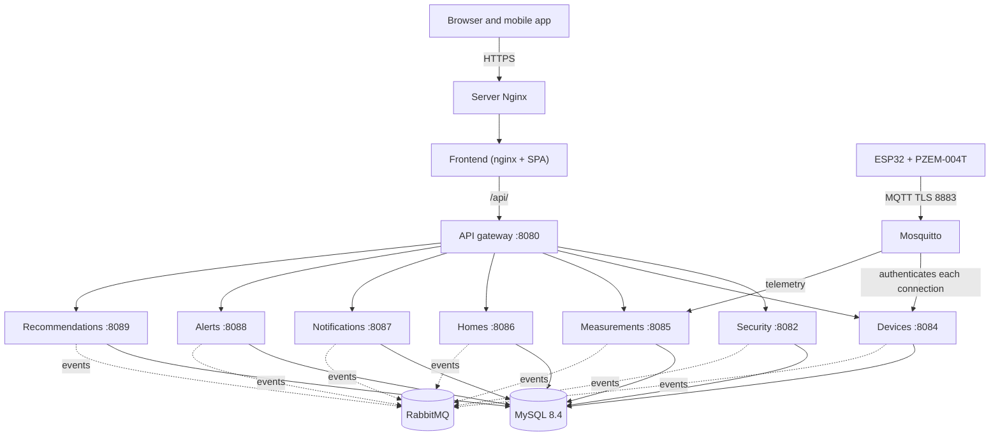

**Figura 1.** *Arquitectura general del sistema (presentación, entrada, lógica, mensajería, datos y dispositivos).*

| **Capa**         | **Tecnología**                                        | **Responsabilidad**                                                                                                  |
|------------------|-------------------------------------------------------|----------------------------------------------------------------------------------------------------------------------|
| Presentación     | React 19 (web) y Expo SDK 57 (móvil, Android)         | Interfaz de usuario, validación de formularios, manejo de sesión y consumo de la API REST a través del gateway.      |
| Entrada          | Spring Cloud Gateway (en-monitor-api-gateway, 8080)   | Enrutamiento por prefijo de ruta, CORS, validación del token, límite de peticiones, 404 de las rutas sin dueño y rechazo de `/internal/**`. |
| Lógica           | Spring Boot 4.1.1 + Spring Security               | Siete microservicios con arquitectura hexagonal: autenticación, autorización, casos de uso, reglas de negocio, ingesta MQTT, alertas, recomendaciones, notificaciones y publicación de eventos. |
| Mensajería       | RabbitMQ 4.1 + transactional outbox                   | Eventos entre servicios con entrega al menos una vez y colas con dead-letter.                                        |
| Datos            | MySQL 8.4 + Spring Data JPA + Liquibase               | Una sola base compartida; cada servicio es dueño de sus tablas y aplica solo sus changesets; sin llaves foráneas entre servicios. |
| Dispositivos     | ESP32 + PZEM-004T V3 + Mosquitto 2                    | Medición, publicación MQTT con TLS (puerto 8883) y autenticación de cada dispositivo contra el servicio de dispositivos. |
| Transversal      | Docker Compose (energy-monitor-infra), Nginx + Certbot, GitHub Actions, SMTP y Actuator | Contenedores, HTTPS en producción, integración y despliegue continuos, correo y salud de cada servicio. |

**Servicios del backend.** Todos en Java 21; Spring Boot 4.1.1 salvo el gateway (4.0.8, porque Spring Cloud 2025.1 es la versión que lo soporta). Los microservicios siguen arquitectura hexagonal (puertos y adaptadores) con las capas `domain`, `application`, `adapter`, `infrastructure` y `api`; el gateway no tiene dominio (paquetes `routing`, `security`, `ratelimit` y `error`).

| **Servicio (repositorio)**       | **Puerto** | **Responsabilidad**                                                                                                                                                       |
|----------------------------------|------------|---------------------------------------------------------------------------------------------------------------------------------------------------------------------------|
| en-monitor-api-gateway           | 8080       | Única entrada de la API (Spring Cloud Gateway Server Web MVC, Spring Cloud 2025.1.3). Responde CORS, valida el token (RS256, emisor y expiración) salvo en los endpoints públicos, lee el token de la cookie HttpOnly `em_access` de la web (`AccessTokenCookieFilter`), limita los POST públicos de cuenta (20 por IP y ruta por minuto, luego 429), rechaza `/internal/**`, responde 404 a lo que ningún servicio atiende, 503 si el servicio no responde y 504 si tarda más de 30 segundos. |
| en-monitor-security-service      | 8082       | Cuentas, registro con verificación de correo (`pending_registration`), aceptación de términos (428 sin ella), inicio de sesión, Google (código en la web, ID token en la app), JWT RS256 (access token de 15 minutos) y refresh token rotativo, sesiones en cookies HttpOnly para la web, recuperación de contraseña, perfil, borrado de cuenta, RBAC y administración de usuarios, contactos de soporte (`GET /api/v1/support/contacts`, pública). |
| en-monitor-device-service        | 8084       | Dispositivos: vinculación, edición, reemisión de credenciales (API key guardada como hash SHA-256), desvinculación, catálogo de electrodomésticos, autenticación y ACL del broker MQTT (Mosquitto go-auth le pregunta), comandos MQTT a los módulos y conectividad (suscrito a telemetría y estado; sin conexión tras 150 segundos sin datos). |
| en-monitor-measurement-service   | 8085       | Mediciones: único suscriptor que guarda la telemetría (MQTT), historial, última lectura, estadísticas, consumo de un hogar (resumen e historial) y niveles de consumo; publica cada lectura como `measurement.recorded` y ofrece un API interno de niveles, energía por hora y dispositivos que reportan. |
| en-monitor-home-service          | 8086       | Hogares, unión por código de acceso, miembros y roles, favoritos, transferencia de propiedad, salida y eliminación del hogar, umbrales (6 kWh diarios y 180 kWh mensuales por defecto) y tipos de hogar; API interno de acceso, límites, resumen del hogar y comprobación de borrado de cuenta; publica `home.deleted` y la actividad de los hogares. |
| en-monitor-notification-service  | 8087       | Correos de códigos (`mail.*`), entrega de alertas y recomendaciones por correo, Web Push y push móvil según las preferencias de cada miembro, notificaciones de actividad (`/api/v1/notifications/activity`), avisos in-app de los administradores (`/api/v1/admin/notifications`), preferencias, suscripciones push y registro de entregas. |
| en-monitor-alert-service         | 8088       | Alertas: consume `measurement.recorded` y los eventos `device.*`, crea alertas THRESHOLD (incluida la de consumo inusual de un aparato, `alert.anomaly.device`), LIMIT, CONNECTIVITY y DEVICE, las resuelve, las expone en `/api/v1/alerts` y anuncia cada una como `alert.raised`. |
| en-monitor-recommendation-service | 8089      | Recomendaciones: cada hora evalúa las reglas PEAK_HOURS, SAVING, HISTORICAL_COMPARISON, THRESHOLD y HIGH_CONSUMPTION sobre los hogares con lecturas en la última semana, las expone en `/api/v1/recommendations` y anuncia cada una como `recommendation.created`. |

## 9.2 Estilo arquitectónico y patrones de diseño

- **Microservicios detrás de un API gateway.** Cada contexto acotado (seguridad, dispositivos, mediciones, hogares, notificaciones, alertas y recomendaciones) es un servicio con su repositorio, su despliegue y sus tablas. Se extrajeron uno a uno del antiguo backend modular (Spring Modulith), que quedó retirado al terminar la migración. El gateway (en-monitor-api-gateway) es la única entrada de la API y enruta por prefijo de ruta, de la más específica a la más general; los clientes llaman las mismas rutas de siempre, de modo que la migración no cambió la API pública.

- **Arquitectura hexagonal por servicio.** Dentro de cada microservicio conviven las capas api, domain (modelo puro, sin Spring), application (puertos de entrada `port/in`, puertos de salida `port/out`, casos de uso `usecase`, comandos y resultados), adapter (entrada `adapter/in/web`, `adapter/in/internal`, `adapter/in/messaging`, `adapter/in/mqtt`, `adapter/in/scheduler` y salida `adapter/out/persistence`, `out/messaging`, `out/event`, `out/home`, `out/device`, `out/measurement`, `out/push`…) e infrastructure con la configuración de Spring.

- **Eventos entre servicios con RabbitMQ y transactional outbox.** Lo que un servicio debe avisar a otro se escribe en su tabla de outbox en la misma transacción que el cambio; un relay lo publica cada segundo con confirmación del broker. La entrega es al menos una vez, los consumidores toleran duplicados (descartan por id de mensaje o son idempotentes) y cada cola es durable, con dead-letter tras tres intentos (detalle en la sección 9.3).

- **Observer sobre eventos de integración.** El servicio de alertas reacciona a cada `measurement.recorded` (umbral, límite y dispositivo vinculado) y a `device.connectivity-lost` / `device.connectivity-restored` (conectividad); el servicio de notificaciones reacciona a `alert.raised`, `recommendation.created`, los eventos de cuenta, los pedidos de correo y la actividad de hogares y dispositivos.

- **Strategy para la autorización por rol en el hogar.** `UserHome.getPermissions()` devuelve `OwnerPermissions` o `MemberPermissions` (interfaz `UserPermissions`), y los casos de uso del servicio de hogares deciden con ella qué puede hacer cada miembro.

- **Factory Method en el dominio.** Las entidades se crean con fábricas estáticas que fijan sus invariantes: `Alert.threshold`, `Alert.limit`, `Alert.connectivity` y `Alert.device`; `Notification.pending` y `Notification.pendingInApp`; `UserHome.owner` y `UserHome.member`; `Recommendation.create`; `PendingRegistration.request`.

- **Base de datos compartida (ADR-003).** Todos los servicios usan la misma base MySQL; cada uno es dueño de sus tablas y aplica solo sus changesets Liquibase. No hay llaves foráneas entre servicios: los otros contextos se referencian por identificador.

- **Recomendaciones por programador.** El servicio de recomendaciones no escucha eventos: `RecommendationScheduler` ejecuta cada hora (`RECOMMENDATION_EVALUATE_INTERVAL`) las reglas puras de `RecommendationRules` con la energía por hora que pide al servicio de mediciones.

- **API sin sesión HTTP en el servidor.** Los servicios no guardan sesión HTTP: cada petición transporta un JWT. La app móvil lo envía en la cabecera Authorization y lo guarda en el almacén seguro del dispositivo; la web lo recibe en cookies HttpOnly (`em_access` y `em_refresh`) que el gateway convierte en `Authorization: Bearer`. La política de CORS se resuelve solo en el gateway, de forma explícita y cerrada por defecto.

- **Front-end por capacidades (features).** Tanto la web como la móvil organizan el código en carpetas por capacidad funcional (auth, dashboard, homes, notifications, Admin…) con componentes, estilos, validaciones zod y pruebas propias. El estado global se maneja con React Context; la web guarda en localStorage solo los datos no secretos de la sesión (cuenta, perfil, permisos e id de sesión), nunca los tokens.

## 9.3 Comunicación entre componentes

Las aplicaciones cliente se comunican únicamente con el API gateway mediante peticiones HTTP en formato JSON bajo el prefijo /api/v1; en producción Nginx termina HTTPS en https://energy-monitor.tech y las peticiones a /api/ llegan al gateway a través del nginx del contenedor web. El gateway valida el token y reenvía cada petición al servicio dueño de la ruta. La app móvil envía la cabecera Authorization: Bearer \<accessToken\>; la web recibe los tokens en cookies HttpOnly y el gateway convierte la cookie `em_access` en esa cabecera (solo si la petición trae `X-Requested-With: XMLHttpRequest`). La identidad del usuario se obtiene exclusivamente del claim `sub` del JWT mediante `CurrentUserResolver` en cada servicio; la cabecera X-User-Id se ignora. El front web renueva automáticamente el access token ante una respuesta 401 mediante POST /auth/refresh, con rotación del refresh token y bloqueo entre pestañas con la API Web Locks.

| **Elemento de comunicación** | **Detalle**                                                                                      |
|------------------------------|--------------------------------------------------------------------------------------------------|
| Protocolo (clientes)         | HTTP/1.1 sobre HTTPS en producción (Nginx + Let's Encrypt); HTTP en desarrollo local.            |
| Formato                      | JSON (Content-Type: application/json).                                                           |
| Punto de entrada             | API gateway: https://energy-monitor.tech/api/v1 en producción, http://localhost:8080/api/v1 en desarrollo. |
| Prefijo de la API            | /api/v1 (todas las rutas públicas; las rutas `/internal/**` nunca pasan por el gateway).         |
| Autenticación                | Authorization: Bearer \<JWT RS256\> con expiración de 15 minutos (móvil) o cookie HttpOnly `em_access` (web). El gateway y cada servicio validan firma, emisor y expiración. |
| Identidad                    | Claim `sub` del JWT; X-User-Id se ignora.                                                        |
| Origen permitido (CORS)      | Solo en el gateway, que elimina la cabecera Origin antes de reenviar. Cerrado por defecto; los orígenes se definen con SECURITY_CORS_ALLOWED_ORIGINS del gateway (p. ej. http://localhost:5173). Métodos: GET, POST, PUT, DELETE y OPTIONS. |
| Manejo de errores            | Respuesta con estructura ApiError: timestamp, status, error, message, path y fieldErrors. Las respuestas propias del gateway (401, 404, 429, 503 y 504) usan la misma forma. |
| Documentación                | OpenAPI y Swagger UI en /v3/api-docs y /swagger-ui.html de cada servicio (en modo desarrollo, en los puertos 8082 y 8084 a 8089). |
| Salud del servicio           | GET /actuator/health de cada servicio devuelve {"status":"UP"} (incluye base de datos y RabbitMQ). |
| Comunicación interna         | REST `/internal/**` entre servicios con la cabecera X-Internal-Token, y eventos en RabbitMQ 4.1 (AMQP, puerto 5672) con transactional outbox. |
| Dispositivos (MQTT)          | MQTT 3.1.1; puerto 8883 con TLS (dispositivos, `mqtt.energy-monitor.tech:8883` en producción) y 1883 solo dentro de Docker (servicios de dispositivos y de mediciones). |

**Rutas del API gateway.** Las rutas de dispositivos y de consumo de un hogar se evalúan antes que la ruta general de hogares, de modo que `/api/v1/homes/{homeId}`, sus miembros, su favorito, su propietario y sus umbrales van al servicio de hogares.

| **Rutas**                                                                                              | **Servicio**                             |
|--------------------------------------------------------------------------------------------------------|------------------------------------------|
| `/api/v1/auth/**`, `/api/v1/admin/users/**`, `/api/v1/admin/roles/**`, `/api/v1/support/**`             | en-monitor-security-service (8082)       |
| `/api/v1/homes/{homeId}/devices/**`, `/api/v1/appliance-types/**`                                      | en-monitor-device-service (8084)         |
| `/api/v1/measurements/**`, `/api/v1/consumption-levels/**`, `/api/v1/homes/{homeId}/consumption/**`    | en-monitor-measurement-service (8085)    |
| Resto de `/api/v1/homes/**`, `/api/v1/home-types/**`                                                   | en-monitor-home-service (8086)           |
| `/api/v1/notifications/**`, `/api/v1/admin/notifications/**`                                           | en-monitor-notification-service (8087)   |
| `/api/v1/alerts/**`                                                                                    | en-monitor-alert-service (8088)          |
| `/api/v1/recommendations/**`                                                                           | en-monitor-recommendation-service (8089) |
| `/internal/**`                                                                                         | Nunca se reenvía (401 sin token, 403 con token) |
| Cualquier otra ruta, incluido el resto de `/api/v1/**`                                                 | 404                                      |

**REST interno entre servicios.** Las rutas `/internal/**` solo se aceptan desde loopback o la red Docker (`172.16.0.0/12`, `INTERNAL_API_ALLOWED_NETWORKS`) **y** con la cabecera `X-Internal-Token` (valor de `INTERNAL_API_TOKEN`, el mismo en todos los servicios), comparada en tiempo constante; sin token configurado se rechaza toda llamada. La autenticación del broker (`/internal/mqtt/**`) solo exige la red permitida.

| **Llama**              | **Endpoint**                                                                                                   | **Para qué**                                                                         |
|------------------------|----------------------------------------------------------------------------------------------------------------|--------------------------------------------------------------------------------------|
| seguridad → hogares    | `GET /internal/accounts/{id}/deletion-check`                                                                   | ¿Se puede borrar la cuenta? (204 sí; 409 si es la única dueña de un hogar con otros miembros). |
| hogares → seguridad    | `POST /internal/users/profiles`                                                                                | Nombres y correos de los miembros de un hogar.                                       |
| dispositivos, mediciones, alertas, recomendaciones → hogares | `GET /internal/homes/{homeId}/access?userId=`                            | ¿Es miembro o dueño del hogar? (nunca en caché).                                     |
| mediciones, alertas, recomendaciones → hogares | `GET /internal/homes/{homeId}/thresholds`                                              | Límites diario y mensual del hogar (404 = sin límites).                              |
| notificaciones → hogares | `GET /internal/homes/{homeId}`                                                                               | Nombre y miembros de un hogar, para entregar alertas, recomendaciones y actividad.   |
| notificaciones → seguridad | `POST /internal/users/profiles`, `GET /internal/users/{id}/permissions`, `GET /internal/administrators`  | Nombres y correos, permiso USER.READ y administradores (avisos in-app).              |
| mediciones, alertas, recomendaciones, notificaciones → dispositivos | `GET /internal/devices/{id}`, `GET /internal/homes/{homeId}/devices` | Hogar y nombre de un módulo y módulos de un hogar (caché de 30 segundos; copia anterior hasta 1 hora si no responde). |
| alertas, recomendaciones → mediciones | `GET /internal/consumption-levels`, `GET /internal/measurements/hourly-energy`, `GET /internal/measurements/reporting-devices` | Nivel de una lectura y energía por hora para las alertas de límite y las recomendaciones. |
| Mosquitto → dispositivos | `POST /internal/mqtt/auth/user`, `POST /internal/mqtt/auth/acl`                                              | Autenticar y autorizar cada cliente MQTT.                                            |

**Eventos en RabbitMQ.** Cada productor escribe el mensaje en su tabla de outbox en la misma transacción que el cambio; un relay lo publica cada segundo, del más antiguo al más reciente, y solo lo marca como publicado cuando el broker lo confirma y una cola lo recibe. La entrega es al menos una vez y las colas son durables, con su `.dlq` (dead-letter) tras tres intentos (1, 2 y 4 segundos).

| **Exchange / routing key**                                                                                         | **Outbox (productor)**             | **Cola del consumidor**                          | **Efecto**                                                                                       |
|--------------------------------------------------------------------------------------------------------------------|------------------------------------|--------------------------------------------------|--------------------------------------------------------------------------------------------------|
| `energy-monitor.security` / `account.registered`, `account.administered`, `account.deleted` | `security_outbox` (seguridad) | `notification-service.notification.account-events`; `home-service.home.account-deleted` (solo `account.deleted`) | Notificaciones: avisos in-app a los administradores y limpieza de preferencias y dispositivos push de las cuentas borradas. Hogares: quita las membresías y borra los hogares sin otros miembros. |
| `energy-monitor.security` / `mail.email-verification`, `mail.password-reset`, `mail.account-deletion` | `security_outbox` (seguridad; vencen con `expires_at`) | `notification-service.notification.mail` | Envío de los códigos por correo (solo el servicio de notificaciones envía correo). |
| `energy-monitor.security` / `account.first-signed-in`; `energy-monitor.home` / `home.created`, `home.member-joined`, `home.member-left`, `home.member-removed`, `home.thresholds-updated`, `home.ownership-transferred`, `home.deleted`; `energy-monitor.device` / `device.linked`, `device.unlinked` | `security_outbox`, `home_outbox`, `device_outbox` | `notification-service.notification.activity` | Notificaciones de actividad (bienvenida y cambios de hogares y dispositivos) en la bandeja y por los canales elegidos. |
| `energy-monitor.home` / `home.deleted`                                                                             | `home_outbox` (hogares)            | `device-service.device.home-deleted`             | Desvincula los módulos del hogar, revoca sus claves y les envía el comando `unlink`.             |
| `energy-monitor.device` / `device.linked`, `device.unlinked`, `device.connectivity-lost`, `device.connectivity-restored` | `device_outbox` (dispositivos) | `alert-service.device.events`; `measurement-service.device.events` (solo linked y unlinked) | Alertas: CONNECTIVITY y su resolución, y dispositivo recién vinculado. Mediciones: limpia su caché de dispositivos. |
| `energy-monitor.measurement` / `measurement.recorded`                                                              | `measurement_outbox` (mediciones; los publicados se purgan a los 7 días) | `alert-service.measurement.recorded` | Alertas de umbral, de límite y de dispositivo vinculado. |
| `energy-monitor.alert` / `alert.raised`                                                                            | `alert_outbox` (alertas)           | `notification-service.notification.alert-raised` | Entrega de la alerta a los miembros del hogar por correo y push.                                |
| `energy-monitor.recommendation` / `recommendation.created`                                                         | `recommendation_outbox` (recomendaciones) | `notification-service.notification.recommendation-created` | Entrega de la recomendación a los miembros del hogar.                                  |

Un outbox se detiene ante un mensaje que ninguna cola recibe (para no perder el orden), por eso cada consumidor declara su cola al arrancar y se despliega antes que su productor. Los interruptores que activan cada consumidor y cada relay están en el Anexo A.

**Contrato MQTT.**

| **Parámetro**             | **Valor**                                                                                                                              |
|---------------------------|----------------------------------------------------------------------------------------------------------------------------------------|
| Client ID                 | `esp32-{deviceId}`                                                                                                                     |
| Usuario / contraseña      | `device_code` / `api_key` (el servicio de dispositivos solo guarda el hash de la clave)                                                |
| Keep alive y última voluntad | Keep alive de 15 segundos; el broker publica la última voluntad aproximadamente a los 22 segundos de una caída de energía             |
| QoS                       | 0 para telemetría y estado; 1 para el comando                                                                                          |
| Cadencia                  | Telemetría cada 60 segundos; estado cada cinco minutos y al conectar; sin conexión tras 150 segundos de silencio                       |
| Tópico de telemetría      | `energy-monitor/devices/{deviceId}/telemetry`                                                                                          |
| Tópico de estado          | `energy-monitor/devices/{deviceId}/status` (retenido)                                                                                  |
| Tópico de comando         | `energy-monitor/devices/{deviceId}/command` (QoS 1, retenido): `{"cmd":"unlink"}` al desvincular el dispositivo                         |

El broker (imagen `iegomez/mosquitto-go-auth`) no guarda usuarios: autentica a cada cliente contra el servicio de dispositivos (`/internal/mqtt/auth/user`) con una caché de cinco minutos, y su ACL permite a cada dispositivo usar únicamente sus propios tópicos (`/internal/mqtt/auth/acl`). Los clientes MQTT son tres: el servicio de dispositivos (`MQTT_DEVICE_SERVICE_USER`: lee telemetría y estado y es el único que publica comandos), el servicio de mediciones (`MQTT_MEASUREMENT_SERVICE_USER`: solo lee telemetría) y cada módulo ESP32 (`device_code` y API key). Los servicios toman el `deviceId` del tópico y descartan los mensajes cuyo cuerpo declare otro dispositivo.

La figura siguiente describe el flujo completo de un inicio de sesión y el acceso posterior a un recurso protegido.

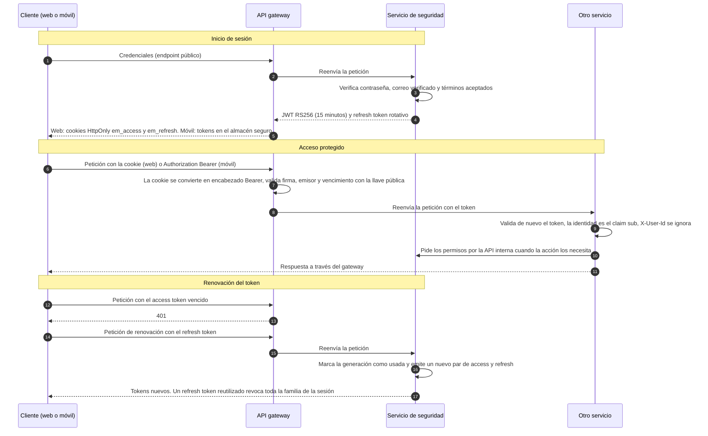

**Figura 2.** *Secuencia de autenticación: inicio de sesión, acceso protegido y renovación de token.*

# 10. Estructura del proyecto

El proyecto se distribuye en once repositorios de código vigentes (API gateway, siete microservicios, front web, app móvil e infraestructura), el backend retirado y los repositorios de documentación. La tabla siguiente resume su contenido y la forma de ejecutarlos.

| **Repositorio**            | **Tipo**                           | **Tecnología**                                          | **Punto de entrada**                                                 | **Ejecución**                                  |
|----------------------------|------------------------------------|---------------------------------------------------------|----------------------------------------------------------------------|------------------------------------------------|
| en-monitor-api-gateway     | API gateway                        | Java 21 + Spring Boot 4.0.8 + Spring Cloud Gateway + Maven | com/energymonitor/gateway/ApiGatewayApplication.java             | ./mvnw spring-boot:run (puerto 8080)           |
| en-monitor-security-service | Microservicio de seguridad        | Java 21 + Spring Boot 4.1.1 + Maven                     | com/energymonitor/security/SecurityServiceApplication.java           | ./mvnw spring-boot:run (puerto 8082)           |
| en-monitor-device-service  | Microservicio de dispositivos      | Java 21 + Spring Boot 4.1.1 + Maven                     | com/energymonitor/device/DeviceServiceApplication.java               | ./mvnw spring-boot:run (puerto 8084)           |
| en-monitor-measurement-service | Microservicio de mediciones    | Java 21 + Spring Boot 4.1.1 + Maven                     | com/energymonitor/measurement/MeasurementServiceApplication.java     | ./mvnw spring-boot:run (puerto 8085)           |
| en-monitor-home-service    | Microservicio de hogares           | Java 21 + Spring Boot 4.1.1 + Maven                     | com/energymonitor/home/HomeServiceApplication.java                   | ./mvnw spring-boot:run (puerto 8086)           |
| en-monitor-notification-service | Microservicio de notificaciones | Java 21 + Spring Boot 4.1.1 + Maven                   | com/energymonitor/notification/NotificationServiceApplication.java   | ./mvnw spring-boot:run (puerto 8087)           |
| en-monitor-alert-service   | Microservicio de alertas           | Java 21 + Spring Boot 4.1.1 + Maven                     | com/energymonitor/alert/AlertServiceApplication.java                 | ./mvnw spring-boot:run (puerto 8088)           |
| en-monitor-recommendation-service | Microservicio de recomendaciones | Java 21 + Spring Boot 4.1.1 + Maven                | com/energymonitor/recommendation/RecommendationServiceApplication.java | ./mvnw spring-boot:run (puerto 8089)         |
| Energy-Monitor-application | Aplicación web (front-end)         | React 19 + Vite 8 (JavaScript)                          | src/main.jsx sobre index.html                                        | npm install / npm run dev (puerto 5173)        |
| Energy-Monitor-Mobile      | Aplicación móvil (front-end)       | Expo SDK 57 + React Native 0.86                         | src/app/\_layout.tsx (expo-router/entry)                             | npm install / npm run start                    |
| energy-monitor-infra       | Infraestructura y despliegue       | Docker Compose, Mosquitto 2, RabbitMQ 4.1, MySQL 8.4, Nginx | docker-compose.yml, docker-compose.dev.yml y docker-compose.prod.yml | docker compose up -d --build              |
| energy-monitor-backend     | Backend retirado (archivado) y firmware | Java 21 + Spring Modulith (histórico); firmware Arduino | firmware/esp32-pzem-monitor/esp32-pzem-monitor.ino                | Ya no se ejecuta; solo arduino-cli upload del firmware |
| energy-monitor-docs-final  | Documentación final                | Markdown (ES y EN)                                      | README.md                                                            | No requiere ejecución                          |

El repositorio legado energy-monitor-devices (firmware y broker antiguos) ya no se usa para ejecutar nada: el firmware vive en `firmware/` de energy-monitor-backend (al que `prepare.sh` de infra le escribe `dev_ca.h`) y el broker en energy-monitor-infra.

## 10.1 Estructura de los servicios del backend

Todos los microservicios tienen la misma forma. Cada uno conserva el paquete que tenía en el backend y sus changesets con la misma ruta relativa, de modo que Liquibase los reconoce como ya aplicados en una base migrada:

```
en-monitor-<contexto>-service/
├── pom.xml                       definición Maven y dependencias
├── mvnw / mvnw.cmd               Maven Wrapper (no requiere Maven instalado)
├── Dockerfile                    imagen multi-stage (Maven + JRE 21, usuario sin privilegios uid 10001)
├── .env.example                  plantilla de variables de entorno
├── README.md                     qué sirve, a quién llama, eventos y despliegue
├── docs/Architecture.md          diseño y decisiones (gateway, seguridad, dispositivos y hogares)
├── .github/workflows/ci-cd.yml   pruebas, imagen Docker y despliegue
└── src/
    ├── main/
    │   ├── java/com/energymonitor/<contexto>/
    │   │   ├── <Contexto>ServiceApplication.java   punto de entrada
    │   │   ├── api/               contratos públicos del servicio (DTO de eventos)
    │   │   ├── domain/model/      entidades puras de dominio
    │   │   ├── application/       port/in, port/out, usecase, command, result, exception
    │   │   ├── adapter/in/        web (REST), internal (/internal/**), messaging (RabbitMQ), mqtt, scheduler
    │   │   ├── adapter/out/       persistence, messaging (outbox, relay, publicador), clientes de otros servicios
    │   │   └── infrastructure/    configuración de Spring (seguridad, RabbitMQ, clientes, Liquibase)
    │   └── resources/
    │       ├── application.yaml                  configuración base
    │       ├── application-local.yaml(.example)  perfil local
    │       └── db/changelog/                     maestro Liquibase + changesets del contexto
    └── test/java/com/energymonitor/<contexto>/   pruebas unitarias, web, de persistencia y BehindGatewayTest
```

| **Servicio** | **Paquete**                    | **Changelog**                       | **Adaptadores de entrada destacados** |
|--------------|--------------------------------|-------------------------------------|---------------------------------------|
| gateway      | com.energymonitor.gateway      | (sin base de datos)                 | routing, security, ratelimit, error   |
| security     | com.energymonitor.security     | db/changelog/security/              | AuthController, AdminController, SupportController, InternalController |
| device       | com.energymonitor.device       | db/changelog/device/                | HomeDeviceController, ApplianceTypeController, BrokerAuthController, InternalDeviceController, ConnectivityMqttConsumer, HomeDeletedConsumer, DeviceInactivityScheduler |
| measurement  | com.energymonitor.measurement  | db/changelog/measurement/           | MeasurementController, ConsumptionLevelController, HomeConsumptionController, InternalMeasurementController, TelemetryMqttConsumer, DeviceLinksConsumer |
| home         | com.energymonitor.home         | db/changelog/home/                  | HomeController, HomeThresholdsController, HomeTypeController, HomeAccessController, HomeLimitsController, HomeSummaryController, AccountDeletionCheckController, AccountDeletedConsumer |
| notification | com.energymonitor.notification | db/changelog/notification/          | NotificationChannelsController, ActivityNotificationsController, AdminNotificationsController, AccountEventsConsumer, MailRequestsConsumer, HomeMessagesConsumer, ActivityEventsConsumer |
| alert        | com.energymonitor.alert        | db/changelog/alert/                 | AlertController, MeasurementRecordedConsumer, DeviceEventsConsumer |
| recommendation | com.energymonitor.recommendation | db/changelog/recommendation/    | RecommendationController, RecommendationScheduler |

**Organización interna de un servicio (ejemplo con home):**

```
home/
├── package-info.java        documenta los límites del servicio
├── api/                     contrato público (mensajes que publica)
├── domain/model/            entidades puras de dominio (Home, UserHome, HomeThresholds,
│                            UserPermissions, OwnerPermissions, MemberPermissions, Role…)
├── application/
│   ├── port/in/             puertos de entrada (CreateHome, JoinHome, DeleteHome…)
│   ├── port/out/            puertos de salida (persistencia, perfiles, eventos)
│   ├── usecase/             implementación de los casos de uso
│   ├── command/ result/     estructuras de entrada y salida
│   └── exception/           excepciones de aplicación
├── adapter/
│   ├── in/web/              controladores REST, DTOs y manejadores de error
│   ├── in/internal/         API interno para otros servicios (acceso, límites, resumen, borrado de cuenta)
│   ├── in/messaging/        consumidor de account.deleted (RabbitMQ)
│   ├── out/messaging/       outbox de home.* , relay y publicador RabbitMQ
│   ├── out/security/        cliente del servicio de seguridad (perfiles)
│   └── out/persistence/     entidades JPA, repositorios, mappers y adaptadores
└── infrastructure/          configuración de Spring
```

El backend retirado (energy-monitor-backend) era un monolito modular Spring Modulith con los módulos home, alert, recommendation y notification y los paquetes intermediarios security, device y measurement. Su código queda en el historial del repositorio; ya no se construye ni se despliega (`deploy.sh` no acepta `backend`).

## 10.2 Estructura de la aplicación web

```
Energy-Monitor-application/
├── index.html · package.json · vite.config.js
├── vitest.config.js · eslint.config.js · .env.example
├── public/ (iconos y recursos)
└── src/
    ├── main.jsx          monta los proveedores y App
    ├── App.jsx · index.css
    ├── routes/           AppRoutes, ProtectedRoute, GuestRoute, HomeRoute,
    │                     RequirePermission (permiso global) y UserOnlyRoute (oculta hogares al ADMIN)
    ├── context/          HomeContext, ThemeContext, NotificationCenterContext
    ├── services/
    │   ├── http/         httpClient (axios), interceptores y errores
    │   ├── auth/         authApi, googleSignIn, session (localStorage, sin tokens), usePermissions
    │   ├── admin/        adminApi (usuarios, roles y avisos de administración)
    │   ├── home/         homeApi (hogares, miembros, umbrales, consumo)
    │   ├── devices/      deviceApi y bleProvisioning (Web Bluetooth)
    │   ├── alerts/       alertApi
    │   ├── recommendations/  recommendationApi
    │   └── notifications/    notificationApi, actividad y webPush
    ├── components/       layout/ (Navbar, MainLayout, Sidebar, Footer) y shared/
    ├── design/           design system (Button, Input, Card, Badge…)
    ├── features/         landingPage, auth (con LegalModal), dashboard, DetailHome,
    │                     Favorites, Notifications, Account, SettingsPage, Admin
    ├── i18n/             locales es, en, fr y pt (incluye admin.json y legalModal.json)
    └── test/setup.js    configuración de Vitest
```

## 10.3 Estructura de la aplicación móvil

```
Energy-Monitor-Mobile/
├── app.json · package.json · tsconfig.json · eas.json · AGENTS.md · .env.example
├── assets/               iconos y pantalla de inicio
└── src/
    ├── app/              rutas Expo Router:
    │                     _layout.tsx (providers y Stack), index.tsx (login),
    │                     register.tsx, verify-account.tsx, recover-password.tsx,
    │                     verify-recover-password.tsx, new-password.tsx,
    │                     dashboard.tsx, homes.tsx (redirige al dashboard), home/[id].tsx,
    │                     favorites.tsx, notifications.tsx, settings.tsx, account.tsx
    ├── components/       Button, Card, Input, Modal, Chart, OtpInput… + layout/ (AuthGate, Sidebar, BottomTabBar)
    ├── config/           env.ts (EXPO_PUBLIC_API_BASE_URL) y easProjectId.ts
    ├── constants/        theme, colors, spacing, typography
    ├── context/          HomeContext, UserContext, ThemeContext, NotificationCenterContext
    ├── services/         http, auth (session con expo-secure-store), home, devices (ble/),
    │                     measurement, alerts, recommendations y notifications (pushRegistration)
    ├── features/         auth (con LegalModal), dashboard, homes, favorites,
    │                     notifications, settings, account
    ├── i18n/             locales es, en, fr y pt
    └── validation/       mensajes i18n de los esquemas zod
```

## 10.4 Función de las carpetas principales

| **Carpeta**                                                                | **Función**                                                                              |
|----------------------------------------------------------------------------|------------------------------------------------------------------------------------------|
| \<servicio\>/src/main/java/com/energymonitor/\<contexto\>/domain/model     | Entidades de dominio puras, sin dependencias de Spring.                                  |
| \<servicio\>/src/main/java/com/energymonitor/\<contexto\>/application      | Casos de uso, puertos de entrada y de salida, comandos, resultados y excepciones.        |
| \<servicio\>/src/main/java/com/energymonitor/\<contexto\>/adapter/in/web   | Controladores REST, DTOs y manejadores de excepciones (@RestControllerAdvice).           |
| \<servicio\>/src/main/java/com/energymonitor/\<contexto\>/adapter/in/internal | API interno `/internal/**` para los demás servicios.                                  |
| \<servicio\>/src/main/java/com/energymonitor/\<contexto\>/adapter/in/messaging y out/messaging | Consumidores de RabbitMQ; outbox, relay y publicador de eventos.      |
| \<servicio\>/src/main/java/com/energymonitor/\<contexto\>/adapter/out/persistence | Entidades JPA, repositorios, mappers y adaptadores de persistencia.               |
| \<servicio\>/src/main/java/com/energymonitor/\<contexto\>/adapter/out/{home,device,measurement,security} | Clientes del API interno de otros servicios, con caché.        |
| \<servicio\>/src/main/resources/db/changelog                               | Changesets de Liquibase de las tablas de ese servicio, con su rollback.                  |
| \<servicio\>/src/test/java                                                 | Pruebas unitarias, de integración web, de persistencia y de seguridad detrás del gateway. |
| en-monitor-api-gateway/src/main/java/com/energymonitor/gateway             | Rutas (routing), validación del token y CORS (security), límite de peticiones (ratelimit) y errores (error). |
| web/src/routes                                                             | Definición de rutas, protecciones (sesión, invitado, permiso, solo usuario) y layouts de la SPA. |
| web/src/services                                                           | Capa de acceso a la API: cliente HTTP, interceptores, sesión y endpoints por dominio.    |
| web/src/features                                                           | Pantallas y componentes agrupados por funcionalidad (incluida Admin).                    |
| web/src/design                                                             | Componentes reutilizables de interfaz (botones, tarjetas, campos) y sus estilos.         |
| mobile/src/app                                                             | Rutas file-based de Expo Router que montan cada pantalla.                                |
| mobile/src/services                                                        | Cliente de la API REST de la aplicación móvil (mismo patrón que la web), BLE y push.     |
| mobile/src/features                                                        | Pantallas, componentes, hooks y validaciones por funcionalidad.                          |
| energy-monitor-backend/firmware/esp32-pzem-monitor                         | Firmware del dispositivo y archivos de configuración.                                    |
| infra/docker-compose\*.yml y infra/mosquitto                               | Pila local, modo desarrollo y producción (MySQL, RabbitMQ, Mosquitto, gateway, servicios y web) y configuración del broker. |
| infra/deploy, infra/e2e y infra/make-admin.sh                              | Despliegue (deploy.sh, Nginx, respaldo de MySQL, renovación del certificado MQTT), pruebas de punta a punta y alta del primer administrador. |

# 11. Base de datos

**Motor:** MySQL 8.4, ejecutado en contenedor Docker (repositorio energy-monitor-infra).

**Esquema:** energy_monitor, una sola base compartida por los servicios (ADR-003). Este capítulo documenta 37 tablas distribuidas en los siete servicios con base de datos. El usuario de aplicación es energy_app.

**Dueño de cada tabla:** cada servicio es dueño de sus tablas y aplica solo sus changesets: seguridad (16 tablas), dispositivos (5), mediciones (3), hogares (5), notificaciones (4), alertas (2) y recomendaciones (2). El backend retirado ya no crea tablas; en una base migrada puede quedar su `backend_outbox` sin uso.

**Gestión del esquema:** Liquibase aplica los changesets versionados en src/main/resources/db/changelog de cada servicio; todos comparten la tabla DATABASECHANGELOG, y los changesets que salieron del backend conservaron su ruta, por lo que no se vuelven a ejecutar. Hibernate está configurado con ddl-auto = validate, es decir, sólo valida que el esquema coincida con las entidades y nunca crea tablas por sí mismo.

**Convenciones:** nombres en snake_case; llaves primarias de tipo VARCHAR(10); columnas de auditoría created_at, updated_at y deleted_at en las tablas de negocio; borrado lógico; índices con el patrón idx\_\[tabla\]\_\[columnas\]. Las referencias entre servicios se almacenan como identificadores a nivel de aplicación y no generan llaves foráneas SQL.

**Artefactos de la carpeta `06-base-datos`:** [diccionario de datos](../../04-software-design/es/data-dictionary.md) (el mismo de la sección 11.3), [script SQL](../../04-software-design/database/energy_monitor.sql) con el estado final del esquema y sus datos semilla, y las fuentes PlantUML del [MER](../../04-software-design/diagrams/er-model.wsd) y del [diagrama de clases](../../04-software-design/diagrams/class-diagram.wsd).

## 11.1 Diagrama entidad-relación

El diagrama muestra las entidades del sistema agrupadas por el servicio dueño, con sus atributos, llaves y relaciones. Las relaciones punteadas entre servicios representan referencias de aplicación (sin foreign key en SQL). La fuente vigente es [`MER.wsd`](../../04-software-design/diagrams/er-model.wsd), generada de los changelogs, y la Figura 3 es su renderizado.

> **Recomendación de lectura:** por su tamaño, el diagrama se presenta en página horizontal; en Word puede ampliarse con el zoom para leer los atributos de cada entidad. En el Anexo B se incluye el mismo modelo desagregado por contexto, con mayor legibilidad.
>
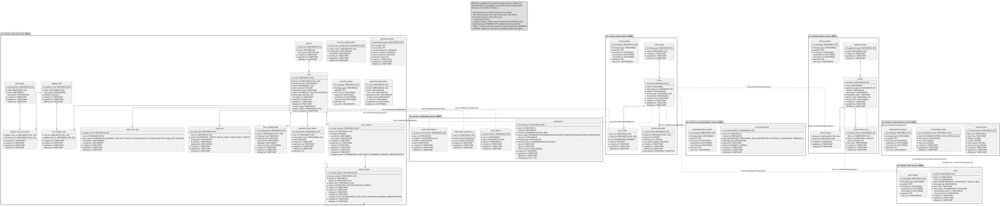

**Figura 3.** *Modelo entidad-relación (MER) completo del sistema «Monitor de Consumo Eléctrico».*

## 11.2 Tablas principales

La tabla siguiente lista las 37 tablas, el servicio dueño, su descripción, su llave primaria y las llaves foráneas que existen dentro del servicio.

| **#** | **Tabla** | **Servicio dueño** | **Descripción** | **Llave primaria** | **Llaves foráneas (dentro del servicio)** |
|---|---|---|---|---|---|
| 1 | person | security (8082) | Registra los datos personales asociados a un usuario. | id_person | — |
| 2 | user | security (8082) | Gestiona las credenciales, estado y datos de acceso del usuario. | id_user | person_id → person |
| 3 | user_configuration | security (8082) | Almacena las preferencias de configuración de cada usuario. | id_configuration | user_id → user |
| 4 | password_reset_token | security (8082) | Almacena tokens para recuperación de contraseña. | id_reset_token | user_id → user |
| 5 | user_session | security (8082) | Registra las sesiones activas y renovables del usuario. | id_user_session | user_id → user |
| 6 | security_configuration | security (8082) | Define parámetros configurables de seguridad del sistema. | id_security_configuration | — |
| 7 | password_policy | security (8082) | Define las reglas de validación y expiración de contraseñas. | id_password_policy | — |
| 8 | login_error_log | security (8082) | Registra los errores producidos durante el inicio de sesión. | id_login_error | user_id → user |
| 9 | system_role | security (8082) | Define los roles disponibles en el sistema. | id_system_role | — |
| 10 | permission | security (8082) | Define los permisos funcionales del sistema. | id_permission | — |
| 11 | user_system_role | security (8082) | Relaciona usuarios con roles del sistema. | user_id, system_role_id | user_id → user; system_role_id → system_role |
| 12 | system_role_permission | security (8082) | Relaciona roles con permisos. | system_role_id, permission_id | system_role_id → system_role; permission_id → permission |
| 13 | audit_log | security (8082) | Registra las acciones relevantes ejecutadas por los usuarios. | id_audit_log | user_id → user |
| 14 | refresh_token | security (8082) | Cada fila es una generación de refresh token. | id_refresh_token | id_user_session → user_session; parent_id → refresh_token |
| 15 | security_outbox | security (8082) | Outbox transaccional del servicio: eventos que publica en RabbitMQ. | id_message | — |
| 16 | pending_registration | security (8082) | Registros que esperan la verificación del correo. | id_user | — |
| 17 | appliance_type | device (8084) | Catálogo de tipos de electrodomésticos. | id_appliance_type | — |
| 18 | device | device (8084) | Registra los dispositivos de medición instalados. | id_device | appliance_type_id → appliance_type |
| 19 | device_status_log | device (8084) | Registra el estado y conectividad de los dispositivos. | id_device_status | device_id → device |
| 20 | device_home | device (8084) | Relaciona dispositivos con hogares. | device_id, home_id | device_id → device |
| 21 | device_outbox | device (8084) | Outbox transaccional del servicio: eventos que publica en RabbitMQ. | id_message | — |
| 22 | measurement | measurement (8085) | Almacena las mediciones eléctricas registradas. | id_measurement | — |
| 23 | consumption_level | measurement (8085) | Define niveles de riesgo y sus rangos de consumo. | id_consumption_level | — |
| 24 | measurement_outbox | measurement (8085) | Outbox transaccional del servicio: eventos que publica en RabbitMQ. | id_message | — |
| 25 | home_type | home (8086) | Catálogo de tipos de hogar. | id_home_type | — |
| 26 | home | home (8086) | Registra los hogares administrados por el sistema. | id_home | home_type_id → home_type |
| 27 | home_thresholds | home (8086) | Configura los límites de consumo de un hogar. | id_threshold | home_id → home |
| 28 | user_home | home (8086) | Relaciona usuarios con hogares y define su rol. | user_id, home_id | home_id → home |
| 29 | home_outbox | home (8086) | Outbox transaccional del servicio: eventos que publica en RabbitMQ. | id_message | — |
| 30 | notification | notification (8087) | Registro de entrega de un mensaje al usuario. | id_notification | — |
| 31 | notification_preference | notification (8087) | Preferencias de canal de notificación de cada usuario (correo y push). | user_id | — |
| 32 | push_subscription | notification (8087) | Suscripciones de notificaciones push de los navegadores del usuario. | id_push_subscription | — |
| 33 | push_device | notification (8087) | Instalaciones de la app móvil que reciben notificaciones push por el relay de Expo (una fila por instalación). | id_push_device | — |
| 34 | alert | alert (8088) | Alertas de un hogar: lectura sobre el umbral de potencia (THRESHOLD, nivel HIGH o CRITICAL), límite diario o mensual alcanzado (LIMIT), dispositivo sin conexión (CONNECTIVITY) y primera lectura de un dispositivo recién vinculado (DEVICE). | id_alert | — |
| 35 | alert_outbox | alert (8088) | Outbox transaccional del servicio: eventos que publica en RabbitMQ. | id_message | — |
| 36 | recommendation | recommendation (8089) | Recomendaciones de ahorro que genera cada hora el servicio de recomendaciones a partir de la energía por hora del hogar; device_id vacío si aplica a todo el hogar. | id_recommendation | — |
| 37 | recommendation_outbox | recommendation (8089) | Outbox transaccional del servicio: eventos que publica en RabbitMQ. | id_message | — |

## 11.3 Diccionario de datos

El diccionario de datos describe campo por campo cada tabla del esquema: tipo de dato, tamaño o valores, si admite nulos, restricciones y descripción. Se generó a partir de los changesets de Liquibase de los servicios, que son la fuente de verdad del esquema; es el mismo contenido de [`06-base-datos/diccionario-datos`](../../04-software-design/es/data-dictionary.md), donde además están los datos semilla. Para las reglas de integridad véase también [`05.2-modelo-de-datos.md`](../../04-software-design/es/data-model.md).

**Leyenda de restricciones:** PK = llave primaria; FK = llave foránea dentro del mismo servicio; UNIQUE = valor único (con el nombre de la restricción); DEFAULT = valor por defecto; *Nulo* = Sí si la columna admite NULL; en los ENUM la columna *Tamaño / valores* lista los valores permitidos.

### person

*Registra los datos personales asociados a un usuario.*

**Servicio dueño:** en-monitor-security-service · **Changesets:** security-001-create-person, security-018-drop-person-contact-data, security-020-drop-person-cellphone

| **Campo** | **Tipo** | **Tamaño / valores** | **Nulo** | **Restricción** | **Descripción** |
|---|---|---|---|---|---|
| id_person | VARCHAR | 10 | No | PK | Identificador de la persona |
| name | VARCHAR | 100 | No | — | Nombres de la persona |
| last_name | VARCHAR | 100 | Sí | — | Apellidos de la persona (opcional) |
| created_at | TIMESTAMP | — | No | DEFAULT CURRENT_TIMESTAMP | Fecha y hora de creación del registro (auditoría) |
| updated_at | TIMESTAMP | — | No | DEFAULT CURRENT_TIMESTAMP ON UPDATE CURRENT_TIMESTAMP | Fecha y hora de la última modificación (auditoría) |
| deleted_at | TIMESTAMP | — | Sí | — | Fecha y hora del borrado lógico; vacío si el registro está vigente |

**Índices:** Ninguno

### user

*Gestiona las credenciales, estado y datos de acceso del usuario.*

**Servicio dueño:** en-monitor-security-service · **Changesets:** security-002-create-user, security-017-add-user-profile-image, security-022-widen-user-profile-image, security-024-add-user-google-subject, security-029-add-user-terms-accepted-at

| **Campo** | **Tipo** | **Tamaño / valores** | **Nulo** | **Restricción** | **Descripción** |
|---|---|---|---|---|---|
| id_user | VARCHAR | 10 | No | PK | Identificador del usuario |
| person_id | VARCHAR | 10 | No | UNIQUE (uk_user_person_id); FK → person.id_person | Persona asociada |
| password_hash | VARCHAR | 255 | No | — | Hash de la contraseña |
| email | VARCHAR | 255 | No | UNIQUE (uk_user_email) | Correo electrónico |
| email_verified | BOOLEAN | — | No | — | Indica si el correo fue verificado |
| registration_date | TIMESTAMP | — | No | — | Fecha y hora de registro |
| status | ENUM | ACTIVE, INACTIVE, BLOCKED | No | — | Estado de la cuenta |
| failed_login_attempts | INT | — | No | — | Cantidad de intentos fallidos |
| last_login_at | TIMESTAMP | — | Sí | — | Último inicio de sesión |
| created_at | TIMESTAMP | — | No | DEFAULT CURRENT_TIMESTAMP | Fecha y hora de creación del registro (auditoría) |
| updated_at | TIMESTAMP | — | No | DEFAULT CURRENT_TIMESTAMP ON UPDATE CURRENT_TIMESTAMP | Fecha y hora de la última modificación (auditoría) |
| deleted_at | TIMESTAMP | — | Sí | — | Fecha y hora del borrado lógico; vacío si el registro está vigente |
| profile_image | MEDIUMTEXT | — | Sí | — | Imagen de perfil de la cuenta (URL de datos en base64) |
| google_subject | VARCHAR | 255 | Sí | UNIQUE (uq_user_google_subject) | Identificador estable (sub) de la cuenta de Google con la que se creó la cuenta; vacío si se registró con contraseña |
| terms_accepted_at | TIMESTAMP | — | Sí | — | Momento en que la cuenta aceptó los términos y condiciones; vacío obliga a aceptarlos en el próximo inicio de sesión (respuesta 428) |

**Índices:** Ninguno

### user_configuration

*Almacena las preferencias de configuración de cada usuario.*

**Servicio dueño:** en-monitor-security-service · **Changesets:** security-003-create-user-configuration

| **Campo** | **Tipo** | **Tamaño / valores** | **Nulo** | **Restricción** | **Descripción** |
|---|---|---|---|---|---|
| id_configuration | VARCHAR | 10 | No | PK | Identificador de la configuración |
| user_id | VARCHAR | 10 | No | UNIQUE (uk_user_configuration_user_id); FK → user.id_user | Usuario configurado |
| notify_by_email | BOOLEAN | — | No | — | Activa notificaciones por correo |
| notify_by_push | BOOLEAN | — | No | — | Activa notificaciones push |
| color_theme | VARCHAR | 50 | Sí | — | Tema de color |
| language | VARCHAR | 50 | Sí | — | Idioma preferido |
| social_provider | VARCHAR | 50 | Sí | — | Proveedor de autenticación social |
| created_at | TIMESTAMP | — | No | DEFAULT CURRENT_TIMESTAMP | Fecha y hora de creación del registro (auditoría) |
| updated_at | TIMESTAMP | — | No | DEFAULT CURRENT_TIMESTAMP ON UPDATE CURRENT_TIMESTAMP | Fecha y hora de la última modificación (auditoría) |
| deleted_at | TIMESTAMP | — | Sí | — | Fecha y hora del borrado lógico; vacío si el registro está vigente |

**Índices:** Ninguno

### password_reset_token

*Almacena tokens para recuperación de contraseña.*

**Servicio dueño:** en-monitor-security-service · **Changesets:** security-004-create-password-reset-token, security-021-add-password-reset-token-attempts

| **Campo** | **Tipo** | **Tamaño / valores** | **Nulo** | **Restricción** | **Descripción** |
|---|---|---|---|---|---|
| id_reset_token | VARCHAR | 10 | No | PK | Identificador del token |
| user_id | VARCHAR | 10 | No | FK → user.id_user | Usuario propietario |
| reset_token_hash | VARCHAR | 64 | No | UNIQUE (uk_password_reset_token_reset_token_hash) | Hash HMAC-SHA256 (con pepper) del código de recuperación |
| used | BOOLEAN | — | No | — | Indica si el token fue utilizado |
| created_at | TIMESTAMP | — | No | DEFAULT CURRENT_TIMESTAMP | Fecha y hora de creación del registro (auditoría) |
| expiration_at | TIMESTAMP | — | No | — | Fecha de expiración |
| updated_at | TIMESTAMP | — | No | DEFAULT CURRENT_TIMESTAMP ON UPDATE CURRENT_TIMESTAMP | Fecha y hora de la última modificación (auditoría) |
| deleted_at | TIMESTAMP | — | Sí | — | Fecha y hora del borrado lógico; vacío si el registro está vigente |
| attempts | INT | — | No | DEFAULT 0 | Intentos de canje del código |

**Índices:** Ninguno

### user_session

*Registra las sesiones activas y renovables del usuario.*

**Servicio dueño:** en-monitor-security-service · **Changesets:** security-005-create-user-session, security-014-add-session-revocation, security-016-drop-session-refresh-token

| **Campo** | **Tipo** | **Tamaño / valores** | **Nulo** | **Restricción** | **Descripción** |
|---|---|---|---|---|---|
| id_user_session | VARCHAR | 10 | No | PK | Identificador de sesión |
| user_id | VARCHAR | 10 | No | FK → user.id_user | Usuario de la sesión |
| revoked | BOOLEAN | — | No | — | Indica si la sesión fue revocada |
| ip_address | VARCHAR | 45 | Sí | — | Dirección IP |
| user_agent | VARCHAR | 150 | Sí | — | Agente del cliente |
| created_at | TIMESTAMP | — | No | DEFAULT CURRENT_TIMESTAMP | Fecha y hora de creación del registro (auditoría) |
| expiration_at | TIMESTAMP | — | No | — | Fecha de expiración |
| closed_at | TIMESTAMP | — | Sí | — | Fecha de cierre |
| updated_at | TIMESTAMP | — | No | DEFAULT CURRENT_TIMESTAMP ON UPDATE CURRENT_TIMESTAMP | Fecha y hora de la última modificación (auditoría) |
| deleted_at | TIMESTAMP | — | Sí | — | Fecha y hora del borrado lógico; vacío si el registro está vigente |
| revoked_at | TIMESTAMP | — | Sí | — | Fecha y hora de revocación de la sesión |
| revoked_reason | ENUM | REFRESH_TOKEN_REUSE, PASSWORD_CHANGED, ADMINISTRATIVE | Sí | — | Motivo de la revocación |

**Índices:** Ninguno

### security_configuration

*Define parámetros configurables de seguridad del sistema.*

**Servicio dueño:** en-monitor-security-service · **Changesets:** security-006-create-security-configuration

| **Campo** | **Tipo** | **Tamaño / valores** | **Nulo** | **Restricción** | **Descripción** |
|---|---|---|---|---|---|
| id_security_configuration | VARCHAR | 10 | No | PK | Identificador de configuración |
| config_name | VARCHAR | 100 | No | UNIQUE (uk_security_configuration_config_name) | Nombre de la configuración |
| config_value | VARCHAR | 100 | No | — | Valor de la configuración |
| description | VARCHAR | 255 | Sí | — | Descripción |
| created_at | TIMESTAMP | — | No | DEFAULT CURRENT_TIMESTAMP | Fecha y hora de creación del registro (auditoría) |
| updated_at | TIMESTAMP | — | No | DEFAULT CURRENT_TIMESTAMP ON UPDATE CURRENT_TIMESTAMP | Fecha y hora de la última modificación (auditoría) |
| deleted_at | TIMESTAMP | — | Sí | — | Fecha y hora del borrado lógico; vacío si el registro está vigente |

**Índices:** Ninguno

### password_policy

*Define las reglas de validación y expiración de contraseñas.*

**Servicio dueño:** en-monitor-security-service · **Changesets:** security-007-create-password-policy

| **Campo** | **Tipo** | **Tamaño / valores** | **Nulo** | **Restricción** | **Descripción** |
|---|---|---|---|---|---|
| id_password_policy | VARCHAR | 10 | No | PK | Identificador de política |
| min_length | INT | — | No | — | Longitud mínima |
| max_length | INT | — | No | — | Longitud máxima |
| require_uppercase | BOOLEAN | — | No | — | Exige mayúsculas |
| require_numbers | BOOLEAN | — | No | — | Exige números |
| require_symbols | BOOLEAN | — | No | — | Exige símbolos |
| expiration_days | INT | — | No | — | Días de vigencia |
| created_at | TIMESTAMP | — | No | DEFAULT CURRENT_TIMESTAMP | Fecha y hora de creación del registro (auditoría) |
| updated_at | TIMESTAMP | — | No | DEFAULT CURRENT_TIMESTAMP ON UPDATE CURRENT_TIMESTAMP | Fecha y hora de la última modificación (auditoría) |
| deleted_at | TIMESTAMP | — | Sí | — | Fecha y hora del borrado lógico; vacío si el registro está vigente |

**Índices:** Ninguno

### login_error_log

*Registra los errores producidos durante el inicio de sesión.*

**Servicio dueño:** en-monitor-security-service · **Changesets:** security-008-create-login-error-log, security-027-login-error-email-not-verified

| **Campo** | **Tipo** | **Tamaño / valores** | **Nulo** | **Restricción** | **Descripción** |
|---|---|---|---|---|---|
| id_login_error | VARCHAR | 10 | No | PK | Identificador del error |
| user_id | VARCHAR | 10 | Sí | FK → user.id_user | Usuario relacionado, si existe |
| error_type | ENUM | INVALID_PASSWORD, USER_NOT_FOUND, ACCOUNT_BLOCKED, ACCOUNT_INACTIVE, EMAIL_NOT_VERIFIED | No | — | Tipo de error |
| description | VARCHAR | 500 | Sí | — | Descripción del error |
| ip_address | VARCHAR | 45 | Sí | — | Dirección IP |
| created_at | TIMESTAMP | — | No | DEFAULT CURRENT_TIMESTAMP | Fecha y hora de creación del registro (auditoría) |
| updated_at | TIMESTAMP | — | No | DEFAULT CURRENT_TIMESTAMP ON UPDATE CURRENT_TIMESTAMP | Fecha y hora de la última modificación (auditoría) |
| deleted_at | TIMESTAMP | — | Sí | — | Fecha y hora del borrado lógico; vacío si el registro está vigente |

**Índices:** Ninguno

### system_role

*Define los roles disponibles en el sistema.*

**Servicio dueño:** en-monitor-security-service · **Changesets:** security-009-create-system-role

| **Campo** | **Tipo** | **Tamaño / valores** | **Nulo** | **Restricción** | **Descripción** |
|---|---|---|---|---|---|
| id_system_role | VARCHAR | 10 | No | PK | Identificador del rol |
| name | VARCHAR | 50 | No | UNIQUE (uk_system_role_name) | Nombre del rol |
| description | VARCHAR | 200 | Sí | — | Descripción |
| enabled | BOOLEAN | — | No | — | Indica si está habilitado |
| created_at | TIMESTAMP | — | No | DEFAULT CURRENT_TIMESTAMP | Fecha y hora de creación del registro (auditoría) |
| updated_at | TIMESTAMP | — | No | DEFAULT CURRENT_TIMESTAMP ON UPDATE CURRENT_TIMESTAMP | Fecha y hora de la última modificación (auditoría) |
| deleted_at | TIMESTAMP | — | Sí | — | Fecha y hora del borrado lógico; vacío si el registro está vigente |

**Índices:** Ninguno

### permission

*Define los permisos funcionales del sistema.*

**Servicio dueño:** en-monitor-security-service · **Changesets:** security-010-create-permission

| **Campo** | **Tipo** | **Tamaño / valores** | **Nulo** | **Restricción** | **Descripción** |
|---|---|---|---|---|---|
| id_permission | VARCHAR | 10 | No | PK | Identificador del permiso |
| code | VARCHAR | 30 | No | UNIQUE (uk_permission_code) | Código único |
| name | VARCHAR | 50 | No | — | Nombre del permiso |
| description | VARCHAR | 100 | Sí | — | Descripción |
| created_at | TIMESTAMP | — | No | DEFAULT CURRENT_TIMESTAMP | Fecha y hora de creación del registro (auditoría) |
| updated_at | TIMESTAMP | — | No | DEFAULT CURRENT_TIMESTAMP ON UPDATE CURRENT_TIMESTAMP | Fecha y hora de la última modificación (auditoría) |
| deleted_at | TIMESTAMP | — | Sí | — | Fecha y hora del borrado lógico; vacío si el registro está vigente |

**Índices:** Ninguno

### user_system_role

*Relaciona usuarios con roles del sistema.*

**Servicio dueño:** en-monitor-security-service · **Changesets:** security-011-create-user-system-role

| **Campo** | **Tipo** | **Tamaño / valores** | **Nulo** | **Restricción** | **Descripción** |
|---|---|---|---|---|---|
| user_id | VARCHAR | 10 | No | PK; FK → user.id_user | Usuario relacionado |
| system_role_id | VARCHAR | 10 | No | PK; FK → system_role.id_system_role | Rol asignado |
| assigned_at | TIMESTAMP | — | No | — | Fecha de asignación |
| created_at | TIMESTAMP | — | No | DEFAULT CURRENT_TIMESTAMP | Fecha y hora de creación del registro (auditoría) |
| updated_at | TIMESTAMP | — | No | DEFAULT CURRENT_TIMESTAMP ON UPDATE CURRENT_TIMESTAMP | Fecha y hora de la última modificación (auditoría) |
| deleted_at | TIMESTAMP | — | Sí | — | Fecha y hora del borrado lógico; vacío si el registro está vigente |

**Índices:** Ninguno

### system_role_permission

*Relaciona roles con permisos.*

**Servicio dueño:** en-monitor-security-service · **Changesets:** security-012-create-system-role-permission

| **Campo** | **Tipo** | **Tamaño / valores** | **Nulo** | **Restricción** | **Descripción** |
|---|---|---|---|---|---|
| system_role_id | VARCHAR | 10 | No | PK; FK → system_role.id_system_role | Rol relacionado |
| permission_id | VARCHAR | 10 | No | PK; FK → permission.id_permission | Permiso asignado |
| assigned_at | TIMESTAMP | — | No | — | Fecha de asignación |
| created_at | TIMESTAMP | — | No | DEFAULT CURRENT_TIMESTAMP | Fecha y hora de creación del registro (auditoría) |
| updated_at | TIMESTAMP | — | No | DEFAULT CURRENT_TIMESTAMP ON UPDATE CURRENT_TIMESTAMP | Fecha y hora de la última modificación (auditoría) |
| deleted_at | TIMESTAMP | — | Sí | — | Fecha y hora del borrado lógico; vacío si el registro está vigente |

**Índices:** Ninguno

### audit_log

*Registra las acciones relevantes ejecutadas por los usuarios.*

**Servicio dueño:** en-monitor-security-service · **Changesets:** security-013-create-audit-log

| **Campo** | **Tipo** | **Tamaño / valores** | **Nulo** | **Restricción** | **Descripción** |
|---|---|---|---|---|---|
| id_audit_log | VARCHAR | 10 | No | PK | Identificador del registro |
| user_id | VARCHAR | 10 | Sí | FK → user.id_user | Usuario que ejecutó la acción |
| action | ENUM | CREATE, UPDATE, DELETE, LOGIN, LOGIN_FAILED, LOGOUT | No | — | Acción auditada |
| description | VARCHAR | 255 | Sí | — | Descripción |
| ip_address | VARCHAR | 45 | Sí | — | Dirección IP |
| application | VARCHAR | 255 | Sí | — | Aplicación de origen |
| created_at | TIMESTAMP | — | No | DEFAULT CURRENT_TIMESTAMP | Fecha y hora de creación del registro (auditoría) |
| updated_at | TIMESTAMP | — | No | DEFAULT CURRENT_TIMESTAMP ON UPDATE CURRENT_TIMESTAMP | Fecha y hora de la última modificación (auditoría) |
| deleted_at | TIMESTAMP | — | Sí | — | Fecha y hora del borrado lógico; vacío si el registro está vigente |

**Índices:** Ninguno

### refresh_token

*Cada fila es una generación de refresh token. Solo se guarda el hash SHA-256 del secreto, nunca el secreto en claro. family_id agrupa todas las generaciones de un mismo login y parent_id encadena la genealogía.*

**Servicio dueño:** en-monitor-security-service · **Changesets:** security-015-create-refresh-token

| **Campo** | **Tipo** | **Tamaño / valores** | **Nulo** | **Restricción** | **Descripción** |
|---|---|---|---|---|---|
| id_refresh_token | VARCHAR | 10 | No | PK | Identificador de la generación del token |
| id_user_session | VARCHAR | 10 | No | FK → user_session.id_user_session | Sesión a la que pertenece la generación |
| family_id | VARCHAR | 10 | No | — | Identificador de la raíz de la familia de generaciones |
| parent_id | VARCHAR | 10 | Sí | FK → refresh_token.id_refresh_token | Generación que esta reemplaza |
| token_hash | VARCHAR | 64 | No | UNIQUE (uk_refresh_token_hash) | Hash SHA-256 del secreto (nunca el secreto en claro) |
| status | ENUM | ACTIVE, ROTATED, REVOKED, EXPIRED | No | — | Estado del ciclo de vida de la generación |
| created_at | TIMESTAMP | — | No | DEFAULT CURRENT_TIMESTAMP | Fecha y hora de creación del registro (auditoría) |
| expires_at | TIMESTAMP | — | No | — | Fecha de expiración |
| rotated_at | TIMESTAMP | — | Sí | — | Fecha en que fue reemplazada |
| revoked_at | TIMESTAMP | — | Sí | — | Fecha de revocación |
| revoked_reason | ENUM | REFRESH_TOKEN_REUSE, PASSWORD_CHANGED, ADMINISTRATIVE | Sí | — | Motivo de la revocación |
| updated_at | TIMESTAMP | — | No | DEFAULT CURRENT_TIMESTAMP ON UPDATE CURRENT_TIMESTAMP | Fecha y hora de la última modificación (auditoría) |
| deleted_at | TIMESTAMP | — | Sí | — | Fecha y hora del borrado lógico; vacío si el registro está vigente |

**Índices:** `ix_refresh_token_family_id` (family_id); `ix_refresh_token_user_session` (id_user_session)

### security_outbox

*Outbox transaccional del servicio: cada evento que el servicio publica en RabbitMQ se escribe aquí en la misma transacción que el cambio, y un relay lo publica cada segundo, del más antiguo al más reciente.*

**Servicio dueño:** en-monitor-security-service · **Changesets:** security-026-create-security-outbox

| **Campo** | **Tipo** | **Tamaño / valores** | **Nulo** | **Restricción** | **Descripción** |
|---|---|---|---|---|---|
| id_message | VARCHAR | 10 | No | PK | Identificador del mensaje; viaja como message id en RabbitMQ y permite a los consumidores descartar duplicados |
| message_type | VARCHAR | 60 | No | — | Tipo de mensaje (routing key), por ejemplo `home.deleted` |
| payload | TEXT | — | Sí | — | Cuerpo del evento en JSON |
| occurred_at | DATETIME | 6 | No | — | Momento en que ocurrió el cambio (orden de publicación) |
| expires_at | DATETIME | 6 | Sí | — | Momento a partir del cual el mensaje ya no se publica (solo security_outbox, para los correos con código) |
| published_at | DATETIME | 6 | Sí | — | Momento en que el broker confirmó el mensaje; vacío mientras está pendiente |
| discarded_at | DATETIME | 6 | Sí | — | Momento en que el mensaje se descartó sin publicarse (vencido o escrito por las pruebas) |
| attempts | INT | — | No | DEFAULT 0 | Intentos de publicación realizados |
| last_error | VARCHAR | 255 | Sí | — | Último error de publicación (por ejemplo, ninguna cola recibió el mensaje) |

**Índices:** `idx_security_outbox_pending` (published_at, discarded_at, occurred_at)

### pending_registration

*Registros que esperan la verificación del correo. Ninguna cuenta (person ni user) existe hasta que se verifica el código; la solicitud vence a las 24 horas y un proceso horario la elimina.*

**Servicio dueño:** en-monitor-security-service · **Changesets:** security-028-create-pending-registration

| **Campo** | **Tipo** | **Tamaño / valores** | **Nulo** | **Restricción** | **Descripción** |
|---|---|---|---|---|---|
| id_user | VARCHAR | 10 | No | PK | Identificador reservado para la cuenta que se creará al verificar el correo |
| email | VARCHAR | 255 | No | UNIQUE (uq_pending_registration_email) | Correo de la solicitud (normalizado en minúsculas) |
| name | VARCHAR | 100 | No | — | Nombre ingresado en el registro |
| last_name | VARCHAR | 100 | Sí | — | Apellido ingresado en el registro (opcional) |
| password_hash | VARCHAR | 255 | No | — | Hash BCrypt de la contraseña elegida |
| profile_image | MEDIUMTEXT | — | Sí | — | Foto de perfil enviada en el registro (URL de datos en base64), opcional |
| ip_address | VARCHAR | 45 | Sí | — | Dirección IP desde la que se hizo el registro |
| requested_at | DATETIME | 6 | No | — | Momento de la solicitud; se usa como fecha de aceptación de los términos |
| expires_at | DATETIME | 6 | No | — | Vencimiento de la solicitud (24 horas) |

**Índices:** `idx_pending_registration_expires_at` (expires_at)

### appliance_type

*Catálogo de tipos de electrodomésticos.*

**Servicio dueño:** en-monitor-device-service · **Changesets:** device-001-create-appliance-type

| **Campo** | **Tipo** | **Tamaño / valores** | **Nulo** | **Restricción** | **Descripción** |
|---|---|---|---|---|---|
| id_appliance_type | VARCHAR | 10 | No | PK | Identificador del tipo |
| name | VARCHAR | 50 | No | UNIQUE (uk_appliance_type_name) | Nombre del tipo |
| created_at | TIMESTAMP | — | No | DEFAULT CURRENT_TIMESTAMP | Fecha y hora de creación del registro (auditoría) |
| updated_at | TIMESTAMP | — | No | DEFAULT CURRENT_TIMESTAMP ON UPDATE CURRENT_TIMESTAMP | Fecha y hora de la última modificación (auditoría) |
| deleted_at | TIMESTAMP | — | Sí | — | Fecha y hora del borrado lógico; vacío si el registro está vigente |

**Índices:** Ninguno

### device

*Registra los dispositivos de medición instalados.*

**Servicio dueño:** en-monitor-device-service · **Changesets:** device-002-create-device, device-007-add-api-key-hash, device-008-drop-clear-api-key

| **Campo** | **Tipo** | **Tamaño / valores** | **Nulo** | **Restricción** | **Descripción** |
|---|---|---|---|---|---|
| id_device | VARCHAR | 10 | No | PK | Identificador del dispositivo |
| name | VARCHAR | 50 | No | — | Nombre |
| appliance_type_id | VARCHAR | 10 | No | FK → appliance_type.id_appliance_type | Tipo de electrodoméstico |
| location | VARCHAR | 50 | Sí | — | Ubicación |
| description | VARCHAR | 200 | Sí | — | Descripción |
| installation_date | TIMESTAMP | — | No | — | Fecha de instalación |
| device_code | VARCHAR | 6 | No | UNIQUE (uk_device_device_code) | Código de 6 caracteres del módulo; es también su usuario MQTT |
| api_key_hash | VARCHAR | 64 | No | — | Hash SHA-256 de la clave de integración (la clave no se guarda en claro) |
| created_at | TIMESTAMP | — | No | DEFAULT CURRENT_TIMESTAMP | Fecha y hora de creación del registro (auditoría) |
| updated_at | TIMESTAMP | — | No | DEFAULT CURRENT_TIMESTAMP ON UPDATE CURRENT_TIMESTAMP | Fecha y hora de la última modificación (auditoría) |
| deleted_at | TIMESTAMP | — | Sí | — | Fecha y hora del borrado lógico; vacío si el registro está vigente |

**Índices:** Ninguno

### device_status_log

*Registra el estado y conectividad de los dispositivos.*

**Servicio dueño:** en-monitor-device-service · **Changesets:** device-003-create-device-status-log, device-005-status-log-last-seen-precision

| **Campo** | **Tipo** | **Tamaño / valores** | **Nulo** | **Restricción** | **Descripción** |
|---|---|---|---|---|---|
| id_device_status | VARCHAR | 10 | No | PK | Identificador del registro |
| device_id | VARCHAR | 10 | Sí | FK → device.id_device | Dispositivo relacionado |
| status | ENUM | ONLINE, OFFLINE | No | — | Estado del dispositivo |
| signal_strength | INT | — | Sí | — | Intensidad de señal |
| last_seen | TIMESTAMP | 6 | No | — | Última fecha de conexión |
| created_at | TIMESTAMP | — | No | DEFAULT CURRENT_TIMESTAMP | Fecha y hora de creación del registro (auditoría) |
| updated_at | TIMESTAMP | — | No | DEFAULT CURRENT_TIMESTAMP ON UPDATE CURRENT_TIMESTAMP | Fecha y hora de la última modificación (auditoría) |
| deleted_at | TIMESTAMP | — | Sí | — | Fecha y hora del borrado lógico; vacío si el registro está vigente |

**Índices:** Ninguno

### device_home

*Relaciona dispositivos con hogares.*

**Servicio dueño:** en-monitor-device-service · **Changesets:** device-004-create-device-home

| **Campo** | **Tipo** | **Tamaño / valores** | **Nulo** | **Restricción** | **Descripción** |
|---|---|---|---|---|---|
| device_id | VARCHAR | 10 | No | PK; FK → device.id_device | Dispositivo relacionado |
| home_id | VARCHAR | 10 | No | PK; home (referencia de aplicación, sin FK) | Hogar relacionado |
| created_at | TIMESTAMP | — | No | DEFAULT CURRENT_TIMESTAMP | Fecha y hora de creación del registro (auditoría) |
| updated_at | TIMESTAMP | — | No | DEFAULT CURRENT_TIMESTAMP ON UPDATE CURRENT_TIMESTAMP | Fecha y hora de la última modificación (auditoría) |
| deleted_at | TIMESTAMP | — | Sí | — | Fecha y hora del borrado lógico; vacío si el registro está vigente |

**Índices:** Ninguno

### device_outbox

*Outbox transaccional del servicio: cada evento que el servicio publica en RabbitMQ se escribe aquí en la misma transacción que el cambio, y un relay lo publica cada segundo, del más antiguo al más reciente.*

**Servicio dueño:** en-monitor-device-service · **Changesets:** device-009-create-device-outbox

| **Campo** | **Tipo** | **Tamaño / valores** | **Nulo** | **Restricción** | **Descripción** |
|---|---|---|---|---|---|
| id_message | VARCHAR | 10 | No | PK | Identificador del mensaje; viaja como message id en RabbitMQ y permite a los consumidores descartar duplicados |
| message_type | VARCHAR | 60 | No | — | Tipo de mensaje (routing key), por ejemplo `home.deleted` |
| payload | TEXT | — | No | — | Cuerpo del evento en JSON |
| occurred_at | DATETIME | 6 | No | — | Momento en que ocurrió el cambio (orden de publicación) |
| published_at | DATETIME | 6 | Sí | — | Momento en que el broker confirmó el mensaje; vacío mientras está pendiente |
| discarded_at | DATETIME | 6 | Sí | — | Momento en que el mensaje se descartó sin publicarse (vencido o escrito por las pruebas) |
| attempts | INT | — | No | DEFAULT 0 | Intentos de publicación realizados |
| last_error | VARCHAR | 255 | Sí | — | Último error de publicación (por ejemplo, ninguna cola recibió el mensaje) |

**Índices:** `idx_device_outbox_pending` (published_at, discarded_at, occurred_at)

### measurement

*Almacena las mediciones eléctricas registradas.*

**Servicio dueño:** en-monitor-measurement-service · **Changesets:** measurement-001-create-measurement

| **Campo** | **Tipo** | **Tamaño / valores** | **Nulo** | **Restricción** | **Descripción** |
|---|---|---|---|---|---|
| id_measurement | VARCHAR | 10 | No | PK | Identificador de la medición |
| device_id | VARCHAR | 10 | No | — | Dispositivo que genera la medición |
| date_time | TIMESTAMP | — | No | — | Fecha y hora de la medición |
| voltage | DOUBLE | — | No | — | Voltaje medido |
| current | DOUBLE | — | No | — | Corriente medida |
| active_power | DOUBLE | — | No | — | Potencia activa |
| stored_energy | DOUBLE | — | No | — | Energía acumulada |
| created_at | TIMESTAMP | — | No | DEFAULT CURRENT_TIMESTAMP | Fecha y hora de creación del registro (auditoría) |
| updated_at | TIMESTAMP | — | No | DEFAULT CURRENT_TIMESTAMP ON UPDATE CURRENT_TIMESTAMP | Fecha y hora de la última modificación (auditoría) |
| deleted_at | TIMESTAMP | — | Sí | — | Fecha y hora del borrado lógico; vacío si el registro está vigente |

**Índices:** Ninguno

### consumption_level

*Define niveles de riesgo y sus rangos de consumo.*

**Servicio dueño:** en-monitor-measurement-service · **Changesets:** measurement-002-create-consumption-level

| **Campo** | **Tipo** | **Tamaño / valores** | **Nulo** | **Restricción** | **Descripción** |
|---|---|---|---|---|---|
| id_consumption_level | VARCHAR | 10 | No | PK | Identificador del nivel |
| name | ENUM | LOW, MEDIUM, HIGH, CRITICAL | No | UNIQUE (uk_consumption_level_name) | Nivel de riesgo |
| description | VARCHAR | 200 | No | — | Descripción |
| min_limit | DOUBLE | — | No | — | Límite inferior |
| max_limit | DOUBLE | — | No | — | Límite superior |
| created_at | TIMESTAMP | — | No | DEFAULT CURRENT_TIMESTAMP | Fecha y hora de creación del registro (auditoría) |
| updated_at | TIMESTAMP | — | No | DEFAULT CURRENT_TIMESTAMP ON UPDATE CURRENT_TIMESTAMP | Fecha y hora de la última modificación (auditoría) |
| deleted_at | TIMESTAMP | — | Sí | — | Fecha y hora del borrado lógico; vacío si el registro está vigente |

**Índices:** Ninguno

### measurement_outbox

*Outbox transaccional del servicio: cada evento que el servicio publica en RabbitMQ se escribe aquí en la misma transacción que el cambio, y un relay lo publica cada segundo, del más antiguo al más reciente.*

**Servicio dueño:** en-monitor-measurement-service · **Changesets:** measurement-004-create-measurement-outbox

| **Campo** | **Tipo** | **Tamaño / valores** | **Nulo** | **Restricción** | **Descripción** |
|---|---|---|---|---|---|
| id_message | VARCHAR | 10 | No | PK | Identificador del mensaje; viaja como message id en RabbitMQ y permite a los consumidores descartar duplicados |
| message_type | VARCHAR | 60 | No | — | Tipo de mensaje (routing key), por ejemplo `home.deleted` |
| payload | TEXT | — | No | — | Cuerpo del evento en JSON |
| occurred_at | DATETIME | 6 | No | — | Momento en que ocurrió el cambio (orden de publicación) |
| published_at | DATETIME | 6 | Sí | — | Momento en que el broker confirmó el mensaje; vacío mientras está pendiente |
| discarded_at | DATETIME | 6 | Sí | — | Momento en que el mensaje se descartó sin publicarse (vencido o escrito por las pruebas) |
| attempts | INT | — | No | DEFAULT 0 | Intentos de publicación realizados |
| last_error | VARCHAR | 255 | Sí | — | Último error de publicación (por ejemplo, ninguna cola recibió el mensaje) |

**Índices:** `idx_measurement_outbox_pending` (published_at, discarded_at, occurred_at); `idx_measurement_outbox_discarded` (discarded_at)

### home_type

*Catálogo de tipos de hogar.*

**Servicio dueño:** en-monitor-home-service · **Changesets:** home-001-create-home-type

| **Campo** | **Tipo** | **Tamaño / valores** | **Nulo** | **Restricción** | **Descripción** |
|---|---|---|---|---|---|
| id_home_type | VARCHAR | 10 | No | PK | Identificador del tipo |
| name | VARCHAR | 50 | No | UNIQUE (uk_home_type_name) | Nombre del tipo de hogar |
| created_at | TIMESTAMP | — | No | DEFAULT CURRENT_TIMESTAMP | Fecha y hora de creación del registro (auditoría) |
| updated_at | TIMESTAMP | — | No | DEFAULT CURRENT_TIMESTAMP ON UPDATE CURRENT_TIMESTAMP | Fecha y hora de la última modificación (auditoría) |
| deleted_at | TIMESTAMP | — | Sí | — | Fecha y hora del borrado lógico; vacío si el registro está vigente |

**Índices:** Ninguno

### home

*Registra los hogares administrados por el sistema.*

**Servicio dueño:** en-monitor-home-service · **Changesets:** home-002-create-home

| **Campo** | **Tipo** | **Tamaño / valores** | **Nulo** | **Restricción** | **Descripción** |
|---|---|---|---|---|---|
| id_home | VARCHAR | 10 | No | PK | Código del hogar |
| name | VARCHAR | 50 | No | — | Nombre del hogar |
| home_type_id | VARCHAR | 10 | No | FK → home_type.id_home_type | Tipo de hogar |
| address | VARCHAR | 200 | No | — | Dirección |
| access_code | VARCHAR | 8 | No | UNIQUE (uk_home_access_code) | Código de acceso de 8 caracteres (letras mayúsculas y números) con el que otros usuarios se unen al hogar |
| description | VARCHAR | 200 | Sí | — | Descripción |
| creation_date | TIMESTAMP | — | No | — | Fecha de creación |
| created_at | TIMESTAMP | — | No | DEFAULT CURRENT_TIMESTAMP | Fecha y hora de creación del registro (auditoría) |
| updated_at | TIMESTAMP | — | No | DEFAULT CURRENT_TIMESTAMP ON UPDATE CURRENT_TIMESTAMP | Fecha y hora de la última modificación (auditoría) |
| deleted_at | TIMESTAMP | — | Sí | — | Fecha y hora del borrado lógico; vacío si el registro está vigente |

**Índices:** Ninguno

### home_thresholds

*Configura los límites de consumo de un hogar.*

**Servicio dueño:** en-monitor-home-service · **Changesets:** home-003-create-home-thresholds, home-006-add-threshold-limit-period

| **Campo** | **Tipo** | **Tamaño / valores** | **Nulo** | **Restricción** | **Descripción** |
|---|---|---|---|---|---|
| id_threshold | VARCHAR | 10 | No | PK | Identificador del umbral |
| home_id | VARCHAR | 10 | No | UNIQUE (uk_home_thresholds_home_id); FK → home.id_home | Hogar configurado |
| daily_limit | DOUBLE | — | No | — | Límite diario de consumo |
| monthly_limit | DOUBLE | — | No | — | Límite mensual de consumo |
| use_system_default | BOOLEAN | — | No | — | Usa límites predeterminados |
| created_at | TIMESTAMP | — | No | DEFAULT CURRENT_TIMESTAMP | Fecha y hora de creación del registro (auditoría) |
| updated_at | TIMESTAMP | — | No | DEFAULT CURRENT_TIMESTAMP ON UPDATE CURRENT_TIMESTAMP | Fecha y hora de la última modificación (auditoría) |
| deleted_at | TIMESTAMP | — | Sí | — | Fecha y hora del borrado lógico; vacío si el registro está vigente |
| limit_period | ENUM | DAILY, MONTHLY | No | DEFAULT 'DAILY' | Límite que fijó el propietario (DAILY o MONTHLY) |

**Índices:** Ninguno

### user_home

*Relaciona usuarios con hogares y define su rol.*

**Servicio dueño:** en-monitor-home-service · **Changesets:** home-004-create-user-home

| **Campo** | **Tipo** | **Tamaño / valores** | **Nulo** | **Restricción** | **Descripción** |
|---|---|---|---|---|---|
| user_id | VARCHAR | 10 | No | PK; user (referencia de aplicación, sin FK) | Usuario relacionado |
| home_id | VARCHAR | 10 | No | PK; FK → home.id_home | Hogar relacionado |
| role | ENUM | OWNER, MEMBER | No | — | Rol del usuario en el hogar |
| favorite | BOOLEAN | — | No | — | Indica si es el hogar favorito |
| created_at | TIMESTAMP | — | No | DEFAULT CURRENT_TIMESTAMP | Fecha y hora de creación del registro (auditoría) |
| updated_at | TIMESTAMP | — | No | DEFAULT CURRENT_TIMESTAMP ON UPDATE CURRENT_TIMESTAMP | Fecha y hora de la última modificación (auditoría) |
| deleted_at | TIMESTAMP | — | Sí | — | Fecha y hora del borrado lógico; vacío si el registro está vigente |

**Índices:** Ninguno

### home_outbox

*Outbox transaccional del servicio: cada evento que el servicio publica en RabbitMQ se escribe aquí en la misma transacción que el cambio, y un relay lo publica cada segundo, del más antiguo al más reciente.*

**Servicio dueño:** en-monitor-home-service · **Changesets:** home-007-create-home-outbox

| **Campo** | **Tipo** | **Tamaño / valores** | **Nulo** | **Restricción** | **Descripción** |
|---|---|---|---|---|---|
| id_message | VARCHAR | 10 | No | PK | Identificador del mensaje; viaja como message id en RabbitMQ y permite a los consumidores descartar duplicados |
| message_type | VARCHAR | 60 | No | — | Tipo de mensaje (routing key), por ejemplo `home.deleted` |
| payload | TEXT | — | No | — | Cuerpo del evento en JSON |
| occurred_at | DATETIME | 6 | No | — | Momento en que ocurrió el cambio (orden de publicación) |
| published_at | DATETIME | 6 | Sí | — | Momento en que el broker confirmó el mensaje; vacío mientras está pendiente |
| discarded_at | DATETIME | 6 | Sí | — | Momento en que el mensaje se descartó sin publicarse (vencido o escrito por las pruebas) |
| attempts | INT | — | No | DEFAULT 0 | Intentos de publicación realizados |
| last_error | VARCHAR | 255 | Sí | — | Último error de publicación (por ejemplo, ninguna cola recibió el mensaje) |

**Índices:** `idx_home_outbox_pending` (published_at, discarded_at, occurred_at)

### notification

*Registro de entrega de un mensaje al usuario. Alert y Recommendation son eventos; Notification registra si el mensaje fue entregado, por qué canal y su estado de lectura.*

**Servicio dueño:** en-monitor-notification-service · **Changesets:** notification-001-create-notification, notification-004-add-in-app-admin-notifications, notification-006-add-activity-sources, notification-007-add-message-params

| **Campo** | **Tipo** | **Tamaño / valores** | **Nulo** | **Restricción** | **Descripción** |
|---|---|---|---|---|---|
| id_notification | VARCHAR | 10 | No | PK | Identificador de la notificación |
| user_id | VARCHAR | 10 | No | user (referencia de aplicación, sin FK) | Usuario destinatario |
| home_id | VARCHAR | 10 | Sí | home (referencia de aplicación, sin FK) | Hogar relacionado |
| channel | ENUM | EMAIL, PUSH, IN_APP | No | — | Canal: EMAIL, PUSH o IN_APP (bandeja de la web y la app) |
| source_type | ENUM | ALERT, RECOMMENDATION, SECURITY, ADMINISTRATION, ACCOUNT, HOME, DEVICE | No | — | Origen: ALERT, RECOMMENDATION, SECURITY, ADMINISTRATION, ACCOUNT, HOME o DEVICE |
| source_id | VARCHAR | 10 | Sí | (source_type) (referencia de aplicación, sin FK) | Identificador del origen |
| message_key | VARCHAR | 100 | No | — | Clave del mensaje |
| delivery_status | ENUM | PENDING, SENT, FAILED | No | — | Estado de la entrega |
| sent_at | TIMESTAMP | — | Sí | — | Fecha de envío |
| read_at | TIMESTAMP | — | Sí | — | Fecha de lectura |
| failure_reason | VARCHAR | 200 | Sí | — | Motivo del fallo de entrega |
| created_at | TIMESTAMP | — | No | DEFAULT CURRENT_TIMESTAMP | Fecha y hora de creación del registro (auditoría) |
| updated_at | TIMESTAMP | — | No | DEFAULT CURRENT_TIMESTAMP ON UPDATE CURRENT_TIMESTAMP | Fecha y hora de la última modificación (auditoría) |
| deleted_at | TIMESTAMP | — | Sí | — | Fecha y hora del borrado lógico; vacío si el registro está vigente |
| message_params | TEXT | — | Sí | — | Parámetros del texto en JSON (nombres del hogar, del dispositivo o de las personas en el momento del evento), para traducirlo en el cliente |

**Índices:** `idx_notification_user_channel_created` (user_id, channel, created_at); `idx_notification_source` (source_type, source_id)

### notification_preference

*Preferencias de canal de notificación de cada usuario (correo y push).*

**Servicio dueño:** en-monitor-notification-service · **Changesets:** notification-002-create-notification-preference

| **Campo** | **Tipo** | **Tamaño / valores** | **Nulo** | **Restricción** | **Descripción** |
|---|---|---|---|---|---|
| user_id | VARCHAR | 10 | No | PK; user (referencia de aplicación, sin FK) | Usuario dueño de las preferencias (clave primaria) |
| email_enabled | BOOLEAN | — | No | DEFAULT TRUE | Entrega de alertas y recomendaciones por correo |
| push_enabled | BOOLEAN | — | No | DEFAULT TRUE | Entrega por notificación del navegador |
| created_at | TIMESTAMP | — | No | DEFAULT CURRENT_TIMESTAMP | Fecha y hora de creación del registro (auditoría) |
| updated_at | TIMESTAMP | — | No | DEFAULT CURRENT_TIMESTAMP ON UPDATE CURRENT_TIMESTAMP | Fecha y hora de la última modificación (auditoría) |
| deleted_at | TIMESTAMP | — | Sí | — | Fecha y hora del borrado lógico; vacío si el registro está vigente |

**Índices:** Ninguno

### push_subscription

*Suscripciones de notificaciones push de los navegadores del usuario.*

**Servicio dueño:** en-monitor-notification-service · **Changesets:** notification-003-create-push-subscription

| **Campo** | **Tipo** | **Tamaño / valores** | **Nulo** | **Restricción** | **Descripción** |
|---|---|---|---|---|---|
| id_push_subscription | VARCHAR | 10 | No | PK | Identificador de la suscripción |
| user_id | VARCHAR | 10 | No | user (referencia de aplicación, sin FK) | Usuario suscrito |
| endpoint | VARCHAR | 500 | No | UNIQUE (uk_push_subscription_endpoint) | Dirección del servicio push del navegador (única) |
| p256dh | VARCHAR | 100 | No | — | Clave pública de cifrado de la suscripción |
| auth | VARCHAR | 50 | No | — | Secreto de autenticación de la suscripción |
| created_at | TIMESTAMP | — | No | DEFAULT CURRENT_TIMESTAMP | Fecha y hora de creación del registro (auditoría) |
| updated_at | TIMESTAMP | — | No | DEFAULT CURRENT_TIMESTAMP ON UPDATE CURRENT_TIMESTAMP | Fecha y hora de la última modificación (auditoría) |
| deleted_at | TIMESTAMP | — | Sí | — | Fecha y hora del borrado lógico; vacío si el registro está vigente |

**Índices:** `idx_push_subscription_user_id` (user_id)

### push_device

*Instalaciones de la app móvil que reciben notificaciones push por el relay de Expo (una fila por instalación). No es otro tipo de PushSubscription: el token del relay no lleva endpoint ni claves de cifrado.*

**Servicio dueño:** en-monitor-notification-service · **Changesets:** notification-005-create-push-device

| **Campo** | **Tipo** | **Tamaño / valores** | **Nulo** | **Restricción** | **Descripción** |
|---|---|---|---|---|---|
| id_push_device | VARCHAR | 10 | No | PK | Identificador de la instalación |
| user_id | VARCHAR | 10 | No | user (referencia de aplicación, sin FK) | Usuario dueño de la instalación (con índice) |
| token | VARCHAR | 255 | No | UNIQUE (uk_push_device_token) | Token de push de la instalación; si se registra otra vez, cambia de dueño |
| platform | VARCHAR | 10 | No | — | Plataforma de la instalación (la app publicada es Android: ANDROID) |
| created_at | TIMESTAMP | — | No | DEFAULT CURRENT_TIMESTAMP | Fecha y hora de creación del registro (auditoría) |
| updated_at | TIMESTAMP | — | No | DEFAULT CURRENT_TIMESTAMP ON UPDATE CURRENT_TIMESTAMP | Fecha y hora de la última modificación (auditoría) |
| deleted_at | TIMESTAMP | — | Sí | — | Fecha y hora del borrado lógico; vacío si el registro está vigente |

**Índices:** `idx_push_device_user_id` (user_id)

### alert

*Alertas de un hogar: lectura sobre el umbral de potencia (THRESHOLD, nivel HIGH o CRITICAL), límite diario o mensual alcanzado (LIMIT), dispositivo sin conexión (CONNECTIVITY) y primera lectura de un dispositivo recién vinculado (DEVICE).*

**Servicio dueño:** en-monitor-alert-service · **Changesets:** alert-001-create-alert, alert-002-add-device-alert-type, alert-003-add-limit-alert-type

| **Campo** | **Tipo** | **Tamaño / valores** | **Nulo** | **Restricción** | **Descripción** |
|---|---|---|---|---|---|
| id_alert | VARCHAR | 10 | No | PK | Identificador de la alerta |
| home_id | VARCHAR | 10 | No | home (referencia de aplicación, sin FK) | Hogar al que aplica |
| device_id | VARCHAR | 10 | Sí | device (referencia de aplicación, sin FK) | Dispositivo relacionado |
| type | ENUM | THRESHOLD, CONNECTIVITY, DEVICE, LIMIT | No | — | Tipo de alerta: THRESHOLD, CONNECTIVITY, DEVICE o LIMIT |
| message_key | VARCHAR | 100 | No | — | Clave del texto que traduce el cliente (alert.threshold.high, alert.threshold.critical, alert.limit.daily, alert.limit.monthly, alert.connectivity.offline, alert.device.linked) |
| date_time | TIMESTAMP | — | No | — | Fecha y hora |
| alert_status | ENUM | PENDING, RESOLVED | No | — | PENDING mientras sigue activa; RESOLVED cuando se resolvió o se marcó como leída |
| consumption_level_id | VARCHAR | 10 | Sí | consumption_level (referencia de aplicación, sin FK) | Nivel de consumo asociado |
| measurement_id | VARCHAR | 10 | Sí | measurement (referencia de aplicación, sin FK) | Medición asociada |
| created_at | TIMESTAMP | — | No | DEFAULT CURRENT_TIMESTAMP | Fecha y hora de creación del registro (auditoría) |
| updated_at | TIMESTAMP | — | No | DEFAULT CURRENT_TIMESTAMP ON UPDATE CURRENT_TIMESTAMP | Fecha y hora de la última modificación (auditoría) |
| deleted_at | TIMESTAMP | — | Sí | — | Fecha y hora del borrado lógico; vacío si el registro está vigente |

**Índices:** `idx_alert_home_id` (home_id)

### alert_outbox

*Outbox transaccional del servicio: cada evento que el servicio publica en RabbitMQ se escribe aquí en la misma transacción que el cambio, y un relay lo publica cada segundo, del más antiguo al más reciente.*

**Servicio dueño:** en-monitor-alert-service · **Changesets:** alert-004-create-alert-outbox

| **Campo** | **Tipo** | **Tamaño / valores** | **Nulo** | **Restricción** | **Descripción** |
|---|---|---|---|---|---|
| id_message | VARCHAR | 10 | No | PK | Identificador del mensaje; viaja como message id en RabbitMQ y permite a los consumidores descartar duplicados |
| message_type | VARCHAR | 60 | No | — | Tipo de mensaje (routing key), por ejemplo `home.deleted` |
| payload | TEXT | — | No | — | Cuerpo del evento en JSON |
| occurred_at | DATETIME | 6 | No | — | Momento en que ocurrió el cambio (orden de publicación) |
| published_at | DATETIME | 6 | Sí | — | Momento en que el broker confirmó el mensaje; vacío mientras está pendiente |
| discarded_at | DATETIME | 6 | Sí | — | Momento en que el mensaje se descartó sin publicarse (vencido o escrito por las pruebas) |
| attempts | INT | — | No | DEFAULT 0 | Intentos de publicación realizados |
| last_error | VARCHAR | 255 | Sí | — | Último error de publicación (por ejemplo, ninguna cola recibió el mensaje) |

**Índices:** `idx_alert_outbox_pending` (published_at, discarded_at, occurred_at)

### recommendation

*Recomendaciones de ahorro que genera cada hora el servicio de recomendaciones a partir de la energía por hora del hogar; device_id vacío si aplica a todo el hogar.*

**Servicio dueño:** en-monitor-recommendation-service · **Changesets:** recommendation-001-create-recommendation

| **Campo** | **Tipo** | **Tamaño / valores** | **Nulo** | **Restricción** | **Descripción** |
|---|---|---|---|---|---|
| id_recommendation | VARCHAR | 10 | No | PK | Identificador de la recomendación |
| home_id | VARCHAR | 10 | No | home (referencia de aplicación, sin FK) | Hogar al que aplica |
| device_id | VARCHAR | 10 | Sí | device (referencia de aplicación, sin FK) | Dispositivo relacionado |
| type | ENUM | SAVING, PEAK_HOURS, HIGH_CONSUMPTION, HISTORICAL_COMPARISON, THRESHOLD | No | — | Regla que la generó: PEAK_HOURS, SAVING, HISTORICAL_COMPARISON, THRESHOLD o HIGH_CONSUMPTION |
| message_key | VARCHAR | 100 | No | — | Clave del texto (recommendation.peakHours, .standby, .aboveAverage, .limitProjection, .deviceIncrease) |
| date_time | TIMESTAMP | — | No | — | Fecha y hora |
| status | ENUM | READ, UNREAD | No | — | UNREAD o READ |
| created_at | TIMESTAMP | — | No | DEFAULT CURRENT_TIMESTAMP | Fecha y hora de creación del registro (auditoría) |
| updated_at | TIMESTAMP | — | No | DEFAULT CURRENT_TIMESTAMP ON UPDATE CURRENT_TIMESTAMP | Fecha y hora de la última modificación (auditoría) |
| deleted_at | TIMESTAMP | — | Sí | — | Fecha y hora del borrado lógico; vacío si el registro está vigente |

**Índices:** `idx_recommendation_home_id` (home_id)

### recommendation_outbox

*Outbox transaccional del servicio: cada evento que el servicio publica en RabbitMQ se escribe aquí en la misma transacción que el cambio, y un relay lo publica cada segundo, del más antiguo al más reciente.*

**Servicio dueño:** en-monitor-recommendation-service · **Changesets:** recommendation-002-create-recommendation-outbox

| **Campo** | **Tipo** | **Tamaño / valores** | **Nulo** | **Restricción** | **Descripción** |
|---|---|---|---|---|---|
| id_message | VARCHAR | 10 | No | PK | Identificador del mensaje; viaja como message id en RabbitMQ y permite a los consumidores descartar duplicados |
| message_type | VARCHAR | 60 | No | — | Tipo de mensaje (routing key), por ejemplo `home.deleted` |
| payload | TEXT | — | No | — | Cuerpo del evento en JSON |
| occurred_at | DATETIME | 6 | No | — | Momento en que ocurrió el cambio (orden de publicación) |
| published_at | DATETIME | 6 | Sí | — | Momento en que el broker confirmó el mensaje; vacío mientras está pendiente |
| discarded_at | DATETIME | 6 | Sí | — | Momento en que el mensaje se descartó sin publicarse (vencido o escrito por las pruebas) |
| attempts | INT | — | No | DEFAULT 0 | Intentos de publicación realizados |
| last_error | VARCHAR | 255 | Sí | — | Último error de publicación (por ejemplo, ninguna cola recibió el mensaje) |

**Índices:** `idx_recommendation_outbox_pending` (published_at, discarded_at, occurred_at)


# 12. Módulos técnicos

## 12.1 Vista general de los servicios

El backend del sistema conserva sus siete contextos acotados, cada uno en su microservicio, más el API gateway como componente técnico sin dominio. La migración desde el backend modular terminó el 27 de octubre de 2026 y energy-monitor-backend quedó retirado.

| **Servicio**   | **Responsabilidad**                                                                    | **Controladores / consumidores / casos de uso**                                                                           | **Estado** |
|----------------|----------------------------------------------------------------------------------------|---------------------------------------------------------------------------------------------------------------------------|------------|
| gateway (en-monitor-api-gateway, 8080) | Enrutamiento, CORS, validación del token, límite de peticiones y errores propios | GatewayRoutes, SecurityFilterChainConfiguration, AccessTokenCookieFilter, AuthRateLimitFilter y GatewayExceptionHandler | Activo     |
| security (en-monitor-security-service, 8082) | Registro, verificación de correo, términos, autenticación (incluido Google), sesiones, contraseñas, perfil, RBAC, administración de usuarios, auditoría y borrado de cuenta | AuthController, AdminController, SupportController, InternalController + casos de uso | Activo     |
| device (en-monitor-device-service, 8084) | Dispositivos, vinculación, credenciales, estado de conexión, comandos y autorización del broker | HomeDeviceController, ApplianceTypeController, BrokerAuthController, InternalDeviceController, ConnectivityMqttConsumer, HomeDeletedConsumer + 5 servicios | Activo     |
| measurement (en-monitor-measurement-service, 8085) | Ingesta de telemetría por MQTT, histórico, estadísticas y consumo del hogar | MeasurementController, ConsumptionLevelController, HomeConsumptionController, InternalMeasurementController, TelemetryMqttConsumer, DeviceLinksConsumer | Activo     |
| home (en-monitor-home-service, 8086) | Hogares, miembros, favoritos, código de acceso, umbrales, eliminación del hogar, transferencia de propiedad y actividad | HomeController, HomeThresholdsController, HomeTypeController, controladores internos, AccountDeletedConsumer + 20 casos de uso | Activo     |
| notification (en-monitor-notification-service, 8087) | Correo, Web Push y push móvil, preferencias, actividad, avisos de administrador y registro de entregas | NotificationChannelsController, ActivityNotificationsController, AdminNotificationsController + 4 consumidores de RabbitMQ + casos de uso | Activo     |
| alert (en-monitor-alert-service, 8088) | Alertas de consumo, límite, dispositivo vinculado y conectividad, y su bandeja | AlertController, MeasurementRecordedConsumer, DeviceEventsConsumer + 10 casos de uso                                     | Activo     |
| recommendation (en-monitor-recommendation-service, 8089) | Reglas de ahorro evaluadas cada hora y bandeja de recomendaciones | RecommendationController, RecommendationScheduler + 2 servicios                                                          | Activo     |

## 12.2 Diagrama de clases del dominio

El diagrama de clases modela las clases, interfaces y enumeraciones del dominio de cada servicio, junto con los patrones de diseño aplicados: Strategy para la autorización por rol en el hogar (`UserPermissions`, `OwnerPermissions` y `MemberPermissions`), Observer para la reacción a los eventos de mediciones y dispositivos (consumidores de RabbitMQ del servicio de alertas) y Factory Method para la creación de alertas, recomendaciones, membresías y notificaciones. La fuente vigente es [`06-base-datos/modelo-ER/Diagrama_clases.wsd`](../../04-software-design/diagrams/class-diagram.wsd) (copia en `05-diseno-software/*/assets/diagramas`). Los patrones están descritos en [`05.4-patrones-de-diseno.md`](../../04-software-design/es/design-patterns.md) y las clases en [`05.3-modelo-de-clases.md`](../../04-software-design/es/class-model.md).

> **Nota:** al igual que el MER, el diagrama completo se presenta en página horizontal. El Anexo C lo desglosa por dominio para facilitar su lectura.
>
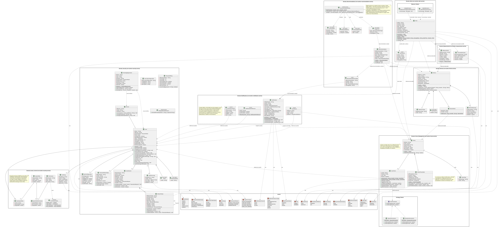

**Figura 4.** *Diagrama de clases del dominio, incluyendo los patrones Strategy, Observer y Factory Method.*

## 12.3 Servicios del backend por contexto

Cada subsección indica el repositorio del servicio; las rutas de archivo son relativas a `src/main/java/com/energymonitor/` de ese repositorio.

### 12.3.1 Servicio de seguridad (security)

**Función:** Identidad, registro con verificación de correo, aceptación de términos, autenticación, sesiones, control de acceso, administración de usuarios, auditoría y borrado de cuenta.

**Estado:** Activo · **Ubicación:** en-monitor-security-service (puerto 8082).

**Archivos relacionados:**

- security/adapter/in/web/AuthController.java (autenticación, perfil y cuenta), AdminController.java (`/api/v1/admin/users` y `/api/v1/admin/roles`) y SupportController.java (contactos de soporte)

- security/adapter/in/web/internal/InternalController.java (API interno: permisos, perfiles y administradores)

- security/application/usecase/ (RegisterUserService, EmailVerificationService, AuthenticateUserService, SignInWithGoogleService, RefreshSessionService, LogoutUserSessionService, ChangePasswordService, CreatePasswordResetTokenService, ResetPasswordService, UpdateUserProfileService, DeleteAccountService, CheckPermissionService, AssignRoleService, RevokeRoleService, ManageUserStatusService…)

- security/domain/model/ (User, Person, PendingRegistration, Email, PasswordHash, PasswordPolicy, UserSession, RefreshToken, SystemRole, Permission, PermissionCodes, AuditLog, LoginErrorLog) y domain/service/MistypedEmailDomains (dominios de correo mal escritos)

- security/infrastructure/ (SecurityFilterChainConfiguration, JwtTokenIssuer, PemRsaKeys, JwtAuthenticationEntryPoint) y security/adapter/out/security/ (BCryptPasswordHasherAdapter, Sha256TokenHasher, PepperedHmacResetCodeHasher, InMemoryResetAttemptLimiter)

- security/adapter/out/messaging/ (OutboxWriter, OutboxRelay, RabbitOutboxPublisher: eventos de cuenta y pedidos de correo) y el cliente del servicio de hogares para la comprobación de borrado

**Tablas relacionadas:** person, user, user_configuration, password_reset_token, user_session, refresh_token, security_configuration, password_policy, login_error_log, system_role, permission, user_system_role, system_role_permission, audit_log, security_outbox y pending_registration.

**Operaciones principales:**

- Registrar la solicitud en `pending_registration` (202) y crear la cuenta solo al verificar el código de 6 dígitos (vence entre 15 y 30 minutos; la solicitud vence a las 24 horas); rechazar dominios mal escritos o sin correo (400)

- Exigir la aceptación de los términos y condiciones (`acceptTerms`) en el registro, en el primer ingreso con Google y en el inicio de sesión de cuentas sin aceptación (428 sin ella)

- Iniciar sesión con correo y contraseña (403 si el correo no está verificado) o con Google (código en la web, ID token en la app) y renovar tokens; cerrar sesión

- Recuperar y cambiar contraseñas (las cuentas de Google no tienen cambio de contraseña: 409)

- Consultar y actualizar el perfil

- Consultar permisos (RBAC) y administrar usuarios: directorio, cambio de estado y asignación o revocación de roles globales (un administrador no puede cambiarse a sí mismo: 409)

- Publicar los contactos de soporte (administradores activos)

- Eliminar la cuenta con la contraseña o, en cuentas de Google, con un código enviado por correo (`SECURITY_ACCOUNT_DELETION_CODE_MAIL_ENABLED`); antes pregunta al servicio de hogares por `/internal/accounts/{id}/deletion-check`, luego cierra las sesiones, elimina lógicamente los datos, libera el correo y la cuenta de Google y publica `account.deleted`

- Pedir al servicio de notificaciones, por RabbitMQ, el envío de los correos con código (`mail.*`) y publicar `account.registered`, `account.administered` y `account.first-signed-in`

- Registrar auditoría e intentos fallidos

### 12.3.2 Servicio de hogares (home)

**Función:** Gestión de hogares, miembros, favoritos, umbrales de consumo, eliminación del hogar, transferencia de propiedad y anuncio de la actividad de los hogares.

**Estado:** Activo · **Ubicación:** en-monitor-home-service (puerto 8086).

**Archivos relacionados:**

- home/adapter/in/web/HomeController.java, HomeThresholdsController.java, HomeTypeController.java y CurrentUserResolver.java

- home/adapter/in/internal/ (HomeAccessController, HomeLimitsController, HomeSummaryController y AccountDeletionCheckController: API interno para los demás servicios)

- home/adapter/in/messaging/AccountDeletedConsumer.java (cola `home-service.home.account-deleted`) y home/adapter/out/messaging/ (HomeOutboxWriter, HomeOutboxRelay, RabbitHomeOutboxPublisher, HomeMessageTypes: publica `home.*`)

- home/application/usecase/ (CreateHomeService, JoinHomeService, LeaveHomeService, ListHomesService, ListMembersService, RemoveUserService, ToggleFavoriteService, DeleteHomeService, TransferHomeOwnershipService, HomeRemoval, RemoveDeletedAccountService, CheckAccountDeletionService, DescribeHomeAccessService, DescribeHomeLimitsService, DescribeHomeService, GetHomeThresholdsService, UpdateHomeThresholdsService, ListHomeTypesService, GetHomeTypeService)

- home/domain/model/ (Home, HomeType, HomeThresholds, UserHome, Role, UserPermissions, OwnerPermissions, MemberPermissions)

**Tablas relacionadas:** home, home_type, home_thresholds, user_home y home_outbox.

**Operaciones principales:**

- Crear un hogar y generar su código de acceso de 8 caracteres; unirse a un hogar con el código (no hay invitaciones por correo)

- Listar hogares (con rol y favorito) y miembros (con nombres que pide al servicio de seguridad)

- Marcar favorito, quitar miembros (solo OWNER) y salir del hogar (el último propietario no puede salir)

- Consultar, actualizar (solo OWNER, límite diario o mensual) y restablecer umbrales (6 kWh diarios y 180 kWh mensuales)

- Eliminar el hogar (solo OWNER): eliminación lógica de `home`, `user_home` y `home_thresholds` y, en la misma transacción, `home.deleted` en `home_outbox`; el servicio de dispositivos lo consume, desvincula los módulos, revoca sus claves y les envía el comando MQTT de desvinculación. Lo mismo ocurre al recibir `account.deleted` de la única dueña de un hogar sin otros miembros

- Transferir la propiedad a un miembro (solo OWNER; intercambio atómico de roles) y publicar `home.ownership-transferred`

- Publicar la actividad (`home.created`, `home.member-joined`, `home.member-left`, `home.member-removed`, `home.thresholds-updated`, `home.ownership-transferred` y `home.deleted`, con el nombre del hogar y sus miembros)

- Responder al API interno: acceso de un usuario a un hogar, límites, resumen (nombre y miembros) y si una cuenta se puede borrar (409 si es la única dueña de un hogar con otros miembros)

### 12.3.3 Servicio de mediciones (measurement)

**Función:** Ingesta y análisis de mediciones de consumo eléctrico.

**Estado:** Activo · **Ubicación:** en-monitor-measurement-service (puerto 8085).

**Archivos relacionados:**

- measurement/adapter/in/web/MeasurementController.java, ConsumptionLevelController.java, HomeConsumptionController.java

- measurement/adapter/in/internal/InternalMeasurementController.java (API interno: niveles, energía por hora y dispositivos con lecturas)

- measurement/adapter/in/mqtt/ (TelemetryMqttConsumer, MqttTopics, MqttIngestionConfiguration; la suscripción se activa con `MEASUREMENT_MQTT_ENABLED`)

- measurement/adapter/in/messaging/DeviceLinksConsumer.java (consume `device.linked` y `device.unlinked` para limpiar su caché)

- measurement/application/usecase/ (RegisterMeasurementService, ListMeasurementsService, GetLatestMeasurementService, GetConsumptionStatisticsService, HomeConsumptionUseCase, HourlyEnergyCalculator, ListConsumptionLevelsService, TimeRange)

- measurement/adapter/out/messaging/ (MeasurementOutboxWriter, MeasurementOutboxRelay, RabbitMeasurementOutboxPublisher, MeasurementOutboxPurge: publican `measurement.recorded`) y los clientes de los servicios de hogares y dispositivos

**Tablas relacionadas:** measurement, consumption_level y measurement_outbox (el estado de conexión se registra en device_status_log, del servicio de dispositivos).

**Operaciones principales:**

- Registrar las lecturas que llegan por MQTT (voltaje, corriente, potencia activa, energía acumulada) con la hora del dispositivo; es el único suscriptor que las guarda

- Consultar histórico por dispositivo y rango de fechas y la última medición (solo miembros del hogar al que está vinculado)

- Calcular estadísticas, el resumen y el historial de consumo del hogar (día, semana, mes o año)

- Publicar cada lectura como `measurement.recorded` en RabbitMQ

- Responder al API interno: niveles de consumo, energía por hora y dispositivos con lecturas

### 12.3.4 Servicio de alertas (alert)

**Función:** Generación y bandeja de alertas de consumo, de límite, de dispositivo vinculado y de conectividad.

**Estado:** Activo · **Ubicación:** en-monitor-alert-service (puerto 8088).

**Regla de consumo inusual (`RegisterAnomalyAlertService`):** cada lectura es una anomalía cuando su potencia es de al menos 200 W (`MIN_POWER`) y de al menos 2,5 veces (`FACTOR`) la potencia habitual del aparato. La potencia habitual es el promedio de su potencia media por hora en los 7 días previos, excluida la última hora, y solo cuenta con al menos 24 horas de historial (`MIN_HOURS`) y un promedio de al menos 5 W (`MIN_BASELINE`); un aparato nuevo o casi apagado no genera la alerta. La línea base se pide al servicio de mediciones (`DeviceBaselineAdapter`). La alerta es de tipo `THRESHOLD` con `messageKey = alert.anomaly.device`, se resuelve sola cuando el consumo se normaliza y se anuncia por correo y push como cualquier alerta. Los umbrales son constantes del código (DT-27).

**Archivos relacionados:**

- alert/adapter/in/web/AlertController.java (consulta, lectura y eliminación)

- alert/adapter/in/messaging/MeasurementRecordedConsumer.java (cola `alert-service.measurement.recorded`) y DeviceEventsConsumer.java (cola `alert-service.device.events`)

- alert/application/usecase/ (ListAlertsService, GetAlertService, ResolveAlertService, DeleteAlertsService, RegisterThresholdAlertService, RegisterLimitAlertService, RegisterConnectivityAlertService, RegisterDeviceLinkedAlertService, ResolveConnectivityAlertsService, AlertAccessService)

- alert/adapter/out/ (home, device y measurement: clientes del API interno; messaging: AlertOutboxWriter, AlertOutboxRelay, RabbitAlertOutboxPublisher)

**Tablas relacionadas:** alert y alert_outbox.

**Operaciones principales:**

- Generar una alerta THRESHOLD de nivel HIGH o CRITICAL cuando una lectura supera el umbral de potencia (una sola mientras siga activa) y resolverla con una lectura baja

- Generar alertas LIMIT al alcanzar el límite diario o mensual del hogar (zona `ALERT_LIMIT_ZONE`) y DEVICE con la primera lectura de un dispositivo recién vinculado

- Generar y resolver alertas CONNECTIVITY (dispositivo sin conexión y su reconexión)

- Listar alertas por hogar y estado, consultar una, marcarla como leída y eliminar las resueltas

- Anunciar cada alerta nueva como `alert.raised` (outbox)

### 12.3.5 Servicio de notificaciones (notification)

**Función:** Entrega de alertas, recomendaciones y actividad por correo, Web Push y push móvil; correos con código; preferencias; avisos in-app a los administradores; registro de entregas.

**Estado:** Activo · **Ubicación:** en-monitor-notification-service (puerto 8087).

**Archivos relacionados:**

- notification/adapter/in/web/NotificationChannelsController.java, ActivityNotificationsController.java (`/api/v1/notifications/activity`) y AdminNotificationsController.java (`/api/v1/admin/notifications`)

- notification/adapter/in/messaging/ (AccountEventsConsumer, MailRequestsConsumer, HomeMessagesConsumer y ActivityEventsConsumer)

- notification/application/usecase/ (NotifyAlert, AlertMessages, NotifyActivity, ActivityInbox, ActivityMessages, AdminNotifications, ManageNotificationChannels, MemberChannels, SendEmailVerification, SendPasswordResetEmail, SendAccountDeletionCode)

- notification/infrastructure/mail/ (EmailSender, MailDeliveryConfiguration, AbandonedDeliverySweeper) y notification/adapter/out/push/ (WebPushSender y ExpoPushSender)

- notification/adapter/out/ (security, home y device: clientes del API interno) y persistence

**Tablas relacionadas:** notification, notification_preference, push_subscription y push_device.

**Operaciones principales:**

- Enviar los correos de verificación, recuperación y borrado de cuenta que solicita el servicio de seguridad (es el único servicio que envía correo)

- Entregar cada alerta y recomendación a los miembros del hogar por correo, Web Push y push móvil (Expo) según sus preferencias

- Registrar y entregar las notificaciones de actividad (bienvenida, hogares y dispositivos) en la bandeja de la web y la app, con la clave del texto y los nombres del momento (`message_params`), y por los canales elegidos

- Registrar avisos in-app para los administradores cuando se registra una cuenta o otro administrador cambia el estado o los roles de una cuenta

- Registrar el estado de entrega (PENDING, SENT, FAILED) y barrer las entregas abandonadas

- Gestionar las preferencias, las suscripciones push del navegador y los dispositivos de la app móvil; limpiar los datos de las cuentas borradas

### 12.3.6 Servicio de dispositivos (device)

**Función:** Registro y vinculación de dispositivos, credenciales (API key), estado de conexión, comandos y autorización del broker MQTT.

**Estado:** Activo · **Ubicación:** en-monitor-device-service (puerto 8084).

**Archivos relacionados:**

- device/adapter/in/web/HomeDeviceController.java, ApplianceTypeController.java y BrokerAuthController.java

- device/adapter/in/internal/InternalDeviceController.java (API interno para los servicios de mediciones, alertas, recomendaciones y notificaciones)

- device/application/usecase/ (HomeDeviceService, BrokerAccessService, DeviceConnectivityService, DeviceReportService, DeviceQueryService)

- device/domain/model/ (Device, DeviceHome, DeviceStatusLog, ApplianceType, ApiKeyHash)

- device/adapter/in/mqtt/ConnectivityMqttConsumer.java, device/adapter/in/messaging/HomeDeletedConsumer.java (cola `device-service.device.home-deleted`), device/adapter/in/event/DeviceCommandListener.java y device/adapter/in/scheduler/DeviceInactivityScheduler.java

- device/adapter/out/ (mqtt/MqttDeviceCommandAdapter, messaging/ con DeviceOutboxRelay y RabbitDeviceOutboxPublisher, home/ para consultar el acceso al servicio de hogares, persistencia y generadores de credenciales)

**Tablas relacionadas:** device, appliance_type, device_status_log, device_home y device_outbox.

**Operaciones principales:**

- Vincular un dispositivo a un hogar (solo OWNER), editarlo, emitir nuevas credenciales para cambiar su Wi-Fi y desvincularlo (el permiso de miembro u OWNER se pregunta al servicio de hogares)

- Autenticar al dispositivo y autorizar sus tópicos para Mosquitto (solo el hash SHA-256 de la clave se almacena)

- Registrar la conectividad a partir de la telemetría y del estado retenido, y marcar el dispositivo sin conexión tras 150 segundos de silencio (`DeviceInactivityScheduler`)

- Publicar `device.linked`, `device.unlinked`, `device.connectivity-lost` y `device.connectivity-restored` en RabbitMQ

- Enviar el comando MQTT de desvinculación al desvincular el dispositivo o al recibir `home.deleted`

### 12.3.7 Servicio de recomendaciones (recommendation)

**Función:** Recomendaciones de ahorro generadas a partir del consumo medido.

**Estado:** Activo · **Ubicación:** en-monitor-recommendation-service (puerto 8089).

**Archivos relacionados:**

- recommendation/adapter/in/web/RecommendationController.java

- recommendation/adapter/in/scheduler/RecommendationScheduler.java (cada hora; primera evaluación tras `RECOMMENDATION_INITIAL_DELAY`)

- recommendation/application/usecase/ (EvaluateRecommendationsService, RecommendationInboxService)

- recommendation/domain/service/RecommendationRules.java (reglas puras, sin E/S) y domain/model (Recommendation, Suggestion, HourSample, MonitoredDevice, ConsumptionLimit)

- recommendation/adapter/out/ (home, device y measurement: clientes del API interno; messaging: outbox de `recommendation.created`)

**Tablas relacionadas:** recommendation y recommendation_outbox.

**Operaciones principales:**

- Evaluar cada hora, para los hogares con lecturas en la última semana, cinco reglas: PEAK_HOURS (al menos 40 % de la energía de 7 días entre 18:00 y 22:00 hora local, mínimo 2 kWh), SAVING (un equipo que no es de uso continuo consume 15 W o más entre 01:00 y 05:00 tres noches seguidas), HISTORICAL_COMPARISON (25 % más que la semana anterior), THRESHOLD (el ritmo actual supera el límite del hogar) y HIGH_CONSUMPTION (potencia media de un equipo 30 % mayor que en los 21 días anteriores); el mismo consejo no se repite en 7 días

- Listar las recomendaciones de un hogar, marcarlas como leídas y eliminar las leídas

- Anunciar cada recomendación nueva como `recommendation.created` (outbox)

## 12.4 Módulo front-end web

**Función:** landing page pública e interfaz de consulta, gestión y administración del consumo eléctrico (SPA React)

**Archivos relacionados:**

- src/routes/AppRoutes.jsx (rutas), ProtectedRoute.jsx (sesión), GuestRoute.jsx (login y registro solo sin sesión), RequirePermission.jsx (permiso global), UserOnlyRoute.jsx (lleva al ADMIN a la administración) y HomeRoute.jsx (detalle del hogar)

- src/services/http/httpClient.js (cliente axios hacia el gateway, interceptores, sesión en cookies HttpOnly con `X-Session-Transport: cookie` y renovación de token)

- src/services/auth (incluido usePermissions), admin, home, devices, alerts, recommendations y notifications (endpoints consumidos)

- src/context/HomeContext.jsx, ThemeContext.jsx y NotificationCenterContext.jsx (estado global)

- src/features/ (landingPage, auth, dashboard, DetailHome, Favorites, Notifications, Account, SettingsPage, Admin)

**Pantallas y rutas:**

| **Ruta**                                                  | **Pantalla**                | **Función**                                                                                |
|-----------------------------------------------------------|-----------------------------|--------------------------------------------------------------------------------------------|
| /home, /about, /support                                   | Landing page                | Páginas públicas de presentación, acerca de y soporte (preguntas frecuentes y contacto con los administradores activos), con pie de página. |
| /login, /register                                         | Login y Registro            | Autenticación (incluido Google) y creación de cuenta con validación zod y aceptación de los términos y la política de privacidad (ventana legal). |
| /VerifyAccount, /recover-password, /verifyRecoverPassword | Verificación y recuperación | Código de verificación de correo y recuperación de contraseña.                             |
| /dashboard                                                | Panel de hogares            | Tarjetas de hogares, crear hogar, unirse con código y favoritos (no visible para ADMIN).   |
| /homes/:homeId                                            | Detalle del hogar           | Seis pestañas: Consumo, Historial, Usuarios (quitar y transferir propiedad), Dispositivos (vincular por Bluetooth, editar, cambiar Wi-Fi, eliminar), Umbrales y Hogar (código, salir o eliminar hogar). |
| /favorites                                                | Favoritos                   | Listado de hogares marcados como favoritos (no visible para ADMIN).                        |
| /notifications                                            | Notificaciones              | Usuario: pestañas Todas, Alertas, Recomendaciones y Actividad con filtro por hogar o cuenta; leer y eliminar. ADMIN: avisos de administración. |
| /settings                                                 | Configuración               | Idioma, tema, notificaciones (correo y push; no para ADMIN) y centro de ayuda.             |
| /account                                                  | Cuenta                      | Edición de perfil, foto, contraseña (no en cuentas de Google) y eliminación de cuenta (con contraseña o código). |
| /admin/users                                              | Administración (solo ADMIN) | Directorio de usuarios con búsqueda y paginación, cambio de estado y rol de administrador (requiere USER.READ; acciones según USER.MANAGE y ROLE.MANAGE). |

**Operaciones principales:** iniciar y cerrar sesión, registrar y verificar cuenta, aceptar términos, recuperar contraseña, crear y unirse a hogares, marcar favoritos, consultar y gestionar miembros y umbrales, vincular y gestionar dispositivos, visualizar consumo e historial, visualizar alertas, recomendaciones y actividad, activar notificaciones push, eliminar el hogar o transferir su propiedad, cambiar idioma y tema, y administrar cuentas (ADMIN).

## 12.5 Módulo front-end móvil

**Función:** aplicación Android «EnergyMonitor» conectada a la API REST

**Archivos relacionados:**

- src/app/ (rutas Expo Router: \_layout, index, register, verify-account, recover-password, verify-recover-password, new-password, dashboard, homes, home/\[id\], favorites, notifications, settings, account)

- src/services/ (http, auth con sesión en expo-secure-store, home, devices con ble/, measurement, alerts, recommendations, notifications con pushRegistration)

- src/features/ (auth con LegalModal, dashboard, homes, favorites, notifications, settings, account)

- src/context/ (HomeContext, UserContext, ThemeContext, NotificationCenterContext)

- src/components/ y src/constants/ (design system propio con StyleSheet; menú lateral y barra inferior)

**Operaciones principales:** registro con los términos y la política de privacidad en una ventana (mismos textos que la web) y reglas de contraseña visibles como ayuda permanente, verificación de código, recuperación de contraseña, inicio con Google, panel de hogares, detalle del hogar con seis pestañas (incluidas la transferencia de propiedad y la eliminación del hogar), vinculación del módulo por Bluetooth nativo, favoritos, notificaciones (alertas, recomendaciones y actividad, con filtro por hogar) y push, configuración de idioma (es, en, fr, pt), tema (cuatro) y notificaciones, y gestión de cuenta.

**Cambios de octubre de 2026:** tokens de sesión en el almacén seguro del dispositivo (Keystore/Keychain, con `AFTER_FIRST_UNLOCK_THIS_DEVICE_ONLY`); copias de seguridad de Android desactivadas; accesibilidad (etiquetas para lector de pantalla, roles y estados en los controles, títulos marcados como encabezados, áreas táctiles más grandes, códigos OTP etiquetados y que aceptan pegado); iconos en lugar de emojis; título de página en Configuración y Mi cuenta; nombre de la app «EnergyMonitor».

> **Limitaciones vigentes:** la app no tiene landing page ni pantallas de administración (la administración solo se hace en la web), no tiene pruebas automatizadas y no está disponible para iPhone.

# 13. API o rutas del sistema

**URL base:** https://energy-monitor.tech/api/v1 en producción y http://localhost:8080/api/v1 en desarrollo (API gateway) \| **Formato:** JSON \| **Documentación interactiva:** /swagger-ui.html y /v3/api-docs de cada servicio

Todas las rutas de negocio están bajo `/api/v1` y pasan por el gateway, que las reenvía al servicio dueño según la tabla «Rutas del API gateway» de la sección 9.3. La migración no cambió las rutas que ya usaban los clientes. A ellas se suman dos rutas internas para el broker y las rutas de infraestructura. Todas las que no aparecen como públicas requieren un JWT válido (cabecera Authorization o cookie `em_access` de la web); si el token falta, expiró o es inválido, el gateway responde 401 sin reenviar la petición, y si el usuario no tiene el permiso requerido, el servicio responde 403.

| **Método** | **Ruta**                                              | **Descripción**                                                       | **Parámetros**                                                         | **Autenticación** |
|------------|-------------------------------------------------------|-----------------------------------------------------------------------|------------------------------------------------------------------------|-------------------|
| POST       | /api/v1/auth/register                                 | Guarda la solicitud de registro y envía el código (202; 409 si el correo ya tiene cuenta; 428 sin aceptar los términos). | body: email, password, name, lastName (opcional), profileImage (opcional), acceptTerms | Pública |
| POST       | /api/v1/auth/email/verify                             | Verifica el correo con el código de 6 dígitos y crea la cuenta.       | body: email, code                                                      | Pública           |
| POST       | /api/v1/auth/email/verification/resend                | Reenvía el código de verificación (siempre responde 202).             | body: email                                                            | Pública           |
| POST       | /api/v1/auth/login                                    | Autentica y devuelve access token y refresh token (403 sin verificar el correo; 428 sin términos aceptados). | body: email, password, acceptTerms (opcional)            | Pública           |
| POST       | /api/v1/auth/google                                   | Inicia sesión o registra la cuenta con Google (428 si la cuenta nueva no acepta los términos; 503 si no está configurado). | body: code (web) o idToken (app), acceptTerms | Pública |
| POST       | /api/v1/auth/refresh                                  | Renueva el access token y rota el refresh token.                      | body: refreshToken (móvil) o cookie em_refresh (web)                   | Pública           |
| POST       | /api/v1/auth/logout                                   | Cierra la sesión registrada.                                          | body: idUserSession                                                    | JWT               |
| POST       | /api/v1/auth/password/forgot                          | Solicita el código de recuperación de contraseña (202; 404 si el correo no tiene cuenta). | body: email                                        | Pública           |
| POST       | /api/v1/auth/password/reset                           | Restablece la contraseña con el código recibido.                      | body: email, resetToken, newPassword                                   | Pública           |
| POST       | /api/v1/auth/password/change                          | Cambia la contraseña conociendo la actual (409 en cuentas de Google). | body: currentPassword, newPassword                                     | JWT               |
| PUT        | /api/v1/auth/profile                                  | Actualiza nombre, apellido, imagen o correo.                          | body: name, lastName, profileImage, newEmail                           | JWT               |
| POST       | /api/v1/auth/account/delete/code                      | Envía el código de borrado a una cuenta de Google (202; 409 si la cuenta tiene contraseña; 503 si el correo del código está desactivado). | ninguno | JWT |
| POST       | /api/v1/auth/account/delete                           | Elimina la cuenta tras confirmar la contraseña o el código (409 si es la única dueña de un hogar con miembros). | body: password o code                  | JWT               |
| GET        | /api/v1/auth/account                                  | Devuelve la cuenta autenticada (incluye `googleAccount`).             | ninguno (identidad del JWT)                                            | JWT               |
| GET        | /api/v1/auth/permissions                              | Lista los códigos de permiso del usuario.                             | ninguno                                                                | JWT               |
| GET        | /api/v1/admin/users                                   | Directorio de usuarios (requiere USER.READ).                          | query: q, page, size (1 a 50; 20 por defecto)                          | JWT               |
| GET        | /api/v1/admin/roles                                   | Lista los roles globales asignables (requiere USER.READ).             | ninguno                                                                | JWT               |
| PUT        | /api/v1/admin/users/{idUser}/status                   | Cambia el estado de otra cuenta (requiere USER.MANAGE; 409 sobre la propia). | path: idUser; body: status (ACTIVE, INACTIVE o BLOCKED)         | JWT               |
| PUT        | /api/v1/admin/users/{idUser}/roles/{roleName}         | Otorga un rol global (requiere ROLE.MANAGE).                          | path: idUser, roleName                                                 | JWT               |
| DELETE     | /api/v1/admin/users/{idUser}/roles/{roleName}         | Revoca un rol global (requiere ROLE.MANAGE).                          | path: idUser, roleName                                                 | JWT               |
| GET        | /api/v1/support/contacts                              | Nombre y correo de cada administrador activo, para la página de soporte. | ninguno                                                             | Pública           |
| GET        | /api/v1/measurements                                  | Lista las mediciones de un dispositivo en un rango.                   | query: deviceId (obligatorio), from, to                                | JWT               |
| GET        | /api/v1/measurements/latest                           | Devuelve la última medición de un dispositivo.                        | query: deviceId                                                        | JWT               |
| GET        | /api/v1/measurements/statistics                       | Estadísticas de consumo del periodo.                                  | query: deviceId, from, to                                              | JWT               |
| GET        | /api/v1/consumption-levels                            | Lista los niveles de consumo (LOW, MEDIUM, HIGH, CRITICAL).           | ninguno                                                                | JWT               |
| GET        | /api/v1/homes/{homeId}/consumption/summary           | Resumen de consumo del hogar.                                         | path: homeId; query: zone (UTC por defecto)                            | JWT               |
| GET        | /api/v1/homes/{homeId}/consumption/history           | Historial de consumo del hogar por periodo.                           | path: homeId; query: period (day, week, month o year), zone            | JWT               |
| POST       | /api/v1/homes                                         | Crea un hogar y devuelve su código de acceso.                         | body: name, homeTypeId, address, description                           | JWT               |
| GET        | /api/v1/homes                                         | Lista los hogares del usuario con su rol y si es favorito.            | ninguno                                                                | JWT               |
| GET        | /api/v1/homes/{homeId}/members                        | Lista los miembros de un hogar con nombres y roles.                   | path: homeId                                                           | JWT               |
| POST       | /api/v1/homes/join                                    | Permite unirse a un hogar con su código de acceso.                    | body: accessCode                                                       | JWT               |
| PUT        | /api/v1/homes/{homeId}/favorite                       | Marca o desmarca un hogar como favorito.                              | path: homeId                                                           | JWT               |
| DELETE     | /api/v1/homes/{homeId}/members/{userId}               | Quita a un miembro (solo OWNER).                                      | path: homeId, userId                                                   | JWT               |
| DELETE     | /api/v1/homes/{homeId}/members/me                     | Permite al usuario salir del hogar (no al último propietario).        | path: homeId                                                           | JWT               |
| DELETE     | /api/v1/homes/{homeId}                                | Elimina el hogar (solo OWNER): 204; 403 si es MEMBER; 404 si no pertenece. | path: homeId                                                      | JWT               |
| PUT        | /api/v1/homes/{homeId}/owner                          | Transfiere la propiedad a un miembro: 204; 403, 404 y 409 según el caso. | path: homeId; body: newOwnerId                                     | JWT               |
| GET        | /api/v1/homes/{homeId}/thresholds                     | Consulta los umbrales del hogar.                                      | path: homeId                                                           | JWT               |
| PUT        | /api/v1/homes/{homeId}/thresholds                     | Actualiza el límite del hogar (solo OWNER).                           | path: homeId; body: limitPeriod (DAILY o MONTHLY), limit               | JWT               |
| POST       | /api/v1/homes/{homeId}/thresholds/defaults            | Restablece los umbrales a los valores del sistema (6 kWh diarios y 180 kWh mensuales). | path: homeId                                          | JWT               |
| GET        | /api/v1/home-types                                    | Lista los tipos de hogar disponibles.                                 | ninguno                                                                | JWT               |
| GET        | /api/v1/home-types/{idHomeType}                       | Consulta un tipo de hogar.                                            | path: idHomeType                                                       | JWT               |
| GET        | /api/v1/appliance-types                               | Lista el catálogo de electrodomésticos.                               | ninguno                                                                | JWT               |
| GET        | /api/v1/homes/{homeId}/devices                        | Lista los dispositivos del hogar.                                     | path: homeId                                                           | JWT               |
| POST       | /api/v1/homes/{homeId}/devices                        | Vincula un dispositivo y devuelve sus credenciales y la dirección del broker (solo OWNER). | body: deviceCode, name, applianceTypeId, location          | JWT               |
| PUT        | /api/v1/homes/{homeId}/devices/{deviceId}             | Edita electrodoméstico, nombre y ubicación (solo OWNER).              | path: homeId, deviceId; body: name, applianceTypeId, location          | JWT               |
| POST       | /api/v1/homes/{homeId}/devices/{deviceId}/credentials | Emite una clave nueva para cambiar la red Wi-Fi (invalida la anterior). | path: homeId, deviceId                                               | JWT               |
| DELETE     | /api/v1/homes/{homeId}/devices/{deviceId}             | Desvincula el dispositivo (solo OWNER).                               | path: homeId, deviceId                                                 | JWT               |
| GET        | /api/v1/alerts                                        | Lista las alertas de un hogar.                                        | query: homeId (obligatorio), status (PENDING \| RESOLVED)              | JWT               |
| GET        | /api/v1/alerts/{idAlert}                              | Consulta una alerta.                                                  | path: idAlert                                                          | JWT               |
| PUT        | /api/v1/alerts/{idAlert}/read                         | Marca una alerta como leída (409 en alertas del sistema que se resuelven solas). | path: idAlert                                               | JWT               |
| DELETE     | /api/v1/alerts/{idAlert}                              | Elimina una alerta resuelta.                                          | path: idAlert                                                          | JWT               |
| DELETE     | /api/v1/alerts                                        | Elimina todas las alertas resueltas de un hogar.                      | query: homeId                                                          | JWT               |
| GET        | /api/v1/recommendations                               | Lista las recomendaciones de un hogar.                                | query: homeId                                                          | JWT               |
| PUT        | /api/v1/recommendations/{idRecommendation}/read       | Marca una recomendación como leída.                                   | path: idRecommendation                                                 | JWT               |
| DELETE     | /api/v1/recommendations/{idRecommendation}            | Elimina una recomendación leída (409 si no está leída).               | path: idRecommendation                                                 | JWT               |
| DELETE     | /api/v1/recommendations                               | Elimina todas las recomendaciones leídas de un hogar.                 | query: homeId                                                          | JWT               |
| GET        | /api/v1/notifications/activity                        | Notificaciones de actividad del usuario (cuenta, hogares y dispositivos). | query: homeId (opcional)                                           | JWT               |
| PUT        | /api/v1/notifications/activity/{id}/read              | Marca una notificación de actividad como leída.                       | path: id                                                               | JWT               |
| PUT        | /api/v1/notifications/activity/read                   | Marca como leídas todas las de actividad (o las de un hogar).         | query: homeId (opcional)                                               | JWT               |
| DELETE     | /api/v1/notifications/activity/{id}                   | Elimina una notificación de actividad.                                | path: id                                                               | JWT               |
| GET        | /api/v1/notifications/preferences                     | Consulta las preferencias de notificación del usuario.                | ninguno                                                                | JWT               |
| PUT        | /api/v1/notifications/preferences                     | Actualiza las preferencias de correo y push.                          | body: emailEnabled, pushEnabled                                        | JWT               |
| GET        | /api/v1/notifications/push/public-key                 | Devuelve la clave pública VAPID (vacía si el push está desactivado).  | ninguno                                                                | JWT               |
| POST       | /api/v1/notifications/push/subscriptions              | Registra una suscripción push del navegador.                          | body: endpoint, keys (p256dh, auth)                                    | JWT               |
| POST       | /api/v1/notifications/push/subscriptions/remove       | Elimina una suscripción push.                                         | body: endpoint                                                         | JWT               |
| POST       | /api/v1/notifications/push/devices                    | Registra la instalación de la app móvil para push (Expo).             | body: token, platform (ANDROID o IOS)                                  | JWT               |
| POST       | /api/v1/notifications/push/devices/remove             | Elimina el registro push de una instalación de la app.                | body: token                                                            | JWT               |
| GET        | /api/v1/notifications/push/devices/available          | Indica si el push de la app está configurado (404 si no lo está).     | ninguno                                                                | JWT               |
| GET        | /api/v1/admin/notifications                           | Avisos in-app del administrador (requiere USER.READ).                 | ninguno                                                                | JWT               |
| PUT        | /api/v1/admin/notifications/{id}/read                 | Marca un aviso de administrador como leído.                           | path: id                                                               | JWT               |
| DELETE     | /api/v1/admin/notifications/{id}                      | Elimina un aviso de administrador.                                    | path: id                                                               | JWT               |
| POST       | /internal/mqtt/auth/user                              | Interna (servicio de dispositivos): Mosquitto autentica a un cliente MQTT (caché de cinco minutos). El gateway la rechaza. | body: username, password, clientid | Red interna |
| POST       | /internal/mqtt/auth/acl                               | Interna (servicio de dispositivos): Mosquitto autoriza el tópico de un cliente. El gateway la rechaza. | body: username, clientid, topic, acc | Red interna       |
| GET        | /actuator/health                                      | Estado de cada servicio (UP / DOWN).                                  | ninguno                                                                | Pública           |
| GET        | /swagger-ui.html y /v3/api-docs                       | Documentación interactiva de la API de cada servicio (OpenAPI).       | ninguno                                                                | Pública           |
| OPTIONS    | /\*\*                                                 | Preflight de CORS (lo responde el gateway).                           | cabeceras Origin y Access-Control-Request-\*                           | Pública           |

> *Las rutas `/internal/mqtt/**` solo aceptan llamadas desde las redes de `MQTT_AUTH_ALLOWED_NETWORKS`; las demás rutas `/internal/**` (sección 9.3) exigen además la cabecera `X-Internal-Token`. El gateway nunca las reenvía (401 sin token, 403 con token) y el nginx de la web solo reenvía `/api/`.*

## 13.1 Códigos de respuesta habituales

| **Código**      | **Cuándo se produce**                                                         | **Estructura de la respuesta**                                 |
|-----------------|-------------------------------------------------------------------------------|----------------------------------------------------------------|
| 200 / 201 / 202 / 204 | Operación exitosa (consulta, creación, solicitud aceptada o eliminación sin contenido). | Cuerpo con el recurso o mensaje correspondiente.     |
| 400             | Validación de datos incorrecta (Bean Validation o esquema zod en el cliente), dominio de correo mal escrito o inexistente, código vencido. | ApiError con fieldErrors detalle de cada campo. |
| 401             | Token ausente, expirado o credenciales inválidas (el gateway lo responde antes de reenviar). | ApiError con mensaje genérico (no revela si el correo existe). |
| 403             | Cuenta bloqueada o inactiva, correo sin verificar al iniciar sesión, o permiso insuficiente (p. ej. un MEMBER intenta eliminar el hogar). | ApiError. |
| 404             | Recurso inexistente (hogar, alerta, miembro…), hogar al que no se pertenece o ruta que ningún servicio atiende (gateway). | ApiError o {"error": "..."} según el servicio.  |
| 409             | Conflicto (correo ya registrado, último propietario que no puede salir, transferencia al propietario actual, administrador que intenta cambiarse a sí mismo, cuenta única dueña de un hogar con miembros). | ApiError. |
| 422             | La contraseña no cumple la política de seguridad.                             | ApiError.                                                      |
| 428             | Faltan los términos y condiciones aceptados (registro, Google o inicio de sesión). | ApiError.                                                 |
| 429             | Límite de intentos alcanzado en verificación, recuperación o borrado con código (servicio de seguridad) o más de 20 POST públicos de cuenta por IP y ruta en un minuto (gateway). | ApiError con cabecera Retry-After. |
| 503             | Un servicio no acepta la conexión (gateway), un servicio interno del que depende la operación no responde, o inicio de sesión con Google sin credenciales configuradas. | ApiError. |
| 504             | Un servicio tarda más de 30 segundos en responder (gateway).                  | ApiError.                                                      |
| 500             | Error interno no controlado.                                                  | ApiError sin traza de pila (nunca se filtra stack trace).      |

## 13.2 Ejemplo de petición y respuesta

```
POST /api/v1/auth/login
Content-Type: application/json

{ "email": "usuario@correo.com", "password": "********" }

200 OK

{
  "accessToken": "eyJhbGciOiJSUzI1NiIsImV4cCI6MTc2…",
  "refreshToken": "7f3c…",
  "tokenType": "Bearer",
  "expiresIn": 900,
  "account": { "idUser": "user000001", "email": "usuario@correo.com", "status": "ACTIVE" }
}
```

Es la respuesta que recibe la app móvil, que guarda los tokens en el almacén seguro del dispositivo. Con la cabecera `X-Session-Transport: cookie` (la que envía la web) el servicio de seguridad entrega los tokens en las cookies HttpOnly `em_access` y `em_refresh`, y `accessToken` y `refreshToken` llegan en `null`.

# 14. Seguridad

## 14.1 Controles implementados

| **Control**                   | **Implementación técnica**                                                                                                                                                                              |
|-------------------------------|---------------------------------------------------------------------------------------------------------------------------------------------------------------------------------------------------------|
| Autenticación                 | JWT firmado con algoritmo RS256 por el servicio de seguridad, el único que tiene la clave privada (PEM); el gateway y los demás servicios lo validan con la clave pública (firma, emisor y expiración), de modo que un servicio alcanzado sin pasar por el gateway tampoco queda abierto. Vida útil del access token: 15 minutos; sin roles dentro del JWT; claims sub (idUser), person_id y email. |
| Identidad                     | Todos los servicios obtienen el usuario del claim `sub` mediante `CurrentUserResolver`; la cabecera X-User-Id se ignora.                                                                                |
| Verificación y términos       | Ninguna cuenta existe hasta verificar el correo (`pending_registration`, 24 horas); el inicio de sesión exige el correo verificado (403) y los términos aceptados (`user.terms_accepted_at`, 428). |
| Sesiones                      | Sin sesión HTTP en el servidor (STATELESS). La app móvil recibe los tokens en el cuerpo y los guarda en el almacén seguro del sistema (expo-secure-store: Keystore/Keychain), con las copias de seguridad de Android desactivadas; la web, en cookies HttpOnly y SameSite=Strict (Secure en producción): `em_access` (Path=/api) y `em_refresh` (Path=/api/v1/auth). El gateway solo usa la cookie si la petición trae `X-Requested-With: XMLHttpRequest`, cabecera que un formulario o una imagen de otro sitio no pueden enviar (protección CSRF). |
| Renovación de sesión          | Refresh token opaco con estado, rotado en cada uso, almacenado como hash SHA-256 con family_id y parent_id para detectar reutilización (replay) y revocado al cambiar la contraseña o al bloquear la cuenta. |
| Cifrado de contraseñas        | BCrypt (BCryptPasswordHasherAdapter) aislado del dominio; nunca se almacenan contraseñas en claro.                                                                                                      |
| Política de contraseñas       | Tabla password_policy: longitud mínima 8 y máxima 64, exige mayúsculas, números y símbolos, expira a los 90 días. Incumplimiento =\> 422. Los clientes muestran las reglas como ayuda permanente.      |
| Autorización global (RBAC)    | Cadena de cinco tablas (system_role, permission, user_system_role, system_role_permission y user) consultada en vivo en el servicio de seguridad; permisos consultables en GET /api/v1/auth/permissions. El servicio de notificaciones pide el permiso USER.READ por el API interno. Un administrador no puede cambiar su propio estado ni sus roles (409). El gateway no decide permisos. |
| Autorización por hogar        | Roles OWNER y MEMBER por hogar resueltos con el patrón Strategy (`OwnerPermissions`, `MemberPermissions`) en el servicio de hogares; los demás servicios le preguntan por `/internal/homes/{homeId}/access` sin caché, de modo que un miembro quitado pierde el acceso de inmediato. |
| Validación de entrada         | Bean Validation en los DTOs de los servicios (@NotBlank, @Size, @NotNull, @Positive, @Pattern), validación del dominio del correo y esquemas zod en los formularios de los front-ends.                  |
| CORS                          | Solo en el gateway, que elimina la cabecera Origin antes de reenviar. Cerrado por defecto: lista explícita de orígenes (SECURITY_CORS_ALLOWED_ORIGINS del gateway), sin comodines y con manejo del preflight OPTIONS; métodos GET, POST, PUT, DELETE y OPTIONS. |
| Límite de intentos            | Limitadores en memoria: en el gateway, 20 POST por IP y ruta por minuto en los endpoints públicos de cuenta =\> 429 con Retry-After; en el servicio de seguridad, 10 intentos por IP cada 15 minutos en la recuperación de contraseña, cinco intentos por correo y ventana en la verificación y cinco intentos en 15 minutos en el borrado con código. |
| Protección contra enumeración | Login fallido con mensaje genérico; la comprobación de correo no verificado se hace después de la contraseña. Por decisión documentada, password/forgot responde 404 si el correo no tiene cuenta (como el registro responde 409 si ya existe), y el límite por IP se cobra antes de la búsqueda. |
| Códigos de un solo uso        | Recuperación: 6 dígitos, 15 minutos, uso único, guardados como HMAC-SHA256 con pepper (SECURITY_RESET_PEPPER). Verificación y borrado de cuenta de Google: derivados (HMAC con el mismo pepper sobre la cuenta, el correo y la ventana de 15 minutos), no se guardan. |
| Credenciales de dispositivo   | Cada dispositivo usa `device_code` y `api_key`; el servicio de dispositivos solo guarda el hash SHA-256 de la clave (`api_key_hash`). Mosquitto autentica al dispositivo contra el servicio de dispositivos y la ACL limita sus tópicos. |
| Transporte de dispositivos    | MQTT 3.1.1 con TLS en el puerto 8883; el puerto 1883 solo existe dentro de la red Docker y las rutas `/internal/mqtt/**` solo se aceptan desde redes permitidas.                                       |
| Comunicación interna          | Las rutas `/internal/**` exigen loopback o la red Docker (`172.16.0.0/12`) y la cabecera `X-Internal-Token` (`INTERNAL_API_TOKEN`), comparada en tiempo constante; sin token configurado se rechaza toda llamada. El gateway nunca las reenvía y en Docker solo se publican la web (80), el gateway para la app en la LAN (8080, solo en la pila local), MQTT con TLS (8883) y, en 127.0.0.1, los puertos de administración. |
| Auditoría                     | Tablas audit_log (acciones, IP, usuario; incluye los cambios de estado y de roles hechos por administradores) e login_error_log (intentos fallidos). El gateway agrega la IP del cliente a X-Forwarded-For y los servicios solo la toman de esa cabecera cuando la conexión llega desde loopback o la red Docker. |
| Documentación                 | El endpoint de OpenAPI de cada servicio declara el esquema bearerAuth; los endpoints públicos son sólo los de autenticación, `GET /api/v1/support/contacts` y los de infraestructura.                     |
| Transporte                    | En producción se sirve por HTTPS (Nginx + Certbot con Let's Encrypt) en https://energy-monitor.tech, y MQTT con TLS en mqtt.energy-monitor.tech:8883; en desarrollo local se usa HTTP. |

## 14.2 Limitaciones y riesgos conocidos

> Los siguientes puntos están declarados por el propio equipo y deben tenerse en cuenta antes de ampliar el sistema.

| **Limitación**                                                                                 | **Impacto**                                                                           | **Recomendación**                                                                   |
|------------------------------------------------------------------------------------------------|---------------------------------------------------------------------------------------|-------------------------------------------------------------------------------------|
| Telemetría y estado con MQTT QoS 0.                                                            | Una lectura puede perderse (sin duplicados).                                          | Evaluar un cliente MQTT con QoS 1 (por ejemplo espMqttClient).                      |
| Mosquitto depende del servicio de dispositivos para autenticar a cada cliente.                 | Si el servicio cae, se rechazan los nuevos inicios de sesión MQTT y los módulos conectados solo publican mientras duran las decisiones de ACL en caché (5 minutos). | Vigilar la salud del servicio de dispositivos; el despliegue espera a que todos los servicios estén `healthy`. |
| Un outbox se detiene ante un mensaje que ninguna cola recibe.                                  | Si un productor se despliega antes que la cola de su consumidor, sus demás eventos quedan detrás. | Desplegar primero el consumidor (orden documentado en el manual de instalación) y vigilar `last_error` de los `*_outbox`. |
| Limitadores de intentos (gateway y seguridad) en memoria y relays de outbox pensados para una sola instancia. | Se reinician con cada arranque y no se comparten entre instancias; una segunda instancia podría reordenar mensajes. | Usar Redis u otro almacén compartido si se escala a varias instancias.          |
| Sin actualización por aire (OTA) del firmware.                                                 | Actualizar el firmware exige un cable USB.                                            | Evaluar OTA en una versión futura.                                                  |
| Las pruebas de persistencia no son herméticas.                                                 | Necesitan el MySQL del repositorio de infraestructura en ejecución y SPRING_DATASOURCE_PASSWORD. | Usar un contenedor de base de datos para pruebas.                        |
| El access token sigue siendo válido hasta 15 minutos tras borrar o bloquear la cuenta.         | Ventana breve de acceso residual.                                                     | Aceptado; documentado.                                                              |
| El rol ADMIN no se niega en el servidor en las rutas de hogares.                               | Solo la web le oculta esas pantallas (UserOnlyRoute); la app móvil no distingue administradores. | Negar en el servidor los endpoints de hogares a las cuentas administradoras o documentar su uso. |
| Web Bluetooth limitado a Chrome, Edge y Chrome para Android, y a HTTPS o localhost.            | En otros navegadores se usa el portal de configuración Wi-Fi o la app móvil; en iOS no hay push web sin instalar la web. | Mantener el portal `EnergyMonitor-Setup` como alternativa.  |
| El historial del dispositivo no se limita al periodo de vinculación.                           | Un hogar puede ver mediciones de un periodo anterior de otro hogar.                   | Limitar el historial al periodo de vinculación (RF-HOM-11).                         |
| La aplicación móvil no tiene pruebas automatizadas ni versión para iPhone.                     | La verificación de la app es manual.                                                  | Agregar pruebas y evaluar la publicación en iOS.                                    |
| El servicio de notificaciones no tiene workflow de CI/CD en su repositorio local revisado.    | Su despliegue no está automatizado como el de los demás.                              | Agregar `.github/workflows/ci-cd.yml` con el mismo esquema de los otros servicios.  |

## 14.3 Buenas prácticas para los desarrolladores

- No commitear nunca los archivos .env (de cada servicio y de infra), application-local.yaml ni las claves RSA (\*.pem); ya están declarados en .gitignore. La clave privada solo la recibe el servicio de seguridad; los demás servicios reciben únicamente `public.pem`.

- No registrar contraseñas, tokens ni códigos de recuperación en los logs de la aplicación.

- Mantener actualizadas las dependencias de los servicios del backend y del front y revisar sus avisos de seguridad.

- Toda funcionalidad nueva debe validar la entrada en el servicio que la atiende, independientemente de las validaciones del cliente.

- Entre servicios, comunicarse solo por el REST interno y los eventos de RabbitMQ; nunca importar entidades o repositorios de otro servicio ni crear llaves foráneas entre servicios.

- Un endpoint público nuevo en el servicio de seguridad debe agregarse también a la lista de endpoints públicos del gateway (`SecurityFilterChainConfiguration`), y una ruta nueva bajo `/api/v1` debe registrarse en `GatewayRoutes`: sin ella el gateway responde 404.

- Un evento nuevo debe tener su cola declarada por el consumidor antes de que el productor lo publique.

- Rotar las claves JWT, el pepper de recuperación y el `INTERNAL_API_TOKEN` (en todos los servicios a la vez) si se sospecha de una filtración.

# 15. Control de versiones del software

El proyecto utiliza Git con repositorio remoto en GitHub. Cada componente del sistema se desarrolla en un repositorio independiente para facilitar su despliegue y su revisión. La columna de commits indica el último commit de `dev` revisado para este manual (27/10/2026) y el de `main`, que es el que se despliega.

| **Repositorio**            | **Contenido**                                                    | **Observaciones**                                                                         |
|----------------------------|------------------------------------------------------------------|-------------------------------------------------------------------------------------------|
| en-monitor-api-gateway     | API gateway en Java 21 / Spring Boot 4.0.8 / Spring Cloud Gateway. | https://github.com/Juan-Cortes2045/en-monitor-api-gateway; `dev` en `d377c14`, `main` en `c070cec`. |
| en-monitor-security-service | Microservicio de seguridad en Java 21 / Spring Boot 4.1.1.      | https://github.com/Juan-Cortes2045/en-monitor-security-service; `dev` en `13f3a12`, `main` en `334691a`. Changesets security-001 a 030. |
| en-monitor-device-service  | Microservicio de dispositivos.                                   | https://github.com/Juan-Cortes2045/en-monitor-device-service; `dev` en `9dac108`, `main` en `b64bda5`. Changesets device-001 a 009. |
| en-monitor-measurement-service | Microservicio de mediciones.                                 | https://github.com/Juan-Cortes2045/en-monitor-measurement-service; `dev` en `b722669`, `main` en `ee2cb81`. Changesets measurement-001 a 004. |
| en-monitor-home-service    | Microservicio de hogares.                                        | https://github.com/angelgarcia0/en-monitor-home-service; `dev` en `aedd2aa`, `main` en `7d78c3d`. Changesets home-001 a 007. |
| en-monitor-notification-service | Microservicio de notificaciones.                            | https://github.com/angelgarcia0/en-monitor-notification-service; `dev` en `146c49f`, `main` en `713be4e`. Changesets notification-001 a 007. |
| en-monitor-alert-service   | Microservicio de alertas.                                        | https://github.com/angelgarcia0/en-monitor-alert-service; `dev` en `f3f60b1`, `main` en `e66b9aa`. Changesets alert-001 a 004. |
| en-monitor-recommendation-service | Microservicio de recomendaciones.                         | https://github.com/angelgarcia0/en-monitor-recommendation-service; `dev` en `400dc7e`, `main` en `6e5f5bd`. Changesets recommendation-001 y 002. |
| Energy-Monitor-application | Aplicación web React 19 / Vite 8.                                | https://github.com/Juan-Cortes2045/Energy-Monitor-application; `dev` en `8457d50`, `main` en `e59bece`. Pruebas Vitest (38 archivos). |
| Energy-Monitor-Mobile      | Aplicación móvil Expo SDK 57.                                    | https://github.com/angelgarcia0/Energy-Monitor-Mobile; `dev` en `1e4109b`, `main` en `894b65a`. Incluye LICENSE, AGENTS.md y eas.json. |
| energy-monitor-infra       | Docker Compose (local, desarrollo y producción), Mosquitto, Nginx y despliegue. | https://github.com/Juan-Cortes2045/energy-monitor-infra; `dev` en `7986ae3`, `main` en `eaf961b`. Incluye deploy.sh, make-admin.sh y las pruebas de punta a punta (e2e/). |
| energy-monitor-backend     | Backend modular retirado y firmware del ESP32.                   | https://github.com/Juan-Cortes2045/energy-monitor-backend; archivado (`dev` en `8fc6c27`, «Refactor/retire backend»). Conserva la carpeta firmware/. |
| energy-monitor-docs-final  | Documentación final bilingüe (ES y EN).                          | Documento general, especificación de requisitos, propuesta técnica, diseño, base de datos y manuales. Otros repositorios de documentación: en-monitor-docs y Energy-Monitor-Documentation. |
| energy-monitor-devices     | Firmware y broker antiguos (legado).                             | Ya no se usa para ejecutar nada; el firmware está en energy-monitor-backend y el broker en energy-monitor-infra. |

- Todos los repositorios tienen las ramas `main` (producción) y `dev` (integración). Las ramas de trabajo siguen la convención `[tipo]/[nombre-en-kebab-case]` (feat/*, fix/*, chore/*) y los commits siguen Conventional Commits con el mensaje en inglés.

- La integración de código se hace mediante pull request a `dev` y luego de `dev` a `main`.

- Cada repositorio de código tiene un flujo de GitHub Actions que ejecuta las pruebas y el build en cada pull request y push a `dev` y `main`; tras un push a `main` y la aprobación del environment `production`, despliega por SSH con `infra/deploy/deploy.sh security|device|measurement|home|notification|alert|recommendation|gateway|frontend|infra` (sección 16.1). En la copia revisada, en-monitor-notification-service no tiene `ci-cd.yml`.

- Antes de fusionar cambios se debe ejecutar la suite de pruebas del repositorio afectado (./mvnw test en cada servicio) y las pruebas del front web (npm test).

- Los cambios en el esquema de base de datos se realizan únicamente mediante un nuevo changeset de Liquibase con rollback, en el servicio dueño de la tabla; nunca se editan changesets ya aplicados.

- Las ramas de integración deben mantener el código en estado compilable y las pruebas en verde.

- Las versiones entregadas se etiquetan para conservar la referencia exacta del software documentado en este manual.

# 16. Recomendaciones de mantenimiento

## 16.1 Actualizaciones del código

| **Área**      | **Recomendación**                                                                                                                                                                 |
|---------------|-----------------------------------------------------------------------------------------------------------------------------------------------------------------------------------|
| Backend       | Compilar con ./mvnw clean test (.\mvnw.cmd en Windows) en cada repositorio de servicio antes de cada entrega. |
| Base de datos | Crear un changeset nuevo por cada modificación de esquema en el repositorio del servicio dueño de la tabla, con identificador secuencial de su contexto y su rollback; levantar MySQL desde energy-monitor-infra (modo desarrollo) para probar contra MySQL 8.4 real; regenerar el diccionario, el script y el MER de `06-base-datos`. |
| Dependencias  | Actualizar Spring Boot, Spring Cloud, Expo o React en ramas de prueba, ejecutando la suite completa antes de fusionar (el gateway sigue en Spring Boot 4.0 porque Spring Cloud 2025.1 es la versión que lo soporta). |
| Front web     | Mantener `VITE_API_BASE_URL` apuntando al gateway y la lista de orígenes permitidos (SECURITY_CORS_ALLOWED_ORIGINS del gateway); volver a ejecutar npm test y npm run lint.        |
| Front móvil   | Revisar la documentación versionada de Expo 57 antes de incorporar librerías nativas; no hay pruebas automatizadas, por lo que la verificación es manual.                         |
| Dispositivos  | Recompilar y cargar el firmware por USB tras cambiar config.h o el certificado; renovar el certificado del broker y reiniciar el contenedor `mosquitto` (en producción lo hace el hook de Certbot `deploy/renew-mqtt-cert.sh`). |
| Despliegue    | Desplegar desde `main` con GitHub Actions y `infra/deploy/deploy.sh <componente>`: respalda MySQL, actualiza y reconstruye solo ese servicio, espera a que todos los servicios Java estén `healthy`, la web responda 200 y `/api/v1/homes` responda 401 por el gateway, y revierte si falla. Antes, correr las pruebas de `infra/e2e/` sobre la pila local. |
| Seguridad     | Revisar trimestralmente los permisos RBAC, las cuentas con rol ADMIN, la política de contraseñas y la vigencia de las claves JWT.                                                  |

## 16.2 Copias de seguridad de la base de datos

Antes de cada actualización relevante se debe respaldar el esquema energy_monitor, que comparten todos los servicios. En producción, `deploy.sh` respalda MySQL antes de cada despliegue y `deploy/backup-mysql.sh` hace un respaldo lógico diario. Procedimiento manual recomendado:

1.  Detener la escritura de información (no ejecutar cargas de mediciones durante el respaldo).

2.  Ejecutar el volcado: mysqldump -h localhost -u energy_app -p energy_monitor \> backup_energy_monitor_AAAA-MM-DD.sql

3.  Guardar el archivo en una carpeta segura y fuera del repositorio, con la fecha en el nombre.

4.  Verificar el respaldo restaurándolo en una base de datos de prueba antes de darlo por válido.

5.  Restauración: mysql -h localhost -u energy_app -p energy_monitor \< backup_energy_monitor_AAAA-MM-DD.sql

## 16.3 Soporte y resolución de incidentes

| **Síntoma**                             | **Verificación sugerida**                                                                                                            |
|-----------------------------------------|--------------------------------------------------------------------------------------------------------------------------------------|
| Un servicio no inicia                   | Revisar su puerto (8080, 8082 u 8084 a 8089), los contenedores de MySQL y RabbitMQ (docker compose ps en infra) y la variable SPRING_DATASOURCE_PASSWORD. Sin RabbitMQ, /actuator/health responde DOWN. |
| La API responde 403/401 de forma masiva | Verificar que SECURITY_JWT_PUBLIC_KEY_PATH de cada servicio sea la clave pública del par del servicio de seguridad, y la fecha y hora del servidor. |
| El gateway responde 503 o 504           | El servicio dueño de la ruta no está en ejecución o tarda más de 30 segundos; revisar su salud con docker compose ps.                 |
| El gateway responde 404 en una ruta de `/api/v1` | La ruta no está registrada en `GatewayRoutes` (ya no existe un backend que atienda el resto).                               |
| Fallan las llamadas internas (503, nombres faltantes) | Verificar que INTERNAL_API_TOKEN tenga el mismo valor en todos los servicios y que el servicio llamado esté en ejecución.   |
| El front web no conecta con la API      | Confirmar que el gateway responde en el puerto 8080 y que SECURITY_CORS_ALLOWED_ORIGINS del gateway incluye el origen http://localhost:5173. |
| Los correos no llegan                   | Revisar MAIL_HOST, MAIL_PORT, MAIL_USERNAME y MAIL_PASSWORD del servicio de notificaciones, la cola `notification-service.notification.mail` y su `.dlq`, y `last_error` de `security_outbox`. |
| Un dispositivo no envía lecturas        | Revisar el broker (docker compose logs mosquitto), que el servicio de dispositivos esté en ejecución (el broker le pregunta por cada cliente), DEVICE_MQTT_PUBLIC_HOST (nunca localhost), el certificado TLS y la salida serie del ESP32. |
| Llegan lecturas pero no se generan alertas | Revisar que el servicio de alertas esté `healthy`, `ALERT_CONSUMERS_ENABLED`, la cola `alert-service.measurement.recorded` (o su `.dlq`) y el INTERNAL_API_TOKEN. |
| No aparecen recomendaciones             | Revisar `RECOMMENDATION_SCHEDULER_ENABLED`, que el hogar tenga lecturas en la última semana y el log del servicio de recomendaciones (evalúa cada hora). |
| Un outbox no avanza                     | Consultar `last_error` de la tabla `*_outbox` del productor: suele faltar la cola del consumidor (desplegarlo primero).               |
| Las migraciones fallan al arrancar      | Revisar el log de Liquibase y el orden de los changesets en el db.changelog-master.xml del servicio que falla.                       |
| Los mensajes de error no son legibles   | Revisar la consola del navegador y el cuerpo ApiError devuelto por la API.                                                           |

## 16.4 Trabajos pendientes declarados

- Limitar el historial del dispositivo al periodo de vinculación (RF-HOM-11).

- Negar en el servidor los endpoints de hogares a las cuentas administradoras (hoy solo la web les oculta esas pantallas) y enviar los avisos de administrador también por correo o push.

- Agregar pruebas automatizadas a la aplicación móvil.

- Agregar el workflow de CI/CD al servicio de notificaciones.

- Evaluar MQTT con QoS 1 para no perder lecturas.

- Evaluar la actualización del firmware por aire (OTA).

- Mover el firmware fuera del repositorio retirado energy-monitor-backend y decidir qué hacer con el repositorio legado `energy-monitor-devices` (archivarlo o eliminarlo).

- Eliminar de la base migrada la tabla `backend_outbox` del backend retirado y las colas `energy-monitor-backend.*` que queden en RabbitMQ.

# 17. Glosario

| **Término**           | **Definición**                                                                                                                        |
|-----------------------|---------------------------------------------------------------------------------------------------------------------------------------|
| ADSO                  | Análisis y Desarrollo de Software: tecnología SENA que forma parte del proyecto (ficha 3145556).                                      |
| API REST              | Interfaz de programación basada en HTTP que expone recursos en formato JSON bajo rutas versionadas (/api/v1).                         |
| API gateway           | Servicio que es la única entrada de la API (en-monitor-api-gateway): enruta cada petición al servicio dueño, valida el token y responde CORS. |
| Access token          | Token JWT de corta duración (15 minutos) que prueba la identidad del usuario en cada petición.                                        |
| Bounded context       | Contexto acotado de dominio (security, home, measurement…) con sus propias tablas y API; en este proyecto cada uno es un microservicio. |
| Microservicio         | Aplicación independiente, con su repositorio, su despliegue y sus tablas, que implementa un contexto (seguridad, dispositivos, mediciones, hogares, notificaciones, alertas o recomendaciones). |
| Notificación de actividad | Aviso en la bandeja (y por los canales elegidos) de lo que pasó en la cuenta, en sus hogares y en sus dispositivos.              |
| RabbitMQ              | Broker de mensajes (AMQP) que transporta los eventos entre servicios.                                                                 |
| Transactional outbox  | Patrón por el que el mensaje se guarda en una tabla de outbox en la misma transacción que el cambio y un relay lo publica después en RabbitMQ. |
| Dead-letter (.dlq)    | Cola a la que pasa un mensaje que falló tres intentos, para no bloquear la cola principal.                                            |
| X-Internal-Token      | Cabecera con el secreto compartido (INTERNAL_API_TOKEN) que exigen las rutas internas `/internal/**` entre servicios.                  |
| BCrypt                | Algoritmo de hash con sal utilizado para guardar contraseñas de forma irreversible.                                                   |
| BLE / Web Bluetooth   | Bluetooth de baja energía con el que la app (nativo) y la web (API del navegador) entregan al módulo la red Wi-Fi y sus credenciales. |
| Broker MQTT           | Servidor (Eclipse Mosquitto) que recibe los mensajes publicados por los dispositivos y los entrega a los suscriptores.                |
| CORS                  | Política HTTP que controla desde qué orígenes (p. ej. http://localhost:5173) el navegador puede llamar a la API.                      |
| Changeset             | Unidad de migración de Liquibase: instrucción versionada para crear o modificar tablas.                                               |
| CurrentUserResolver   | Componente de cada servicio que obtiene la identidad del usuario del claim `sub` del JWT.                                             |
| Docker Compose        | Herramienta que define y levanta contenedores (por ejemplo mysql:8.4) con un solo comando; la del proyecto está en energy-monitor-infra. |
| DTO                   | Objeto de transferencia de datos: estructura JSON de entrada o salida de un endpoint.                                                 |
| ER / MER              | Diagrama entidad-relación: modelo lógico de las tablas y sus relaciones.                                                              |
| JWT                   | JSON Web Token: token firmado (algoritmo RS256) que transporta la identidad del usuario.                                              |
| Liquibase             | Gestor de esquema: aplica changesets de base de datos de forma controlada y versionada.                                               |
| Monolito modular (retirado) | Forma anterior del backend (energy-monitor-backend, Spring Modulith) con varios contextos en una sola aplicación.               |
| MQTT / QoS            | Protocolo de mensajería para dispositivos y nivel de calidad de entrega (0: como máximo una vez; 1: al menos una vez).                |
| PK / Llave primaria   | Campo que identifica de forma única una fila (en este proyecto, VARCHAR(10)).                                                         |
| FK / Llave foránea    | Campo que referencia a otra tabla dentro del mismo servicio. Entre servicios sólo se guardan IDs (sin FK SQL).                        |
| RBAC                  | Control de acceso basado en roles: system_role, permission, user_system_role y system_role_permission.                                |
| Refresh token         | Token opaco de larga duración guardado como hash SHA-256 que permite renovar el access token (rotación y detección de reutilización). |
| SHA-256               | Función de hash criptográfico usada para guardar refresh tokens, claves de dispositivo y, con pepper HMAC, códigos de recuperación.   |
| SPA                   | Single Page Application: aplicación web que se ejecuta entera en el navegador y navega sin recargar (React + react-router).           |
| Swagger / OpenAPI     | Documentación interactiva generada automáticamente en /swagger-ui.html.                                                               |
| Umbrales (thresholds) | Límites diario y mensual de consumo configurables por hogar que disparan alertas.                                                     |
| Borrado lógico        | No se ejecutan DELETE físicos: deleted_at con valor indica que el registro fue eliminado.                                             |
| Web Push              | Notificaciones del navegador entregadas aunque la pestaña esté cerrada, con claves VAPID.                                             |
| X-User-Id             | Cabecera que los servicios ignoran: la identidad se obtiene siempre del claim `sub` del JWT.                                          |

# 18. Anexos

## Anexo A. Configuración y comandos

**Variables de entorno.** Cada servicio lee sus secretos desde su propio archivo .env (importado por spring.config.import) cuya estructura se documenta en su .env.example y que se lee como `.properties` (valores sin comillas y sin `$`); en Docker, los valores salen de `infra/.env` (o `.env.prod` en el servidor) del repositorio energy-monitor-infra. El front web usa .env.local con VITE_API_BASE_URL y VITE_GOOGLE_CLIENT_ID, y la app móvil usa .env con EXPO_PUBLIC_API_BASE_URL. Por razones de seguridad no se publican valores reales:

| **Variable**                                                 | **Descripción**                                                                                      |
|--------------------------------------------------------------|------------------------------------------------------------------------------------------------------|
| MYSQL_PASSWORD / MYSQL_ROOT_PASSWORD                         | Contraseñas del usuario de aplicación y del usuario root de MySQL (definidas en infra/.env).         |
| SPRING_DATASOURCE_PASSWORD                                   | Contraseña de energy_app en cada servicio con base de datos y en sus pruebas.                        |
| SECURITY_JWT_PRIVATE_KEY_PATH / SECURITY_JWT_PUBLIC_KEY_PATH | Rutas absolutas al par de claves RSA usado por RS256: la privada solo en el servicio de seguridad; la pública en el gateway y en todos los servicios. |
| SECURITY_RESET_PEPPER                                        | Servicio de seguridad: pepper del HMAC-SHA256 de los códigos de recuperación, verificación y borrado. |
| SECURITY_SESSION_COOKIE_SECURE                               | Servicio de seguridad: marca Secure de las cookies de sesión (solo se desactiva en sitios servidos por HTTP). |
| SECURITY_EMAIL_DOMAIN_CHECK_ENABLED                          | Servicio de seguridad: comprobación DNS del dominio del correo (activa por defecto).                 |
| SECURITY_ACCOUNT_DELETION_CODE_MAIL_ENABLED                  | Servicio de seguridad: envío del código de borrado a cuentas de Google (desactivado por defecto; activarlo solo con el servicio de notificaciones desplegado). |
| SECURITY_CORS_ALLOWED_ORIGINS / SECURITY_CORS_ALLOWED_ORIGIN_PATTERNS | Gateway: orígenes permitidos por CORS (por defecto ninguno; http://localhost:5173 en desarrollo). |
| GOOGLE_CLIENT_ID / GOOGLE_CLIENT_SECRET                      | Servicio de seguridad: credenciales OAuth para iniciar sesión con Google; vacías, el botón responde 503. |
| INTERNAL_API_TOKEN                                           | Secreto de la cabecera X-Internal-Token; mismo valor en todos los servicios.                         |
| INTERNAL_API_ALLOWED_NETWORKS                                | Redes autorizadas a llamar a las rutas `/internal/**` de cada servicio.                              |
| SECURITY_SERVICE_URL / DEVICE_SERVICE_URL / MEASUREMENT_SERVICE_URL / HOME_SERVICE_URL / NOTIFICATION_SERVICE_URL / ALERT_SERVICE_URL / RECOMMENDATION_SERVICE_URL | Dirección de cada servicio (8082, 8084, 8085, 8086, 8087, 8088 y 8089). El gateway las usa todas; cada servicio, las de los servicios a los que llama. |
| RABBITMQ_HOST / RABBITMQ_PORT / RABBITMQ_USERNAME / RABBITMQ_PASSWORD | Conexión a RabbitMQ de los siete servicios.                                               |
| MQTT_BROKER_URL / MQTT_CLIENT_ID                             | Servicios de dispositivos y de mediciones: conexión al broker MQTT (listener interno 1883).          |
| MQTT_DEVICE_SERVICE_USER / MQTT_DEVICE_SERVICE_PASS          | Usuario MQTT del servicio de dispositivos (lee telemetría y estado, publica comandos).               |
| MQTT_MEASUREMENT_SERVICE_USER / MQTT_MEASUREMENT_SERVICE_PASS | Usuario MQTT del servicio de mediciones (solo lee telemetría).                                      |
| MEASUREMENT_MQTT_ENABLED                                     | Servicio de mediciones: activa la suscripción a la telemetría (desactivada por defecto; la pila de infra la activa). |
| MQTT_AUTH_ALLOWED_NETWORKS                                   | Servicio de dispositivos: redes autorizadas a llamar a las rutas internas de autenticación del broker. |
| DEVICE_MQTT_PUBLIC_HOST / DEVICE_MQTT_PUBLIC_PORT            | Servicio de dispositivos: dirección del broker que se entrega al dispositivo al vincularlo (puerto 8883). |
| DEVICE_OFFLINE_AFTER                                         | Servicio de dispositivos: silencio tras el cual un dispositivo se marca sin conexión (PT150S).        |
| MAIL_HOST / MAIL_PORT / MAIL_USERNAME / MAIL_PASSWORD / MAIL_FROM | Servicio de notificaciones: servidor SMTP (por defecto smtp.gmail.com:587) y cuenta remitente.  |
| NOTIFICATION_WEB_URL / NOTIFICATION_VAPID_PUBLIC_KEY / NOTIFICATION_VAPID_PRIVATE_KEY / NOTIFICATION_VAPID_SUBJECT | Servicio de notificaciones: enlaces de los correos y claves VAPID del push del navegador. |
| EXPO_ACCESS_TOKEN                                            | Servicio de notificaciones: token de Expo para el push de la app móvil; vacío, no hay push en la app. |
| SECURITY_EVENTS_CONSUMER_ENABLED / ALERT_EVENTS_CONSUMER_ENABLED / ACTIVITY_CONSUMER_ENABLED | Servicio de notificaciones: consumidores de eventos de cuenta y correos, de alertas y recomendaciones, y de actividad (activos por defecto). |
| HOME_OUTBOX_RELAY_ENABLED / ACCOUNT_DELETED_CONSUMER_ENABLED | Servicio de hogares: relay de `home_outbox` y consumidor de `account.deleted` (activos por defecto). |
| ALERT_CONSUMERS_ENABLED / ALERT_OUTBOX_RELAY_ENABLED (en infra, ALERT_SERVICE_OUTBOX_RELAY_ENABLED) / ALERT_LIMIT_ZONE | Servicio de alertas: consumidores, relay de `alert_outbox` y zona horaria de las alertas de límite. |
| RECOMMENDATION_SCHEDULER_ENABLED / RECOMMENDATION_OUTBOX_RELAY_ENABLED / RECOMMENDATION_EVALUATE_INTERVAL / RECOMMENDATION_INITIAL_DELAY / RECOMMENDATION_ZONE | Servicio de recomendaciones: evaluación horaria, relay, frecuencia, primera espera (PT2M) y zona. |
| GATEWAY_CONNECT_TIMEOUT / GATEWAY_READ_TIMEOUT / GATEWAY_RATE_LIMIT_REQUESTS / GATEWAY_RATE_LIMIT_WINDOW | Gateway: esperas (2 s y 30 s) y límite de POST públicos (20 por minuto). |
| SECURITY_CONTEXT / DEVICE_CONTEXT / MEASUREMENT_CONTEXT / HOME_CONTEXT / NOTIFICATION_CONTEXT / ALERT_CONTEXT / RECOMMENDATION_CONTEXT / GATEWAY_CONTEXT / FRONTEND_CONTEXT | infra/.env: rutas de los repositorios si no están clonados uno al lado del otro. |
| VITE_API_BASE_URL / VITE_GOOGLE_CLIENT_ID (front web)        | URL base del gateway (vacía en Docker: mismo origen) e ID de cliente de Google.                      |
| EXPO_PUBLIC_API_BASE_URL / EXPO_PUBLIC_GOOGLE_WEB_CLIENT_ID / EXPO_PUBLIC_EAS_PROJECT_ID (app móvil) | URL base del gateway (IP de la LAN del PC en desarrollo), ID web de Google para el inicio nativo y proyecto de Expo para el push. |

> *Variables retiradas con el backend: BACKEND_URL, BACKEND_INTERNAL_URL, BACKEND_CONTEXT y MQTT_BACKEND_USER / MQTT_BACKEND_PASS.*

**Comandos de operación:**

| **Comando**                             | **Descripción**                                                                    |
|-----------------------------------------|------------------------------------------------------------------------------------|
| ./prepare.sh (en infra)                 | Genera el par RSA, el `.env` y los certificados de desarrollo del broker.          |
| docker compose up -d --build (en infra) | Levanta la pila completa local: MySQL, RabbitMQ, Mosquitto, el gateway, los siete servicios y la web (http://localhost). |
| docker compose -f docker-compose.yml -f docker-compose.dev.yml up -d mysql rabbitmq mosquitto (en infra) | Modo desarrollo: levanta solo MySQL, RabbitMQ y el broker. |
| docker compose down -v (en infra)       | Detiene los contenedores y elimina sus volúmenes (regenera el esquema con Liquibase). |
| ./make-admin.sh [--prod] correo (en infra) | Otorga el rol global ADMIN a una cuenta ya registrada (idempotente).            |
| ./mvnw spring-boot:run (en cada servicio; .\mvnw.cmd en Windows) | Arranca el gateway (8080) o un servicio (8082, 8084 a 8089).               |
| ./mvnw test                             | Ejecuta la suite de pruebas del servicio.                                          |
| ./mvnw package                          | Genera el JAR ejecutable en la carpeta /target.                                    |
| npm install / npm run dev               | Instala dependencias y arranca la aplicación web (http://localhost:5173).          |
| npm test / npm run lint                 | Ejecuta las pruebas y el análisis estático del front web.                          |
| npm run start / npm run android         | Arranca la aplicación móvil en Expo (dispositivo o emulador Android).              |
| e2e/\*.sh (en infra)                    | Pruebas de punta a punta sobre la pila local (dispositivos, mediciones, actividad, alertas, recomendaciones y borrado de cuenta). |
| deploy/deploy.sh \<componente\> (en el servidor) | Despliega un componente; lo invoca GitHub Actions.                        |
| arduino-cli compile / upload (en firmware/esp32-pzem-monitor) | Compila y carga el firmware del dispositivo por USB.         |

**Verificación tras la instalación:** GET /actuator/health de cada servicio responde {"status":"UP"} (docker compose ps muestra gateway, security, device, measurement, home, notification, alert y recommendation como healthy), la pantalla de inicio se carga en el navegador, el registro de una cuenta envía el código de verificación, los hogares creados aparecen en el panel de la aplicación y la primera lectura de un dispositivo vinculado aparece en el hogar.

# Anexo B. MER por contexto

Modelo entidad-relación desagregado por servicio para facilitar su lectura. Las convenciones (snake_case, llaves primarias VARCHAR(10), columnas de auditoría y borrado lógico) son las mismas del diagrama completo de la sección 11.1. Generadas desde [`MER.wsd`](../../04-software-design/diagrams/er-model.wsd).

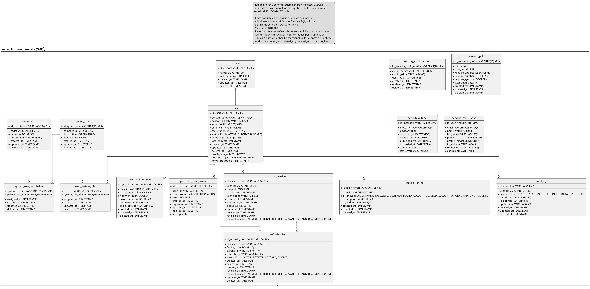

**Figura 5.** *Servicio de seguridad: personas, usuarios, registros pendientes, sesiones, tokens, roles, permisos, auditoría y outbox.*

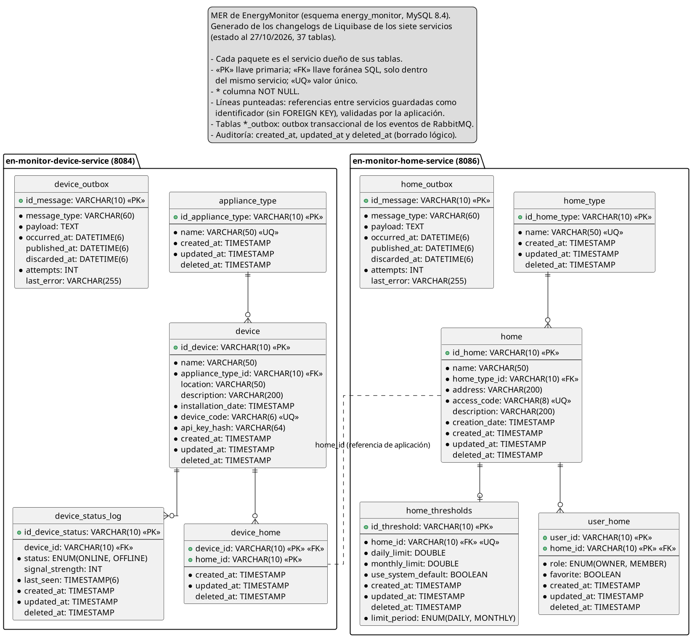

**Figura 6.** *Servicios de hogares y de dispositivos: hogares, miembros, umbrales, dispositivos y sus outbox.*

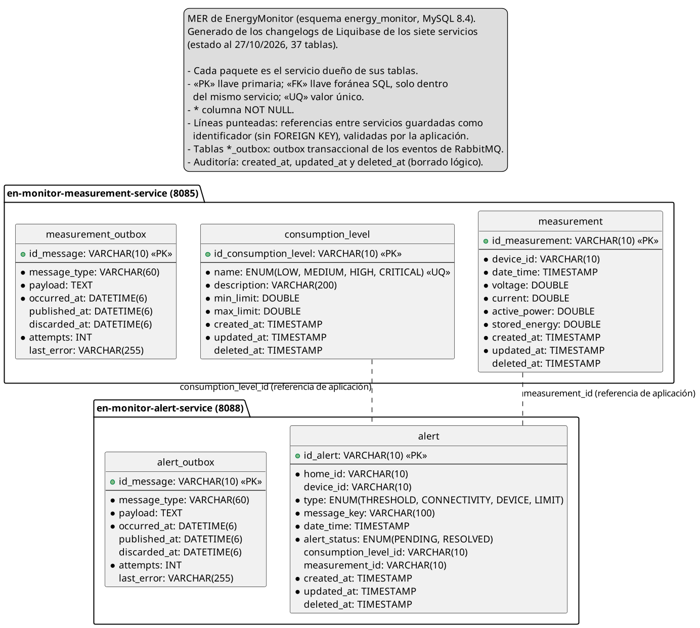

**Figura 7.** *Servicios de mediciones y de alertas: mediciones, niveles de consumo, alertas y sus outbox.*

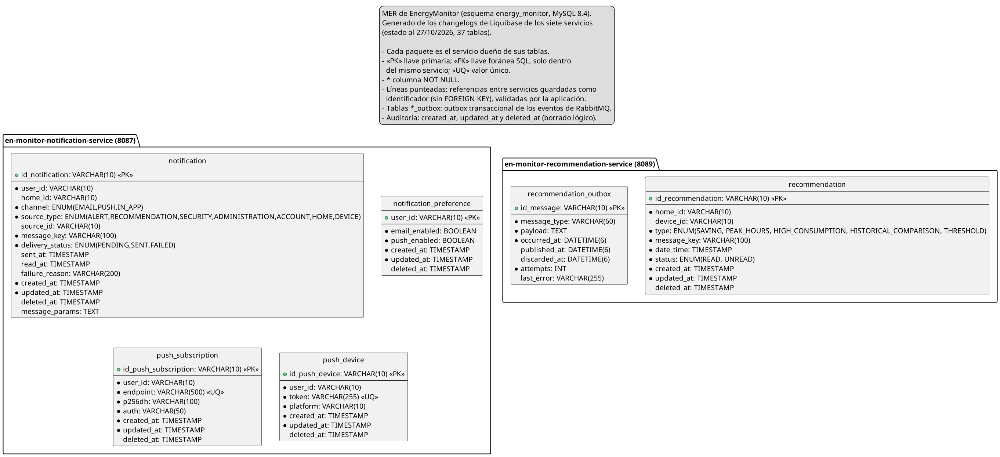

**Figura 8.** *Servicios de recomendaciones y de notificaciones: recomendaciones, registro de entregas, preferencias y suscripciones push.*

# Anexo C. Diagrama de clases por dominio

Generadas desde [`Diagrama_clases.wsd`](../../04-software-design/diagrams/class-diagram.wsd).

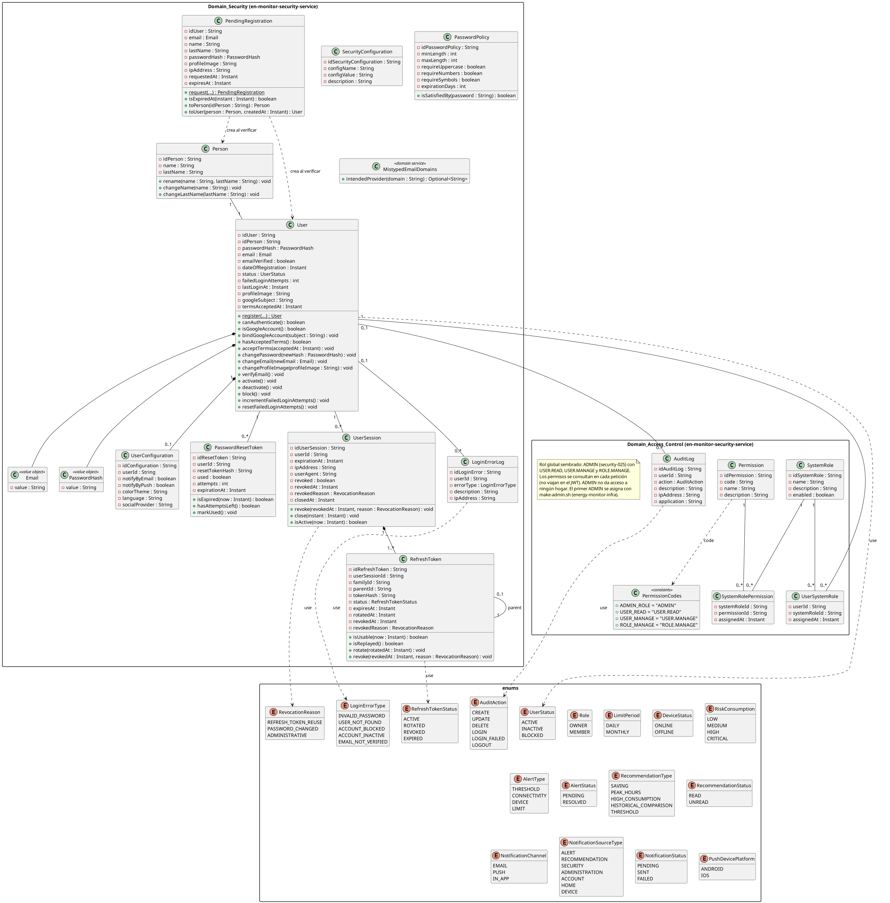

**Figura 9.** *Dominios Domain_Security y Domain_Access_Control, con las enumeraciones.*

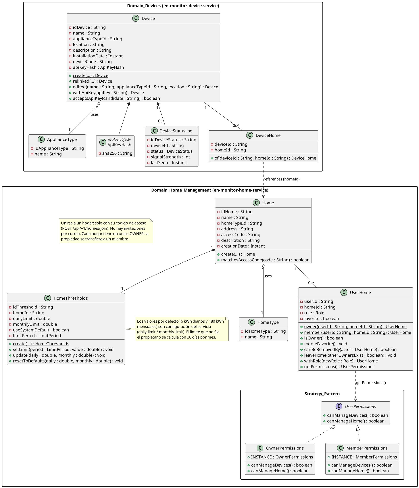

**Figura 10.** *Dominios Domain_Home_Management (con el patrón Strategy) y Domain_Devices.*

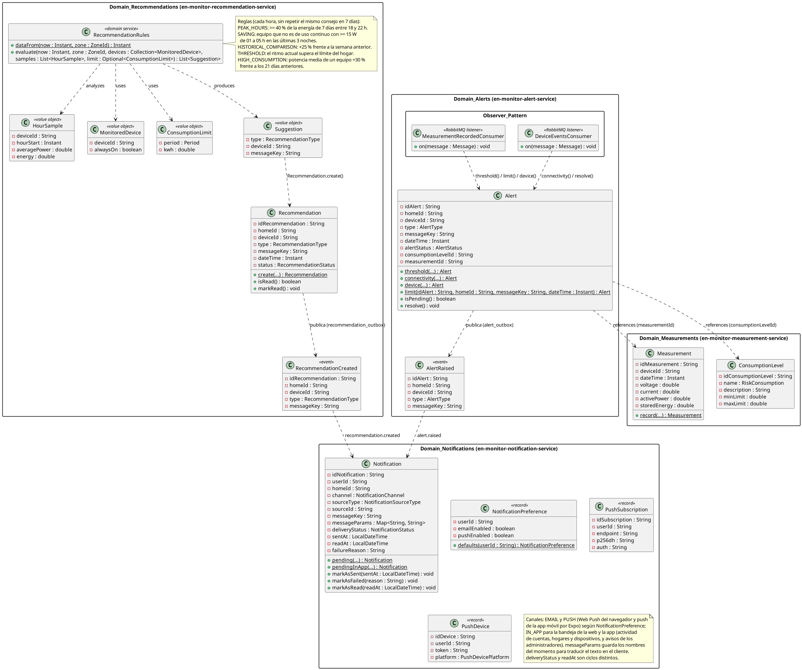

**Figura 11.** *Dominios Domain_Measurements, Domain_Alerts (Observer y Factory Method), Domain_Recommendations y Domain_Notifications.*
