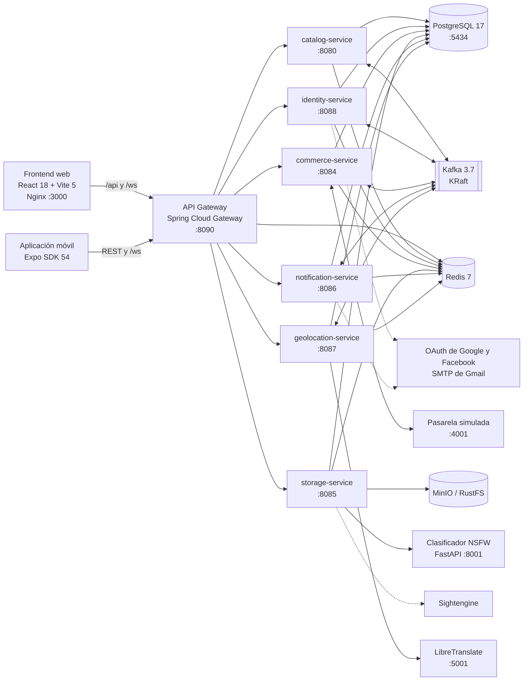
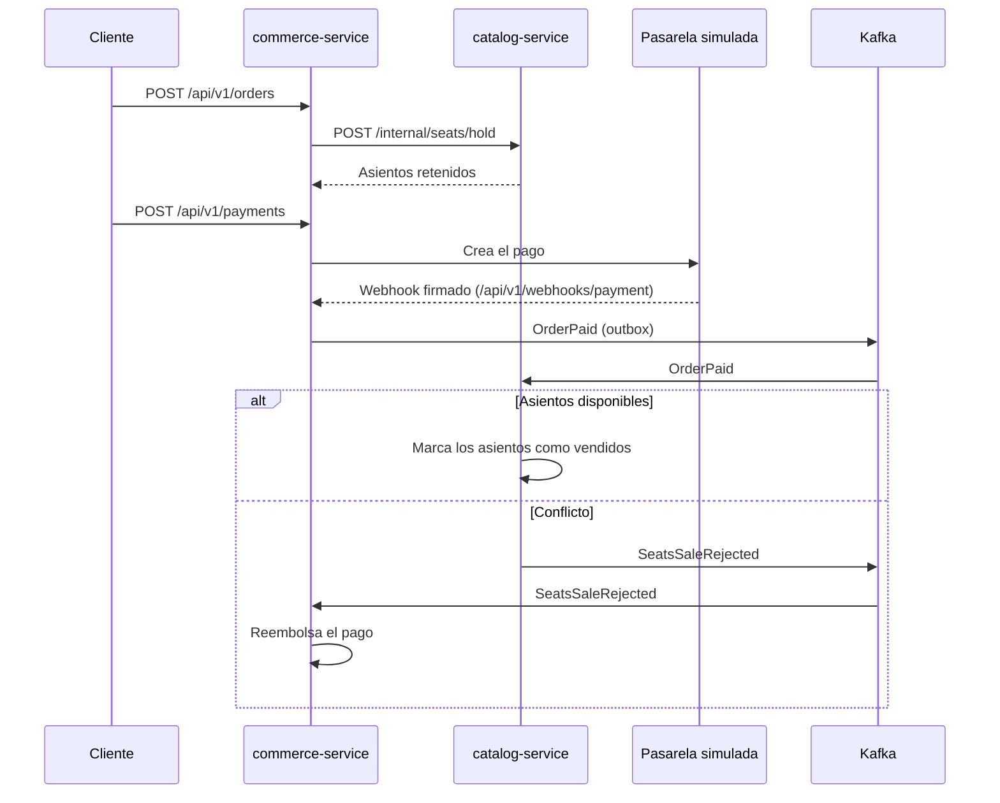
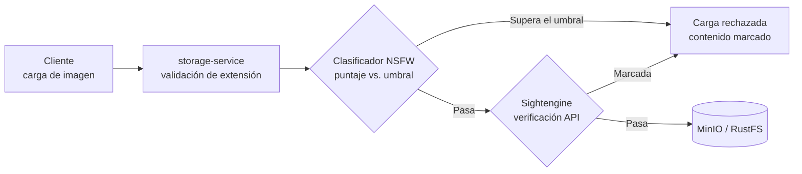

# Manual técnico — Tu Evento

> Documento consolidado de Tu Evento. Reúne los documentos siguientes, cuyo contenido se conserva sin cambios; los metadatos de conversión de cada uno van en un comentario HTML al inicio de su sección.

**Contenido**

1. [Manual técnico](#doc-te-0160)

---

<a id="doc-te-0160"></a>

<!--
ruta_anterior: es/09_Manuales/Manual_Tecnico_TuEvento.md
id: TE-0160
title: "Manual_Tecnico_TuEvento"
lang: es
source: 09_Manuales/Manual_Tecnico_TuEvento.pdf
source_sha256: 144ed09c7b2e23ab28904fb3718ab499922e9e124e50a0eb741ec7f6a29124c5
conversion: "pdfplumber 0.11.10 + conversor de PDF sin etiquetar (método C, piloto 3); sin revisión manual"
converted_on: 2026-10-23
fidelity: parcial
losses:
  - "Cabecera o pie de página omitido en las páginas 1–44: «{n}»."
  - "Página 6: figura incluida como imagen (pagina-06-figura-1.png); su texto (69 palabras) va en un comentario HTML no visible, agrupado por caja ([...]) de arriba abajo y de izquierda a derecha; flechas y relaciones solo están en la imagen."
  - "Página 8: figura incluida como imagen (pagina-08-figura-1.png); su texto (40 palabras) va en un comentario HTML no visible, agrupado por caja ([...]) de arriba abajo y de izquierda a derecha; flechas y relaciones solo están en la imagen."
  - "Página 30: figura incluida como imagen (pagina-30-figura-1.png); su texto (0 palabras) va en un comentario HTML no visible, agrupado por caja ([...]) de arriba abajo y de izquierda a derecha; flechas y relaciones solo están en la imagen."
  - "Página 36: figura incluida como imagen (pagina-36-figura-1.png); su texto (23 palabras) va en un comentario HTML no visible, agrupado por caja ([...]) de arriba abajo y de izquierda a derecha; flechas y relaciones solo están en la imagen."
  - "Palabras partidas sin guion por el ancho de la celda unidas sin espacio: @react-native-async-storage/async-storage, jdbc:postgresql://postgres-service:5432/tuevento, postgres-fake-gateway, postgres_fake_gateway_data, postgres-fake-gateway, /api/v1/admin/organizer-requests/{id}/approve, /api/v1/admin/organizer-requests/{id}/reject, /api/v1/admin/organizer-requests/{id}/document, HMAC-SHA256, login_credentials, account_activation, account_lockout, organizer_petition, event_status_log, ticket_checkin, wallet_transaction, wallet_reference."
  - "Índice manual (páginas 2–4): se conservan los números de página del original y se quitan las líneas guía."
  - "Se conservan negritas, cursivas y fuente monoespaciada; no se conservan tamaños, colores, alineación ni sangrías."
  - "Verificación automática frente a pdftotext: cobertura 99.65%, precisión 99.24%, orden 98.94%; faltan {'n': 1, 'stora': 1, 'ge': 1, 'gatew': 1, 'ay': 1, 'gate': 1, 'way': 1, 'ga': 1, 'teway': 1, 'ap': 1, 'prove': 1, 're': 1, 'ject': 1, 'do': 1, 'cument': 1} (explicado arriba)."
  - "Página 36: el diagrama de la cascada de moderación quedó dividido en dos recortes en una ejecución intermedia; la versión final es un solo recorte con las 6 cajas y sus conectores (comprobado visualmente)."
  - "Tablas 1-37: cada «Tabla N» va seguida de su tabla con el mismo título que el original; filas comprobadas visualmente en las Tablas 7 y 24 (PyMuPDF cuenta líneas físicas y no sirve como referencia de filas)."
  - "Diferencias de orden: el texto de los diagramas está en el comentario en la posición de la figura (págs. 6, 8 y 36); el resto de secciones conserva el orden del original."
status: borrador
reviewed_by: ""
-->

# TuEvento: Manual Técnico

Jhampier Santos Ortiz y Cristofer David Lozano Contreras

Servicio Nacional de Aprendizaje (SENA)

Análisis y Desarrollo de Software (ADSO), Ficha 3145556

Instructora: Karol Daniela Correa

5 de noviembre de 2026

Versión 1.1

**Control del documento**

| Campo | Valor |
|---|---|
| Repositorio verificado | `lozano2303/TuEvento` |
| Versión del código | `v1.2.0` (rama `main`, commit `ef9b329`, 3 de noviembre de 2026) |
| Fecha de verificación | 5 de noviembre de 2026 |
| Método | Lectura del código y de la configuración de esa versión: `docker-compose.yml`, `pom.xml`, `package.json`, `application*.yml`, controladores, changelogs de Liquibase y flujo de CI |

# Tabla de contenido

**Introducción**

Propósito · Alcance · Audiencia · Documentos relacionados

**Arquitectura del sistema**

Visión general · Servicios del backend · Flujos de comunicación · Estructura por capas

**Pila tecnológica**

Dependencias del backend · Dependencias del frontend web, la aplicación móvil y los servicios auxiliares

**Repositorio y organización del código**

Estructura general · Módulos por servicio · Organización del frontend · Árbol de directorios

**Backend**

Perfiles de configuración · Servicios de Docker Compose · Variables de entorno · Autenticación y autorización · API Gateway · Comunicación entre servicios · Autenticación de WebSocket · Manejo de errores

**API REST y servicios**

identity-service · catalog-service · commerce-service · Otros controladores · API interna

**Base de datos**

Motor y acceso · Migraciones del esquema · Resumen del modelo de datos · Tablas por dominio

**Frontend web**

**Aplicación móvil**

**Integraciones**

Inicio de sesión con Google y Facebook · Notificaciones por correo · Almacenamiento de objetos · Redis · Kafka · Traducción automática · Cascada de moderación de imágenes · Pasarela de pago

**Patrones de diseño y decisiones técnicas**

**Seguridad**

Controles implementados · Endurecimiento pendiente

**Pruebas y calidad**

Pruebas existentes · Integración continua · Despliegue y manifiestos de Kubernetes

**Mantenimiento y extensión**

Convenciones · Cómo agregar un módulo · Solución de problemas

**Limitaciones conocidas**

**Pendiente de verificar**

**Glosario**

**Referencias**

# Introducción

## Propósito

Este manual documenta la arquitectura, la implementación y el funcionamiento interno de TuEvento, una plataforma de gestión de eventos desarrollada por el equipo CapySoft. Está escrito para desarrolladores, arquitectos de software y personal técnico que mantienen, extienden u operan el sistema. Describe el sistema tal como existe en la versión 1.2.0 del repositorio del proyecto (Santos Ortiz y Lozano Contreras, 2026b).

## Alcance

El documento cubre la arquitectura del sistema, la pila tecnológica y sus versiones, la organización del código, la configuración, la capa de datos, las integraciones, las decisiones de diseño, la seguridad, las prácticas de pruebas y calidad, y las pautas de mantenimiento y extensión. Los pasos de instalación no se repiten aquí; se describen en el manual de instalación (Santos Ortiz y Lozano Contreras, 2026a). El procedimiento de despliegue en servidor se describe en el documento de implementación.

## Audiencia

Los desarrolladores backend y frontend usan este manual para comprender la estructura del código. El personal de DevOps lo usa para entender la configuración y los servicios. Los arquitectos lo usan para evaluar las decisiones técnicas y los evaluadores lo usan para conocer la funcionalidad que debe verificarse.

## Documentos relacionados

Este manual complementa el manual de instalación, el documento de implementación, la Especificación de Requisitos de Software (SRS), los documentos de análisis y diseño, el diccionario de datos y la propuesta técnica del proyecto.

# Arquitectura del sistema

## Visión general

Hasta la versión 1.1.x, el backend de TuEvento era un monolito modular. En la versión 1.2.0 el monolito se dividió: los módulos de identidad, comercio, archivos, notificaciones y geolocalización se extrajeron a cinco microservicios, y lo que queda del monolito es `catalog-service` (eventos, categorías, secciones y asientos). Todo el tráfico de los clientes entra por un **API Gateway** basado en Spring Cloud Gateway, que reparte cada prefijo de `/api/v1` entre los servicios.

Los servicios comparten una sola base de datos PostgreSQL, pero cada uno es dueño de sus tablas: las claves foráneas que cruzaban las fronteras entre servicios se eliminaron (changelogs 109 y 110) y cada servicio guarda los identificadores de los demás como valores planos. Se comunican por HTTP interno, protegido con una clave compartida, y por mensajes en Apache Kafka. Todos los servicios se orquestan con Docker Compose mediante el archivo `docker-compose.yml` de la raíz del repositorio (Docker, Inc., s. f.). La Figura 1 muestra los componentes y cómo se conectan, y la Tabla 1 lista cada componente con su tecnología y su puerto publicado en el host.

**Figura 1**<br>
*Arquitectura del sistema de TuEvento (v1.2.0)*



*Nota.* Elaboración propia a partir de `docker-compose.yml` y de las rutas del API Gateway (v1.2.0). Las líneas punteadas son servicios externos.

**Tabla 1**<br>
*Componentes de la plataforma y puertos del host*

| **Componente** | **Tecnología** | **Puerto host** |
|---|---|---|
| Frontend web | React 18 + Vite 5, servido por Nginx 1.29 en el contenedor | 3000 |
| Frontend móvil | React Native 0.81 / Expo SDK 54 | No aplica |
| API Gateway | Spring Boot 3.5.12 + Spring Cloud Gateway (Spring Cloud 2025.0.0) | 8090 |
| catalog-service | Spring Boot 3.5.12, Java 17; la imagen Docker ejecuta un JRE 21 | 8080 |
| identity-service | Spring Boot 3.5.12, Java 17 | 8088 |
| commerce-service | Spring Boot 3.5.12, Java 17 | 8084 |
| storage-service | Spring Boot 3.5.12, Java 17 | 8085 |
| notification-service | Spring Boot 3.5.12, Java 17 | 8086 |
| geolocation-service | Spring Boot 3.5.12, Java 17 | 8087 |
| Base de datos | PostgreSQL 17, compartida por todos los servicios | 5434 (contenedor 5432) |
| Mensajería | Apache Kafka 3.7 en modo KRaft (sin Zookeeper) | 9094, solo en 127.0.0.1 |
| Caché y lista de revocación | Redis 7 (sin contraseña por defecto) | 6379 |
| Almacenamiento de objetos | MinIO (por defecto) o RustFS, ambos compatibles con S3 | 9000/9001 y 9100/9101 |
| Traducción automática | LibreTranslate 1.9.6 (es, en, fr, pt) | 5001, solo en 127.0.0.1 |
| Moderación de imágenes | Clasificador NSFW (Python, FastAPI, opennsfw2) | 8001 (contenedor 8000) |
| Pasarela de pagos sandbox | fake-payment-gateway, solo desarrollo y pruebas del flujo de pago | 4001 |
| Base de datos de la pasarela | Instancia PostgreSQL dedicada | 5435 |
| Integración continua | GitHub Actions (servicio en la nube) | No aplica |
| Calidad de código | SonarQube Cloud (servicio en la nube) | No aplica |

*Nota.* Fuente: `docker-compose.yml`, `pom.xml` y `package.json` de v1.2.0. GitHub Actions y SonarQube Cloud no son necesarios para ejecutar la aplicación. Jenkins y SonarQube locales siguen en el compose dentro del perfil `ci`, inactivos.

## Servicios del backend

**Tabla 2**<br>
*Responsabilidad de cada servicio del backend*

| **Servicio** | **Responsabilidad** | **Rutas que le asigna el gateway** |
|---|---|---|
| catalog-service (`TuEventoBackend/tu-evento`) | Eventos, calificaciones y comentarios, layouts, medios, categorías, secciones, asientos y reservas; broker WebSocket `/ws`; ejecuta todas las migraciones de Liquibase | `/api/v1/events/**`, `/categories/**`, `/category-events/**`, `/section-types/**`, `/event-sections/**`, `/seat-blocks/**`, `/seats/**`, `/admin/events/**` y las traducciones de catálogo; `/ws/**` |
| identity-service | Registro, inicio de sesión, tokens, OAuth, usuarios, roles, solicitudes de organizador, temas, perfiles y panel de administración; firma los JWT y publica el JWKS; crea el administrador inicial | `/api/v1/auth/**`, `/users/...`, `/admin/stats`, `/admin/users`, `/admin/organizer-requests/**`, `/themes/**`, `/profiles/**`; `/.well-known/jwks.json` |
| commerce-service | Órdenes, boletas y QR, check-in, pagos, webhook de la pasarela, reembolsos, billetera y ganancias de organizadores | `/api/v1/orders/**`, `/tickets/**`, `/payments/**`, `/webhooks/**`, `/wallet/**`, `/admin/wallet/**`, `/admin/refunds/**`, `/organizer/earnings/**` |
| storage-service | Subida y consulta de archivos, URL públicas y prefirmadas, moderación de imágenes; único servicio que escribe en el bucket | `/api/v1/storage/**` |
| notification-service | Guarda las notificaciones, envía los correos y devuelve los avisos en vivo al WebSocket de catalog-service | `/api/v1/notifications/**` |
| geolocation-service | Departamentos, ciudades, sedes, idiomas y traducciones automáticas con LibreTranslate | `/api/v1/geolocation/**`, `/api/v1/languages/**`, `/api/v1/admin/languages/**` |

*Nota.* Fuente: `TuEventoBackend/gateway/src/main/resources/application.yml` (v1.2.0). El gateway no tiene ruta por defecto: una ruta que no esté en la lista responde 404.

## Flujos de comunicación

Los clientes se autentican con una solicitud de inicio de sesión a identity-service (a través del gateway) y reciben JSON Web Tokens (Jones et al., 2015) firmados con RS256. Las llamadas posteriores a la API llevan el token de acceso como token portador (bearer); cada servicio valida la firma con el JWK Set que publica identity-service y consulta en Redis la lista de revocación de tokens.

Entre servicios hay dos canales. Las consultas síncronas usan la API interna `/internal/**`, protegida con la cabecera `X-Internal-Api-Key` (variable `INTERNAL_API_KEY`). Los cambios de estado se publican como eventos en Kafka mediante el patrón *transactional outbox*: el servicio escribe el evento en la tabla `outbox_event` en la misma transacción que el cambio, un proceso lo envía a Kafka y los consumidores registran los eventos procesados para ser idempotentes.

La compra de boletas es una saga coreografiada (Figura 2): commerce-service reserva los asientos mediante la API interna de catalog-service, la pasarela confirma el pago con un webhook firmado (`WEBHOOK_SECRET`), el evento `OrderPaid` vende los asientos, `SeatsSaleRejected` reembolsa el pago y `OrderReleased` libera los asientos de las órdenes canceladas o vencidas. Las notificaciones en tiempo real usan una conexión WebSocket al endpoint `/ws` de catalog-service, autenticada con el token. Las imágenes que suben los usuarios pasan por la cascada de moderación de storage-service antes de almacenarse.

**Figura 2**<br>
*Saga de compra de boletas*



*Nota.* Elaboración propia a partir de las notas de la versión 1.2.0 (`CHANGELOG.md`) y de los controladores `InternalCatalogController`, `OrderController`, `PaymentController` y `WebhookController`.

## Estructura por capas

Cada servicio sigue una arquitectura hexagonal (puertos y adaptadores) (Cockburn, 2005) con módulos orientados al dominio (Evans, 2003). Cada módulo separa su modelo de dominio, sus casos de uso de aplicación, sus adaptadores de infraestructura y sus interfaces de entrada, como se muestra en la Figura 3. Los servicios con un solo dominio (storage, notification y geolocation) aplican las mismas capas directamente bajo su paquete raíz.

**Figura 3**<br>
*Estructura hexagonal de un módulo del backend*


<!-- Texto dentro de la figura (página 8): [application casos de uso puertos de entrada / salida DTO de solicitud / respuesta mappers MapStruct] [interfaces controladores rest (adaptadores de entrada)] [domain modelos interfaces de repositorio eventos de dominio] [infrastructure entidades y repositorios JPA clientes externos (adaptadores de salida)] -->

*Nota.* Elaboración propia a partir de la estructura de paquetes de com.capysoft.tuevento.modules; los microservicios siguen la misma organización.

# Pila tecnológica

Las siguientes tablas resumen las principales tecnologías usadas en cada parte del sistema. Las versiones se tomaron de los archivos de dependencias de v1.2.0 (Spring, s. f.-a; React, s. f.; Expo, s. f.).

**Tabla 3**<br>
*Tecnologías del backend*

| **Área** | **Tecnología** | **Versión / detalle** |
|---|---|---|
| Framework | Spring Boot | 3.5.12 en todos los servicios |
| Gateway | Spring Cloud Gateway (WebFlux), Resilience4j | Spring Cloud 2025.0.0 |
| Lenguaje | Java | 17; las imágenes ejecutan JRE 17 (microservicios y gateway) o JRE 21 (catalog-service) |
| Construcción | Maven | Maven wrapper en catalog-service y gateway; librería compartida `tuevento-common` |
| Persistencia | Spring Data JPA, PostgreSQL, HikariCP | PostgreSQL 17 |
| Migraciones | Liquibase | Changelogs YAML numerados, ejecutados por catalog-service |
| Seguridad | Spring Security, OAuth2 Resource Server (Nimbus), jjwt, BCrypt | JWT RS256 con JWKS; costo BCrypt 12 |
| Inicio de sesión social | OAuth 2.0 (Google, Facebook) | En identity-service |
| Mensajería | Spring Kafka | Kafka 3.7 (KRaft); outbox transaccional |
| Tiempo real | Spring WebSocket | STOMP sobre SockJS, en catalog-service |
| Correo | Spring Mail | SMTP de Gmail, en identity-service y notification-service |
| Almacenamiento | AWS S3 SDK para MinIO y RustFS | 2.25.60, en storage-service |
| Mapeo | MapStruct | 1.6.3 |
| Documentación de la API | SpringDoc OpenAPI | 2.8.8, en cada servicio |
| Operación | Spring Boot Actuator | Salud y métricas |
| Productividad | Lombok, Bean Validation | No aplica |

*Nota.* Fuente: `pom.xml` de catalog-service, del gateway y de los servicios de `TuEventoBackend/services/`.

**Tabla 4**<br>
*Tecnologías del frontend web*

| **Área** | **Tecnología** | **Versión** |
|---|---|---|
| Framework | React | 18.2.0 |
| Herramienta de build | Vite | 5.0.0 |
| Enrutamiento | React Router DOM | 6.20.0 |
| Internacionalización | i18next, react-i18next | 26.4.4 y 17.0.16 |
| Estilos | Tailwind CSS | 4.2.2 |
| Iconos | Lucide React | 1.7.0 |
| Editor de layouts | Konva y react-konva | 9.3.22 y 18.2.10 |
| Mapas | Leaflet y react-leaflet | 1.9.4 y 4.2.1 |
| Códigos QR | qrcode.react | 3.1.0 |
| Tiempo real | @stomp/stompjs y sockjs-client | 7.3.0 y 1.6.1 |
| Fechas | date-fns | 3.0.0 |
| Pruebas y calidad | Vitest, Testing Library, ESLint, Prettier | 3.2.7, 16.3.3, 9.39.5, 3.9.10 |

*Nota.* El editor de layouts usa Konva (Konva, s. f.) y los mapas usan Leaflet (Leaflet, s. f.).

**Tabla 5**<br>
*Tecnologías de la aplicación móvil*

| **Área** | **Tecnología** | **Versión** |
|---|---|---|
| Framework | React Native y Expo | 0.81.5 y 54.0.37 |
| Biblioteca | React | 19.1.0 |
| Navegación | React Navigation | 7.x |
| Internacionalización | i18next, react-i18next | 26.5.6 y 17.1.3 |
| Estilos | NativeWind | 2.0.11 |
| Gráficos | @shopify/react-native-skia | 2.11.0 |
| Autenticación | Expo Auth Session, Google Sign-In, jwt-decode | 7.0.11, 16.1.5 y 4.0.0 |
| Cámara y QR | expo-camera, react-native-qrcode-svg | 17.0.10 y 6.3.27 |
| HTTP y formularios | Axios, React Hook Form | 1.15.0 y 7.72.1 |
| Pruebas y calidad | Jest (jest-expo), Testing Library, ESLint, Prettier | 29.7.0, 14.1.0, 9.39.5, 3.9.10 |

*Nota.* La aplicación móvil no forma parte del despliegue con Docker (React Native, s. f.).

Los servicios auxiliares incluyen el clasificador NSFW, construido con FastAPI (FastAPI, s. f.) y el modelo opennsfw2 (bhky, s. f.), LibreTranslate para las traducciones automáticas (LibreTranslate, s. f.) y la pasarela de pagos sandbox (fake-payment-gateway), que tiene su propia base de datos PostgreSQL. La orquestación usa Docker Compose, la integración continua usa GitHub Actions (GitHub, Inc., s. f.), el análisis de código usa SonarQube Cloud (SonarSource, s. f.) y se conservan manifiestos de Kubernetes de la etapa monolítica (The Kubernetes Authors, s. f.).

## Dependencias del backend

La Tabla 6 lista las dependencias declaradas en los `pom.xml` del backend, agrupadas por función.

**Tabla 6**<br>
*Dependencias del backend (pom.xml)*

| **Grupo** | **Artefacto** | **Versión** | **Servicios** |
|---|---|---|---|
| Web y framework | spring-boot-starter-parent | 3.5.12 | Todos |
|  | spring-boot-starter-web | 3.5.12 | catalog y microservicios |
|  | spring-cloud-starter-gateway-server-webflux | 2025.0.0 (BOM) | gateway |
|  | spring-cloud-starter-circuitbreaker-reactor-resilience4j | 2025.0.0 (BOM) | gateway |
|  | spring-boot-starter-actuator | 3.5.12 | Todos |
|  | spring-boot-starter-websocket | 3.5.12 | catalog |
| Seguridad | spring-boot-starter-security | 3.5.12 | catalog y microservicios |
|  | spring-boot-starter-oauth2-resource-server | 3.5.12 | catalog y microservicios |
|  | spring-boot-starter-oauth2-client | 3.5.12 | catalog |
|  | jjwt-api, jjwt-impl, jjwt-jackson | 0.12.6 | catalog, identity y commerce |
| Persistencia | spring-boot-starter-data-jpa | 3.5.12 | catalog y microservicios |
|  | spring-boot-starter-data-redis / -reactive | 3.5.12 | Todos |
|  | spring-session-data-redis | — | catalog |
|  | postgresql | runtime | catalog y microservicios |
|  | liquibase-core | — | catalog |
| Mensajería | spring-kafka | — | catalog, identity, commerce, notification y geolocation |
|  | spring-boot-starter-mail | 3.5.12 | identity y notification |
| Utilidades | lombok | — | Todos |
|  | mapstruct, mapstruct-processor | 1.6.3 | catalog y microservicios |
|  | spring-dotenv | 4.0.0 | catalog |
|  | software.amazon.awssdk:s3 | 2.25.60 | storage |
|  | spring-boot-starter-validation | 3.5.12 | catalog y microservicios |
| Documentación | springdoc-openapi-starter-webmvc-ui | 2.8.8 | catalog y microservicios |
| Monitoreo | micrometer-tracing-bridge-brave | — | catalog |
| Pruebas | spring-boot-starter-test, spring-security-test, spring-kafka-test | test | catalog y microservicios |
|  | h2 | test | catalog |
|  | jacoco-maven-plugin | 0.8.12 | catalog y microservicios |

*Nota.* Fuente: `pom.xml` de cada servicio. Un guion indica que el `pom.xml` no declara una versión explícita; en esos casos la versión la gestiona Spring Boot.

## Dependencias del frontend web, la aplicación móvil y los servicios auxiliares

**Tabla 7**<br>
*Dependencias del frontend web (package.json)*

| **Tipo** | **Paquete** | **Versión** | **Propósito** |
|---|---|---|---|
| dependencies | react, react-dom | ^18.2.0 | Biblioteca de interfaz |
|  | react-router-dom | ^6.20.0 | Enrutamiento |
|  | i18next, react-i18next, i18next-browser-languagedetector | ^26.4.4, ^17.0.16, ^8.2.1 | Internacionalización |
|  | @stomp/stompjs, sockjs-client | ^7.3.0, ^1.6.1 | Cliente WebSocket |
|  | konva, react-konva | ^9.3.22, ^18.2.10 | Editor de layouts |
|  | leaflet, react-leaflet | ^1.9.4, ^4.2.1 | Mapas |
|  | qrcode.react | ^3.1.0 | Códigos QR de las boletas |
|  | date-fns | ^3.0.0 | Manejo de fechas |
|  | lucide-react | ^1.7.0 | Iconos |
| devDependencies | vite, @vitejs/plugin-react | ^5.0.0, ^4.2.0 | Servidor y build |
|  | tailwindcss, @tailwindcss/postcss | ^4.2.2 | Estilos |
|  | autoprefixer, postcss | ^10.4.27, ^8.5.8 | Procesamiento de CSS |
|  | vitest, jsdom, @testing-library/react, @testing-library/jest-dom | ^3.2.7, ^30.1.3, ^16.3.3, ^7.0.1 | Pruebas |
|  | eslint (y plugins de React), prettier | ^9.39.5, ^3.9.10 | Calidad y formato |

*Nota.* Fuente: package.json de TuEventoFrontend/web (v1.2.0).

**Tabla 8**<br>
*Dependencias de la aplicación móvil (package.json)*

| **Tipo** | **Paquete** | **Versión** | **Propósito** |
|---|---|---|---|
| dependencies | expo | ~54.0.37 | Plataforma de desarrollo |
|  | react, react-native | 19.1.0, 0.81.5 | Interfaz nativa |
|  | @react-navigation/native, native-stack, bottom-tabs | ^7.2.2, ^7.14.10, ^7.15.9 | Navegación |
|  | expo-auth-session, @react-native-google-signin/google-signin | ~7.0.11, ^16.1.5 | OAuth móvil |
|  | @react-native-async-storage/async-storage | 2.2.0 | Almacenamiento local |
|  | @stomp/stompjs, sockjs-client | ^7.3.0, ^1.6.1 | Cliente WebSocket |
|  | axios | ^1.15.0 | Cliente HTTP |
|  | expo-camera, react-native-qrcode-svg | ~17.0.10, ^6.3.27 | Escáner y códigos QR |
|  | expo-image-picker, expo-document-picker | ~17.0.11, ~14.0.8 | Selección de imágenes y documentos |
|  | i18next, react-i18next | 26.5.6, 17.1.3 | Internacionalización |
|  | react-native-webview | 13.15.0 | Vista web (pasarela de pago) |
|  | react-hook-form, jwt-decode | ^7.72.1, ^4.0.0 | Formularios y decodificación de JWT |
|  | nativewind, @shopify/react-native-skia | ^2.0.11, ^2.11.0 | Estilos y gráficos 2D |
| devDependencies | jest, jest-expo, @testing-library/react-native | ~29.7.0, ~54.0.18, ^14.1.0 | Pruebas |
|  | typescript, @types/react, babel-preset-expo, tailwindcss | ~5.9.2, ~19.1.10, ~54.0.10, ^3.3.2 | Herramientas de desarrollo |
|  | eslint, eslint-config-expo, prettier | ^9.39.5, ~10.0.0, ^3.9.10 | Calidad y formato |

*Nota.* Fuente: package.json de TuEventoFrontend/movil (v1.2.0).

**Tabla 9**<br>
*Dependencias de los servicios auxiliares*

| **Servicio** | **Dependencia** | **Versión** | **Propósito** |
|---|---|---|---|
| NSFW (Python 3.11) | fastapi | 0.111.0 | API web |
|  | uvicorn | 0.30.1 | Servidor ASGI |
|  | pillow | 10.3.0 | Procesamiento de imágenes |
|  | opennsfw2 | 0.13.3 | Clasificador NSFW |
|  | tensorflow | 2.16.2 | Motor de aprendizaje automático |
| LibreTranslate | Imagen libretranslate/libretranslate | v1.9.6 | Traducción automática (es, en, fr, pt) |
| fake-payment-gateway | spring-boot-starter-parent, -web, -data-jpa, -validation | 3.5.0 | Servicio REST con persistencia |
|  | postgresql, lombok | runtime, — | Controlador y reducción de código |

*Nota.* Fuente: requirements.txt de nsfw-service, pom.xml de fake-payment-gateway y docker-compose.yml.

# Repositorio y organización del código

## Estructura general

El código fuente del proyecto está alojado en un repositorio público de GitHub (Santos Ortiz y Lozano Contreras, 2026b). La Tabla 10 describe su organización de nivel superior.

**Tabla 10**<br>
*Estructura de nivel superior del repositorio*

| **Ruta** | **Contenido** |
|---|---|
| `TuEventoBackend/tu-evento/` | catalog-service (antiguo monolito) |
| `TuEventoBackend/gateway/` | API Gateway |
| `TuEventoBackend/services/` | Microservicios (identity, commerce, storage, notification y geolocation) y la librería compartida `tuevento-common` |
| `TuEventoFrontend/web/` | Frontend web en React |
| `TuEventoFrontend/movil/` | Aplicación móvil React Native (Expo) |
| `nsfw-service/` | Clasificador de imágenes en Python |
| `fake-payment-gateway/` | Pasarela de pagos sandbox |
| `loadtest/` | Pruebas de carga (carrera por asientos) |
| `k8s/` | Manifiestos de Kubernetes (8 archivos YAML) |
| `.github/workflows/ci.yml` y `sonar-project.properties` | Integración continua y análisis de calidad |
| `docker-compose.yml` y `docker-compose.prod.yml` | Orquestación local y de producción |
| `.env.example` y `.env.prod.example` | Plantillas de variables de entorno |
| `CHANGELOG.md` y `docs/` | Historial de versiones y documentación técnica del equipo |

## Módulos por servicio

El paquete `shared` de cada servicio contiene el código transversal (configuración, seguridad, outbox y manejador global de excepciones). La librería `tuevento-common` reúne las excepciones de dominio, la respuesta estándar `ApiResponse`, el filtro de la clave interna (`InternalApiKeyFilter`) y el decodificador de JWT que consulta la lista de revocación en Redis (`RevocationCheckingJwtDecoder`). La Tabla 11 lista los módulos de dominio de cada servicio.

**Tabla 11**<br>
*Módulos de dominio por servicio*

| **Servicio** | **Módulo** | **Responsabilidad** |
|---|---|---|
| catalog-service | event | Ciclo de vida de eventos, calificaciones y comentarios con respuestas, medios, layouts y traducciones |
|  | category | Categorías de eventos |
|  | section | Tipos de sección y secciones de eventos |
|  | seat | Bloques, asientos y reservas |
|  | catalogbridge | Lado de catálogo de la saga de compra: retención de asientos, réplica de eventos hacia comercio y avisos en vivo de comercio |
|  | identitybridge | Integración con identidad: eventos de usuario, documentos de organizador y datos del panel de administración |
| identity-service | security | Autenticación, usuarios, roles, activación, recuperación de contraseña, solicitudes de organizador y panel de administración |
|  | profile | Perfiles de usuario |
|  | theme | Temas de la interfaz |
| commerce-service | ticket | Órdenes, boletas, QR y check-in |
|  | payment | Pagos, webhook, reembolsos, conciliación y ganancias de organizadores |
|  | wallet | Billetera digital |
| storage-service | (un solo dominio) | Archivos y moderación de imágenes |
| notification-service | (un solo dominio) | Notificaciones, correo y avisos en vivo |
| geolocation-service | (raíz) y language | Departamentos, ciudades y sedes; idiomas y traducciones |

*Nota.* Fuente: directorios bajo `src/main/java` de cada servicio en v1.2.0.

## Organización del frontend

El frontend web mantiene su código en `src/` con los directorios `assets`, `components`, `constants`, `context`, `data`, `hooks`, `layouts`, `locales`, `pages`, `services`, `styles`, `theme` y `utils`, y el archivo `i18n.js` para la internacionalización. El estado global lo proveen proveedores de contexto de React para autenticación, tema, idioma y notificaciones. El directorio `services` contiene los clientes de la API, con `httpClient.js` como cliente HTTP compartido. La aplicación móvil sigue una organización similar, con `navigation/` para la navegación, `screens/` para las pantallas, `locales/` e `i18n.js` para los idiomas y `services/httpClient.js` como cliente base de la API.

## Árbol de directorios

Los siguientes árboles muestran la estructura real del backend, del frontend web, de la aplicación móvil y de los servicios auxiliares.

Backend (TuEventoBackend):

```text
tu-evento/                       catalog-service
  src/main/java/com/capysoft/tuevento/
    modules/  catalogbridge/  category/  event/  identitybridge/  seat/  section/
    shared/   application/  domain/  infrastructure/  interfaces/
  src/main/resources/  db/changelog/  keys/  application*.yml
gateway/                         API Gateway
services/
  tuevento-common/               librería compartida
  identity-service/  commerce-service/  storage-service/
  notification-service/  geolocation-service/
```

Frontend web (TuEventoFrontend/web/src):

```text
App.jsx  main.jsx  i18n.js
assets/  components/  constants/  context/  data/  hooks/
layouts/  locales/  pages/  services/  styles/  theme/  utils/
```

Aplicación móvil (TuEventoFrontend/movil/src):

```text
i18n.js
assets/  components/  context/  hooks/  locales/
navigation/  screens/  services/  theme/  utils/
```

Servicios auxiliares:

```text
nsfw-service/
  main.py  requirements.txt  Dockerfile
fake-payment-gateway/
  src/main/java/com/capysoft/fakepaymentgateway/
  pom.xml  Dockerfile
```

# Backend

## Perfiles de configuración

catalog-service usa perfiles de Spring: `application.yaml` (común), `application-dev.yml` (desarrollo local y Docker Compose), `application-prod.yml` (producción) y `application-k8s.yml` (Kubernetes); el perfil activo se selecciona con `SPRING_PROFILES_ACTIVE`. Los microservicios y el gateway tienen un único `application.yml` cuyos valores por defecto apuntan a los puertos publicados en el host (`localhost:5434`, `localhost:9094`, `localhost:6379`), de modo que pueden ejecutarse fuera de Docker sin cambios; dentro de Docker, el compose sobrescribe esas direcciones. La Tabla 12 resume los parámetros principales.

**Tabla 12**<br>
*Parámetros principales de la configuración*

| **Parámetro** | **Valor (desarrollo)** | **Fuente** |
|---|---|---|
| Puertos | gateway 8090, catalog 8080, commerce 8084, storage 8085, notification 8086, geolocation 8087, identity 8088 | `application*.yml` |
| Vida del access token | 900000 ms (15 minutos) | identity-service |
| Vida del refresh token | 604800000 ms (7 días) | identity-service |
| Orígenes CORS | Gateway: http://localhost:3000, http://localhost:5173, http://localhost:19000 | gateway |
| Tamaño máximo de archivo / solicitud | 10 MB / 12 MB | catalog-service y Nginx |
| Base de datos | `jdbc:postgresql://postgres:5432/tuevento_db` en Docker | `docker-compose.yml` |
| Kafka | `kafka:9092` en Docker; `localhost:9094` desde el host | `application*.yml` |
| Almacenamiento | MinIO en `http://minio:9000` (bucket `tuevento`); RustFS opcional | storage-service |
| Correo | smtp.gmail.com, puerto 587 | identity-service y notification-service |
| Redis | `redis:6379` en Docker | `docker-compose.yml` |
| Hibernate ddl-auto | validate | catalog-service |
| Actuator | catalog: `/actuator/**` público; microservicios: health, info y metrics expuestos, solo health e info públicos | `SecurityConfig` de cada servicio |

*Nota.* Fuente: archivos de configuración de v1.2.0.

## Servicios de Docker Compose

La Tabla 13 lista los servicios que define el archivo `docker-compose.yml`, con sus imágenes, puertos y dependencias.

**Tabla 13**<br>
*Servicios definidos en docker-compose.yml*

| **Servicio** | **Imagen o build** | **Puertos** | **Volumen** | **Depende de** |
|---|---|---|---|---|
| postgres | postgres:17-alpine | 5434:5432 | postgres_data | — |
| postgres-fake-gateway | postgres:17-alpine | 5435:5432 | postgres_fake_gateway_data | — |
| redis | redis:7-alpine | 6379:6379 | redis_data | — |
| kafka | bitnamilegacy/kafka:3.7.0 | 127.0.0.1:9094:9094 | kafka_data | — |
| minio | quay.io/minio/minio:latest | 9000:9000, 9001:9001 | minio_data | — |
| minio-init | quay.io/minio/minio:latest | — | — | minio (healthy) |
| rustfs | rustfs/rustfs:1.0.0-alpha.59 | 9100:9000, 9101:9001 | rustfs_data | — |
| nsfw-classifier | build: ./nsfw-service | 8001:8000 | — | — |
| libretranslate | libretranslate/libretranslate:v1.9.6 | 127.0.0.1:5001:5000 | libretranslate-models | — |
| fake-payment-gateway | build: ./fake-payment-gateway | 4001:4001 | — | postgres-fake-gateway |
| backend (catalog-service) | build: ./TuEventoBackend/tu-evento | 8080:8080 | — | postgres, redis, kafka (healthy) |
| identity-service | build: ./TuEventoBackend/services | 8088:8088 | carpeta `keys/` (solo lectura) | postgres, redis, kafka, backend |
| commerce-service | build: ./TuEventoBackend/services | 8084:8084 | — | postgres, redis, kafka (healthy), backend |
| storage-service | build: ./TuEventoBackend/services | 8085:8085 | — | postgres, redis, minio (healthy), nsfw-classifier, backend |
| notification-service | build: ./TuEventoBackend/services | 8086:8086 | — | postgres, redis, kafka (healthy), backend |
| geolocation-service | build: ./TuEventoBackend/services | 8087:8087 | — | postgres, redis, kafka (healthy), libretranslate (healthy), backend |
| gateway | build: ./TuEventoBackend/gateway | 8090:8090 | — | backend, los cinco microservicios y redis |
| frontend | build: ./TuEventoFrontend/web | 3000:80 | — | gateway |
| jenkins, sonarqube | perfil `ci` (inactivos) | 8082, 50000, 9002 | jenkins_data, sonarqube_* | — |

*Nota.* Fuente: docker-compose.yml (v1.2.0).

## Variables de entorno

Los servicios leen su configuración de variables de entorno. En Docker Compose se definen en el archivo `.env` de la raíz, que se crea a partir de `.env.example`, y el compose pasa a cada contenedor solo las que necesita. La Tabla 14 lista las variables principales. Los valores reales nunca deben incluirse en el repositorio.

**Tabla 14**<br>
*Variables de entorno principales*

| **Variable** | **Propósito** |
|---|---|
| `POSTGRES_DB / USER / PASSWORD` | Nombre de la base de datos (debe ser `tuevento_db`), usuario y contraseña |
| `JWT_SECRET` | Secreto HS256 heredado: valida tokens anteriores al cambio a RS256 y es el valor de respaldo de `QR_SECRET` |
| `APP_JWT_PRIVATE_KEY_PATH` | Ruta de la clave privada RSA (PKCS#8) con la que identity-service firma los JWT |
| `INTERNAL_API_KEY` | Clave compartida para la API interna `/internal/**`; vacía deja esas rutas cerradas |
| `WEBHOOK_SECRET` | Secreto HMAC con el que la pasarela firma los webhooks y commerce-service los verifica |
| `FAKE_GATEWAY_API_KEY` | Clave de administración de la pasarela simulada |
| `QR_SECRET` | Secreto de firma de los QR de las boletas (por defecto, `JWT_SECRET`) |
| `KAFKA_BOOTSTRAP_SERVERS` | Dirección de Kafka fuera de Docker |
| `MAIL_USERNAME / MAIL_PASSWORD` | Cuenta de Gmail y contraseña de aplicación usadas para enviar correo |
| `GOOGLE_CLIENT_ID / SECRET` | Credenciales OAuth 2.0 de Google |
| `VITE_GOOGLE_CLIENT_ID` | Client ID de Google usado por el frontend web |
| `FACEBOOK_CLIENT_ID / SECRET` | Credenciales OAuth de Facebook |
| `ADMIN_EMAIL / PASSWORD / ALIAS` | Cuenta inicial del administrador |
| `MINIO_ROOT_USER / PASSWORD` | Credenciales de administrador de MinIO |
| `STORAGE_PROVIDER` y `RUSTFS_*` | Proveedor de almacenamiento (`minio` o `rustfs`) y credenciales de RustFS |
| `REDIS_HOST / REDIS_PORT` | Conexión a Redis fuera de Docker |
| `NSFW_SERVICE_URL / NSFW_THRESHOLD` | Dirección del clasificador NSFW y umbral de decisión |
| `SIGHTENGINE_API_USER / API_SECRET / MODELS / THRESHOLD` | Credenciales, modelos y umbral de Sightengine |
| `NOTIFICATION_EMAIL_ENABLED` | Habilita o deshabilita el envío de correos |
| `PAYMENT_GATEWAY / FAKE_GATEWAY_URL` | Pasarela de pago usada y su dirección fuera de Docker |

*Nota.* Fuente: `.env.example` y `docker-compose.yml` (v1.2.0). El manual de instalación indica cuáles son obligatorias y sus valores por defecto.

Además, los servicios leen variables con valor por defecto que pueden sobrescribirse (Tabla 15).

**Tabla 15**<br>
*Variables adicionales leídas por el código*

| **Variable** | **Valor por defecto** | **Servicio** |
|---|---|---|
| `SPRING_DATASOURCE_URL` | `jdbc:postgresql://localhost:5434/tuevento_db` (microservicios) | Todos |
| `<SERVICIO>_SERVICE_PORT` / `GATEWAY_PORT` | Puertos de la Tabla 12 | Microservicios y gateway |
| `*_SERVICE_URI` | Direcciones de los servicios de destino | gateway |
| `JWK_SET_URI` | `http://localhost:8088/.well-known/jwks.json` | Microservicios |
| `AUTH_COOKIE_SECURE` / `AUTH_COOKIE_SAME_SITE` | `true` / `Strict` | identity-service |
| `SECURITY_LOCKOUT_MINUTES` | 30 | identity-service |
| `RATE_LIMIT_ENABLED` / `RATE_LIMIT_REQUESTS_PER_MINUTE` | `true` / 10 | identity-service |
| `APP_OAUTH_ALLOWED_FRONTEND_REDIRECT_URIS` | `http://localhost:5173/login,http://localhost:3000/login` | identity-service |
| `APP_PROFILE_DEFAULT_AVATAR_ID` | 1 | identity-service |
| `MINIO_PUBLIC_URL` | `http://localhost:9000` | storage-service |
| `SIGHTENGINE_NUDITY_THRESHOLD` | 0.15 | storage-service |
| `PAYMENT_RECONCILIATION_ENABLED` / `_THRESHOLD_MINUTES` / `_EXPIRE_MINUTES` | `true` / 15 / 30 | commerce-service |
| `TRANSLATION_LIBRETRANSLATE_BASE_URL` | `http://localhost:5001` | geolocation-service |
| `TRANSLATION_PROTECTED_TERMS` | `Tu Evento` | geolocation-service |
| `OUTBOX_RELAY_ENABLED` / `MESSAGING_CONSUMERS_ENABLED` | `true` / `true` | catalog-service |
| `GATEWAY_CORS_ALLOWED_ORIGINS` | http://localhost:3000, http://localhost:5173, http://localhost:19000 | gateway |

*Nota.* Fuente: `application*.yml` de cada servicio (v1.2.0).

## Autenticación y autorización

identity-service autentica a los usuarios con JSON Web Tokens (Jones et al., 2015) firmados con **RS256**: firma con una clave privada RSA y publica la clave pública en `/.well-known/jwks.json`. Los demás servicios solo verifican la firma con ese JWK Set (`NimbusJwtDecoder`) y, además, consultan en Redis la lista de revocación (`RevocationCheckingJwtDecoder`, de `tuevento-common`); si Redis no responde, el token se rechaza (*fail-closed*). identity-service no arranca sin la clave privada (`ephemeral-keys-allowed: false`). El secreto HS256 anterior (`JWT_SECRET`) solo valida tokens emitidos antes del cambio.

Las contraseñas se almacenan como hashes BCrypt con costo 12. El módulo de seguridad conserva un historial de contraseñas, de modo que una contraseña nueva pueda compararse con las anteriores cuando el usuario la cambia. El inicio de sesión social con Google y Facebook sigue el marco de autorización OAuth 2.0 (Hardt, 2012).

La autorización se basa en roles. Liquibase (changelog 017) inserta los tres roles del sistema y los estados de usuario listados en la Tabla 16; las migraciones no crean ningún usuario. El administrador inicial lo crea identity-service al arrancar, mediante la clase `AdminAccountSeeder`, a partir de las variables `ADMIN_*` (Spring, s. f.-b).

**Tabla 16**<br>
*Roles del sistema y estados de usuario*

| **Elemento** | **Valores** | **Descripción** |
|---|---|---|
| Roles | ADMIN | Acceso completo al sistema |
|  | ORGANIZER | Crea y gestiona eventos |
|  | USER | Usuario regular de la plataforma |
| Estados de usuario | PENDING, ACTIVE, BLOCKED, INACTIVE, DELETED | Ciclo de vida de la cuenta |

*Nota.* Fuente: changelog de Liquibase 017-insert-initial-roles-and-user-status.yaml.

El token de acceso dura 15 minutos (900000 ms) y el refresh token dura 7 días (604800000 ms). El refresh token viaja en una cookie (`Secure` y `SameSite=Strict` por defecto) y rota en cada uso: al renovar la sesión se emite un par nuevo y el anterior deja de ser válido (`RefreshTokenUseCase`). Para el inicio de sesión, el sistema cuenta los intentos fallidos en la tabla `account_lockout`: tras 5 intentos fallidos dentro de una ventana de 15 minutos, la cuenta se bloquea temporalmente durante 30 minutos por defecto (`LoginUseCase`). Además, `AuthRateLimitFilter` limita a 10 solicitudes por minuto los intentos de inicio de sesión, registro, activación y recuperación; los contadores viven en Redis.

## API Gateway

El gateway (Spring Cloud Gateway sobre WebFlux) es el único punto de entrada de los clientes. Enruta por prefijo de ruta (Tabla 2), aplica CORS de forma centralizada, propaga el WebSocket `/ws` hacia catalog-service y expone `/.well-known/jwks.json` desde identity-service. Define tiempos de conexión y de respuesta por ruta y usa Redis y Resilience4j. No tiene ruta por defecto, de modo que una ruta no asignada responde 404.

## Comunicación entre servicios

**Tabla 17**<br>
*Canales de comunicación entre servicios*

| **Canal** | **Uso** | **Ejemplos** |
|---|---|---|
| HTTP interno (`/internal/**`, cabecera `X-Internal-Api-Key`) | Consultas síncronas entre servicios | Retener asientos (`POST /internal/seats/hold`), asientos con pago pendiente, boletas vendidas, archivos (`/internal/files`), cifras del panel de administración |
| Kafka con outbox transaccional | Eventos de dominio y comandos asíncronos | Saga de compra (`tuevento.order`, `tuevento.seat`), réplica de eventos (`tuevento.event`), usuarios (`tuevento.user`), notificaciones (`tuevento.notificaciones.*`), traducciones (`tuevento.localizacion.translation.*`), avisos en vivo (`*.push`) |
| JWK Set | Verificación local de los JWT | `/.well-known/jwks.json` de identity-service |

*Nota.* Fuente: controladores `Internal*Controller`, clases `*Outbox*` y temas de Kafka del código de v1.2.0. Los temas se crean automáticamente al primer mensaje (`KAFKA_CFG_AUTO_CREATE_TOPICS_ENABLE`).

## Autenticación de WebSocket

Las conexiones en tiempo real terminan en catalog-service (el gateway las reenvía) y se autentican durante el handshake mediante la clase `JwtHandshakeInterceptor`. El cliente envía el token de acceso como parámetro de consulta `token` de la URL `/ws`, porque la API WebSocket del navegador no permite encabezados personalizados. El interceptor valida el token, almacena el identificador del usuario en los atributos de la sesión y rechaza la conexión con una respuesta de no autorizado cuando el token no es válido. La configuración está en `WebSocketConfig.java`: el endpoint es `/ws` (STOMP sobre SockJS) con un broker simple en memoria para `/topic` y `/queue`; las actualizaciones de asientos se publican en `/topic/events/{eventId}/...` y las notificaciones personales llegan por `/user/queue/notifications`. Los avisos que generan los microservicios (notificaciones, identidad, comercio) llegan a catalog-service por Kafka (`*.push`) y este los reenvía a los clientes. Los clientes web y móvil usan `@stomp/stompjs` y `sockjs-client`.

## Manejo de errores

Las violaciones de reglas de negocio se lanzan como excepciones que llevan un código de error (`BusinessException` y derivadas, en `tuevento-common`), y un manejador global de excepciones en cada servicio las convierte en respuestas HTTP consistentes con el formato `ApiResponse`. Por ejemplo, publicar dos comentarios en el mismo evento dentro del intervalo permitido produce el código `COMMENT_RATE_LIMITED` (diez segundos entre comentarios).

# API REST y servicios

La API se publica bajo el prefijo `/api/v1` a través del gateway (`http://localhost:8090/api/v1` en local). Esta sección documenta los endpoints de identity-service, catalog-service (eventos) y commerce-service, indicando el método HTTP, la ruta, una descripción breve y el rol requerido. Los controladores restantes se listan en la Tabla 24; la documentación interactiva está disponible en la interfaz Swagger UI que genera SpringDoc OpenAPI en cada servicio (`/swagger-ui/index.html` en el puerto de cada uno).

## identity-service

**Tabla 18**<br>
*Endpoints de AuthController*

| **Método** | **Ruta** | **Descripción** | **Rol requerido** |
|---|---|---|---|
| POST | `/api/v1/auth/register` | Registrar una cuenta nueva | Público |
| POST | `/api/v1/auth/activate` | Activar la cuenta con el código | Público |
| POST | `/api/v1/auth/login` | Iniciar sesión con correo y contraseña | Público |
| POST | `/api/v1/auth/logout` | Cerrar sesión y revocar el token | Público |
| POST | `/api/v1/auth/refresh` | Renovar el token de acceso | Público |
| POST | `/api/v1/auth/recover-password` | Solicitar el código de recuperación | Público |
| POST | `/api/v1/auth/reset-password` | Restablecer la contraseña con el código | Público |
| GET | `/api/v1/auth/oauth/{provider}` | Redirigir al proveedor OAuth | Público |
| GET | `/api/v1/auth/oauth/{provider}/callback` | Callback del proveedor OAuth | Público |
| POST | `/api/v1/auth/google` | Autenticar con un ID Token de Google | Público |
| POST | `/api/v1/auth/resend-activation` | Reenviar el código de activación | Público |
| POST | `/api/v1/auth/reactivate-request` | Solicitar la reactivación de la cuenta | Público |
| POST | `/api/v1/auth/reactivate-confirm` | Confirmar la reactivación | Público |

*Nota.* Fuente: AuthController.java, identity-service.

**Tabla 19**<br>
*Endpoints de UserController*

| **Método** | **Ruta** | **Descripción** | **Rol requerido** |
|---|---|---|---|
| POST | `/api/v1/users/change-password` | Cambiar la contraseña | USER |
| POST | `/api/v1/users/oauth/link` | Vincular una cuenta OAuth | USER |
| POST | `/api/v1/users/organizer-request` | Solicitar ser organizador | USER |
| GET | `/api/v1/users/organizer-petition` | Consultar el estado de la solicitud | USER |
| DELETE | `/api/v1/users/me` | Desactivar la cuenta propia | USER |

*Nota.* Fuente: UserController.java, identity-service.

**Tabla 20**<br>
*Endpoints de AdminController*

| **Método** | **Ruta** | **Descripción** | **Rol requerido** |
|---|---|---|---|
| GET | `/api/v1/admin/stats` | Cifras del panel de administración | ADMIN |
| GET | `/api/v1/admin/pending-counts` | Conteos de elementos pendientes | ADMIN |
| GET | `/api/v1/admin/organizer-requests` | Listar las solicitudes de organizador | ADMIN |
| PUT | `/api/v1/admin/organizer-requests/{id}/approve` | Aprobar una solicitud | ADMIN |
| PUT | `/api/v1/admin/organizer-requests/{id}/reject` | Rechazar una solicitud | ADMIN |
| GET | `/api/v1/admin/organizer-requests/{id}/document` | Obtener la URL del documento adjunto | ADMIN |
| DELETE | `/api/v1/admin/organizer-users/{userId}/revoke` | Revocar el rol de organizador | ADMIN |
| GET | `/api/v1/admin/activity` | Actividad reciente | ADMIN |
| GET | `/api/v1/admin/users` | Listar los usuarios | ADMIN |

*Nota.* Fuente: AdminController.java, identity-service. La gestión de eventos del administrador (`/api/v1/admin/events`) está en catalog-service (Tabla 21).

## catalog-service

**Tabla 21**<br>
*Endpoints de EventController y AdminEventController*

| **Método** | **Ruta** | **Descripción** | **Rol requerido** |
|---|---|---|---|
| POST | `/api/v1/events` | Crear un evento | ORGANIZER |
| GET | `/api/v1/events/{eventId}` | Obtener un evento por identificador | Público |
| GET | `/api/v1/events/user/{userId}` | Listar los eventos de un usuario | Público |
| GET | `/api/v1/events/status/{status}` | Listar eventos por estado | Público |
| PUT | `/api/v1/events/{eventId}` | Actualizar un evento | ORGANIZER |
| DELETE | `/api/v1/events/{eventId}` | Eliminar un evento | ORGANIZER |
| PATCH | `/api/v1/events/{eventId}/status` | Cambiar el estado de un evento | ORGANIZER |
| GET | `/api/v1/events/public` | Listar eventos públicos | Público |
| GET | `/api/v1/events/public/search` | Buscar eventos públicos | Público |
| GET | `/api/v1/events/public/city/{cityId}` | Eventos públicos por ciudad | Público |
| GET | `/api/v1/events/public/category/{categoryId}` | Eventos públicos por categoría | Público |
| GET | `/api/v1/events/public/date-range` | Eventos públicos por rango de fechas | Público |
| GET | `/api/v1/admin/events` | Listar todos los eventos | ADMIN |
| PATCH | `/api/v1/admin/events/{eventId}/status` | Cambiar el estado de un evento | ADMIN |

*Nota.* Fuente: EventController.java y AdminEventController.java, catalog-service.

**Tabla 22**<br>
*Endpoints de calificaciones, layout y medios*

| **Método** | **Ruta** | **Descripción** | **Rol requerido** |
|---|---|---|---|
| POST | `/api/v1/events/{eventId}/ratings` | Agregar una calificación, comentario o respuesta (`parentRatingId`) | USER |
| GET | `/api/v1/events/{eventId}/ratings` | Listar comentarios y respuestas (lista plana) | Público |
| DELETE | `/api/v1/events/{eventId}/ratings/{ratingId}` | Eliminar un comentario propio | USER |
| PATCH | `/api/v1/events/{eventId}/ratings/{ratingId}` | Editar un comentario propio | USER |
| GET | `/api/v1/events/{eventId}/layout` | Obtener el layout del evento | Público |
| PUT | `/api/v1/events/{eventId}/layout` | Crear o actualizar el layout | ORGANIZER |
| POST | `/api/v1/events/{eventId}/media` | Subir medios del evento | ORGANIZER o ADMIN |
| GET | `/api/v1/events/{eventId}/media` | Obtener los medios del evento | Público |

*Nota.* Fuente: EventRatingController, EventLayoutController y EventMediaController. Las respuestas a comentarios ya no tienen un controlador propio: se crean con el mismo POST indicando `parentRatingId`.

## commerce-service

**Tabla 23**<br>
*Endpoints de órdenes, pagos, boletas y billetera*

| **Método** | **Ruta** | **Descripción** | **Rol requerido** |
|---|---|---|---|
| POST | `/api/v1/orders` | Crear una orden (retiene los asientos) | USER |
| GET | `/api/v1/orders/my` | Listar las órdenes propias | USER |
| GET | `/api/v1/orders/{orderId}` | Obtener una orden | USER |
| GET | `/api/v1/orders/{orderId}/tickets` | Boletas de una orden | USER |
| POST | `/api/v1/orders/{orderId}/qr` | Generar el QR de la orden | USER |
| POST | `/api/v1/orders/{orderId}/cancel` | Cancelar una orden | USER |
| POST | `/api/v1/payments` | Crear un pago | USER |
| GET | `/api/v1/payments/{id}` | Obtener un pago por identificador | USER |
| POST | `/api/v1/payments/{id}/refund` | Solicitar un reembolso | ADMIN u ORGANIZER |
| POST | `/api/v1/webhooks/payment` | Webhook de la pasarela de pago | Público, firma HMAC-SHA256 |
| GET | `/api/v1/tickets/{ticketId}` | Obtener una boleta | USER |
| GET | `/api/v1/tickets/my` | Listar las boletas propias | USER |
| GET | `/api/v1/tickets/user/{userId}` | Listar las boletas de un usuario | USER |
| POST | `/api/v1/tickets/{ticketId}/qr` | Generar el QR de una boleta | USER |
| POST | `/api/v1/tickets/scan` | Validar un QR en la entrada | ORGANIZER |
| POST | `/api/v1/tickets/{ticketId}/checkin` | Registrar el check-in de una boleta | ORGANIZER |
| GET | `/api/v1/wallet/me` | Consultar el saldo propio | USER |
| GET | `/api/v1/wallet/me/transactions` | Consultar el historial de transacciones | USER |
| POST | `/api/v1/wallet/credit` | Acreditar saldo | ADMIN |
| POST | `/api/v1/wallet/adjust` | Ajuste administrativo del saldo | ADMIN |
| POST | `/api/v1/admin/wallet/credit-all` | Acreditar saldo a todos los usuarios | ADMIN |
| GET | `/api/v1/admin/refunds` | Listar los reembolsos | ADMIN |
| GET | `/api/v1/organizer/earnings` | Ganancias del organizador | ORGANIZER o ADMIN |

*Nota.* Fuente: OrderController, PaymentController, WebhookController, TicketController, WalletController, AdminWalletController, AdminRefundController y OrganizerEarningsController. Los roles de las rutas sin `@PreAuthorize` se derivan de la configuración de seguridad del servicio.

## Otros controladores

**Tabla 24**<br>
*Controladores adicionales*

| **Servicio** | **Controladores** |
|---|---|
| catalog-service | CategoryController, CategoryEventController, CategoryTranslationController, EventTranslationController, EventRatingTranslationController, EventSectionController, SectionTypeController, SectionTypeTranslationController, SeatController, SeatReservationController, SeatBlockController |
| identity-service | ThemeController, ProfileController, ProfileTranslationController, JwksController |
| storage-service | StorageController |
| notification-service | NotificationController |
| geolocation-service | GeolocationController, LanguageController |

*Nota.* Fuente: directorios `interfaces/rest` de cada servicio. Sus endpoints se consultan en Swagger UI.

## API interna

Las rutas `/internal/**` no pasan por el gateway: solo las usan los servicios entre sí y exigen la cabecera `X-Internal-Api-Key`. Las exponen `InternalCatalogController`, `InternalAdminPanelController`, `InternalOrganizerDocumentController` e `InternalProfileTranslationController` (catalog-service); `InternalUserController`, `InternalAdminController` e `InternalProfileController` (identity-service); `InternalCommerceController` (commerce-service) e `InternalStorageController` (storage-service).

# Base de datos

## Motor y acceso

El sistema usa PostgreSQL 17 (PostgreSQL Global Development Group, s. f.). La base de datos principal se llama `tuevento_db`, la comparten catalog-service y los cinco microservicios, y se publica en el puerto 5434 del host (puerto 5432 del contenedor). Cada servicio accede solo a las tablas de su dominio. La pasarela de pago usa una instancia de PostgreSQL separada en el puerto 5435.

## Migraciones del esquema

El esquema se crea y evoluciona con Liquibase (Liquibase, s. f.), que ejecuta únicamente catalog-service al arrancar; los microservicios no incluyen Liquibase y esperan a que el backend termine las migraciones. El changelog maestro es `db/changelog/db.changelog-master.yaml` y cada cambio es un archivo YAML numerado en `db/changelog/changes/`. En v1.2.0 hay 131 archivos, numerados del 001 al 113 (algunos números tienen dos archivos y existe un `084b`). Entre los cambios recientes están la tabla `outbox_event` (106 y 108), `processed_event` para la idempotencia de los consumidores (109), la eliminación de las claves foráneas entre servicios (109 y 110) y `event_ref`, la réplica de eventos que mantiene commerce-service (112 y 113). Los changelogs son la definición autorizada de cada tabla, columna, restricción e índice.

## Resumen del modelo de datos

La Tabla 25 agrupa las entidades principales por dominio y por el servicio dueño. Las definiciones completas están en los changelogs de Liquibase y en el diccionario de datos.

**Tabla 25**<br>
*Entidades principales por dominio*

| **Dominio (servicio dueño)** | **Entidades principales** |
|---|---|
| Seguridad (identity) | Usuario, estado de usuario, rol, credenciales, refresh token, historial de contraseñas, activación de cuenta, bloqueo de cuenta, solicitud de organizador, perfil, tema |
| Eventos (catalog) | Evento, layout, medios, calificación, historial de estados, traducciones |
| Asientos (catalog) | Sección del evento, tipo de sección, bloque de asientos, asiento, historial de asientos |
| Geolocalización (geolocation) | Departamento, ciudad, sitio, idioma |
| Comercio (commerce) | Orden, boleta, asiento de boleta, check-in, pago, reembolso, billetera, transacción, réplica de evento (`event_ref`) |
| Archivos (storage) | Archivo almacenado, registro de operaciones |
| Notificaciones (notification) | Notificación, notificación por usuario |
| Mensajería (cada servicio) | `outbox_event`, `processed_event` |

*Nota.* Los nombres exactos de las tablas principales se detallan en las tablas por dominio de esta sección.

La Figura 4 muestra las relaciones entre las tablas principales tal como se definieron en los changelogs originales. Desde los changelogs 109 y 110, las relaciones que cruzan de un servicio a otro (por ejemplo, `event.user_id` hacia `app_user`) se mantienen como columnas con el identificador, pero sin restricción de clave foránea.

**Figura 4**<br>
*Diagrama entidad-relación de las tablas principales*


*Nota.* Elaboración propia a partir de los changelogs de Liquibase. Cada línea une una tabla con la clave foránea (extremo con pata de gallo, lado de muchos) con la tabla que referencia (extremo con barra, lado de uno). Se muestran las tablas principales; el resto se describe en las tablas por dominio.

## Tablas por dominio

En las Tablas 26 a 32, «ref. lógica» indica una columna que guarda el identificador de otro servicio sin restricción de clave foránea (changelogs 109 y 110).

**Tabla 26**<br>
*Dominio Security: tablas principales*

| **Tabla** | **Columnas principales** | **Claves foráneas** | **Restricciones** |
|---|---|---|---|
| `app_user` | user_id (PK), user_status_id, role_id, alias, activated | user_status_id a user_status; role_id a role | alias único, no nulo |
| `login_credentials` | credential_id (PK), user_id, email, password_hash | user_id a app_user | email único, no nulo |
| `account_activation` | activation_id (PK), user_id, activation_code, expires_at | user_id a app_user | activation_code único |
| `account_lockout` | account_lockout_id (PK), user_id, failed_attempts, window_started_at, locked_until | user_id a app_user | failed_attempts mayor o igual a 0 |
| `organizer_petition` | petition_id (PK), user_id, stored_file_id, status | user_id a app_user; stored_file_id: ref. lógica | user_id único |

*Nota.* Fuente: changelogs de Liquibase.

**Tabla 27**<br>
*Dominio Event: tablas principales*

| **Tabla** | **Columnas principales** | **Claves foráneas** | **Restricciones** |
|---|---|---|---|
| `event` | event_id (PK), user_id, site_id, event_name, start_date, finish_date, status | user_id y site_id: ref. lógica | finish_date mayor que start_date; status en DRAFT, PUBLISHED, CANCELLED, COMPLETED |
| `event_layout` | layout_id (PK), event_id, layout_data | event_id a event | event_id único |
| `event_media` | media_id (PK), event_id, stored_file_id, img_url | event_id a event; stored_file_id a stored_file | No nulos |
| `event_rating` | rating_id (PK), event_id, user_id, rating, comment, parent_rating_id | event_id a event; user_id: ref. lógica | rating entre 1 y 5 |
| `event_status_log` | log_id (PK), event_id, status, reason, changed_by | event_id a event; changed_by: ref. lógica | Eliminación en cascada |

*Nota.* Fuente: changelogs de Liquibase.

**Tabla 28**<br>
*Dominio Geolocation: tablas principales*

| **Tabla** | **Columnas principales** | **Claves foráneas** | **Restricciones** |
|---|---|---|---|
| `department` | department_id (PK), name, country_code | — | name no nulo |
| `city` | city_id (PK), department_id, name, postal_code | department_id a department | name no nulo |
| `site` | site_id (PK), city_id, name, address, latitude, longitude | city_id a city | name no nulo |

*Nota.* Fuente: changelogs de Liquibase.

**Tabla 29**<br>
*Dominio Seat y Section: tablas principales*

| **Tabla** | **Columnas principales** | **Claves foráneas** | **Restricciones** |
|---|---|---|---|
| `event_section` | section_id (PK), event_id, section_type_id, name, price | event_id a event; section_type_id a section_type | price mayor o igual a 0 |
| `seat_block` | block_id (PK), section_id, name, rows, columns | section_id a event_section | rows y columns mayores que 0 |
| `seat` | seat_id (PK), block_id, row_number, seat_number, status, reserved_until, reserved_by | block_id a seat_block; reserved_by: ref. lógica | status en AVAILABLE, RESERVED, OCCUPIED, BLOCKED |
| `seat_log` | log_id (PK), seat_id, previous_status, new_status, changed_by | seat_id a seat; changed_by: ref. lógica | No nulos |

*Nota.* Fuente: changelogs de Liquibase.

**Tabla 30**<br>
*Dominio Ticket: tablas principales*

| **Tabla** | **Columnas principales** | **Claves foráneas** | **Restricciones** |
|---|---|---|---|
| `order` | order_id (PK), user_id, event_id, total_amount, currency, status | user_id: ref. lógica; event_id a event | status en DRAFT, PAYMENT_PENDING, PAID, CANCELLED, REFUNDED, USED |
| `ticket` | ticket_id (PK), order_id, user_id, event_id, ticket_code, price, status | order_id a order; user_id: ref. lógica; event_id a event | ticket_code único |
| `seat_ticket` | seat_ticket_id (PK), ticket_id, seat_id | ticket_id a ticket; seat_id a seat | Único (ticket_id, seat_id) |
| `ticket_checkin` | checkin_id (PK), ticket_id, checkin_time, validated_by | ticket_id a ticket; validated_by: ref. lógica | ticket_id único |
| `event_ref` | Réplica en comercio del dueño, nombre, estado y fecha de cada evento | — | Mantenida por commerce-service |

*Nota.* Fuente: changelogs de Liquibase.

**Tabla 31**<br>
*Dominio Payment: tablas principales*

| **Tabla** | **Columnas principales** | **Claves foráneas** | **Restricciones** |
|---|---|---|---|
| `payment` | payment_id (PK), order_id, amount, currency, status, wallet_amount | order_id a order | amount y wallet_amount mayores o iguales a 0 |
| `payment_log` | log_id (PK), payment_id, previous_status, new_status | payment_id a payment | No nulos |
| `refund` | refund_id (PK), payment_id, amount, reason, status | payment_id a payment | amount mayor que 0 |

*Nota.* Fuente: changelogs de Liquibase.

**Tabla 32**<br>
*Dominio Wallet y mensajería: tablas principales*

| **Tabla** | **Columnas principales** | **Claves foráneas** | **Restricciones** |
|---|---|---|---|
| `wallet` | wallet_id (PK), user_id, balance, currency, version | user_id a app_user | user_id único; balance mayor o igual a 0; currency en COP |
| `wallet_transaction` | transaction_id (PK), wallet_id, amount, transaction_type, reference_id | wallet_id a wallet; reference_id a wallet_reference | amount distinto de 0 |
| `wallet_reference` | reference_id (PK), entity_type, entity_id, description | — | entity_type no nulo |
| `outbox_event` | Evento pendiente de publicar en Kafka (tema, clave, carga y estado de envío) | — | Escrito en la misma transacción que el cambio |
| `processed_event` | Identificadores de los mensajes ya consumidos | — | Evita procesar dos veces el mismo mensaje |

*Nota.* Fuente: changelogs de Liquibase (074, 106, 108, 109 y siguientes).

# Frontend web

El frontend web es una aplicación de página única construida con React y Vite. El estado global se maneja con proveedores de contexto de React para autenticación, tema, idioma y notificaciones, y el estado local con hooks de React. El enrutamiento usa React Router, con rutas protegidas para usuarios autenticados, organizadores y administradores. La interfaz está traducida con i18next (archivos de `locales/`) y arranca en el idioma preferido del usuario cuando hay sesión.

Todas las llamadas a la API pasan por el cliente HTTP compartido, `httpClient.js`, que apunta al gateway (`VITE_API_URL`, por defecto `http://localhost:8090/api/v1`), adjunta el token de acceso y lo renueva cuando el backend informa que expiró. El contexto de notificaciones abre la conexión WebSocket con el token como parámetro de consulta y entrega los mensajes en tiempo real a la interfaz. En el contenedor, Nginx sirve la aplicación y reenvía `/api` y `/ws` al gateway (`api-gateway:8090`).

Vale la pena destacar dos componentes especializados. El editor de layouts de eventos permite a los organizadores diseñar la distribución de asientos de un recinto sobre un lienzo de Konva (con elementos decorativos y asientos de cortesía), y el layout se almacena como JSON junto con el evento. Los componentes de mapa usan Leaflet para mostrar las ubicaciones de los eventos. El inicio de sesión con Google usa el Client ID definido en `VITE_GOOGLE_CLIENT_ID`, y la página de pago redirige a la pasarela simulada (`VITE_GATEWAY_URL`). Como Vite incrusta las variables `VITE_*` en tiempo de compilación, la imagen de Docker debe reconstruirse cuando cambian.

# Aplicación móvil

La aplicación móvil usa Expo SDK 54 y React Native 0.81, con React Navigation para la navegación de pilas y pestañas e i18next para los idiomas. Su dirección del backend se lee de `EXPO_PUBLIC_API_URL` (el gateway, puerto 8090) en el archivo `.env` móvil, junto con `EXPO_PUBLIC_GATEWAY_URL` (pasarela simulada), `EXPO_PUBLIC_GOOGLE_CLIENT_ID`, `EXPO_PUBLIC_FACEBOOK_APP_ID` y `EXPO_PUBLIC_MINIO_HOST`. La dirección de la API debe usar la dirección IP local de la máquina de desarrollo, nunca `localhost`. Los builds de EAS leen estas variables del entorno de EAS.

El cliente base de la API es `services/httpClient.js`, y cada dominio tiene su propio servicio (`authService.js`, `eventService.js`, `orderService.js`, `ticketService.js`, entre otros). El servicio de WebSocket (`websocketService.js`) deriva su URL de la misma variable eliminando el sufijo `/api/v1`. La aplicación incluye una pantalla de escáner QR (con `expo-camera`) usada para el check-in de boletas.

# Integraciones

## Inicio de sesión con Google y Facebook

identity-service admite el inicio de sesión OAuth 2.0 con Google y Facebook (Hardt, 2012), además de la autenticación directa con un ID Token de Google, que se valida contra el JWKS público de Google (`NimbusGoogleIdTokenVerifier`). Una vez que el proveedor confirma la identidad del usuario, el servicio crea o vincula una cuenta local y devuelve sus propios tokens. Las credenciales se suministran mediante las variables `GOOGLE_*` y `FACEBOOK_*`.

## Notificaciones por correo

Los correos se envían mediante SMTP de Gmail (host `smtp.gmail.com`, puerto 587) usando una contraseña de aplicación en lugar de la contraseña personal de la cuenta. identity-service envía los correos de la cuenta (activación y recuperación) y notification-service los de las notificaciones, que recibe como comandos por Kafka; los datos que escriben los usuarios se escapan antes de insertarlos en las plantillas HTML. El envío puede deshabilitarse con `NOTIFICATION_EMAIL_ENABLED=false` durante las pruebas.

## Almacenamiento de objetos

storage-service es el único servicio que escribe en el almacenamiento de objetos. Usa MinIO por defecto (MinIO, Inc., s. f.) o RustFS con `STORAGE_PROVIDER=rustfs`, ambos mediante el SDK de AWS S3 (patrón Strategy). La URL pública usada para servir los archivos se define en `MINIO_PUBLIC_URL` y el servicio accede al almacenamiento mediante `APP_STORAGE_ENDPOINT`. Los prefijos `profile_picture/` y `event_media/` son de lectura pública; `organizer_document/` es privado y se sirve con URL prefirmadas. Los demás servicios suben y consultan archivos por la API interna `/internal/files`.

## Redis

Redis 7 (Redis, s. f.) se ejecuta sin contraseña en desarrollo. Lo usan todos los servicios para la lista de revocación de JWT; además guarda los contadores del límite de solicitudes de identity-service, los nonces de los QR de commerce-service, las sesiones de catalog-service y el estado que necesita el gateway. Los servicios se conectan mediante `REDIS_HOST` y `REDIS_PORT`.

## Kafka

Apache Kafka 3.7 (Apache Software Foundation, s. f.) se ejecuta en modo KRaft con un solo nodo en desarrollo, retención de 72 horas y creación automática de temas. Los servicios publican mediante el patrón outbox transaccional y consumen de forma idempotente (tabla `processed_event`). Los temas siguen el prefijo `tuevento.` (Tabla 17).

## Traducción automática

geolocation-service traduce los contenidos (eventos, categorías, comentarios, perfiles y notificaciones) con LibreTranslate (LibreTranslate, s. f.), cargado con español, inglés, francés y portugués. Los demás servicios piden las traducciones por Kafka (`tuevento.localizacion.translation.command`) y reciben el resultado por el mismo medio. Los términos de `TRANSLATION_PROTECTED_TERMS` (por defecto, «Tu Evento») no se traducen.

## Cascada de moderación de imágenes

storage-service verifica las imágenes en dos etapas antes de almacenarlas (Figura 5). Primero comprueba la extensión del archivo, no solo el tipo de contenido que declara el cliente. Luego, el clasificador NSFW local devuelve un puntaje que se compara con `NSFW_THRESHOLD`. Las imágenes que pasan se verifican con la API de Sightengine (Sightengine, s. f.) usando los modelos configurados en `SIGHTENGINE_MODELS` y el umbral `SIGHTENGINE_THRESHOLD`. Solo las imágenes que pasan ambas verificaciones se almacenan.

**Figura 5**<br>
*Cascada de moderación de imágenes*



*Nota.* Elaboración propia a partir de `ImageModerationService`, `NsfwClientAdapter` y `SightengineAdapter` (storage-service, v1.2.0).

## Pasarela de pago

En desarrollo, los pagos los procesa la pasarela de pagos sandbox (servicio fake-payment-gateway), un servicio independiente con su propia base de datos para pruebas del flujo de pago. commerce-service crea el pago en la pasarela (`FAKE_GATEWAY_URL`, protegida con `FAKE_GATEWAY_API_KEY`) y la pasarela confirma el resultado con un webhook firmado con HMAC-SHA256 (`WEBHOOK_SECRET`) a `/api/v1/webhooks/payment`. Un proceso de conciliación revisa cada 5 minutos los pagos pendientes por más de 15 minutos y vence los que superan 30 minutos. La pasarela se selecciona con `PAYMENT_GATEWAY` (por defecto `fake`). La pasarela sandbox no procesa pagos reales y no debe usarse con dinero real.

# Patrones de diseño y decisiones técnicas

## Patrones arquitectónicos

Cada servicio aplica arquitectura hexagonal: los puertos de entrada definen los casos de uso, los puertos de salida definen lo que la aplicación necesita del exterior y los adaptadores los implementan (Cockburn, 2005). El diseño guiado por el dominio orienta la división en servicios y módulos, donde cada uno posee su modelo de dominio y sus tablas (Evans, 2003). El sistema evolucionó de un monolito modular a microservicios con el patrón *strangler fig*: el gateway desvió prefijo a prefijo el tráfico hacia cada servicio extraído hasta que el monolito quedó como catalog-service. La consistencia entre servicios se logra con eventos y sagas coreografiadas en lugar de transacciones distribuidas.

## Patrones de diseño

El código usa el patrón Repository (interfaces de dominio implementadas por adaptadores JPA), el patrón Adapter para servicios externos como MinIO, el clasificador NSFW, Sightengine y LibreTranslate, el patrón Builder mediante Lombok, y componentes mapper generados por MapStruct para convertir entre entidades, modelos de dominio y DTO. La selección de la pasarela de pago y del proveedor de almacenamiento mediante configuración sigue el patrón Strategy. La mensajería aplica Transactional Outbox y consumidores idempotentes, y el gateway aplica API Gateway.

## Decisiones técnicas

La firma RS256 con JWKS permite que solo identity-service tenga la clave privada y que cada servicio verifique los tokens sin llamarlo. La lista de revocación en Redis permite cerrar sesiones antes de que el token expire, y es *fail-closed*. Los refresh tokens permiten usar tokens de acceso de corta duración. Compartir una sola base de datos con tablas por dueño facilitó la extracción gradual; eliminar las claves foráneas entre servicios deja preparada la separación en esquemas o bases distintas. La autenticación de WebSocket usa un parámetro de consulta porque los navegadores no pueden enviar encabezados personalizados durante el handshake. La moderación de imágenes se divide en un clasificador local y una API remota para que el contenido obviamente inapropiado se filtre localmente antes de llamar al servicio remoto.

# Seguridad

## Controles implementados

La Tabla 33 resume los controles de seguridad presentes en el sistema.

**Tabla 33**<br>
*Controles de seguridad implementados*

| **Control** | **Descripción** |
|---|---|
| Autenticación con tokens | JWT firmados con RS256 por identity-service y verificados con JWKS; refresh tokens en cookie |
| Revocación de tokens | Lista de revocación en Redis consultada por todos los servicios (*fail-closed*) |
| Protección de contraseñas | Hash BCrypt (costo 12) y verificación de historial al cambiar |
| Autorización basada en roles | Roles ADMIN, ORGANIZER y USER |
| Bloqueo de cuenta | Bloqueo de 30 minutos tras 5 intentos fallidos en una ventana de 15 minutos |
| Límite de solicitudes | 10 por minuto en inicio de sesión, registro, activación y recuperación |
| Duración de los tokens | Access token de 15 minutos; refresh token de 7 días con rotación en cada uso |
| Estados de cuenta | PENDING, ACTIVE, BLOCKED, INACTIVE y DELETED |
| API interna | Rutas `/internal/**` protegidas con `X-Internal-Api-Key`; cerradas si la clave está vacía |
| Webhook de pagos | Firma HMAC-SHA256 con `WEBHOOK_SECRET` |
| Validación del handshake WebSocket | Token validado antes de aceptar la conexión |
| CORS | Centralizado en el gateway (`GATEWAY_CORS_ALLOWED_ORIGINS`) |
| Límite de comentarios | Diez segundos entre comentarios del mismo usuario |
| Moderación de imágenes | Validación de extensión y cascada de dos etapas antes del almacenamiento |
| Escape en correos | Los datos del usuario se escapan antes de insertarlos en las plantillas HTML |
| Contenedores | catalog-service, el gateway y los cinco microservicios se ejecutan con usuarios sin privilegios dentro de sus imágenes |
| Gestión de secretos | Secretos en el archivo `.env` y la clave privada en `keys/`, excluidos del control de versiones |

## Endurecimiento pendiente

La configuración por defecto está pensada para desarrollo. La Tabla 34 lista los puntos que deben atenderse antes de exponer el sistema a Internet.

**Tabla 34**<br>
*Endurecimiento requerido antes de producción*

| **Elemento** | **Estado actual** | **Acción** |
|---|---|---|
| Actuator de catalog-service | `/actuator/**` público | Exponer solo health e info, o restringir por red |
| Swagger / OpenAPI | Público en catalog-service y en cada microservicio | Deshabilitar o restringir |
| Puertos de los servicios internos | 8080 y 8084 a 8088 publicados en el compose local | Publicar solo el frontend y el gateway |
| Redis | Sin contraseña | Exigir una contraseña (`REDIS_PASSWORD`) |
| `FAKE_GATEWAY_API_KEY` y claves de RustFS | Valores por defecto conocidos | Definir valores privados |
| Pasarela de pagos sandbox | Solo desarrollo y pruebas | Configurar una pasarela real |
| Seguridad de transporte | HTTP en configuraciones locales | Usar HTTPS mediante un proxy inverso |

*Nota.* Fuente: configuración de v1.2.0 y notas de seguridad del manual de instalación (Santos Ortiz y Lozano Contreras, 2026a).

Al momento de redactar este documento, el código no contiene una configuración de Content Security Policy ni un límite de frecuencia global de solicitudes; el límite existe solo en los endpoints de autenticación y en los comentarios.

# Pruebas y calidad

## Pruebas existentes

Hay pruebas automatizadas en todas las capas. La Tabla 35 resume las clases o archivos de prueba de cada componente en v1.2.0. El backend usa JUnit con Spring Boot Test, H2 como base de datos en memoria (catalog-service) y JaCoCo 0.8.12 para medir la cobertura; el frontend web usa Vitest con Testing Library y la aplicación móvil usa Jest (jest-expo). El directorio `loadtest/seat-race/` contiene una prueba de carga de la carrera por asientos.

**Tabla 35**<br>
*Pruebas automatizadas por componente*

| **Componente** | **Archivos de prueba** | **Herramienta** |
|---|---|---|
| catalog-service | 101 | JUnit, Spring Boot Test, H2 |
| identity-service | 43 | JUnit, Spring Boot Test |
| commerce-service | 42 | JUnit, Spring Boot Test |
| storage-service | 15 | JUnit, Spring Boot Test |
| geolocation-service | 11 | JUnit, Spring Boot Test |
| notification-service | 7 | JUnit, Spring Boot Test |
| tuevento-common | 1 | JUnit |
| fake-payment-gateway | 9 | JUnit |
| Frontend web | 14 | Vitest, Testing Library |
| Aplicación móvil | 9 | Jest, Testing Library |
| API Gateway | 0 | — |

*Nota.* Conteo de archivos terminados en `Test.java` o `Tests.java` (backend) y `.test.*` o `.spec.*` (frontend) en v1.2.0.

## Integración continua

La integración continua se ejecuta en GitHub Actions con el flujo `.github/workflows/ci.yml`, que se activa con cada push o pull request a las ramas `main` y `develop` y ejecuta los trabajos de la Tabla 36. El análisis de calidad lo realiza SonarQube Cloud, configurado en `sonar-project.properties`; sus resultados se consultan en https://sonarcloud.io/project/overview?id=lozano2303_TuEvento.

**Tabla 36**<br>
*Trabajos del flujo de GitHub Actions*

| **Trabajo** | **Acción** |
|---|---|
| Backend (tests + SonarQube) | `./mvnw -B verify` en catalog-service (pruebas y cobertura con JaCoCo) y análisis en SonarQube Cloud |
| Microservicios | Instala `tuevento-common`, ejecuta `verify` en los cinco microservicios, compila el gateway y construye sus imágenes Docker |
| Web (build) | `npm ci`, `npm run lint`, `npm test` y `npm run build` |
| Móvil (bundle Expo) | `npm ci`, `npm run lint`, `npm test` y `npx expo export --platform android` |

## Despliegue y manifiestos de Kubernetes

El despliegue de producción usa `docker-compose.prod.yml` con imágenes publicadas en Docker Hub (`jhampier23/tu-evento`, una etiqueta por componente y versión, por ejemplo `identity-v1.2.0`) y Nginx Proxy Manager como proxy inverso con TLS; el procedimiento se describe en el documento de implementación. El flujo de integración continua construye las imágenes para verificarlas, pero no las publica.

El directorio `k8s/` conserva 8 manifiestos de la etapa monolítica (Tabla 37): despliegan solo el backend y el frontend y no incluyen el gateway, los microservicios ni Kafka.

**Tabla 37**<br>
*Manifiestos de Kubernetes*

| **Archivo** | **Propósito** |
|---|---|
| `deployment.yaml` | Deployment del backend (imagen `jhampier23/tu-evento:latest`) |
| `frontend-deployment.yaml` | Deployment del frontend React |
| `service.yaml` | Service del backend (ClusterIP) |
| `frontend-service.yaml` | Service del frontend (ClusterIP) |
| `ingress.yaml` | Ingress Nginx (api.tuevento.com y app.tuevento.com) |
| `configmap.yaml` | ConfigMap con variables de configuración |
| `secrets.example.yaml` | Plantilla de los Secrets con variables sensibles |
| `hpa.yaml` | Horizontal Pod Autoscaler |

*Nota.* Fuente: directorio k8s/ del repositorio (v1.2.0).

# Mantenimiento y extensión

## Convenciones

Las clases de Java usan PascalCase, los métodos y variables usan camelCase y las constantes usan UPPER_SNAKE_CASE. Los endpoints de la API usan el prefijo `/api/v1` y sustantivos en plural para las colecciones; las rutas entre servicios usan `/internal`. Los temas de Kafka usan el prefijo `tuevento.`. Los componentes de React usan PascalCase y las utilidades usan camelCase. Los mensajes de commit siguen el formato Conventional Commits, las versiones siguen SemVer con un tag anotado por release y los cambios se registran en `CHANGELOG.md`.

## Cómo agregar un módulo

Para agregar un módulo a un servicio existente, cree un paquete con las cuatro capas (`domain`, `application`, `infrastructure` e `interfaces`), siguiendo la estructura de la Figura 3. Defina primero el modelo de dominio y la interfaz del repositorio, luego los casos de uso y los puertos, después la entidad JPA y el adaptador del repositorio, y finalmente el controlador REST. Si el módulo expone rutas nuevas, agréguelas a la ruta del servicio correspondiente en el `application.yml` del gateway; sin ese paso responderán 404. Si necesita datos de otro servicio, use su API interna o sus eventos de Kafka, nunca sus tablas. Cada cambio en las tablas debe ser un nuevo changelog de Liquibase numerado en catalog-service, agregado al changelog maestro; los changelogs existentes no deben editarse una vez aplicados.

## Solución de problemas

Los problemas comunes de instalación y ejecución, como conflictos de puertos, la clave de firma faltante, `INTERNAL_API_KEY` o `WEBHOOK_SECRET` vacíos, errores de conexión de Liquibase o de Kafka, errores de CORS, fallas de autenticación del correo y problemas de conexión móvil, se documentan con sus soluciones en la sección de solución de problemas del manual de instalación (Santos Ortiz y Lozano Contreras, 2026a).

# Limitaciones conocidas

**Tabla 38**<br>
*Limitaciones conocidas de la versión actual*

| **Área** | **Limitación** |
|---|---|
| Datos | Todos los servicios comparten una base de datos; la separación por dueño es lógica, no física |
| Migraciones | Solo catalog-service ejecuta Liquibase, así que los microservicios dependen de que el backend arranque primero |
| Pagos | La pasarela de pagos es un sandbox para pruebas del flujo de pago y no procesa pagos reales |
| Pruebas | El API Gateway no tiene pruebas automatizadas |
| Despliegue | Los manifiestos de Kubernetes no incluyen el gateway, los microservicios ni Kafka; la CI no publica imágenes |
| Tiempo real | El broker de WebSocket es en memoria, en una sola instancia de catalog-service |
| Seguridad | Sin Content Security Policy ni límite de frecuencia global |

# Pendiente de verificar

| **#** | **Punto** | **Cómo resolverlo** |
|---|---|---|
| 1 | Roles de las rutas sin `@PreAuthorize` (Tablas 18 a 23): se derivan de la configuración de seguridad de cada servicio | Revisar `SecurityConfig` de cada servicio o probar cada ruta con tokens de cada rol |
| 2 | Uso exacto de Redis en el gateway | Revisar la configuración de filtros del gateway |
| 3 | Columnas de las Tablas 26 a 32 y la Figura 4: se conservan de la versión anterior; se comprobó que las tablas existen y qué claves foráneas se eliminaron, no cada columna | Regenerar el esquema desde los changelogs de v1.2.0 y compararlo con el diccionario de datos (generado contra `2d259e7`) |
| 4 | Uso de las variables `FACEBOOK_*`: están en `.env.example`, pero el compose de v1.2.0 no las pasa a ningún servicio | Preguntar al equipo de backend si el inicio de sesión con Facebook sigue activo |

# Glosario

**Tabla 39**<br>
*Glosario de términos*

| **Término** | **Definición** |
|---|---|
| API Gateway | Punto de entrada único que enruta las solicitudes de los clientes hacia los servicios |
| DTO | Data Transfer Object; estructura usada para mover datos entre capas |
| Arquitectura hexagonal | Arquitectura que aísla el dominio de los detalles técnicos mediante puertos y adaptadores |
| JWKS | JSON Web Key Set; conjunto de claves públicas para verificar JWT |
| JWT | JSON Web Token; token compacto usado para autenticación |
| Kafka | Plataforma de mensajería basada en registros distribuidos |
| Liquibase | Herramienta que aplica migraciones de base de datos versionadas |
| Microservicio | Servicio desplegable de forma independiente que es dueño de un dominio |
| NSFW | Not safe for work; contenido no apto para audiencias generales |
| OAuth 2.0 | Marco de autorización para acceso delegado sin compartir contraseñas |
| Outbox transaccional | Patrón que guarda los eventos en una tabla en la misma transacción que el cambio y los publica después |
| RBAC | Control de acceso basado en roles |
| RS256 | Firma RSA con SHA-256 usada en los JWT |
| Saga | Secuencia de transacciones locales coordinada por eventos, con acciones de compensación |
| STOMP | Simple Text Oriented Messaging Protocol; se usa sobre WebSocket |
| Webhook | Llamada HTTP que un sistema envía a otro para notificar un evento |

# Referencias

Apache Software Foundation. (s. f.). *Apache Kafka documentation.* https://kafka.apache.org/documentation/

bhky. (s. f.). *opennsfw2* [Software de computadora]. GitHub. https://github.com/bhky/opennsfw2

Cockburn, A. (2005). *Hexagonal architecture.* https://alistair.cockburn.us/hexagonal-architecture/

Docker, Inc. (s. f.). *Docker Compose documentation.* https://docs.docker.com/compose/

Evans, E. (2003). *Domain-driven design: Tackling complexity in the heart of software.* Addison-Wesley.

Expo. (s. f.). *Expo documentation.* https://docs.expo.dev/

FastAPI. (s. f.). *FastAPI documentation.* https://fastapi.tiangolo.com/

GitHub, Inc. (s. f.). *GitHub Actions documentation.* https://docs.github.com/en/actions

Hardt, D. (Ed.). (2012). *The OAuth 2.0 authorization framework* (RFC 6749). Internet Engineering Task Force. https://doi.org/10.17487/RFC6749

Jones, M., Bradley, J., y Sakimura, N. (2015). *JSON Web Token (JWT)* (RFC 7519). Internet Engineering Task Force. https://doi.org/10.17487/RFC7519

Konva. (s. f.). *Konva.js documentation.* https://konvajs.org/docs/

Leaflet. (s. f.). *Leaflet documentation.* https://leafletjs.com/reference.html

LibreTranslate. (s. f.). *LibreTranslate documentation.* https://docs.libretranslate.com

Liquibase. (s. f.). *Liquibase documentation.* https://docs.liquibase.com/

MinIO, Inc. (s. f.). *MinIO documentation.* https://min.io/docs/minio/linux/index.html

PostgreSQL Global Development Group. (s. f.). *PostgreSQL 17 documentation.* https://www.postgresql.org/docs/17/

React. (s. f.). *React documentation.* https://react.dev/

React Native. (s. f.). *React Native documentation.* https://reactnative.dev/docs/getting-started

Redis. (s. f.). *Redis documentation.* https://redis.io/docs/

Santos Ortiz, J., y Lozano Contreras, C. D. (2026a). *TuEvento: Manual de instalación* (Versión 1.1). CapySoft.

Santos Ortiz, J., y Lozano Contreras, C. D. (2026b). *TuEvento* (Versión 1.2.0) [Código fuente]. GitHub. https://github.com/lozano2303/TuEvento

Sightengine. (s. f.). *Sightengine documentation.* https://sightengine.com/docs

SonarSource. (s. f.). *SonarQube Cloud documentation.* https://docs.sonarsource.com/sonarqube-cloud/

Spring. (s. f.-a). *Spring Boot reference documentation.* https://docs.spring.io/spring-boot/

Spring. (s. f.-b). *Spring Security reference.* https://docs.spring.io/spring-security/reference/

The Kubernetes Authors. (s. f.). *Kubernetes documentation.* https://kubernetes.io/docs/home/
