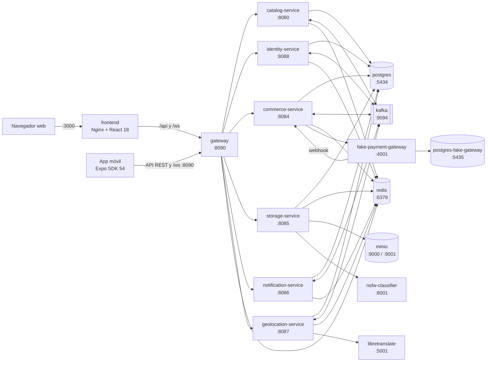
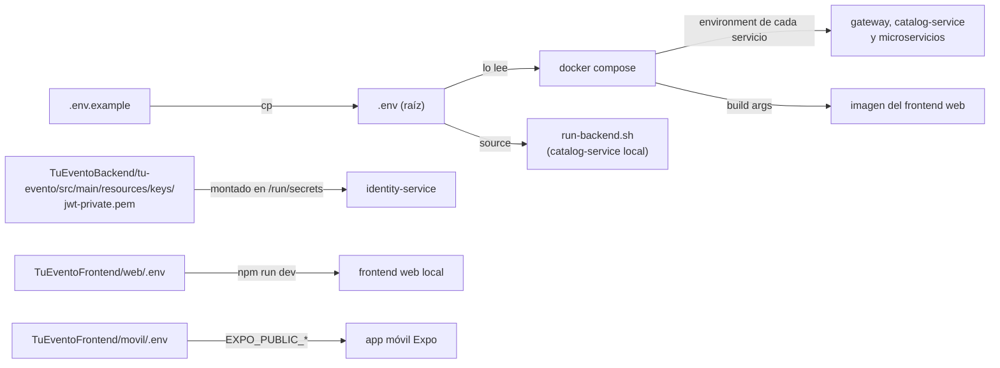
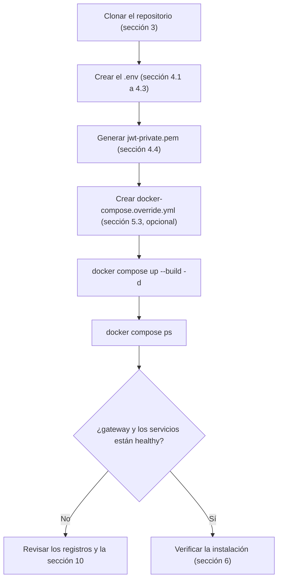
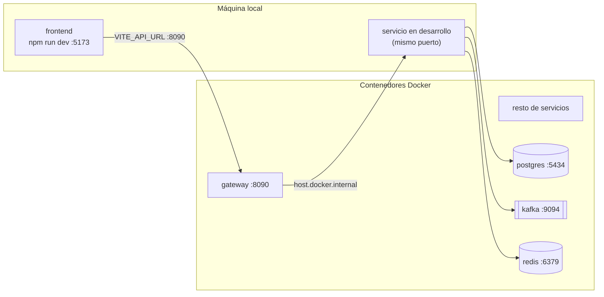
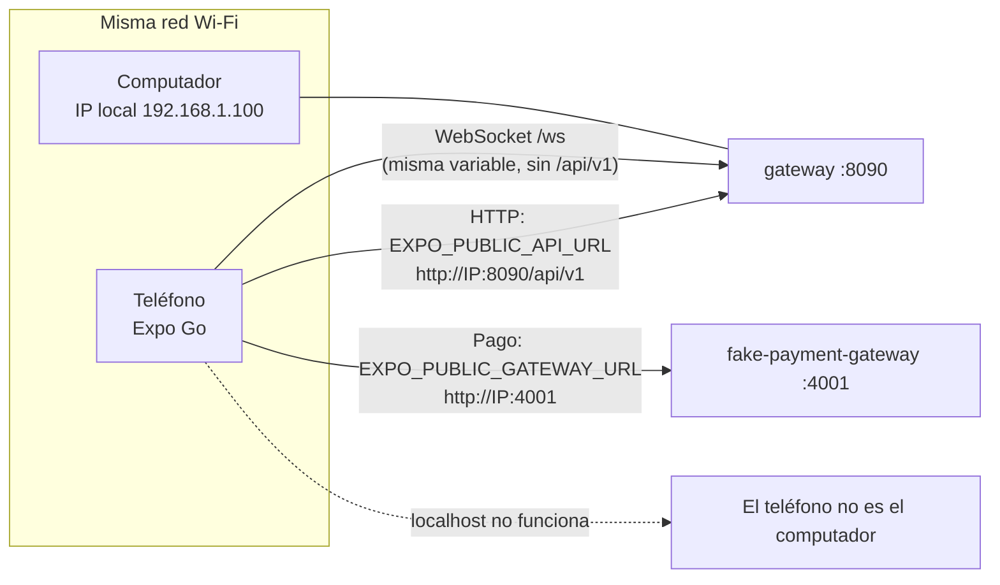
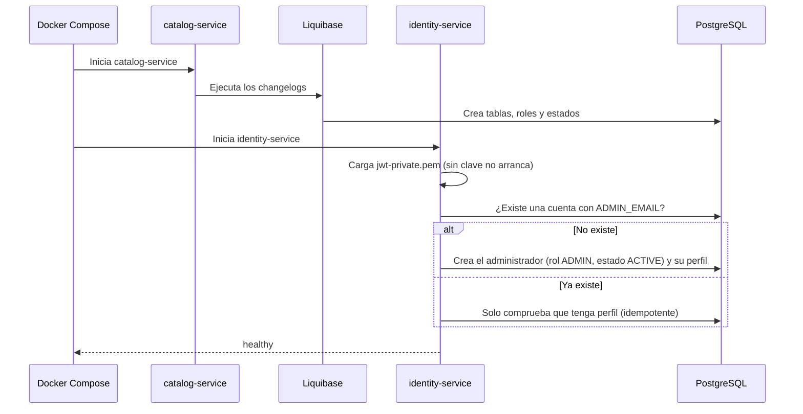

<div align="center">

<br><br><br>

**TuEvento: Manual de instalación**

Guía técnica de despliegue, arquitectura y puesta en marcha del sistema

<br><br>

Jhampier Santos Ortiz y Cristofer David Lozano Contreras

Equipo CapySoft

Servicio Nacional de Aprendizaje (SENA)

Programa de formación: Análisis y Desarrollo de Software (ADSO)

Ficha 3145556

Instructor: Carlos Julio Cadena

Noviembre de 2026

Versión 1.1

</div>

<div style="page-break-after: always;"></div>

## Contenido

1. [Arquitectura y stack tecnológico](#1-arquitectura-y-stack-tecnológico)
2. [Requisitos previos](#2-requisitos-previos)
3. [Obtención del código](#3-obtención-del-código)
4. [Variables de entorno y clave de firma](#4-variables-de-entorno-y-clave-de-firma)
5. [Instalación con Docker (recomendada)](#5-instalación-con-docker-recomendada)
6. [Verificación de la instalación](#6-verificación-de-la-instalación)
7. [Desarrollo local (opcional, modo mixto)](#7-desarrollo-local-opcional-modo-mixto)
8. [Operación diaria](#8-operación-diaria)
9. [App móvil (Expo)](#9-app-móvil-expo)
10. [Solución de problemas](#10-solución-de-problemas)
11. [Notas de seguridad](#11-notas-de-seguridad)
12. [Acceso al sistema](#12-acceso-al-sistema)
13. [Pendiente de verificar](#13-pendiente-de-verificar)
14. [Referencias](#referencias)

### Lista de figuras

- Figura 1. Arquitectura y puertos de TuEvento
- Figura 2. Ubicación y uso de los archivos `.env` y de la clave de firma
- Figura 3. Flujo de instalación con Docker
- Figura 4. Modo de desarrollo local (mixto)
- Figura 5. Conexión de la app móvil con el backend
- Figura 6. Secuencia de arranque y creación del administrador inicial

### Control del documento

| Campo | Valor |
|---|---|
| Repositorio verificado | `lozano2303/TuEvento` |
| Versión del código | `v1.2.0` (rama `main`, commit `ef9b329`, 3 de noviembre de 2026) |
| Fecha de verificación | 5 de noviembre de 2026 |
| Método | Pasos derivados de `docker-compose.yml`, `.env.example`, los `Dockerfile` y los `application*.yml` de cada servicio. La configuración se validó con `docker compose config`; el stack completo no se ejecutó durante esta revisión (ver sección 13). |

> **Alcance.** Este manual cubre la instalación local del frontend web, del backend (API Gateway, `catalog-service` y los cinco microservicios) y de la infraestructura de apoyo. La aplicación móvil (Expo) se trata en la sección 9. El despliegue en servidor (VPS, Render o Kubernetes) se documenta en `09_Implementacion.md`. El formato de citas y referencias sigue las normas APA, séptima edición (American Psychological Association, 2020).

---

## 1. Arquitectura y stack tecnológico

Desde la versión 1.2.0, el backend de TuEvento ya no es un único monolito. Todo el tráfico de los clientes entra por un **API Gateway** (Spring Cloud Gateway), que reparte cada prefijo de `/api/v1` entre `catalog-service` (el antiguo monolito) y cinco microservicios. Los servicios comparten la misma base de datos PostgreSQL y se comunican por HTTP interno y por mensajes en **Kafka**. Todos los servicios están definidos en un único archivo `docker-compose.yml` en la raíz del repositorio (Docker, Inc., s. f.-a).

| Componente | Tecnología | Puerto (host) |
|---|---|---|
| Frontend web | React 18 + Vite 5, servido por Nginx 1.29 en el contenedor | 3000 |
| Frontend móvil | React Native 0.81 / Expo SDK 54 | — |
| API Gateway (`gateway`) | Spring Boot 3.5.12 + Spring Cloud 2025.0.0, Java 17 | 8090 |
| `catalog-service` (servicio `backend`) | Spring Boot 3.5.12, Java 17 (la imagen ejecuta JRE 21). Eventos, categorías, secciones, asientos y WebSocket `/ws`. Ejecuta las migraciones de Liquibase | 8080 |
| `identity-service` | Spring Boot, Java 17. Autenticación, usuarios, temas, perfiles y panel de administración. Firma los JWT (RS256) | 8088 |
| `commerce-service` | Spring Boot, Java 17. Órdenes, boletas y QR, pagos, reembolsos, billetera y ganancias | 8084 |
| `storage-service` | Spring Boot, Java 17. Archivos, URL públicas y moderación de imágenes | 8085 |
| `notification-service` | Spring Boot, Java 17. Notificaciones y correos | 8086 |
| `geolocation-service` | Spring Boot, Java 17. Departamentos, ciudades, sedes, idiomas y traducciones automáticas | 8087 |
| Base de datos | PostgreSQL 17 (compartida por todos los servicios) | 5434 (host) a 5432 (contenedor) |
| Mensajería | Apache Kafka 3.7 en modo KRaft (sin Zookeeper) | 9094, solo en `127.0.0.1` |
| Caché y lista de revocación de JWT | Redis 7 (sin contraseña por defecto) | 6379 |
| Almacenamiento S3 | MinIO | 9000 (API) / 9001 (consola) |
| Almacenamiento S3 alternativo | RustFS (solo si `STORAGE_PROVIDER=rustfs`) | 9100 (API) / 9101 (consola) |
| Traducción automática | LibreTranslate 1.9.6 (es, en, fr, pt) | 5001, solo en `127.0.0.1` |
| Moderación de imágenes NSFW | NSFW Classifier (Python 3.11 / FastAPI) | 8001 a 8000 (contenedor) |
| Pasarela de pagos simulada | Fake Payment Gateway (solo desarrollo) | 4001 |
| Base de datos de la pasarela | PostgreSQL dedicado (`postgres-fake-gateway`) | 5435 |
| Integración continua (opcional) | Jenkins y SonarQube, en el perfil `ci` de Compose | 8082 y 50000 / 9002 |

> **Nota.** La integración continua real corre en GitHub Actions con SonarQube Cloud (`.github/workflows/ci.yml`). Jenkins y SonarQube siguen en `docker-compose.yml`, pero dentro del perfil `ci`: no arrancan con `docker compose up` y no son necesarios para ejecutar la aplicación.

Cada tecnología cuenta con documentación oficial: React (Meta Platforms, s. f.), Vite (Vite, s. f.), Expo (Expo, s. f.), Spring Boot (Spring, s. f.-a), Spring Cloud Gateway (Spring, s. f.-b), PostgreSQL (PostgreSQL Global Development Group, s. f.), Apache Kafka (Apache Software Foundation, s. f.), Redis (Redis, s. f.), MinIO (MinIO, s. f.) y LibreTranslate (LibreTranslate, s. f.).

La Figura 1 resume cómo se comunican los componentes y en qué puerto del host se publica cada uno.

**Figura 1**

*Arquitectura y puertos de TuEvento*



*Nota.* Elaboración propia a partir de `docker-compose.yml` y de las rutas de `TuEventoBackend/gateway/src/main/resources/application.yml` (v1.2.0). Se omiten RustFS y el perfil `ci`.

---

## 2. Requisitos previos

### 2.1 Ejecución con contenedores (recomendada)

| Herramienta | Versión mínima | Verificar con |
|---|---|---|
| Docker Engine | 24.x | `docker --version` |
| Docker Compose | 2.20.x | `docker compose version` |
| Git | Reciente | `git --version` |
| OpenSSL | 1.1.1 o superior | `openssl version` |

- **Windows:** Docker Desktop con el backend WSL2 habilitado. Ejecute los comandos de este manual desde WSL2 o Git Bash.
- **macOS:** Docker Desktop.
- **Linux:** Docker Engine + el plugin de Compose (Docker, Inc., s. f.-b).

OpenSSL se usa para generar la clave de firma de los JWT y las claves aleatorias (sección 4).

### 2.2 Requisitos de hardware

El stack de la versión 1.2.0 ejecuta ocho procesos Java (gateway, `catalog-service`, cinco microservicios y la pasarela simulada) además de Kafka, LibreTranslate y el clasificador NSFW, por lo que exige más memoria que las versiones anteriores.

| Escenario | RAM recomendada | Disco libre |
|---|---|---|
| Stack por defecto (`docker compose up`) | 16 GB | Aprox. 20 GB |
| Stack por defecto sin RustFS | 12 a 16 GB | Aprox. 18 GB |

| Servicio | RAM estimada | Imagen en disco |
|---|---|---|
| nsfw-classifier (TensorFlow) | 1 a 2 GB | Aprox. 3 a 4 GB |
| libretranslate (4 idiomas) | 1 a 2 GB | Aprox. 2 GB + modelos |
| kafka | 512 MB a 1 GB | Aprox. 500 MB |
| gateway, `catalog-service` y cada microservicio (7 en total) | 300 a 700 MB cada uno | Aprox. 300 MB cada uno |
| fake-payment-gateway | 256 a 512 MB | Aprox. 300 MB |
| minio / rustfs | 256 a 512 MB cada uno | Aprox. 250 MB + archivos |
| postgres (x2 instancias) | 128 a 256 MB cada una | Aprox. 250 MB + datos |
| redis / frontend (Nginx) | Menos de 100 MB | Aprox. 90 MB |

Son valores estimados; el consumo real varía según el equipo y la carga. Con Docker Desktop, asigne al menos 12 GB de memoria en *Settings > Resources*.

### 2.3 Desarrollo local sin contenedores (opcional)

| Herramienta | Versión |
|---|---|
| Java JDK | OpenJDK / Eclipse Temurin 17 (todo el backend apunta a Java 17) |
| Maven | 3.9.x (los microservicios de `TuEventoBackend/services/` no incluyen `mvnw`) |
| Node.js | 20.19 o superior con npm 10.x (la imagen del frontend usa Node 20.19 y la CI usa Node 22) |

Incluso en este modo, PostgreSQL, Kafka, Redis, MinIO y el resto de servicios deben estar en ejecución; se inician con Docker (ver sección 7). Por lo tanto es un **modo mixto**: el stack en contenedores y, en su máquina, solo el servicio o el frontend que esté desarrollando.

### 2.4 Puertos que deben estar libres

`3000`, `4001`, `5434`, `5435`, `6379`, `8001`, `8080`, `8084`, `8085`, `8086`, `8087`, `8088`, `8090`, `9000`, `9001`, `9100` y `9101` (Web, Pagos, PostgreSQL, PostgreSQL de pagos, Redis, NSFW, `catalog-service`, los cinco microservicios, Gateway, MinIO y RustFS). Además, en `127.0.0.1`: `5001` (LibreTranslate) y `9094` (Kafka). Si inicia el perfil `ci`, también `8082`, `9002` y `50000` (Jenkins y SonarQube).

---

## 3. Obtención del código

El código fuente del proyecto se encuentra en el repositorio del equipo CapySoft (CapySoft, 2026). Para instalar la versión publicada, clone la rama `main` o el tag `v1.2.0`:

```bash
git clone https://github.com/lozano2303/TuEvento.git tuevento
cd tuevento
git checkout v1.2.0   # opcional: fija exactamente la versión de este manual
```

La rama `develop` contiene el trabajo en curso y puede diferir de lo descrito aquí.

---

## 4. Variables de entorno y clave de firma

### 4.1 Creación del archivo .env

Docker Compose lee un único archivo `.env` en la raíz del repositorio y pasa a cada contenedor solo las variables que declara en `docker-compose.yml`:

```bash
cp .env.example .env
```

Para ejecutar `catalog-service` fuera de Docker, use el script `run-backend.sh` de la raíz, que carga ese mismo `.env` (sección 7). Ya no es necesario copiar el archivo a `TuEventoBackend/tu-evento/`.

Para el frontend web ejecutado con `npm run dev`, cree `TuEventoFrontend/web/.env`:

```env
VITE_API_URL=http://localhost:8090/api/v1
VITE_GOOGLE_CLIENT_ID=<su_client_id_de_google>
VITE_GATEWAY_URL=http://localhost:4001
```

`VITE_GATEWAY_URL` es la URL de la pasarela de pagos simulada a la que se redirige al comprador. La imagen Docker del frontend **no** usa este archivo (el `.dockerignore` excluye los `.env`); recibe los valores como argumentos de construcción (sección 5.3).

La Figura 2 muestra qué archivo lee cada componente.

**Figura 2**

*Ubicación y uso de los archivos `.env` y de la clave de firma*



*Nota.* Elaboración propia. Las variables `VITE_*` se incrustan en tiempo de construcción, por lo que un cambio exige reconstruir la imagen del frontend.

### 4.2 Variables obligatorias

| Variable | Descripción | Ejemplo / cómo obtenerla |
|---|---|---|
| `POSTGRES_DB` | Nombre de la base de datos. **Debe ser `tuevento_db`**: todos los servicios del compose se conectan a `jdbc:postgresql://postgres:5432/tuevento_db` | `tuevento_db` |
| `POSTGRES_USER` | Usuario de PostgreSQL (también lo usa la base de la pasarela) | `tuevento_user` |
| `POSTGRES_PASSWORD` | Contraseña de PostgreSQL | Una contraseña fuerte propia |
| `JWT_SECRET` | Secreto HS256 heredado: valida tokens emitidos antes del cambio a RS256 y es el valor de respaldo de `QR_SECRET` (mín. 32 caracteres) | `openssl rand -base64 48` |
| `INTERNAL_API_KEY` | Clave compartida entre servicios para las rutas `/internal/**` (cabecera `X-Internal-Api-Key`). Si queda vacía, esas rutas quedan cerradas y fallan las subidas de archivos, la compra de boletas y el panel de administración | `openssl rand -hex 32` |
| `WEBHOOK_SECRET` | Secreto con el que la pasarela simulada firma los webhooks y `commerce-service` los verifica. Si falta, los pagos no se confirman | `openssl rand -hex 32` |
| `MAIL_USERNAME` | Cuenta de Gmail que envía las notificaciones | `micuenta@gmail.com` |
| `MAIL_PASSWORD` | Contraseña de aplicación de 16 caracteres (no la contraseña personal) | Ver 4.5 |
| `GOOGLE_CLIENT_ID` | Client ID de OAuth 2.0 | Ver 4.6 |
| `GOOGLE_CLIENT_SECRET` | Client Secret de OAuth 2.0 | Ver 4.6 |
| `MINIO_ROOT_USER` | Usuario administrador de MinIO | Uno propio (evite el valor por defecto de MinIO) |
| `MINIO_ROOT_PASSWORD` | Contraseña del administrador de MinIO (mín. 8 caracteres) | Una contraseña fuerte propia |
| `ADMIN_EMAIL` | Correo del administrador inicial | `admin@sudominio.com` |
| `ADMIN_PASSWORD` | Contraseña del administrador inicial | Una contraseña fuerte propia |
| `ADMIN_ALIAS` | Alias del administrador inicial | `admin` |

### 4.3 Variables opcionales

Tienen un valor por defecto en `docker-compose.yml` o en el `application.yml` del servicio que las usa:

| Variable | Valor por defecto | Cuándo definirla |
|---|---|---|
| `APP_CORS_ALLOWED_ORIGINS` | `http://localhost:3000` | Orígenes que acepta el gateway (`GATEWAY_CORS_ALLOWED_ORIGINS`) si sirve la web desde otro origen |
| `FAKE_GATEWAY_API_KEY` | Un valor de desarrollo conocido | Siempre fuera de local; la comparten la pasarela y `commerce-service` |
| `QR_SECRET` | El valor de `JWT_SECRET` | Para firmar los QR de las boletas con un secreto propio |
| `STORAGE_PROVIDER` | `minio` | `rustfs` para usar RustFS en lugar de MinIO |
| `RUSTFS_ACCESS_KEY` / `RUSTFS_SECRET_KEY` | Un valor por defecto conocido | Si usa RustFS |
| `RUSTFS_PUBLIC_URL` | `http://localhost:9100` | Si usa RustFS desde otro host |
| `MINIO_PUBLIC_URL` | `http://localhost:9000` | URL pública de los archivos; para la app móvil, use la IP local de la máquina |
| `SIGHTENGINE_API_USER` / `SIGHTENGINE_API_SECRET` | Vacías | Moderación de imágenes con Sightengine, además del clasificador local |
| `SIGHTENGINE_MODELS` / `SIGHTENGINE_THRESHOLD` / `SIGHTENGINE_NUDITY_THRESHOLD` | `gore,nudity,weapon` / `0.4` / `0.15` | Ajuste de la moderación |
| `NOTIFICATION_EMAIL_ENABLED` | `true` | `false` para no enviar correos en pruebas |
| `TRANSLATION_PROTECTED_TERMS` | `Tu Evento` | Términos que la traducción automática no debe traducir |
| `GATEWAY_LOG_LEVEL` | `INFO` | `DEBUG` para depurar el enrutamiento |
| `FACEBOOK_CLIENT_ID` / `FACEBOOK_CLIENT_SECRET` | Vacías | Están en `.env.example`, pero el compose de v1.2.0 no las pasa a ningún servicio |

> **Nota.** `.env.example` también lista variables como `REDIS_HOST`, `NSFW_SERVICE_URL`, `KAFKA_BOOTSTRAP_SERVERS`, `PAYMENT_GATEWAY` o `FAKE_GATEWAY_URL`. Dentro de Docker no hace falta definirlas: `docker-compose.yml` fija las direcciones internas (`redis`, `kafka:9092`, `http://fake-payment-gateway:4001`, etc.). Solo se usan al ejecutar un servicio fuera de Docker (sección 7).

### 4.4 Clave de firma de los JWT (RS256)

`identity-service` firma los tokens con una clave privada RSA y publica la clave pública en `/.well-known/jwks.json`; los demás servicios solo verifican. **`identity-service` no arranca sin esta clave** (`ephemeral-keys-allowed: false`). El compose monta la carpeta `TuEventoBackend/tu-evento/src/main/resources/keys/` en `/run/secrets` dentro del contenedor.

```bash
cd TuEventoBackend/tu-evento/src/main/resources/keys
openssl genpkey -algorithm RSA -pkeyopt rsa_keygen_bits:2048 -out jwt-private.pem
chmod 644 jwt-private.pem   # el contenedor lee el archivo con un usuario sin privilegios
cd -
```

- El archivo `jwt-private.pem` está en `.gitignore`; no lo suba al repositorio.
- `openssl genpkey` genera la clave en formato PKCS#8, que es el que espera el servicio.
- Use una clave distinta en cada entorno. El permiso `644` es aceptable en un equipo de desarrollo; en un servidor, restrinja el acceso al directorio.

### 4.5 Obtención de la contraseña de aplicación de Gmail

1. Active la verificación en dos pasos en su cuenta de Google.
2. Vaya a Cuenta de Google, Seguridad, Contraseñas de aplicaciones (Google, s. f.-a).
3. Genere una contraseña para «Correo» y cópiela (16 caracteres, sin espacios) en `MAIL_PASSWORD`.

### 4.6 Configuración de Google OAuth 2.0

1. En Google Cloud Console, cree o seleccione un proyecto (Google, s. f.-b).
2. Vaya a APIs y servicios, Credenciales, Crear credenciales, ID de cliente de OAuth.
3. Tipo de aplicación: Aplicación web.
4. En Orígenes de JavaScript autorizados agregue `http://localhost:3000` (y `http://localhost:5173` si ejecuta el frontend con `npm run dev`, además del dominio de producción si aplica).
5. Copie el Client ID y el Client Secret en las variables correspondientes. El mismo Client ID debe ir en `VITE_GOOGLE_CLIENT_ID` del frontend (sección 5.3).

> **Consejo.** Si aparece el error `origin not allowed` o `origin_mismatch`, el origen no está autorizado en ese Client ID.

### 4.7 Seguridad del archivo .env

- No haga commit del `.env` ni de `jwt-private.pem`. Ambos están en `.gitignore`; verifíquelo con:

  ```bash
  git check-ignore -v .env TuEventoBackend/tu-evento/src/main/resources/keys/jwt-private.pem
  ```

- Rote las credenciales (claves, contraseñas y secretos) si fueron expuestas.

---

## 5. Instalación con Docker (recomendada)

La Figura 3 presenta el flujo completo de esta sección.

**Figura 3**

*Flujo de instalación con Docker*



*Nota.* Elaboración propia a partir de `docker-compose.yml` (v1.2.0).

### 5.1 Inicio de los servicios

1. Verifique que el `.env` esté configurado y que exista `jwt-private.pem` (sección 4).
2. Construya las imágenes e inicie los servicios en segundo plano:

   ```bash
   docker compose up --build -d
   ```

   Este comando inicia todo excepto Jenkins y SonarQube (perfil `ci`).

3. Siga el estado de los contenedores hasta que el gateway y los microservicios aparezcan como `healthy`:

   ```bash
   docker compose ps
   docker compose logs -f backend identity-service gateway
   ```

   Presione `Ctrl + C` para salir de los registros (los servicios siguen en ejecución).

> **Nota.** La primera ejecución puede tardar bastante: se descargan las imágenes base, Maven compila nueve proyectos Java (incluida la librería `tuevento-common`, que cada microservicio compila dentro de su imagen), el clasificador NSFW instala TensorFlow y LibreTranslate descarga los modelos de los cuatro idiomas (su healthcheck concede hasta 300 s de arranque). `geolocation-service` espera a que LibreTranslate esté `healthy`, y `catalog-service`, `notification-service` y `commerce-service` esperan a Kafka.

> **Nota.** Docker Compose muestra el aviso ``the attribute `version` is obsolete``. Es inofensivo: el archivo conserva la clave `version: '3.8'` y Compose la ignora.

### 5.2 Orden de arranque

| Paso | Servicio | Condición en `docker-compose.yml` |
|---|---|---|
| 1 | postgres, postgres-fake-gateway, redis, minio, kafka, libretranslate, nsfw-classifier, rustfs | Sin dependencias |
| 2 | minio-init | Espera a `minio` (`service_healthy`) y crea el bucket `tuevento` con los prefijos públicos `profile_picture/` y `event_media/` |
| 3 | backend (`catalog-service`) | Espera a `kafka` (`service_healthy`); a postgres y redis solo `service_started`. Ejecuta Liquibase |
| 4 | identity, storage, notification, geolocation y commerce | Esperan a que el backend haya iniciado (`service_started`), porque el backend migra las tablas |
| 5 | gateway | Espera a que arranquen el backend y los cinco microservicios |
| 6 | frontend | Espera al gateway |

### 5.3 Configuración local adicional (docker-compose.override.yml)

El servicio `frontend` del compose solo recibe `VITE_API_URL` como argumento de construcción. Para que funcione el inicio de sesión con Google en la web servida desde Docker, cree en la raíz un archivo `docker-compose.override.yml` (Compose lo combina automáticamente con el principal) y no lo suba al repositorio:

```yaml
services:
  frontend:
    build:
      args:
        VITE_GOOGLE_CLIENT_ID: ${VITE_GOOGLE_CLIENT_ID}
        VITE_GATEWAY_URL: http://localhost:4001
```

Defina `VITE_GOOGLE_CLIENT_ID` en el `.env` de la raíz y reconstruya: `docker compose up --build -d frontend`.

### 5.4 Ahorro de memoria

RustFS se inicia por defecto aunque no se use. Si trabaja con MinIO, puede detenerlo:

```bash
docker compose stop rustfs
```

Jenkins y SonarQube solo se inician si se piden de forma explícita:

```bash
docker compose --profile ci up -d jenkins sonarqube
```

---

## 6. Verificación de la instalación

| Verificación | Comando / acción | Resultado esperado |
|---|---|---|
| Contenedores | `docker compose ps` | Todos en ejecución; los que tienen healthcheck, `healthy`. `minio-init` termina con código 0 |
| API Gateway | `curl -s http://localhost:8090/actuator/health` | `{"status":"UP"...}` |
| `catalog-service` | `curl -s http://localhost:8080/actuator/health` | `{"status":"UP"...}` |
| Microservicios | `curl -s http://localhost:<puerto>/actuator/health` con 8084, 8085, 8086, 8087 y 8088 | `{"status":"UP"...}` en cada uno |
| Claves públicas JWT | `curl -s http://localhost:8090/.well-known/jwks.json` | Un JSON con la lista `keys` |
| Ruta a través del gateway | `curl -s http://localhost:8090/api/v1/categories` | Respuesta de `catalog-service` (no 404) |
| Redis | `docker exec -it tuevento-redis redis-cli ping` | `PONG` |
| Kafka | `docker compose ps kafka` | `healthy` |
| LibreTranslate | `docker compose ps libretranslate` | `healthy` (puede tardar hasta 5 minutos la primera vez) |
| Clasificador NSFW | `curl -s http://localhost:8001/health` | `{"status": "ok"}` |
| MinIO | Abrir `http://localhost:9001` | La consola de MinIO es accesible |
| Frontend web | Abrir `http://localhost:3000` | Carga la página de inicio |
| Fake Payment Gateway | `docker compose logs fake-payment-gateway` | Inicia sin errores (no tiene healthcheck) |

> **Consejo.** El gateway no tiene ruta por defecto: una ruta de `/api/v1` que no esté asignada a ningún servicio responde 404. La documentación interactiva (Swagger) se consulta en cada servicio, no en el gateway (sección 12).

### Nombres de los contenedores

| Servicio | Contenedor | Puerto host:contenedor |
|---|---|---|
| postgres | tuevento-postgres | 5434:5432 |
| postgres-fake-gateway | fake-gateway-postgres | 5435:5432 |
| redis | tuevento-redis | 6379:6379 |
| kafka | tuevento-kafka | 127.0.0.1:9094:9094 |
| minio / minio-init | tuevento-minio / tuevento-minio-init | 9000:9000, 9001:9001 / ninguno |
| rustfs | tuevento-rustfs | 9100:9000, 9101:9001 |
| libretranslate | tuevento-libretranslate | 127.0.0.1:5001:5000 |
| nsfw-classifier | nsfw-classifier | 8001:8000 |
| fake-payment-gateway | fake-payment-gateway | 4001:4001 |
| backend (`catalog-service`) | tuevento-backend-dev | 8080:8080 |
| gateway | tuevento-gateway | 8090:8090 |
| identity-service | tuevento-identity-service | 8088:8088 |
| commerce-service | tuevento-commerce-service | 8084:8084 |
| storage-service | tuevento-storage-service | 8085:8085 |
| notification-service | tuevento-notification-service | 8086:8086 |
| geolocation-service | tuevento-geolocation-service | 8087:8087 |
| frontend | tuevento-frontend | 3000:80 |
| jenkins (perfil `ci`) | tuevento-jenkins | 8082:8080, 50000:50000 |
| sonarqube (perfil `ci`) | tuevento-sonarqube | 9002:9000 |

---

## 7. Desarrollo local (opcional, modo mixto)

Con tantos servicios, lo práctico es ejecutar todo el stack en Docker y sacar de Docker solo el componente que se está desarrollando (ver Figura 4). Los `application.yml` de los servicios ya apuntan por defecto a los puertos publicados en el host (`localhost:5434` para PostgreSQL, `localhost:9094` para Kafka, `localhost:6379` para Redis y `localhost:8088` para `identity-service`).

**Figura 4**

*Modo de desarrollo local (mixto)*



*Nota.* Elaboración propia. El gateway dentro de Docker llega a un servicio del host mediante `host.docker.internal` (ver paso 3).

1. **Frontend web.** Con el stack en Docker y `TuEventoFrontend/web/.env` configurado (sección 4.1):

   ```bash
   docker compose stop frontend   # opcional
   cd TuEventoFrontend/web
   npm install
   npm run dev
   ```

   Vite sirve en `http://localhost:5173`, que ya está entre los orígenes CORS por defecto del gateway.

2. **`catalog-service`.** Detenga el contenedor y arranque el servicio con el script de la raíz, que carga el `.env`:

   ```bash
   docker compose stop backend
   ./run-backend.sh
   ```

   Agregue al `.env` las variables que en Docker fija el compose:

   ```env
   SPRING_DATASOURCE_URL=jdbc:postgresql://localhost:5434/tuevento_db
   INTERNAL_API_KEY=<la_misma_clave_del_stack>
   ```

   > **Importante.** Si omite `SPRING_DATASOURCE_URL`, el perfil `dev` usa `localhost:5432`, donde no hay PostgreSQL, y el servicio no podrá iniciar.

3. **Un microservicio** (por ejemplo `identity-service`). Los microservicios dependen de la librería `tuevento-common`, que hay que instalar antes en el repositorio local de Maven:

   ```bash
   docker compose stop identity-service
   cd TuEventoBackend/services
   mvn -B -f tuevento-common/pom.xml install -DskipTests
   set -a; source ../../.env; set +a
   mvn -f identity-service/pom.xml spring-boot:run
   ```

   Para `identity-service` defina además `APP_JWT_PRIVATE_KEY_PATH=file:<ruta_absoluta>/jwt-private.pem` y `AUTH_COOKIE_SECURE=false`.

4. **Redirigir el gateway al servicio local.** Los contenedores llaman a los servicios por su nombre de red, así que hay que indicarles que usen el host. Por ejemplo, para `identity-service`, añada al `docker-compose.override.yml`:

   ```yaml
   services:
     gateway:
       extra_hosts:
         - "host.docker.internal:host-gateway"
       environment:
         - IDENTITY_SERVICE_URI=http://host.docker.internal:8088
   ```

   Y aplique el cambio con `docker compose up -d gateway`. Los demás servicios que llaman a `identity-service` (por ejemplo, a su JWKS) necesitan el mismo ajuste en sus variables `JWK_SET_URI` e `IDENTITY_SERVICE_URL`.

---

## 8. Operación diaria

| Acción | Comando |
|---|---|
| Ver los registros de un servicio | `docker compose logs -f <servicio>` |
| Ver el estado de los servicios | `docker compose ps` |
| Detener sin borrar datos | `docker compose down` |
| Reiniciar un servicio | `docker compose restart <servicio>` |
| Reconstruir un servicio tras cambiar su código | `docker compose up --build -d <servicio>` |
| Actualizar a la última versión | `git pull && docker compose up --build -d` |

> **Advertencia.** `docker compose down -v` elimina todos los volúmenes. Úselo solo para reiniciar el sistema desde cero; borrar volúmenes de forma parcial puede dejar registros huérfanos entre la base de datos, Kafka y MinIO.

### 8.1 Volúmenes persistentes

| Volumen | Servicio | Contenido |
|---|---|---|
| `postgres_data` | postgres | Base de datos principal (compartida por todos los servicios) |
| `postgres_fake_gateway_data` | postgres-fake-gateway | Base de datos de la pasarela simulada |
| `kafka_data` | kafka | Mensajes y offsets (retención de 72 h) |
| `redis_data` | redis | Datos de la caché |
| `minio_data` | minio | Archivos e imágenes subidos |
| `rustfs_data` | rustfs | Archivos, si se usa RustFS |
| `libretranslate-models` | libretranslate | Modelos de traducción descargados |
| `jenkins_data` | jenkins | Configuración y trabajos de Jenkins (perfil `ci`) |
| `sonarqube_data` / `_logs` / `_extensions` | sonarqube | Datos, registros y plugins de SonarQube (perfil `ci`) |

### 8.2 Respaldo de datos

Antes de cualquier operación destructiva o de una actualización de versión, respalde PostgreSQL y MinIO. El respaldo de la base de datos usa `pg_dump` (PostgreSQL Global Development Group, s. f.):

```bash
# PostgreSQL: respaldo y restauración
docker exec tuevento-postgres pg_dump -U <POSTGRES_USER> tuevento_db \
  > backup_tuevento.sql
docker exec -i tuevento-postgres psql -U <POSTGRES_USER> -d tuevento_db \
  < backup_tuevento.sql

# MinIO: copia del volumen (Linux/macOS/Git Bash)
docker volume ls     # busque el nombre real (termina en minio_data)
docker run --rm -v <volumen_minio>:/data -v "$(pwd)":/backup alpine \
  tar czf /backup/minio_backup.tgz -C /data .
```

---

## 9. App móvil (Expo)

La app móvil usa Expo SDK 54 (React Native 0.81) y no forma parte del despliegue con Docker (Expo, s. f.).

```bash
cd TuEventoFrontend/movil
cp .env.example .env
npm install
npx expo start
```

Variables de `TuEventoFrontend/movil/.env`:

| Variable | Valor en local |
|---|---|
| `EXPO_PUBLIC_API_URL` | `http://<IP_LOCAL_DE_LA_MAQUINA>:8090/api/v1` (el gateway) |
| `EXPO_PUBLIC_GATEWAY_URL` | `http://<IP_LOCAL_DE_LA_MAQUINA>:4001` (pasarela de pagos simulada) |
| `EXPO_PUBLIC_MINIO_HOST` | `<IP_LOCAL_DE_LA_MAQUINA>`; reemplaza `localhost` en las URL de los archivos |
| `EXPO_PUBLIC_GOOGLE_CLIENT_ID` | Client ID de Google para la app |
| `EXPO_PUBLIC_FACEBOOK_APP_ID` | App ID de Facebook (opcional) |

- Para probar en un dispositivo físico, instale Expo Go y asegúrese de que el teléfono y el computador estén en la misma red.
- La app debe apuntar a la IP local de la máquina (por ejemplo `192.168.1.100`), nunca a `localhost`.
- El servicio de WebSocket (`websocketService.js`) deriva su URL de `EXPO_PUBLIC_API_URL` (elimina `/api/v1`), por lo que un valor incorrecto también afecta las funciones en tiempo real.
- Después de cambiar el `.env`, reinicie Expo con `npx expo start -c`.
- Los builds de EAS (perfil `preview`) no leen este archivo: las variables se configuran en el entorno `preview` de EAS con `eas env:create`, como indica `.env.example`.

**Figura 5**

*Conexión de la app móvil con el backend*



*Nota.* Elaboración propia. La IP de ejemplo debe reemplazarse por la IP local real del computador que ejecuta el stack.

---

## 10. Solución de problemas

| Problema | Causa probable | Solución |
|---|---|---|
| Puerto en uso (8090, 5434, etc.) | Otro proceso lo está usando | Linux/macOS: `lsof -i :8090`. Windows: `netstat -ano \| findstr :8090`. Cierre el proceso o reasigne el puerto en `docker-compose.override.yml`. |
| Los servicios no se conectan a la base de datos (`database "tuevento_db" does not exist`) | `POSTGRES_DB` tiene otro nombre; el compose crea la base con `POSTGRES_DB`, pero los servicios usan `tuevento_db` | Defina `POSTGRES_DB=tuevento_db`. Si el volumen ya existía, cree la base a mano (`docker exec -it tuevento-postgres createdb -U <POSTGRES_USER> tuevento_db`) o reinicie desde cero con `docker compose down -v`. |
| `identity-service` no arranca (error de clave privada) | Falta `jwt-private.pem` o el contenedor no puede leerlo | Genere la clave (sección 4.4), dele permiso de lectura (`chmod 644`) y ejecute `docker compose up -d identity-service`. |
| Fallan las subidas de imágenes, la compra o el panel de administración (401/403 en `/internal`) | `INTERNAL_API_KEY` vacía | Defina la clave en el `.env` y recree los servicios: `docker compose up -d`. |
| El pago queda pendiente y no se confirma | `WEBHOOK_SECRET` vacío o distinto entre la pasarela y `commerce-service` | Defina `WEBHOOK_SECRET` en el `.env` y recree `fake-payment-gateway` y `commerce-service`. |
| Liquibase: error de conexión a PostgreSQL | El backend inició antes que PostgreSQL (postgres solo tiene condición `service_started`) | `docker compose restart backend`, y después los microservicios que fallaron. Solución permanente: healthcheck en Postgres (ver abajo). |
| `geolocation-service` tarda en iniciar | Espera a LibreTranslate, que descarga sus modelos la primera vez | Espere hasta 5 minutos; revise `docker compose logs -f libretranslate`. |
| Errores de Kafka en los registros (`Connection to node -1`) | Kafka aún no está listo | Espere a que `kafka` esté `healthy`; los servicios reintentan. |
| 404 en una ruta de la API | El gateway no tiene ruta por defecto | Verifique que la ruta exista en la versión instalada y que el servicio que la atiende esté en ejecución. |
| 502/503 desde el gateway | El servicio de destino no está en ejecución o aún no inicia | `docker compose ps` y `docker compose logs <servicio>`. |
| El inicio de sesión con Google no funciona en el frontend de Docker | El compose no pasa `VITE_GOOGLE_CLIENT_ID` a la construcción | Cree el `docker-compose.override.yml` de la sección 5.3 y reconstruya `frontend`. |
| Error de CORS | Origen no permitido por el gateway | Verifique que `APP_CORS_ALLOWED_ORIGINS` incluya el origen de la web y recree el gateway: `docker compose up -d gateway`. |
| Error de autenticación de Gmail | Contraseña incorrecta | Use una contraseña de aplicación de 16 caracteres, no la contraseña personal (requiere verificación en dos pasos). |
| Google: `origin_mismatch` / `origin not allowed` | Origen no autorizado o Client ID incorrecto | Revise los Orígenes de JavaScript autorizados en Google Cloud Console y que `VITE_GOOGLE_CLIENT_ID` coincida. |
| La app móvil no se conecta (ni el WebSocket) | `EXPO_PUBLIC_API_URL` apunta a localhost, a una IP incorrecta o al puerto 8080 | Use `http://<IP_local>:8090/api/v1`, la misma red Wi-Fi, y reinicie con `npx expo start -c`. |
| Las imágenes no cargan en la app móvil | Las URL públicas usan `localhost` | Defina `EXPO_PUBLIC_MINIO_HOST` con la IP local. |
| El clasificador NSFW responde lento al inicio | Carga del modelo en el primer inicio | Espere a que `/health` responda; revise con `docker compose logs -f nsfw-classifier`. |
| Docker se queda sin memoria (contenedores reiniciándose, `Killed`) | El stack completo necesita unos 12 a 16 GB | Asigne más memoria a Docker y detenga lo que no use (`docker compose stop rustfs`). |

### Healthcheck recomendado para PostgreSQL

Se puede añadir en `docker-compose.override.yml`, sin modificar el archivo del repositorio:

```yaml
services:
  postgres:
    healthcheck:
      test: ["CMD-SHELL", "pg_isready -U ${POSTGRES_USER} -d tuevento_db"]
      interval: 5s
      timeout: 5s
      retries: 10
  backend:
    depends_on:
      postgres:
        condition: service_healthy
```

---

## 11. Notas de seguridad

La configuración incluida está pensada para desarrollo. Antes de exponer el sistema, revise:

| Elemento | Estado actual (`docker-compose.yml`) | Acción para producción |
|---|---|---|
| Fake Payment Gateway | Solo desarrollo y pruebas | No usarla con dinero real. |
| `FAKE_GATEWAY_API_KEY`, claves de RustFS | Tienen valores por defecto conocidos | Defina valores propios. |
| `INTERNAL_API_KEY`, `WEBHOOK_SECRET`, `JWT_SECRET` | Definidos por el `.env` | Valores aleatorios largos y distintos en cada entorno. |
| `jwt-private.pem` | Archivo local montado en solo lectura | Una clave por entorno, fuera del repositorio y con acceso restringido. |
| Redis | Sin contraseña | Active `--requirepass` en Redis y defina `REDIS_PASSWORD`, que leen el gateway y los microservicios (ver sección 13 para `catalog-service`). |
| Actuator | En `catalog-service`, `/actuator/**` es público; en los microservicios solo `health` e `info` | Exponga solo health/info y limite el acceso por red. |
| Swagger / OpenAPI | Público en `catalog-service` y en cada microservicio | Desactívelo o restrinja el acceso. |
| Puertos de los servicios internos | 8080 y 8084 a 8088 publicados en el host | En producción, publique solo el frontend y el gateway; el resto debe quedar en la red interna. |
| Cookie del refresh token | `AUTH_COOKIE_SECURE=false` en local (HTTP) | `true` con HTTPS. |
| Jenkins y SonarQube | Perfil `ci`, inactivos | No los exponga a Internet. |
| Administrador inicial | Creado con `ADMIN_PASSWORD` | Cambie la contraseña tras el primer inicio de sesión. |

- Use HTTPS en cualquier entorno distinto del local. Lo habitual es colocar un proxy inverso (Nginx, Nginx Proxy Manager o Caddy) al frente, que termine TLS y sea el único servicio con los puertos 80/443 abiertos al exterior. El repositorio incluye `docker-compose.prod.yml` y `.env.prod.example` para ese escenario (ver `09_Implementacion.md`).
- Mantenga el `.env` fuera del repositorio y rote las credenciales si alguna fue expuesta.

---

## 12. Acceso al sistema

| Recurso | URL |
|---|---|
| Aplicación web | `http://localhost:3000` |
| API (punto de entrada único) | `http://localhost:8090/api/v1` |
| Estado del gateway | `http://localhost:8090/actuator/health` |
| Swagger de `catalog-service` | `http://localhost:8080/swagger-ui/index.html` |
| Swagger de los microservicios | `http://localhost:<puerto>/swagger-ui/index.html` (8084, 8085, 8086, 8087 y 8088) |
| Consola de MinIO | `http://localhost:9001` |
| Consola de RustFS (si se usa) | `http://localhost:9101` |
| Jenkins (perfil `ci`) | `http://localhost:8082` |
| SonarQube (perfil `ci`) | `http://localhost:9002` |

### 12.1 Primer acceso y usuario administrador

Liquibase (changelog 017; Liquibase, s. f.), que ejecuta `catalog-service`, solo inserta los roles (`ADMIN`, `ORGANIZER`, `USER`) y los estados de usuario; no crea ningún usuario. El administrador lo crea `identity-service` al arrancar, mediante la clase `AdminAccountSeeder` (un `ApplicationRunner` con `@Order(1)`), como se ilustra en la Figura 6.

**Figura 6**

*Secuencia de arranque y creación del administrador inicial*



*Nota.* Elaboración propia a partir de `AdminAccountSeeder.java` y `docker-compose.yml` (v1.2.0).

| Campo | Valor |
|---|---|
| Correo | Valor de `ADMIN_EMAIL` |
| Contraseña | Valor de `ADMIN_PASSWORD` (almacenada como hash) |
| Alias | Valor de `ADMIN_ALIAS` |
| Nombre completo | Administrador Principal (fijo en el código) |
| Rol / estado | ADMIN / ACTIVE |
| Idempotencia | Si ya existe una cuenta con ese correo, no se vuelve a crear |
| Sin configurar | Si `ADMIN_EMAIL` o `ADMIN_PASSWORD` están vacías, no se crea el administrador y el servicio lo advierte en el registro |

> **Listo.** Defina `ADMIN_EMAIL`, `ADMIN_PASSWORD` y `ADMIN_ALIAS` en el `.env` antes del primer inicio e ingrese con esas credenciales en `http://localhost:3000`. Cualquier otro usuario puede crearse desde el formulario de registro de la aplicación.

---

## 13. Pendiente de verificar

Puntos que no se pudieron confirmar solo con la lectura del código y que conviene comprobar en la primera instalación limpia:

| # | Punto | Cómo comprobarlo |
|---|---|---|
| 1 | Ejecución completa del stack v1.2.0 en un equipo limpio, siguiendo este manual paso a paso | `docker compose up --build -d` y la tabla de la sección 6 |
| 2 | Requisitos de hardware (sección 2.2): son estimaciones, no mediciones | `docker stats` con el stack en reposo y en uso |
| 3 | Necesidad del `chmod 644` sobre `jwt-private.pem` (depende de los permisos con los que `openssl` crea el archivo y del usuario del contenedor) | Arrancar `identity-service` sin cambiar el permiso y revisar su registro |
| 4 | Que el frontend de Docker funcione con Google solo añadiendo el build arg de la sección 5.3 | Iniciar sesión con Google en `http://localhost:3000` |
| 5 | Pasos del modo mixto para microservicios (sección 7, pasos 3 y 4) | Ejecutar uno de los microservicios con Maven y probarlo a través del gateway |
| 6 | Contraseña de Redis en `catalog-service`: su `application.yaml` de v1.2.0 no declara `REDIS_PASSWORD` | Revisar la configuración de Redis de `catalog-service` antes de activar la contraseña |
| 7 | Uso de `FACEBOOK_CLIENT_ID` / `FACEBOOK_CLIENT_SECRET`: están en `.env.example`, pero el compose de v1.2.0 no los pasa a ningún servicio | Preguntar al equipo de backend si el inicio de sesión con Facebook sigue activo |

<div style="page-break-after: always;"></div>

## Referencias

American Psychological Association. (2020). *Publication manual of the American Psychological Association* (7.ª ed.). https://doi.org/10.1037/0000165-000

Apache Software Foundation. (s. f.). *Apache Kafka documentation*. Recuperado el 5 de noviembre de 2026, de https://kafka.apache.org/documentation/

CapySoft. (2026). *TuEvento* (Versión 1.2.0) [Código fuente]. GitHub. https://github.com/lozano2303/TuEvento

Docker, Inc. (s. f.-a). *Docker Compose overview*. Recuperado el 15 de octubre de 2026, de https://docs.docker.com/compose/

Docker, Inc. (s. f.-b). *Install Docker Engine*. Recuperado el 15 de octubre de 2026, de https://docs.docker.com/engine/install/

Expo. (s. f.). *Expo documentation*. Recuperado el 15 de octubre de 2026, de https://docs.expo.dev

Google. (s. f.-a). *Sign in with app passwords* [Ayuda de Cuentas de Google]. Recuperado el 15 de octubre de 2026, de https://support.google.com/accounts/answer/185833

Google. (s. f.-b). *Using OAuth 2.0 to access Google APIs*. Google for Developers. Recuperado el 15 de octubre de 2026, de https://developers.google.com/identity/protocols/oauth2

LibreTranslate. (s. f.). *LibreTranslate documentation*. Recuperado el 5 de noviembre de 2026, de https://docs.libretranslate.com

Liquibase. (s. f.). *Liquibase documentation*. Recuperado el 15 de octubre de 2026, de https://docs.liquibase.com

Meta Platforms. (s. f.). *React*. Recuperado el 15 de octubre de 2026, de https://react.dev

MinIO. (s. f.). *MinIO documentation*. Recuperado el 15 de octubre de 2026, de https://min.io/docs/minio/linux/index.html

PostgreSQL Global Development Group. (s. f.). *PostgreSQL 17 documentation*. Recuperado el 15 de octubre de 2026, de https://www.postgresql.org/docs/17/

Redis. (s. f.). *Redis documentation*. Recuperado el 15 de octubre de 2026, de https://redis.io/docs/

Spring. (s. f.-a). *Spring Boot*. Recuperado el 15 de octubre de 2026, de https://spring.io/projects/spring-boot

Spring. (s. f.-b). *Spring Cloud Gateway*. Recuperado el 5 de noviembre de 2026, de https://spring.io/projects/spring-cloud-gateway

Vite. (s. f.). *Vite: Next generation frontend tooling*. Recuperado el 15 de octubre de 2026, de https://vite.dev
